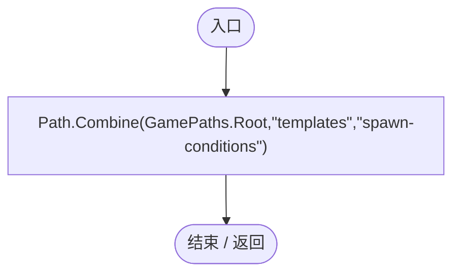
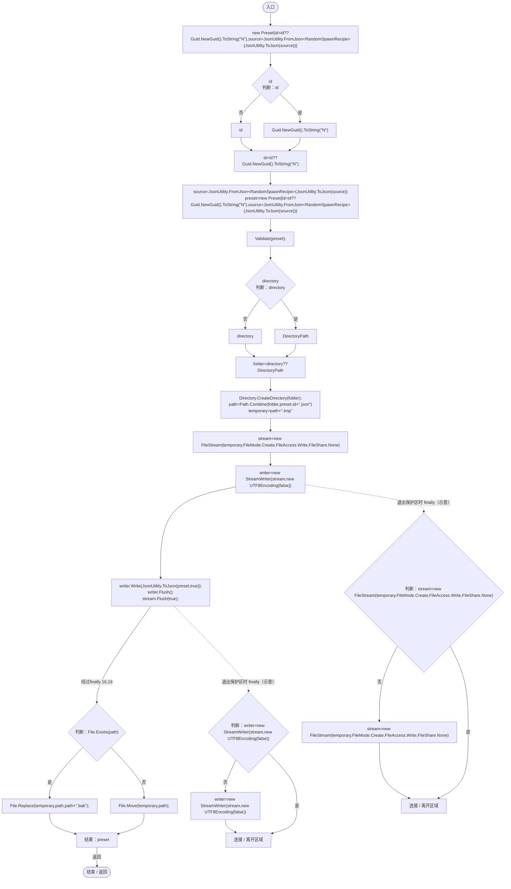
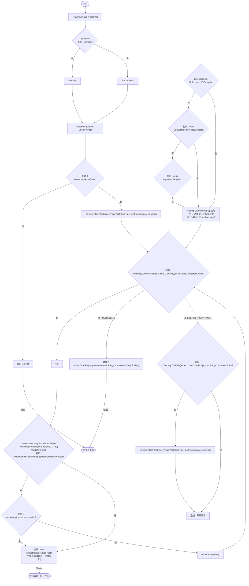
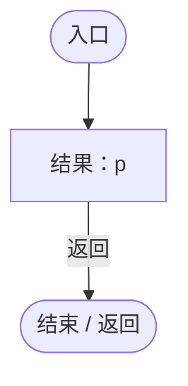
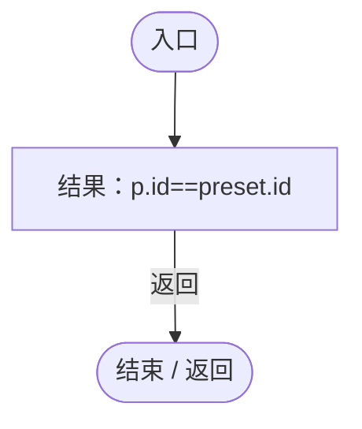
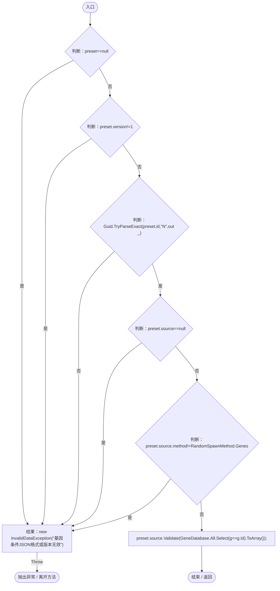
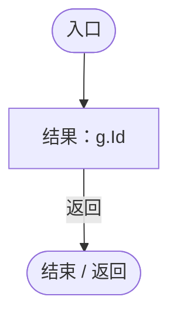

# RandomSpawnPresetStore.cs

[返回总索引](../README.md) · `Runtime` · `Assets/DarwinPark/UI/RandomSpawnPresetStore.cs`

[源文件](../../../Assets/DarwinPark/UI/RandomSpawnPresetStore.cs) · 源码校验：`1fc902795c1ff41913a359504bdfc45d5ba08db96a8bc85b0930181866a9c2cc`

方法按源文件位置排列。事件/回调引用不表示立即执行；分支与异常说明见总索引。完整源码与可点击关系图请打开离线手册。

## DirectoryPath.get · L18

`public static string DirectoryPath`

### Editor / Player · 语法控制结构 / 声明（非CFG）

## Save · L19

`public static Preset Save(RandomSpawnRecipe source,string id=null,string directory=null)`

### Editor / Player · Roslyn编译器控制流

项目内调用/回调引用：

- [RandomSpawnPresetStore.Validate · L42](9f09efd086264861.md#m4a50aad449f7dc2f)（方法）

## Load · L27

`public static List<Preset> Load(string directory=null)`

### Editor / Player · Roslyn编译器控制流

项目内调用/回调引用：

- [RandomSpawnPresetStore.Validate · L42](9f09efd086264861.md#m4a50aad449f7dc2f)（方法）
- [RandomSpawnPresetStore.回调@30 · L30](9f09efd086264861.md#mcf33ef42815a4bcc)（回调/委托）
- [RandomSpawnPresetStore.回调@35 · L35](9f09efd086264861.md#m41e2a6260dd6f8be)（回调/委托）
- [RandomSpawnPresetStore.回调@40 · L40](9f09efd086264861.md#m71ebbccc2cc4c0c2)（回调/委托）

## 回调@30 · L30

`p … => 回调`

### Editor / Player · Roslyn编译器控制流

## 回调@35 · L35

`p … => 回调`

### Editor / Player · Roslyn编译器控制流

## 回调@40 · L40

`p … => 回调`

### Editor / Player · Roslyn编译器控制流

## Validate · L42

`private static void Validate(Preset preset)`

### Editor / Player · Roslyn编译器控制流

项目内调用/回调引用：

- [RandomSpawnRecipe.Validate · L48](923ccc4e86c4786c.md#m0fe74d9bb4825883)（方法）
- [GeneDatabase.All.get · L128](ec0a03483435a863.md#m0a367ed24734f426)（访问器）
- [RandomSpawnPresetStore.回调@45 · L45](9f09efd086264861.md#m003a955bb2a44256)（回调/委托）

## 回调@45 · L45

`g … => 回调`

### Editor / Player · Roslyn编译器控制流

