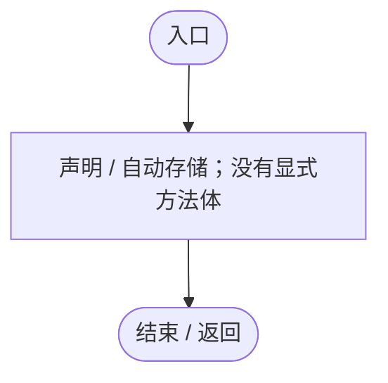
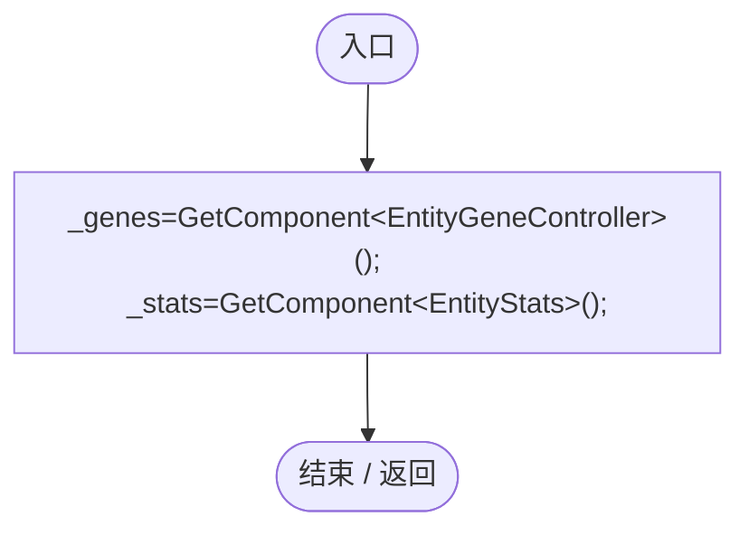
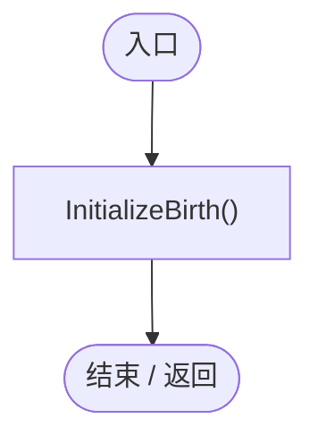
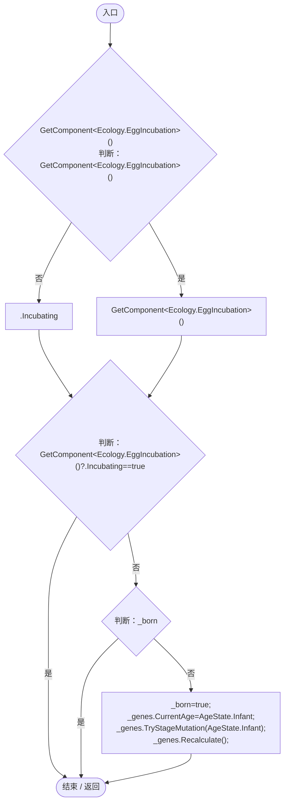
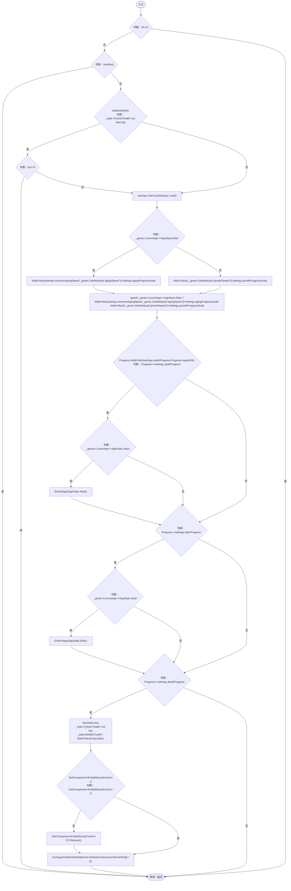
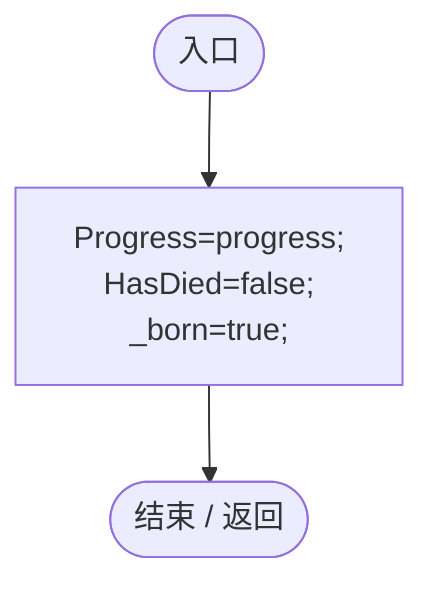
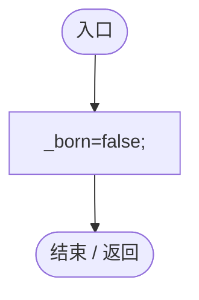
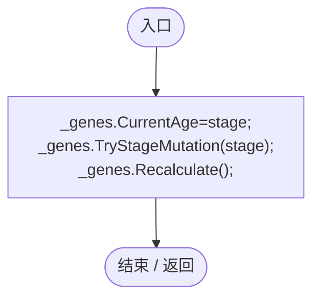

# EntityLifeCycle.cs

[返回总索引](../README.md) · `Runtime` · `Assets/DarwinPark/Entities/EntityLifeCycle.cs`

[源文件](../../../Assets/DarwinPark/Entities/EntityLifeCycle.cs) · 源码校验：`d0f295b2c9448143bc6fe1ab85945101b1adbcdeedfd5024a96a1ad6f7e07932`

方法按源文件位置排列。事件/回调引用不表示立即执行；分支与异常说明见总索引。完整源码与可点击关系图请打开离线手册。

## Progress.get · L10

`get`

### Editor / Player · 语法控制结构 / 声明（非CFG）

## Progress.set · L10

`private set`

### Editor / Player · 语法控制结构 / 声明（非CFG）

## HasDied.get · L11

`get`

### Editor / Player · 语法控制结构 / 声明（非CFG）

## HasDied.set · L11

`private set`

### Editor / Player · 语法控制结构 / 声明（非CFG）

## Awake · L15

`private void Awake()`

### Editor / Player · Roslyn编译器控制流

## Start · L16

`private void Start()`

### Editor / Player · Roslyn编译器控制流

项目内调用/回调引用：

- [EntityLifeCycle.InitializeBirth · L17](9f4138bfbae654b7.md#m76374fa073e2a603)（方法）

## InitializeBirth · L17

`public void InitializeBirth()`

### Editor / Player · Roslyn编译器控制流

项目内调用/回调引用：

- [EntityGeneController.CurrentAge.set · L34](7494d53178552f0e.md#me616ca96310ad01c)（访问器）
- [EntityGeneController.TryStageMutation · L263](7494d53178552f0e.md#m91860b3eca0fc8eb)（方法）
- [EntityGeneController.Recalculate · L97](7494d53178552f0e.md#m65ea735c1e0e37a1)（方法）

## Advance · L25

`public void Advance(float dt)`

### Editor / Player · Roslyn编译器控制流

项目内调用/回调引用：

- [EntityLifeCycle.HasDied.get · L11](9f4138bfbae654b7.md#mf2406e6830e0007e)（访问器）
- [EntityLifeCycle.InitializeBirth · L17](9f4138bfbae654b7.md#m76374fa073e2a603)（方法）
- [EntityStats.TryGet · L90](75aa86a368efdf24.md#m24ee1433e4a70d94)（方法）
- [LifeCycleSettings.Load · L16](ace76969fe8f61de.md#mbd2925785484f343)（方法）
- [EntityGeneController.CurrentAge.get · L34](7494d53178552f0e.md#m83a42c16950b22a4)（访问器）
- [EntityGeneController.GetAttribute · L257](7494d53178552f0e.md#m600509f72d274f0c)（方法）
- [EntityLifeCycle.Progress.set · L10](9f4138bfbae654b7.md#m320c326374b3b468)（访问器）
- [EntityLifeCycle.Progress.get · L10](9f4138bfbae654b7.md#m178185fd5f5a0d74)（访问器）
- [EntityLifeCycle.EnterStage · L51](9f4138bfbae654b7.md#mfbc0309c8f38dc33)（方法）
- [EntityLifeCycle.HasDied.set · L11](9f4138bfbae654b7.md#mba0d285e442f3dba)（访问器）
- [EntityStats.Modify · L111](75aa86a368efdf24.md#m9c837be197158240)（方法）
- [EntityManualControl.Release · L37](a6969896da35e1f0.md#m87aa0efacece2c5b)（方法）
- [EntityDeathSettlement.Die · L11](07fa6bdaadf50796.md#m700276963777d0a6)（方法）

## RestoreProgress · L48

`public void RestoreProgress(float progress)`

★ 适配：读档直接恢复寿命，不运行出生初始化。

### Editor / Player · Roslyn编译器控制流

项目内调用/回调引用：

- [EntityLifeCycle.Progress.set · L10](9f4138bfbae654b7.md#m320c326374b3b468)（访问器）
- [EntityLifeCycle.HasDied.set · L11](9f4138bfbae654b7.md#mba0d285e442f3dba)（访问器）

## WaitForHatch · L50

`public void WaitForHatch()`

★ 适配：读档的卵尚未出生，孵化时仍应执行一次出生阶段初始化。

### Editor / Player · Roslyn编译器控制流

## EnterStage · L51

`private void EnterStage(AgeState stage)`

### Editor / Player · Roslyn编译器控制流

项目内调用/回调引用：

- [EntityGeneController.CurrentAge.set · L34](7494d53178552f0e.md#me616ca96310ad01c)（访问器）
- [EntityGeneController.TryStageMutation · L263](7494d53178552f0e.md#m91860b3eca0fc8eb)（方法）
- [EntityGeneController.Recalculate · L97](7494d53178552f0e.md#m65ea735c1e0e37a1)（方法）
