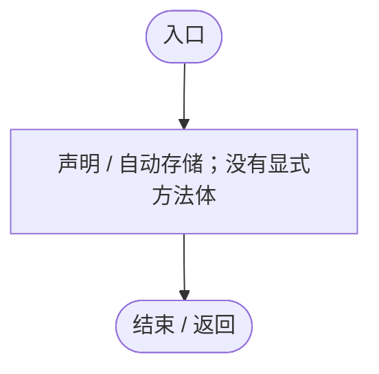
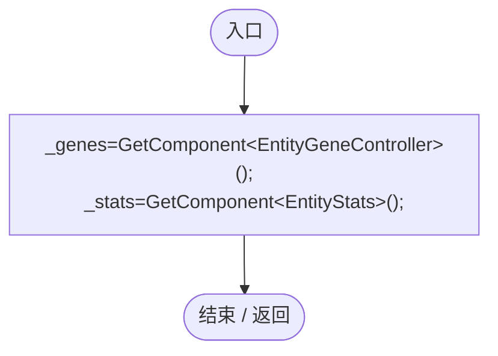
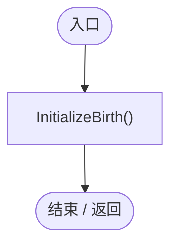
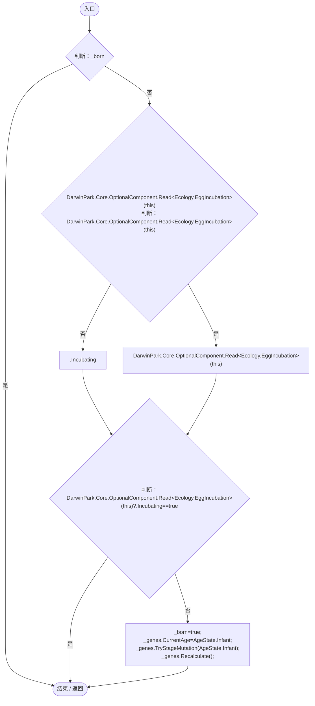
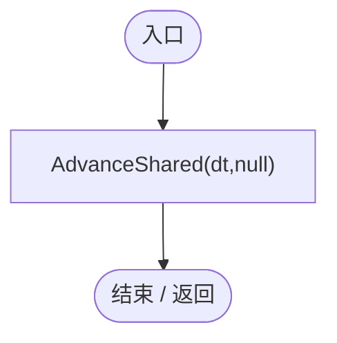
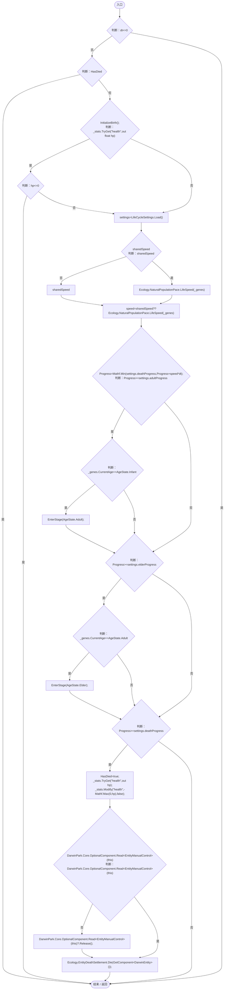
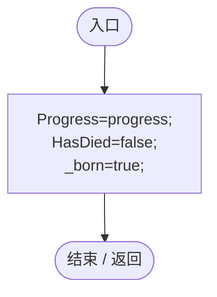
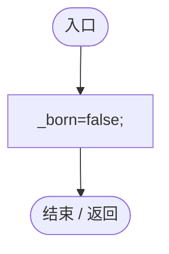
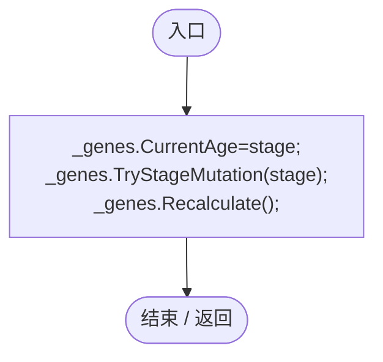

# EntityLifeCycle.cs

[返回总索引](../README.md) · `Runtime` · `Assets/DarwinPark/Entities/EntityLifeCycle.cs`

[源文件](../../../Assets/DarwinPark/Entities/EntityLifeCycle.cs) · 源码校验：`bd35d948d53a67d8fd358a2c3ecdeb6617d6f5784a36f2e5b25f568ab4957315`

方法按源文件位置排列。事件/回调引用不表示立即执行；分支与异常说明见总索引。完整源码与可点击关系图请打开离线手册。

## Progress.get · L12

`get`

### Editor / Player · 语法控制结构 / 声明（非CFG）

## Progress.set · L12

`private set`

### Editor / Player · 语法控制结构 / 声明（非CFG）

## HasDied.get · L13

`get`

### Editor / Player · 语法控制结构 / 声明（非CFG）

## HasDied.set · L13

`private set`

### Editor / Player · 语法控制结构 / 声明（非CFG）

## Awake · L17

`private void Awake()`

### Editor / Player · Roslyn编译器控制流

## Start · L18

`private void Start()`

### Editor / Player · Roslyn编译器控制流

项目内调用/回调引用：

- [EntityLifeCycle.InitializeBirth · L19](9f4138bfbae654b7.md#m80c12af9a9987d8a)（方法）

## InitializeBirth · L19

`public void InitializeBirth()`

### Editor / Player · Roslyn编译器控制流

项目内调用/回调引用：

- [OptionalComponent.Read · L7](806c46b42ced4d36.md#m69622a4dee165c5a)（方法）
- [EntityGeneController.CurrentAge.set · L39](7494d53178552f0e.md#me4193b89bf90aa38)（访问器）
- [EntityGeneController.TryStageMutation · L294](7494d53178552f0e.md#m91a0fc40fa0faba3)（方法）
- [EntityGeneController.Recalculate · L120](7494d53178552f0e.md#m7bf63f9a1482db3c)（方法）

## Advance · L29

`public void Advance(float dt)`

### Editor / Player · Roslyn编译器控制流

项目内调用/回调引用：

- [EntityLifeCycle.AdvanceShared · L31](9f4138bfbae654b7.md#mb1df321a3be857d0)（方法）

## AdvanceShared · L31

`public void AdvanceShared(float dt,float? sharedSpeed)`

★ 适配：相近同基因组只计算一次成长速度，个体仍独立过阶段、变异、结算死亡。

### Editor / Player · Roslyn编译器控制流

项目内调用/回调引用：

- [EntityLifeCycle.HasDied.get · L13](9f4138bfbae654b7.md#maab7204775f0aafa)（访问器）
- [EntityLifeCycle.InitializeBirth · L19](9f4138bfbae654b7.md#m80c12af9a9987d8a)（方法）
- [EntityStats.TryGet · L93](75aa86a368efdf24.md#m03cef847022eee28)（方法）
- [LifeCycleSettings.Load · L16](ace76969fe8f61de.md#m6fe263852e5a8989)（方法）
- [NaturalPopulationPace.LifeSpeed · L43](bb501fbca2e1b01f.md#m7d12dfc0703924bf)（方法）
- [EntityLifeCycle.Progress.set · L12](9f4138bfbae654b7.md#m5e3d3747ad95e224)（访问器）
- [EntityLifeCycle.Progress.get · L12](9f4138bfbae654b7.md#md607c90b6934f95f)（访问器）
- [EntityGeneController.CurrentAge.get · L39](7494d53178552f0e.md#m977f52932bb90600)（访问器）
- [EntityLifeCycle.EnterStage · L56](9f4138bfbae654b7.md#m1a8d074410c26ee3)（方法）
- [EntityLifeCycle.HasDied.set · L13](9f4138bfbae654b7.md#maed84add1bf8c9b2)（访问器）
- [EntityStats.Modify · L114](75aa86a368efdf24.md#m375a3812ef990b45)（方法）
- [OptionalComponent.Read · L7](806c46b42ced4d36.md#m69622a4dee165c5a)（方法）
- [EntityManualControl.Release · L37](a6969896da35e1f0.md#m40fd112901a759d7)（方法）
- [EntityDeathSettlement.Die · L12](07fa6bdaadf50796.md#m9a912ca8df50ff6f)（方法）

## RestoreProgress · L53

`public void RestoreProgress(float progress)`

★ 适配：读档直接恢复寿命，不运行出生初始化。

### Editor / Player · Roslyn编译器控制流

项目内调用/回调引用：

- [EntityLifeCycle.Progress.set · L12](9f4138bfbae654b7.md#m5e3d3747ad95e224)（访问器）
- [EntityLifeCycle.HasDied.set · L13](9f4138bfbae654b7.md#maed84add1bf8c9b2)（访问器）

## WaitForHatch · L55

`public void WaitForHatch()`

★ 适配：读档的卵尚未出生，孵化时仍应执行一次出生阶段初始化。

### Editor / Player · Roslyn编译器控制流

## EnterStage · L56

`private void EnterStage(AgeState stage)`

### Editor / Player · Roslyn编译器控制流

项目内调用/回调引用：

- [EntityGeneController.CurrentAge.set · L39](7494d53178552f0e.md#me4193b89bf90aa38)（访问器）
- [EntityGeneController.TryStageMutation · L294](7494d53178552f0e.md#m91a0fc40fa0faba3)（方法）
- [EntityGeneController.Recalculate · L120](7494d53178552f0e.md#m7bf63f9a1482db3c)（方法）
