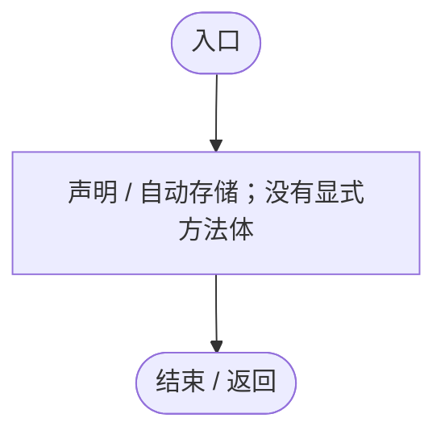
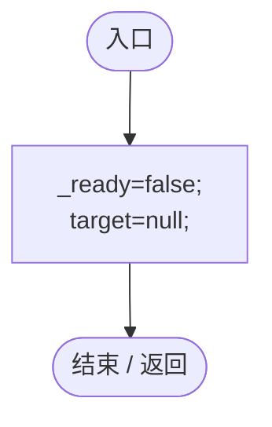

# ActionDecisionCadence.cs

[返回总索引](../README.md) · `Runtime` · `Assets/DarwinPark/Entities/Simulation/ActionDecisionCadence.cs`

[源文件](../../../Assets/DarwinPark/Entities/Simulation/ActionDecisionCadence.cs) · 源码校验：`96afb2028092f219e1cf1e9a55138a6fe6b910712512215772ced23933848268`

方法按源文件位置排列。事件/回调引用不表示立即执行；分支与异常说明见总索引。完整源码与可点击关系图请打开离线手册。

## Decisions.get · L13

`get`

### Editor / Player · 语法控制结构 / 声明（非CFG）

## Decisions.set · L13

`private set`

### Editor / Player · 语法控制结构 / 声明（非CFG）

## Due · L14

`public bool Due(EntityGeneController genes,float dt)`

### Editor / Player · Roslyn编译器控制流

```mermaid
flowchart TD
  b0(["入口"])
  b1{"_remaining-=dt;<br/>hash=new HashCode()<br/>hash.Add(genes.LogicRevision);<br/>hash.Add(EntityResourcePlan.Token(genes));<br/>ant=genes.GetComponent&lt;AntColonyMember&gt;()<br/>判断：ant!=null"}
  b2{"判断：ant.Active"}
  b3["hash.Add(EntityTaskPlan.Feeding(ant));<br/>hash.Add(ant.State.resourceTarget);<br/>hash.Add(ant.State.livingTarget);<br/>hash.Add(ant.State.carriedResource);<br/>hash.Add(ant.State.carriedLiving);"]
  b4["hash"]
  b5{"ant.State.plan<br/>判断：ant.State.plan"}
  b6[".supply"]
  b7["ant.State.plan"]
  b8["hash.Add(ant.State.plan?.supply);"]
  b9["hash.Add(ant.State.founding);<br/>hash.Add(ant.State.patrolRemaining&gt;0);"]
  b10["combat=genes.GetComponent&lt;CombatIntent&gt;()"]
  b11["hash"]
  b12{"combat<br/>判断：combat"}
  b13[".Target"]
  b14["combat"]
  b15["hash.Add(combat?.Target);"]
  b16["rts=genes.GetComponent&lt;RtsOrderController&gt;()"]
  b17["hash"]
  b18{"rts<br/>判断：rts"}
  b19[".State"]
  b20["rts"]
  b21["hash.Add(rts?.State);"]
  b22["hash"]
  b23{"rts<br/>判断：rts"}
  b24[".State.active"]
  b25["rts"]
  b26{"判断：rts?.State.active"}
  b27["rts?.State.active"]
  b28["false"]
  b29["hash.Add(rts?.State.active??false);"]
  b30["pop=genes.GetComponent&lt;PopulationBehavior&gt;()"]
  b31["hash"]
  b32{"pop<br/>判断：pop"}
  b33[".Command"]
  b34["pop"]
  b35["hash.Add(pop?.Command);"]
  b36["hash"]
  b37{"pop<br/>判断：pop"}
  b38[".CommandPointLocal"]
  b39["pop"]
  b40["hash.Add(pop?.CommandPointLocal);"]
  b41["hash"]
  b42{"pop<br/>判断：pop"}
  b43[".Target"]
  b44["pop"]
  b45["hash.Add(pop?.Target);"]
  b46["hash"]
  b47{"genes.GetComponent&lt;EntityStateController&gt;()<br/>判断：genes.GetComponent&lt;EntityStateController&gt;()"}
  b48[".Current"]
  b49{"判断：.Current"}
  b50[".id"]
  b51["genes.GetComponent&lt;EntityStateController&gt;()?.Current?.id"]
  b52["hash.Add(genes.GetComponent&lt;EntityStateController&gt;()?.Current?.id);"]
  b53{"判断：genes.GetComponent&lt;Stats.EntityStats&gt;() is Stats.EntityStats stats"}
  b54["hash.Add(EcologyEnergyBudget.WantsFood(genes,stats,Logic.LocomotionSettings.Load().hungerThreshold));"]
  b55["token=hash.ToHashCode()"]
  b56{"判断：target!=null"}
  b57["!EcologyQueries.Alive(target)"]
  b58["target!=null"]
  b59["lost=target!=null&amp;&amp;!EcologyQueries.Alive(target)"]
  b60{"判断：_ready"}
  b61{"判断：_remaining&gt;0"}
  b62{"判断：_token==token"}
  b63{"判断：lost"}
  b64["结果：false"]
  b65["_token=token;<br/>_ready=true;<br/>_remaining=SimulationOptimization.Current.decisionSeconds;<br/>Decisions++;<br/>结果：true"]
  b66(["结束 / 返回"])
  b0 --> b1
  b1 -->|"是"| b2
  b1 -->|"否"| b10
  b2 -->|"是"| b3
  b2 -->|"否"| b10
  b3 --> b4
  b4 --> b5
  b5 -->|"否"| b6
  b5 -->|"是"| b7
  b6 --> b8
  b7 --> b8
  b8 --> b9
  b9 --> b10
  b10 --> b11
  b11 --> b12
  b12 -->|"否"| b13
  b12 -->|"是"| b14
  b13 --> b15
  b14 --> b15
  b15 --> b16
  b16 --> b17
  b17 --> b18
  b18 -->|"否"| b19
  b18 -->|"是"| b20
  b19 --> b21
  b20 --> b21
  b21 --> b22
  b22 --> b23
  b23 -->|"否"| b24
  b23 -->|"是"| b25
  b24 --> b26
  b25 --> b26
  b26 -->|"否"| b27
  b26 -->|"是"| b28
  b27 --> b29
  b28 --> b29
  b29 --> b30
  b30 --> b31
  b31 --> b32
  b32 -->|"否"| b33
  b32 -->|"是"| b34
  b33 --> b35
  b34 --> b35
  b35 --> b36
  b36 --> b37
  b37 -->|"否"| b38
  b37 -->|"是"| b39
  b38 --> b40
  b39 --> b40
  b40 --> b41
  b41 --> b42
  b42 -->|"否"| b43
  b42 -->|"是"| b44
  b43 --> b45
  b44 --> b45
  b45 --> b46
  b46 --> b47
  b47 -->|"否"| b48
  b47 -->|"是"| b51
  b48 --> b49
  b49 -->|"否"| b50
  b49 -->|"是"| b51
  b50 --> b52
  b51 --> b52
  b52 --> b53
  b53 -->|"是"| b54
  b53 -->|"否"| b55
  b54 --> b55
  b55 --> b56
  b56 -->|"是"| b57
  b56 -->|"否"| b58
  b57 --> b59
  b58 --> b59
  b59 --> b60
  b60 -->|"是"| b61
  b60 -->|"否"| b65
  b61 -->|"是"| b62
  b61 -->|"否"| b65
  b62 -->|"是"| b63
  b62 -->|"否"| b65
  b63 -->|"否"| b64
  b63 -->|"是"| b65
  b64 -->|"返回"| b66
  b65 -->|"返回"| b66

```

项目内调用/回调引用：

- [EntityGeneController.LogicRevision.get · L19](7494d53178552f0e.md#me69facc1c0f1e164)（访问器）
- [EntityResourcePlan.Token · L65](569e8e31d0634370.md#m121c976938745e99)（方法）
- [EntityTaskPlan.Feeding · L20](da041665b1125ffc.md#m0546cdf948a33533)（方法）
- [AntColonyMember.State.get · L32](baebd85c05598377.md#m426db6a7c12dd7aa)（访问器）
- [CombatIntent.Target.get · L11](34193b994b2c0894.md#m5f613e45dae18c85)（访问器）
- [RtsOrderController.State.get · L15](cac3b6501f41ca35.md#m04ce57391ec3040d)（访问器）
- [PopulationBehavior.Command.get · L23](21e4f62f75a9a80f.md#md6a4209cecb72885)（访问器）
- [PopulationBehavior.CommandPointLocal.get · L25](21e4f62f75a9a80f.md#m9cbc18c34603d875)（访问器）
- [PopulationBehavior.Target.get · L26](21e4f62f75a9a80f.md#m03405306fd2aca34)（访问器）
- [EcologyEnergyBudget.WantsFood · L15](06a91c8201f26593.md#m699844ada2b20a0b)（方法）
- [LocomotionSettings.Load · L17](8cce83c7d4563cf0.md#m06b74c04dd63fb4a)（方法）
- [EcologyQueries.Alive · L38](bdf7ccc2c9c0452f.md#mb2877c487f449970)（方法）
- [SimulationOptimization.Current.get · L16](11c9091e70893352.md#m3c7aafe98160d109)（访问器）
- [ActionDecisionCadence.Decisions.set · L13](9f8bb5c506593a21.md#me1feb203dbcdc7b5)（访问器）
- [ActionDecisionCadence.Decisions.get · L13](9f8bb5c506593a21.md#md4bc99c40e6dc274)（访问器）

## Reset · L27

`public void Reset()`

### Editor / Player · Roslyn编译器控制流

