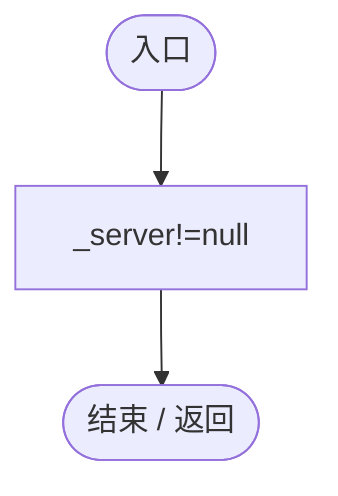
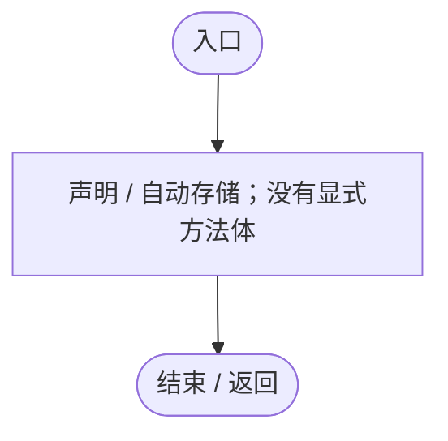
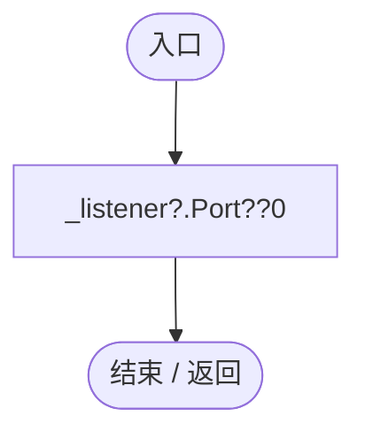
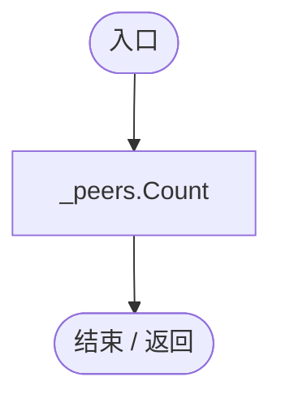
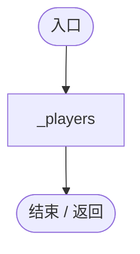
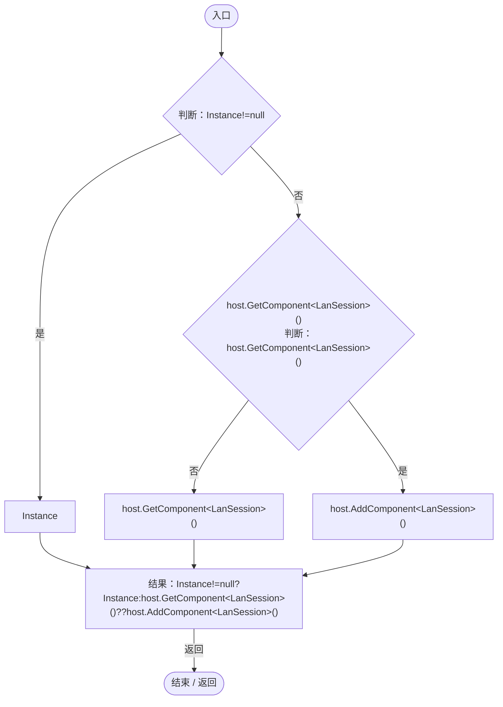

```mermaid
flowchart TD
  n2(["入口"])
  n1["!Online&#124;&#124;IsHost&#124;&#124;Cheats"]
  n0(["结束 / 返回"])
  n1 --> n0
  n2 --> n1

```

# LanSession.cs

[返回总索引](../README.md) · `Runtime` · `Assets/DarwinPark/UI/LanSession.cs`

[源文件](../../../Assets/DarwinPark/UI/LanSession.cs) · 源码校验：`1ff19ec11ee25e5b652b01d09480c651658d39129e86ac1a607a150257dcfdb0`

方法按源文件位置排列。事件/回调引用不表示立即执行；分支与异常说明见总索引。完整源码与可点击关系图请打开离线手册。

<a id="mbf83306994878383"></a>

## Instance.get · L23

`get`


### Editor / Player · 语法控制结构 / 声明（非CFG）


<a id="m65b9474ac6a6a21a"></a>

## Instance.set · L23

`private set`


### Editor / Player · 语法控制结构 / 声明（非CFG）


<a id="m5be907c5a048c30d"></a>

## IsHost.get · L24

`public bool IsHost`


### Editor / Player · 语法控制结构 / 声明（非CFG）


<a id="m17778c303526b6a4"></a>

## IsClient.get · L25

`public bool IsClient`


### Editor / Player · 语法控制结构 / 声明（非CFG）



<a id="md430bd90fd82467f"></a>

## Online.get · L26

`public bool Online`


### Editor / Player · 语法控制结构 / 声明（非CFG）



<a id="m570973099b8f82d5"></a>

```mermaid
flowchart TD
  n2(["入口"])
  n1["IsHost&#124;&#124;IsClient&#124;&#124;_connecting"]
  n0(["结束 / 返回"])
  n1 --> n0
  n2 --> n1

```

## Cheats.get · L27

`get`


### Editor / Player · 语法控制结构 / 声明（非CFG）


<a id="mea5d3063d84d0e75"></a>

## Cheats.set · L27

`private set`


### Editor / Player · 语法控制结构 / 声明（非CFG）


<a id="maf2ef43388dc1dfd"></a>

## CanManage.get · L28

`public bool CanManage`


### Editor / Player · 语法控制结构 / 声明（非CFG）



项目内调用/回调引用：

- [LanSession.Cheats.get · L27](9fb633eebffe669c.md#m570973099b8f82d5)（访问器）

<a id="me99d6c84140bddb3"></a>

## LocalId.get · L29

`get`


### Editor / Player · 语法控制结构 / 声明（非CFG）


<a id="mbf7e6e5a87a0cede"></a>

## LocalId.set · L29

`private set`


### Editor / Player · 语法控制结构 / 声明（非CFG）


<a id="m5adc535c48d20cbe"></a>

## OwnedEntityId.get · L30

`get`


### Editor / Player · 语法控制结构 / 声明（非CFG）



<a id="mab85f356abbbcca4"></a>

## OwnedEntityId.set · L30

`private set`


### Editor / Player · 语法控制结构 / 声明（非CFG）


<a id="md8607b7380abb030"></a>

## Status.get · L31

`get`


### Editor / Player · 语法控制结构 / 声明（非CFG）


<a id="m5f42294bb375d2f9"></a>

## Status.set · L31

`private set`


### Editor / Player · 语法控制结构 / 声明（非CFG）


<a id="mda197b6792c0ebdd"></a>

## Port.get · L32

`public int Port`


### Editor / Player · 语法控制结构 / 声明（非CFG）



<a id="m548d782d81b2ab74"></a>

## RejectedCommands.get · L33

`get`


### Editor / Player · 语法控制结构 / 声明（非CFG）


<a id="m6c8d154ade39ec49"></a>

## RejectedCommands.set · L33

`private set`


### Editor / Player · 语法控制结构 / 声明（非CFG）


<a id="m3ce042030b682a9a"></a>

## MemberCount.get · L34

`public int MemberCount`


### Editor / Player · 语法控制结构 / 声明（非CFG）



<a id="mc47cb744867120f4"></a>

## Players.get · L35

`public IReadOnlyList<LanPlayer> Players`


### Editor / Player · 语法控制结构 / 声明（非CFG）



<a id="med6a52ada5141c7a"></a>

## Ensure · L46

`public static LanSession Ensure(GameObject host)`


### Editor / Player · Roslyn编译器控制流



项目内调用/回调引用：

- [LanSession.Instance.get · L23](9fb633eebffe669c.md#mbf83306994878383)（访问器）

<a id="m84ffba96780d2988"></a>

## Awake · L47

`private void Awake()`


### Editor / Player · Roslyn编译器控制流

```mermaid
flowchart TD
  b0(["入口"])
  b1["Instance=this;"]
  b2["_world"]
  b3{"GetComponent&lt;WorldSessionManager&gt;()<br/>判断：GetComponent&lt;WorldSessionManager&gt;()"}
  b4["GetComponent&lt;WorldSessionManager&gt;()"]
  b5["FindFirstObjectByType&lt;WorldSessionManager&gt;()"]
  b6["_world=GetComponent&lt;WorldSessionManager&gt;()??FindFirstObjectByType&lt;WorldSessionManager&gt;();"]
  b7{"_world.Loaded+=OnLoaded;<br/>判断：GetComponent&lt;LanLobbyUI&gt;()==null"}
  b8["gameObject.AddComponent&lt;LanLobbyUI&gt;();"]
  b9{"判断：GetComponent&lt;RtsSelectionInput&gt;()==null"}
  b10["gameObject.AddComponent&lt;RtsSelectionInput&gt;();"]
  b11(["结束 / 返回"])
  b0 --> b1
  b1 --> b2
  b2 --> b3
  b3 -->|"否"| b4
  b3 -->|"是"| b5
  b4 --> b6
  b5 --> b6
  b6 --> b7
  b7 -->|"是"| b8
  b7 -->|"否"| b9
  b8 --> b9
  b9 -->|"是"| b10
  b9 -->|"否"| b11
  b10 --> b11

```

项目内调用/回调引用：

- [LanSession.Instance.set · L23](9fb633eebffe669c.md#m65b9474ac6a6a21a)（访问器）
- [LanSession.OnLoaded · L193](9fb633eebffe669c.md#m5197907d552ba2ab)（方法）

<a id="m0c512787cde40623"></a>

## PublishAuthority · L52

`private void PublishAuthority()`


### Editor / Player · Roslyn编译器控制流

```mermaid
flowchart TD
  b0(["入口"])
  b1["WorldAuthority.Online=Online;"]
  b2{"WorldAuthority.IsReplica<br/>判断：IsClient"}
  b3["_connecting"]
  b4["IsClient"]
  b5["WorldAuthority.IsReplica=IsClient&#124;&#124;_connecting;"]
  b6["WorldAuthority.CanEdit=CanManage;<br/>WorldAuthority.RequestTime=(running,scale)=&gt;SubmitEdit(new LanCommand{kind=&quot;time&quot;,running=running,scale=scale});"]
  b7(["结束 / 返回"])
  b0 --> b1
  b1 --> b2
  b2 -->|"否"| b3
  b2 -->|"是"| b4
  b3 --> b5
  b4 --> b5
  b5 --> b6
  b6 --> b7

```

项目内调用/回调引用：

- [LanSession.回调@53 · L53](9fb633eebffe669c.md#mda3c3549bf94213d)（回调/委托）

<a id="mda3c3549bf94213d"></a>

## 回调@53 · L53

`( … => 回调`


### Editor / Player · Roslyn编译器控制流

```mermaid
flowchart TD
  b0(["入口"])
  b1["SubmitEdit<br/>new LanCommand{kind=&quot;time&quot;,running=running,scale=scale}<br/>kind=&quot;time&quot;<br/>running=running<br/>scale=scale<br/>结果：SubmitEdit(new LanCommand{kind=&quot;time&quot;,running=running,scale=scale})"]
  b2(["结束 / 返回"])
  b0 --> b1
  b1 -->|"返回"| b2

```

项目内调用/回调引用：

- [LanSession.SubmitEdit · L92](9fb633eebffe669c.md#mf20f22f787288df0)（方法）

<a id="mb6561d391b5d5c24"></a>

## StartHost · L54

`public bool StartHost(int port=-1,bool cheats=false)`


### Editor / Player · Roslyn编译器控制流

```mermaid
flowchart TD
  b0(["入口"])
  b1{"判断：Online"}
  b2{"判断：WorldRuntimeGate.Ready"}
  b3{"判断：_world.Current==null"}
  b4["Status=&quot;请先进入一个单人世界&quot;;<br/>结果：false"]
  b5["settings=LanSettings.Current"]
  b6{"_listener<br/>判断：port&lt;0"}
  b7["settings.port"]
  b8["port"]
  b9["_listener=new LanListener(port&lt;0?settings.port:port,client=&gt; { var connection=new LanConnection(client,settings.maximumPacketBytes,settings.maximumQueuedPackets,Receive,c=&gt;_disconnected.Enqueue(c));_accepted.Enqueue(connection); });"]
  b10["Cheats=cheats;<br/>LocalId=&quot;host&quot;;<br/>_configuration=LanWorldSnapshot.Configuration();<br/>Status=&quot;已对局域网开放，端口 &quot;+Port;<br/>PublishAuthority();<br/>Roster();<br/>Debug.Log(&quot;[联机] 房主开放端口=&quot;+Port+&quot;，作弊=&quot;+Cheats);<br/>结果：true"]
  b11{"(Exception ex)<br/>判断：ex is SocketException"}
  b12{"判断：ex is InvalidOperationException"}
  b13{"_listener<br/>判断：_listener"}
  b14["_listener?.Dispose();"]
  b15["_listener=null;<br/>Status=&quot;开放失败：&quot;+ex.Message;<br/>Debug.LogWarning(&quot;[联机] &quot;+Status);<br/>结果：false"]
  b16(["结束 / 返回"])
  b0 --> b1
  b1 -->|"否"| b2
  b1 -->|"是"| b4
  b2 -->|"是"| b3
  b2 -->|"否"| b4
  b3 -->|"是"| b4
  b3 -->|"否"| b5
  b4 -->|"返回"| b16
  b5 --> b6
  b6 -->|"是"| b7
  b6 -->|"否"| b8
  b7 --> b9
  b8 --> b9
  b9 --> b10
  b10 -->|"返回"| b16
  b11 -->|"否"| b12
  b11 -->|"是"| b13
  b12 -->|"是"| b13
  b13 -->|"否"| b14
  b13 -->|"是"| b15
  b14 --> b15
  b15 -->|"返回"| b16

```

项目内调用/回调引用：

- [WorldSessionManager.Current.get · L21](08741c7b7b9d9344.md#m5d26a5eb846a8504)（访问器）
- [LanSession.Status.set · L31](9fb633eebffe669c.md#m5f42294bb375d2f9)（访问器）
- [LanSettings.Current.get · L15](b87827166724b44d.md#m237a85bb88e296ff)（访问器）
- [LanListener.LanListener.ctor · L68](872c2b8da417200e.md#mbd8c19c98d1efd9a)（构造函数）
- [LanSession.Cheats.set · L27](9fb633eebffe669c.md#mea5d3063d84d0e75)（访问器）
- [LanSession.LocalId.set · L29](9fb633eebffe669c.md#mbf7e6e5a87a0cede)（访问器）
- [LanWorldSnapshot.Configuration · L27](02a722701106da02.md#m6f7bdeb38b3392c1)（方法）
- [LanSession.PublishAuthority · L52](9fb633eebffe669c.md#m0c512787cde40623)（方法）
- [LanSession.Roster · L186](9fb633eebffe669c.md#mafeddb5e9882547a)（方法）
- [LanSession.Cheats.get · L27](9fb633eebffe669c.md#m570973099b8f82d5)（访问器）
- [LanListener.Dispose · L73](872c2b8da417200e.md#m5f6403734e035e45)（方法）
- [LanSession.Status.get · L31](9fb633eebffe669c.md#md8607b7380abb030)（访问器）
- [LanSession.回调@59 · L59](9fb633eebffe669c.md#maeb23716422797a3)（回调/委托）

<a id="maeb23716422797a3"></a>

## 回调@59 · L59

`client … => 回调`


### Editor / Player · Roslyn编译器控制流

```mermaid
flowchart TD
  b0(["入口"])
  b1["connection=new LanConnection(client,settings.maximumPacketBytes,settings.maximumQueuedPackets,Receive,c=&gt;_disconnected.Enqueue(c))<br/>_accepted.Enqueue(connection);"]
  b2(["结束 / 返回"])
  b0 --> b1
  b1 --> b2

```

项目内调用/回调引用：

- [LanConnection.LanConnection.ctor · L21](872c2b8da417200e.md#meebc352a55ab8dad)（构造函数）
- [LanSession.回调@61 · L61](9fb633eebffe669c.md#mbe905ba933ec751f)（回调/委托）
- [LanSession.Receive · L86](9fb633eebffe669c.md#m437d60f7ce8988c5)（方法）

<a id="mbe905ba933ec751f"></a>

## 回调@61 · L61

`c … => 回调`


### Editor / Player · Roslyn编译器控制流

```mermaid
flowchart TD
  b0(["入口"])
  b1["_disconnected.Enqueue(c)"]
  b2(["结束 / 返回"])
  b0 --> b1
  b1 --> b2

```

<a id="m24b68938916764ee"></a>

## Join · L66

`public void Join(string address,int port,string name)`


### Editor / Player · Roslyn编译器控制流

```mermaid
flowchart TD
  b0(["入口"])
  b1{"判断：Online"}
  b2{"判断：port&lt;1"}
  b3{"判断：port&gt;65535"}
  b4{"判断：string.IsNullOrWhiteSpace(address)"}
  b5["Status=&quot;请输入有效地址和端口&quot;;"]
  b6["_connecting=true;<br/>_leaving=false;<br/>Status=&quot;正在连接管理员…&quot;;<br/>PublishAuthority();<br/>settings=LanSettings.Current<br/>Debug.Log(&quot;[联机] 连接地址=&quot;+address.Trim()+&quot;，端口=&quot;+port);<br/>version=Interlocked.Increment(ref _joinVersion)<br/>client=new TcpClient()<br/>_joiningClie…"]
  b7(["结束 / 返回"])
  b0 --> b1
  b1 -->|"是"| b7
  b1 -->|"否"| b2
  b2 -->|"否"| b3
  b2 -->|"是"| b5
  b3 -->|"否"| b4
  b3 -->|"是"| b5
  b4 -->|"是"| b5
  b4 -->|"否"| b6
  b5 --> b7
  b6 --> b7

```

项目内调用/回调引用：

- [LanSession.Status.set · L31](9fb633eebffe669c.md#m5f42294bb375d2f9)（访问器）
- [LanSession.PublishAuthority · L52](9fb633eebffe669c.md#m0c512787cde40623)（方法）
- [LanSettings.Current.get · L15](b87827166724b44d.md#m237a85bb88e296ff)（访问器）
- [LanSession.回调@74 · L74](9fb633eebffe669c.md#m85b0901c57c957dc)（回调/委托）

<a id="m85b0901c57c957dc"></a>

## 回调@74 · L74

`async async … => 回调`


### Editor / Player · Roslyn编译器控制流

```mermaid
flowchart TD
  b0(["入口"])
  b1{"task=client.ConnectAsync(address.Trim(),port)<br/>判断：await Task.WhenAny(task,Task.Delay(TimeSpan.FromSeconds(settings.connectionTimeout)))!=task"}
  b2["结果：new TimeoutException(&quot;连接超时&quot;)"]
  x2(["抛出异常 / 离开方法"])
  b3{"await task;<br/>connection=new LanConnection(client,settings.maximumPacketBytes,settings.maximumQueuedPackets,Receive,c=&gt;_disconnected.Enqueue(c))<br/>判断：version!=Volatile.Read(ref _joinVersion)"}
  b4["connection.Dispose();"]
  b5["_main.Enqueue(()=&gt;{if(!_connecting&#124;&#124;version!=_joinVersion){connection.Dispose();return;}_joiningClient=null;_server=connection;_connecting=false;PublishAuthority();connection.Start();SendMessage(connection,new LanMessage{type=&quot;join&quot;,text…"]
  b6["(Exception ex)<br/>client.Close();<br/>_main.Enqueue(()=&gt;{if(version!=_joinVersion)return;_joiningClient=null;_connecting=false;Status=&quot;连接失败：&quot;+ex.Message;PublishAuthority();Debug.LogWarning(&quot;[联机] &quot;+Status);});"]
  b7(["结束 / 返回"])
  b0 --> b1
  b1 -->|"是"| b2
  b1 -->|"否"| b3
  b2 -->|"Throw"| x2
  b3 -->|"是"| b4
  b3 -->|"否"| b5
  b4 --> b7
  b5 --> b7
  b6 --> b7
  b1 -. "保护区可能异常（示意）" .-> b6

```

项目内调用/回调引用：

- [LanConnection.LanConnection.ctor · L21](872c2b8da417200e.md#meebc352a55ab8dad)（构造函数）
- [LanConnection.Dispose · L62](872c2b8da417200e.md#mcbbf7592b2503d1f)（方法）
- [LanSession.回调@79 · L79](9fb633eebffe669c.md#m51df6516a0f48666)（回调/委托）
- [LanSession.回调@81 · L81](9fb633eebffe669c.md#mcaa4fbd49e278f5a)（回调/委托）
- [LanSession.回调@83 · L83](9fb633eebffe669c.md#m92469abd36d0e7af)（回调/委托）
- [LanSession.Receive · L86](9fb633eebffe669c.md#m437d60f7ce8988c5)（方法）

<a id="m51df6516a0f48666"></a>

## 回调@79 · L79

`c … => 回调`


### Editor / Player · Roslyn编译器控制流

```mermaid
flowchart TD
  b0(["入口"])
  b1["_disconnected.Enqueue(c)"]
  b2(["结束 / 返回"])
  b0 --> b1
  b1 --> b2

```

<a id="mcaa4fbd49e278f5a"></a>

## 回调@81 · L81

`( … => 回调`


### Editor / Player · Roslyn编译器控制流

```mermaid
flowchart TD
  b0(["入口"])
  b1{"判断：_connecting"}
  b2{"判断：version!=_joinVersion"}
  b3["connection.Dispose();"]
  b4["_joiningClient=null;<br/>_server=connection;<br/>_connecting=false;<br/>PublishAuthority();<br/>connection.Start();"]
  b5["connection<br/>new LanMessage{type=&quot;join&quot;,text=(name??&quot;成员&quot;).Trim()}<br/>type=&quot;join&quot;"]
  b6{"name<br/>判断：name"}
  b7["name"]
  b8["&quot;成员&quot;"]
  b9["text=(name??&quot;成员&quot;).Trim()"]
  b10["SendMessage(connection,new LanMessage{type=&quot;join&quot;,text=(name??&quot;成员&quot;).Trim()});"]
  b11(["结束 / 返回"])
  b0 --> b1
  b1 -->|"是"| b2
  b1 -->|"否"| b3
  b2 -->|"是"| b3
  b2 -->|"否"| b4
  b3 --> b11
  b4 --> b5
  b5 --> b6
  b6 -->|"否"| b7
  b6 -->|"是"| b8
  b7 --> b9
  b8 --> b9
  b9 --> b10
  b10 --> b11

```

项目内调用/回调引用：

- [LanConnection.Dispose · L62](872c2b8da417200e.md#mcbbf7592b2503d1f)（方法）
- [LanSession.PublishAuthority · L52](9fb633eebffe669c.md#m0c512787cde40623)（方法）
- [LanConnection.Start · L23](872c2b8da417200e.md#m573f125f91609800)（方法）
- [LanSession.SendMessage · L89](9fb633eebffe669c.md#m6d646648c755fb11)（方法）

<a id="m92469abd36d0e7af"></a>

## 回调@83 · L83

`( … => 回调`


### Editor / Player · Roslyn编译器控制流

```mermaid
flowchart TD
  b0(["入口"])
  b1{"判断：version!=_joinVersion"}
  b2["_joiningClient=null;<br/>_connecting=false;<br/>Status=&quot;连接失败：&quot;+ex.Message;<br/>PublishAuthority();<br/>Debug.LogWarning(&quot;[联机] &quot;+Status);"]
  b3(["结束 / 返回"])
  b0 --> b1
  b1 -->|"是"| b3
  b1 -->|"否"| b2
  b2 --> b3

```

项目内调用/回调引用：

- [LanSession.Status.set · L31](9fb633eebffe669c.md#m5f42294bb375d2f9)（访问器）
- [LanSession.PublishAuthority · L52](9fb633eebffe669c.md#m0c512787cde40623)（方法）
- [LanSession.Status.get · L31](9fb633eebffe669c.md#md8607b7380abb030)（访问器）

<a id="m437d60f7ce8988c5"></a>

## Receive · L86

`private void Receive(LanConnection connection,string text)`


### Editor / Player · Roslyn编译器控制流

```mermaid
flowchart TD
  b0(["入口"])
  b1{"判断：_incoming.Count&gt;=LanSettingsQueueLimit"}
  b2["connection.Dispose();"]
  b3["_incoming.Enqueue((connection,text));"]
  b4(["结束 / 返回"])
  b0 --> b1
  b1 -->|"是"| b2
  b1 -->|"否"| b3
  b2 --> b4
  b3 --> b4

```

项目内调用/回调引用：

- [LanConnection.Dispose · L62](872c2b8da417200e.md#mcbbf7592b2503d1f)（方法）

<a id="m6d646648c755fb11"></a>

## SendMessage · L89

`private static void SendMessage(LanConnection connection,LanMessage message)`


### Editor / Player · Roslyn编译器控制流

```mermaid
flowchart TD
  b0(["入口"])
  b1["connection.Send(JsonUtility.ToJson(message))"]
  b2(["结束 / 返回"])
  b0 --> b1
  b1 --> b2

```

项目内调用/回调引用：

- [LanConnection.Send · L24](872c2b8da417200e.md#mee2fbdf612003a18)（方法）

<a id="me286a0c67c4d8ecd"></a>

## SendCommand · L90

`public void SendCommand(LanCommand command)`


### Editor / Player · Roslyn编译器控制流

```mermaid
flowchart TD
  b0(["入口"])
  b1{"判断：IsClient"}
  b2["_server<br/>new LanMessage{type=&quot;command&quot;,command=command}<br/>type=&quot;command&quot;<br/>command=command<br/>SendMessage(_server,new LanMessage{type=&quot;command&quot;,command=command});"]
  b3{"判断：IsHost"}
  b4["ProcessCommand(null,command);"]
  b5(["结束 / 返回"])
  b0 --> b1
  b1 -->|"是"| b2
  b1 -->|"否"| b3
  b2 --> b5
  b3 -->|"是"| b4
  b3 -->|"否"| b5
  b4 --> b5

```

项目内调用/回调引用：

- [LanSession.SendMessage · L89](9fb633eebffe669c.md#m6d646648c755fb11)（方法）
- [LanSession.ProcessCommand · L142](9fb633eebffe669c.md#m22019411e81c9ecb)（方法）

<a id="mf20f22f787288df0"></a>

## SubmitEdit · L92

`public bool SubmitEdit(LanCommand command)`


### Editor / Player · Roslyn编译器控制流

```mermaid
flowchart TD
  b0(["入口"])
  b1{"判断：CanManage"}
  b2["Status=&quot;只有管理员或开启作弊的成员可以修改世界&quot;;<br/>结果：false"]
  b3{"判断：IsClient"}
  b4["SendCommand(command);<br/>结果：true"]
  b5["结果：LanEditExecutor.Apply(command,this)"]
  b6(["结束 / 返回"])
  b0 --> b1
  b1 -->|"否"| b2
  b1 -->|"是"| b3
  b2 -->|"返回"| b6
  b3 -->|"是"| b4
  b3 -->|"否"| b5
  b4 -->|"返回"| b6
  b5 -->|"返回"| b6

```

项目内调用/回调引用：

- [LanSession.Status.set · L31](9fb633eebffe669c.md#m5f42294bb375d2f9)（访问器）
- [LanSession.SendCommand · L90](9fb633eebffe669c.md#me286a0c67c4d8ecd)（方法）
- [LanEditExecutor.Apply · L27](2816321496f6360e.md#m1f827c7e486ff073)（方法）

<a id="mb874ffc1ba799e4c"></a>

## AllowView · L97

`public bool AllowView(DarwinEntity entity)`


### Editor / Player · Roslyn编译器控制流

```mermaid
flowchart TD
  b0(["入口"])
  b1{"判断：Online"}
  b2["结果：true"]
  b3{"id=EcologyIdentity.Of(entity)<br/>判断：IsClient"}
  b4{"判断：OwnedEntityId!=id"}
  b5["SendCommand<br/>new LanCommand{kind=&quot;choose&quot;,entity=id}<br/>kind=&quot;choose&quot;<br/>entity=id<br/>SendCommand(new LanCommand{kind=&quot;choose&quot;,entity=id});"]
  b6["结果：false"]
  b7["SetRtsMode(false);<br/>结果：true"]
  b8["结果：Assign(null,id)"]
  b9(["结束 / 返回"])
  b0 --> b1
  b1 -->|"否"| b2
  b1 -->|"是"| b3
  b2 -->|"返回"| b9
  b3 -->|"是"| b4
  b3 -->|"否"| b8
  b4 -->|"是"| b5
  b4 -->|"否"| b7
  b5 --> b6
  b6 -->|"返回"| b9
  b7 -->|"返回"| b9
  b8 -->|"返回"| b9

```

项目内调用/回调引用：

- [EcologyIdentity.Of · L21](bdf7ccc2c9c0452f.md#m1143cf9570a93b72)（方法）
- [LanSession.OwnedEntityId.get · L30](9fb633eebffe669c.md#m5adc535c48d20cbe)（访问器）
- [LanSession.SendCommand · L90](9fb633eebffe669c.md#me286a0c67c4d8ecd)（方法）
- [LanSession.SetRtsMode · L113](9fb633eebffe669c.md#md00374cca68a1203)（方法）
- [LanSession.Assign · L126](9fb633eebffe669c.md#ma7c3594af76ac1d7)（方法）

<a id="m606c5e2a01315953"></a>

## RequestEntity · L103

`public void RequestEntity(string id)`


### Editor / Player · Roslyn编译器控制流

```mermaid
flowchart TD
  b0(["入口"])
  b1{"判断：IsClient"}
  b2["SendCommand<br/>new LanCommand{kind=&quot;choose&quot;,entity=id}<br/>kind=&quot;choose&quot;<br/>entity=id<br/>SendCommand(new LanCommand{kind=&quot;choose&quot;,entity=id});"]
  b3{"判断：Assign(null,id)"}
  b4{"判断：EcologyIdentity.Find(id) is DarwinEntity entity"}
  b5["EntityViewController.Instance.EnterView(entity);"]
  b6(["结束 / 返回"])
  b0 --> b1
  b1 -->|"是"| b2
  b1 -->|"否"| b3
  b2 --> b6
  b3 -->|"是"| b4
  b3 -->|"否"| b6
  b4 -->|"是"| b5
  b4 -->|"否"| b6
  b5 --> b6

```

项目内调用/回调引用：

- [LanSession.SendCommand · L90](9fb633eebffe669c.md#me286a0c67c4d8ecd)（方法）
- [LanSession.Assign · L126](9fb633eebffe669c.md#ma7c3594af76ac1d7)（方法）
- [EcologyIdentity.Find · L20](bdf7ccc2c9c0452f.md#m58f756a3ba9ec990)（方法）
- [EntityViewController.EnterView · L73](0ad0345f83229ef0.md#mbd7be6d2bbd0ec83)（方法）
- [EntityViewController.Instance.get · L15](0ad0345f83229ef0.md#mb3b8144b56e80842)（访问器）

<a id="m1b4c6d1ce7a79828"></a>

## CanCommand · L105

`public bool CanCommand(DarwinEntity entity)`


### Editor / Player · Roslyn编译器控制流

```mermaid
flowchart TD
  b0(["入口"])
  b1{"判断：CanManage"}
  b2["结果：true"]
  b3["结果：QueenControls(OwnedEntityId,entity)"]
  b4(["结束 / 返回"])
  b0 --> b1
  b1 -->|"是"| b2
  b1 -->|"否"| b3
  b2 -->|"返回"| b4
  b3 -->|"返回"| b4

```

项目内调用/回调引用：

- [LanSession.QueenControls · L107](9fb633eebffe669c.md#m2c85ed6e23c64b8a)（方法）
- [LanSession.OwnedEntityId.get · L30](9fb633eebffe669c.md#m5adc535c48d20cbe)（访问器）

<a id="m2c85ed6e23c64b8a"></a>

## QueenControls · L107

`private static bool QueenControls(string owned,DarwinEntity entity)`


### Editor / Player · Roslyn编译器控制流

```mermaid
flowchart TD
  b0(["入口"])
  b1{"EcologyIdentity.Find(owned)<br/>判断：EcologyIdentity.Find(owned)"}
  b2[".GetComponent&lt;AntColonyMember&gt;()"]
  b3["EcologyIdentity.Find(owned)"]
  b4["queen=EcologyIdentity.Find(owned)?.GetComponent&lt;AntColonyMember&gt;()"]
  b5{"判断：entity!=null"}
  b6["entity.GetComponent&lt;AntColonyMember&gt;()"]
  b7["null"]
  b8["ant=entity!=null?entity.GetComponent&lt;AntColonyMember&gt;():null"]
  b9{"判断：queen!=null"}
  b10{"判断：queen.Active"}
  b11{"判断：queen.Role==AntRole.Queen"}
  b12{"判断：ant!=null"}
  b13{"判断：ant.Active"}
  b14["ant.GroupId==queen.GroupId"]
  b15["queen!=null&amp;&amp;queen.Active&amp;&amp;queen.Role==AntRole.Queen&amp;&amp;ant!=null&amp;&amp;ant.Active&amp;&amp;ant.GroupId==queen.GroupId"]
  b16["结果：queen!=null&amp;&amp;queen.Active&amp;&amp;queen.Role==AntRole.Queen&amp;&amp;ant!=null&amp;&amp;ant.Active&amp;&amp;ant.GroupId==queen.GroupId"]
  b17(["结束 / 返回"])
  b0 --> b1
  b1 -->|"否"| b2
  b1 -->|"是"| b3
  b2 --> b4
  b3 --> b4
  b4 --> b5
  b5 -->|"是"| b6
  b5 -->|"否"| b7
  b6 --> b8
  b7 --> b8
  b8 --> b9
  b9 -->|"是"| b10
  b9 -->|"否"| b15
  b10 -->|"是"| b11
  b10 -->|"否"| b15
  b11 -->|"是"| b12
  b11 -->|"否"| b15
  b12 -->|"是"| b13
  b12 -->|"否"| b15
  b13 -->|"是"| b14
  b13 -->|"否"| b15
  b14 --> b16
  b15 --> b16
  b16 -->|"返回"| b17

```

项目内调用/回调引用：

- [EcologyIdentity.Find · L20](bdf7ccc2c9c0452f.md#m58f756a3ba9ec990)（方法）
- [AntColonyMember.Role.get · L33](baebd85c05598377.md#mdf6df89f7116c7a3)（访问器）

<a id="m0ea9caea7490455d"></a>

## CanUseRts.get · L112

`public bool CanUseRts`


### Editor / Player · 语法控制结构 / 声明（非CFG）

```mermaid
flowchart TD
  n2(["入口"])
  n1["CanManage&#124;&#124;QueenControls(OwnedEntityId,EcologyIdentity.Find(OwnedEntityId))"]
  n0(["结束 / 返回"])
  n1 --> n0
  n2 --> n1

```

项目内调用/回调引用：

- [LanSession.QueenControls · L107](9fb633eebffe669c.md#m2c85ed6e23c64b8a)（方法）
- [LanSession.OwnedEntityId.get · L30](9fb633eebffe669c.md#m5adc535c48d20cbe)（访问器）
- [EcologyIdentity.Find · L20](bdf7ccc2c9c0452f.md#m58f756a3ba9ec990)（方法）

<a id="md00374cca68a1203"></a>

## SetRtsMode · L113

`public void SetRtsMode(bool active)`


### Editor / Player · Roslyn编译器控制流

```mermaid
flowchart TD
  b0(["入口"])
  b1{"判断：active"}
  b2{"判断：CanUseRts"}
  b3["Status=&quot;只有管理员或王后可以使用RTS&quot;;"]
  b4{"WorldAuthority.RtsMode=active;<br/>判断：active"}
  b5{"EntityViewController.Instance<br/>判断：EntityViewController.Instance"}
  b6["EntityViewController.Instance?.ExitView();"]
  b7{"判断：IsClient"}
  b8["SendCommand<br/>new LanCommand{kind=&quot;mode&quot;,rts=active}<br/>kind=&quot;mode&quot;<br/>rts=active<br/>SendCommand(new LanCommand{kind=&quot;mode&quot;,rts=active});"]
  b9(["结束 / 返回"])
  b0 --> b1
  b1 -->|"是"| b2
  b1 -->|"否"| b4
  b2 -->|"否"| b3
  b2 -->|"是"| b4
  b3 --> b9
  b4 -->|"是"| b5
  b4 -->|"否"| b7
  b5 -->|"否"| b6
  b5 -->|"是"| b7
  b6 --> b7
  b7 -->|"是"| b8
  b7 -->|"否"| b9
  b8 --> b9

```

项目内调用/回调引用：

- [LanSession.Status.set · L31](9fb633eebffe669c.md#m5f42294bb375d2f9)（访问器）
- [EntityViewController.Instance.get · L15](0ad0345f83229ef0.md#mb3b8144b56e80842)（访问器）
- [EntityViewController.ExitView · L105](0ad0345f83229ef0.md#mca8619c7f27942c9)（方法）
- [LanSession.SendCommand · L90](9fb633eebffe669c.md#me286a0c67c4d8ecd)（方法）

<a id="m7bcbba11fd529ea2"></a>

## IssueRts · L119

`public bool IssueRts(string[] selection,RtsOrderKind kind,Vector3 point,DarwinEntity target=null,ColonyResource resource=null)`


### Editor / Player · Roslyn编译器控制流

```mermaid
flowchart TD
  b0(["入口"])
  b1["new LanCommand{kind=&quot;rts&quot;,selection=selection,order=kind,point=point,target=target!=null?EcologyIdentity.Of(target):null,resource=resource?.State.id}<br/>kind=&quot;rts&quot;<br/>selection=selection<br/>order=kind<br/>point=point"]
  b2{"判断：target!=null"}
  b3["EcologyIdentity.Of(target)"]
  b4["null"]
  b5["target=target!=null?EcologyIdentity.Of(target):null"]
  b6{"resource<br/>判断：resource"}
  b7[".State.id"]
  b8["resource"]
  b9["resource=resource?.State.id"]
  b10["command=new LanCommand{kind=&quot;rts&quot;,selection=selection,order=kind,point=point,target=target!=null?EcologyIdentity.Of(target):null,resource=resource?.State.id}"]
  b11{"判断：IsClient"}
  b12["SendCommand(command);<br/>结果：true"]
  b13["结果：ApplyRts(null,command)"]
  b14(["结束 / 返回"])
  b0 --> b1
  b1 --> b2
  b2 -->|"是"| b3
  b2 -->|"否"| b4
  b3 --> b5
  b4 --> b5
  b5 --> b6
  b6 -->|"否"| b7
  b6 -->|"是"| b8
  b7 --> b9
  b8 --> b9
  b9 --> b10
  b10 --> b11
  b11 -->|"是"| b12
  b11 -->|"否"| b13
  b12 -->|"返回"| b14
  b13 -->|"返回"| b14

```

项目内调用/回调引用：

- [EcologyIdentity.Of · L21](bdf7ccc2c9c0452f.md#m1143cf9570a93b72)（方法）
- [ColonyResource.State.get · L22](293dbaecfff4b585.md#m341a1355f4d657bf)（访问器）
- [LanSession.SendCommand · L90](9fb633eebffe669c.md#me286a0c67c4d8ecd)（方法）
- [LanSession.ApplyRts · L168](9fb633eebffe669c.md#m303c5d9b3bcf7ddd)（方法）

<a id="mecda8c5ad1513e5b"></a>

## SetCheats · L124

`public void SetCheats(bool enabled)`


### Editor / Player · Roslyn编译器控制流

```mermaid
flowchart TD
  b0(["入口"])
  b1{"判断：IsHost"}
  b2["Cheats=enabled;<br/>PublishAuthority();<br/>Roster();"]
  b3{"Status<br/>判断：enabled"}
  b4["&quot;作弊模式已开启&quot;"]
  b5["&quot;作弊模式已关闭&quot;"]
  b6["Status=enabled?&quot;作弊模式已开启&quot;:&quot;作弊模式已关闭&quot;;"]
  b7["Debug.Log(&quot;[联机] &quot;+Status);"]
  b8(["结束 / 返回"])
  b0 --> b1
  b1 -->|"否"| b8
  b1 -->|"是"| b2
  b2 --> b3
  b3 -->|"是"| b4
  b3 -->|"否"| b5
  b4 --> b6
  b5 --> b6
  b6 --> b7
  b7 --> b8

```

项目内调用/回调引用：

- [LanSession.Cheats.set · L27](9fb633eebffe669c.md#mea5d3063d84d0e75)（访问器）
- [LanSession.PublishAuthority · L52](9fb633eebffe669c.md#m0c512787cde40623)（方法）
- [LanSession.Roster · L186](9fb633eebffe669c.md#mafeddb5e9882547a)（方法）
- [LanSession.Status.set · L31](9fb633eebffe669c.md#m5f42294bb375d2f9)（访问器）
- [LanSession.Status.get · L31](9fb633eebffe669c.md#md8607b7380abb030)（访问器）

<a id="ma7c3594af76ac1d7"></a>

## Assign · L126

`private bool Assign(Peer peer,string id)`


### Editor / Player · Roslyn编译器控制流

```mermaid
flowchart TD
  b0(["入口"])
  b1{"entity=EcologyIdentity.Find(id)<br/>判断：EcologyQueries.Alive(entity)"}
  b2{"判断：AntColonyWorker.IsCarried(entity)"}
  b3{"entity.GetComponent&lt;EggIncubation&gt;()<br/>判断：entity.GetComponent&lt;EggIncubation&gt;()"}
  b4[".Incubating"]
  b5["entity.GetComponent&lt;EggIncubation&gt;()"]
  b6{"判断：entity.GetComponent&lt;EggIncubation&gt;()?.Incubating==true"}
  b7["Reply(peer,&quot;该实体无法操控&quot;,false);<br/>结果：false"]
  b8{"判断：peer!=null"}
  b9["peer.player.entity"]
  b10["OwnedEntityId"]
  b11["previous=peer!=null?peer.player.entity:OwnedEntityId"]
  b12{"判断：peer!=null"}
  b13{"判断：Cheats"}
  b14{"判断：string.IsNullOrEmpty(previous)"}
  b15{"判断：previous!=id"}
  b16{"判断：EcologyQueries.Alive(EcologyIdentity.Find(previous))"}
  b17["Reply(peer,&quot;成员只能在进入游戏或实体死亡后选择&quot;,false);<br/>结果：false"]
  b18{"判断：_peers.Values.Any(p=&gt;p!=peer&amp;&amp;p.player.entity==id)"}
  b19{"判断：peer!=null"}
  b20{"判断：OwnedEntityId==id"}
  b21["Reply(peer,&quot;该实体已由其他玩家操控&quot;,false);<br/>结果：false"]
  b22{"判断：previous!=id"}
  b23{"EcologyIdentity.Find(previous)<br/>判断：EcologyIdentity.Find(previous)"}
  b24[".GetComponent&lt;EntityManualControl&gt;()"]
  b25{"判断：.GetComponent&lt;EntityManualControl&gt;()"}
  b26["EcologyIdentity.Find(previous)?.GetComponent&lt;EntityManualControl&gt;()?.Release();"]
  b27{"判断：peer==null"}
  b28["OwnedEntityId=id;"]
  b29["peer.player.entity=id;<br/>peer.rts=false;<br/>peer.inputTime=Time.unscaledTime;"]
  b30{"entity.GetComponent&lt;EntityManualControl&gt;()<br/>判断：entity.GetComponent&lt;EntityManualControl&gt;()"}
  b31["entity.GetComponent&lt;EntityManualControl&gt;()"]
  b32["entity.gameObject.AddComponent&lt;EntityManualControl&gt;()"]
  b33["manual=entity.GetComponent&lt;EntityManualControl&gt;()??entity.gameObject.AddComponent&lt;EntityManualControl&gt;()"]
  b34["manual.BeginControl(EcologyQueries.Planet.transform);"]
  b35["peer.connection<br/>new LanMessage{type=&quot;selected&quot;,entity=id}<br/>type=&quot;selected&quot;<br/>entity=id<br/>SendMessage(peer.connection,new LanMessage{type=&quot;selected&quot;,entity=id});"]
  b36["&quot;[联机] 分配实体 player=&quot;"]
  b37{"peer<br/>判断：peer"}
  b38[".player.id"]
  b39["peer"]
  b40{"判断：peer?.player.id"}
  b41["peer?.player.id"]
  b42["&quot;host&quot;"]
  b43["Debug.Log(&quot;[联机] 分配实体 player=&quot;+(peer?.player.id??&quot;host&quot;)+&quot;，entity=&quot;+id);"]
  b44["Roster();<br/>结果：true"]
  b45(["结束 / 返回"])
  b0 --> b1
  b1 -->|"是"| b2
  b1 -->|"否"| b7
  b2 -->|"否"| b3
  b2 -->|"是"| b7
  b3 -->|"否"| b4
  b3 -->|"是"| b5
  b4 --> b6
  b5 --> b6
  b6 -->|"是"| b7
  b6 -->|"否"| b8
  b7 -->|"返回"| b45
  b8 -->|"是"| b9
  b8 -->|"否"| b10
  b9 --> b11
  b10 --> b11
  b11 --> b12
  b12 -->|"是"| b13
  b12 -->|"否"| b18
  b13 -->|"否"| b14
  b13 -->|"是"| b18
  b14 -->|"否"| b15
  b14 -->|"是"| b18
  b15 -->|"是"| b16
  b15 -->|"否"| b18
  b16 -->|"是"| b17
  b16 -->|"否"| b18
  b17 -->|"返回"| b45
  b18 -->|"否"| b19
  b18 -->|"是"| b21
  b19 -->|"是"| b20
  b19 -->|"否"| b22
  b20 -->|"是"| b21
  b20 -->|"否"| b22
  b21 -->|"返回"| b45
  b22 -->|"是"| b23
  b22 -->|"否"| b27
  b23 -->|"否"| b24
  b23 -->|"是"| b27
  b24 --> b25
  b25 -->|"否"| b26
  b25 -->|"是"| b27
  b26 --> b27
  b27 -->|"是"| b28
  b27 -->|"否"| b29
  b28 --> b36
  b29 --> b30
  b30 -->|"否"| b31
  b30 -->|"是"| b32
  b31 --> b33
  b32 --> b33
  b33 --> b34
  b34 --> b35
  b35 --> b36
  b36 --> b37
  b37 -->|"否"| b38
  b37 -->|"是"| b39
  b38 --> b40
  b39 --> b40
  b40 -->|"否"| b41
  b40 -->|"是"| b42
  b41 --> b43
  b42 --> b43
  b43 --> b44
  b44 -->|"返回"| b45

```

项目内调用/回调引用：

- [EcologyIdentity.Find · L20](bdf7ccc2c9c0452f.md#m58f756a3ba9ec990)（方法）
- [EcologyQueries.Alive · L38](bdf7ccc2c9c0452f.md#mb2877c487f449970)（方法）
- [AntColonyWorker.IsCarried · L140](8a0cca2020271b6f.md#mf552b19f9aeffe97)（方法）
- [LanSession.Reply · L184](9fb633eebffe669c.md#ma2abc3394057f288)（方法）
- [LanSession.OwnedEntityId.get · L30](9fb633eebffe669c.md#m5adc535c48d20cbe)（访问器）
- [LanSession.Cheats.get · L27](9fb633eebffe669c.md#m570973099b8f82d5)（访问器）
- [EntityManualControl.Release · L37](a6969896da35e1f0.md#m87aa0efacece2c5b)（方法）
- [LanSession.OwnedEntityId.set · L30](9fb633eebffe669c.md#mab85f356abbbcca4)（访问器）
- [EntityManualControl.BeginControl · L32](a6969896da35e1f0.md#mf0dadf914f9961c7)（方法）
- [LanSession.SendMessage · L89](9fb633eebffe669c.md#m6d646648c755fb11)（方法）
- [LanSession.Roster · L186](9fb633eebffe669c.md#mafeddb5e9882547a)（方法）
- [LanSession.回调@131 · L131](9fb633eebffe669c.md#m4f20200f37427e1d)（回调/委托）

<a id="m4f20200f37427e1d"></a>

## 回调@131 · L131

`p … => 回调`


### Editor / Player · Roslyn编译器控制流

```mermaid
flowchart TD
  b0(["入口"])
  b1{"判断：p!=peer"}
  b2["p.player.entity==id"]
  b3["p!=peer"]
  b4["结果：p!=peer&amp;&amp;p.player.entity==id"]
  b5(["结束 / 返回"])
  b0 --> b1
  b1 -->|"是"| b2
  b1 -->|"否"| b3
  b2 --> b4
  b3 --> b4
  b4 -->|"返回"| b5

```

<a id="m22019411e81c9ecb"></a>

## ProcessCommand · L142

`private void ProcessCommand(Peer peer,LanCommand command)`


### Editor / Player · Roslyn编译器控制流

```mermaid
flowchart TD
  b0(["入口"])
  b1{"判断：command==null"}
  b2{"判断：peer!=null"}
  b3{"判断：Time.unscaledTime-peer.window&gt;=1"}
  b4["peer.window=Time.unscaledTime;<br/>peer.commands=0;"]
  b5{"判断：++peer.commands&gt;LanSettings.Current.maximumCommandsPerSecond"}
  b6["Reply(peer,&quot;指令过于频繁&quot;,false);"]
  b7{"判断：command.kind==&quot;choose&quot;"}
  b8["Assign(peer,command.entity);"]
  b9{"判断：command.kind==&quot;rts&quot;"}
  b10["ApplyRts(peer,command);"]
  b11{"判断：command.kind==&quot;mode&quot;"}
  b12{"判断：peer!=null"}
  b13{"peer.rts=command.rts;<br/>entity=EcologyIdentity.Find(peer.player.entity)<br/>判断：command.rts"}
  b14{"entity<br/>判断：entity"}
  b15[".GetComponent&lt;EntityManualControl&gt;()"]
  b16{"判断：.GetComponent&lt;EntityManualControl&gt;()"}
  b17["entity?.GetComponent&lt;EntityManualControl&gt;()?.Release();"]
  b18{"判断：entity!=null"}
  b19{"entity.GetComponent&lt;EntityManualControl&gt;()<br/>判断：entity.GetComponent&lt;EntityManualControl&gt;()"}
  b20["entity.GetComponent&lt;EntityManualControl&gt;()"]
  b21["entity.gameObject.AddComponent&lt;EntityManualControl&gt;()"]
  b22["(entity.GetComponent&lt;EntityManualControl&gt;()??entity.gameObject.AddComponent&lt;EntityManualControl&gt;()).BeginControl(EcologyQueries.Planet.transform);"]
  b23{"判断：command.kind==&quot;input&quot;"}
  b24{"判断：command.kind==&quot;release&quot;"}
  b25{"判断：peer==null"}
  b26{"entity=EcologyIdentity.Find(peer.player.entity)<br/>判断：EcologyQueries.Alive(entity)"}
  b27{"判断：peer.rts"}
  b28{"判断：Finite(command.direction)"}
  b29{"判断：Finite(command.aim)"}
  b30["Reply(peer,&quot;无有效操控目标&quot;,false);"]
  b31{"判断：command.kind==&quot;release&quot;"}
  b32{"entity.GetComponent&lt;EnergyBlockMetabolism&gt;()<br/>判断：entity.GetComponent&lt;EnergyBlockMetabolism&gt;()"}
  b33["entity.GetComponent&lt;EnergyBlockMetabolism&gt;()?.TryRelease(command.aim,out _);"]
  b34{"peer.inputTime=Time.unscaledTime;<br/>manual=entity.GetComponent&lt;EntityManualControl&gt;()<br/>判断：manual==null"}
  b35{"manual.SetInput(Vector3.ClampMagnitude(command.direction,1),command.attack);<br/>判断：command.attack"}
  b36["manual.QueueAttack();"]
  b37{"判断：command.aim.sqrMagnitude&gt;.1f"}
  b38["command.aim.normalized"]
  b39["entity.transform.forward"]
  b40["aim=command.aim.sqrMagnitude&gt;.1f?command.aim.normalized:entity.transform.forward"]
  b41{"manual.SetAim(new Ray(entity.transform.position+EcologyQueries.Up(entity.transform.position)*.25f,aim));<br/>判断：command.jump"}
  b42{"entity.GetComponent&lt;EntityJumpMotor&gt;()<br/>判断：entity.GetComponent&lt;EntityJumpMotor&gt;()"}
  b43["entity.GetComponent&lt;EntityJumpMotor&gt;()"]
  b44["entity.gameObject.AddComponent&lt;EntityJumpMotor&gt;()"]
  b45["jump=entity.GetComponent&lt;EntityJumpMotor&gt;()??entity.gameObject.AddComponent&lt;EntityJumpMotor&gt;()"]
  b46["jump.Bind(EcologyQueries.Planet.transform);<br/>jump.TryJump(manual.CanMove);"]
  b47{"判断：peer!=null"}
  b48{"判断：Cheats"}
  b49["Reply(peer,&quot;需要管理员权限&quot;,false);"]
  b50["applied=LanEditExecutor.Apply(command,this)"]
  b51{"Reply<br/>peer<br/>判断：applied"}
  b52["&quot;操作已应用：&quot;"]
  b53["&quot;操作被拒绝：&quot;"]
  b54["Reply(peer,(applied?&quot;操作已应用：&quot;:&quot;操作被拒绝：&quot;)+command.kind,applied);"]
  b55(["结束 / 返回"])
  b0 --> b1
  b1 -->|"是"| b55
  b1 -->|"否"| b2
  b2 -->|"是"| b3
  b2 -->|"否"| b7
  b3 -->|"是"| b4
  b3 -->|"否"| b5
  b4 --> b5
  b5 -->|"是"| b6
  b5 -->|"否"| b7
  b6 --> b55
  b7 -->|"是"| b8
  b7 -->|"否"| b9
  b8 --> b55
  b9 -->|"是"| b10
  b9 -->|"否"| b11
  b10 --> b55
  b11 -->|"是"| b12
  b11 -->|"否"| b23
  b12 -->|"是"| b13
  b12 -->|"否"| b55
  b13 -->|"是"| b14
  b13 -->|"否"| b18
  b14 -->|"否"| b15
  b14 -->|"是"| b55
  b15 --> b16
  b16 -->|"否"| b17
  b16 -->|"是"| b55
  b17 --> b55
  b18 -->|"是"| b19
  b18 -->|"否"| b55
  b19 -->|"否"| b20
  b19 -->|"是"| b21
  b20 --> b22
  b21 --> b22
  b22 --> b55
  b23 -->|"否"| b24
  b23 -->|"是"| b25
  b24 -->|"是"| b25
  b24 -->|"否"| b47
  b25 -->|"是"| b55
  b25 -->|"否"| b26
  b26 -->|"是"| b27
  b26 -->|"否"| b30
  b27 -->|"否"| b28
  b27 -->|"是"| b30
  b28 -->|"是"| b29
  b28 -->|"否"| b30
  b29 -->|"否"| b30
  b29 -->|"是"| b31
  b30 --> b55
  b31 -->|"是"| b32
  b31 -->|"否"| b34
  b32 -->|"否"| b33
  b32 -->|"是"| b55
  b33 --> b55
  b34 -->|"是"| b55
  b34 -->|"否"| b35
  b35 -->|"是"| b36
  b35 -->|"否"| b37
  b36 --> b37
  b37 -->|"是"| b38
  b37 -->|"否"| b39
  b38 --> b40
  b39 --> b40
  b40 --> b41
  b41 -->|"是"| b42
  b41 -->|"否"| b55
  b42 -->|"否"| b43
  b42 -->|"是"| b44
  b43 --> b45
  b44 --> b45
  b45 --> b46
  b46 --> b55
  b47 -->|"是"| b48
  b47 -->|"否"| b50
  b48 -->|"否"| b49
  b48 -->|"是"| b50
  b49 --> b55
  b50 --> b51
  b51 -->|"是"| b52
  b51 -->|"否"| b53
  b52 --> b54
  b53 --> b54
  b54 --> b55

```

项目内调用/回调引用：

- [LanSettings.Current.get · L15](b87827166724b44d.md#m237a85bb88e296ff)（访问器）
- [LanSession.Reply · L184](9fb633eebffe669c.md#ma2abc3394057f288)（方法）
- [LanSession.Assign · L126](9fb633eebffe669c.md#ma7c3594af76ac1d7)（方法）
- [LanSession.ApplyRts · L168](9fb633eebffe669c.md#m303c5d9b3bcf7ddd)（方法）
- [EcologyIdentity.Find · L20](bdf7ccc2c9c0452f.md#m58f756a3ba9ec990)（方法）
- [EntityManualControl.Release · L37](a6969896da35e1f0.md#m87aa0efacece2c5b)（方法）
- [EntityManualControl.BeginControl · L32](a6969896da35e1f0.md#mf0dadf914f9961c7)（方法）
- [EcologyQueries.Alive · L38](bdf7ccc2c9c0452f.md#mb2877c487f449970)（方法）
- [LanSession.Finite · L182](9fb633eebffe669c.md#m751b2ad72d2d10c5)（方法）
- [EnergyBlockMetabolism.TryRelease · L44](123c1bf82bdb8ea2.md#m2dd3e56588515232)（方法）
- [EntityManualControl.SetInput · L33](a6969896da35e1f0.md#m7c7f5613b3bebc74)（方法）
- [EntityManualControl.QueueAttack · L24](a6969896da35e1f0.md#md160ef2315358c16)（方法）
- [EntityManualControl.SetAim · L27](a6969896da35e1f0.md#m70f09d0090a1fa41)（方法）
- [EcologyQueries.Up · L41](bdf7ccc2c9c0452f.md#maca7070196f125fd)（方法）
- [EntityJumpMotor.Bind · L20](fa3269c9da0aa692.md#m7322ba5e17678995)（方法）
- [EntityJumpMotor.TryJump · L22](fa3269c9da0aa692.md#m5d4b3420e4d2918e)（方法）
- [LanSession.Cheats.get · L27](9fb633eebffe669c.md#m570973099b8f82d5)（访问器）
- [LanEditExecutor.Apply · L27](2816321496f6360e.md#m1f827c7e486ff073)（方法）

<a id="m303c5d9b3bcf7ddd"></a>

## ApplyRts · L168

`private bool ApplyRts(Peer peer,LanCommand command)`


### Editor / Player · Roslyn编译器控制流

```mermaid
flowchart TD
  b0(["入口"])
  b1{"判断：command.selection==null"}
  b2{"判断：command.selection.Length==0"}
  b3{"判断：command.selection.Length&gt;LanSettings.Current.maximumRtsSelection"}
  b4{"判断：Finite(command.point)"}
  b5{"判断：Enum.IsDefined(typeof(RtsOrderKind),command.order)"}
  b6["Reply(peer,&quot;RTS指令无效&quot;,false);<br/>结果：false"]
  b7["entities=command.selection.Distinct().Select(EcologyIdentity.Find).ToArray()"]
  b8{"peer<br/>判断：peer"}
  b9[".player.entity"]
  b10["peer"]
  b11{"判断：peer?.player.entity"}
  b12["peer?.player.entity"]
  b13["OwnedEntityId"]
  b14["owner=peer?.player.entity??OwnedEntityId"]
  b15{"判断：entities.Any(e=&gt;!EcologyQueries.Alive(e)&#124;&#124;(peer!=null&amp;&amp;!Cheats&amp;&amp;!QueenControls(owner,e))&#124;&#124;_peers.Values.Any(p=&gt;p!=peer&amp;&amp;p.player.entity==EcologyIdentity.Of(e)))"}
  b16["Reply(peer,&quot;不能指挥此实体或外群&quot;,false);<br/>结果：false"]
  b17["target=EcologyIdentity.Find(command.target)<br/>resource=ColonyResource.Find(command.resource)<br/>applied=0"]
  b18["entities"]
  b19{"判断：entities"}
  b20["var"]
  b21{"point=command.point<br/>判断：command.order==RtsOrderKind.Move"}
  b22{"判断：entities.Length&gt;1"}
  b23{"up=EcologyQueries.Up(point)<br/>axis=Vector3.Cross(up,Vector3.forward).normalized<br/>判断：axis.sqrMagnitude&lt;.1f"}
  b24["axis=Vector3.Cross(up,Vector3.right).normalized;"]
  b25["point=EcologyQueries.Surface(point+Quaternion.AngleAxis(applied*137.5f,up)*axis*LanSettings.Current.rtsFormationSpacing*Mathf.Sqrt(applied));"]
  b26{"order=RtsOrderController.Ensure(entity)<br/>order.arrivalDistance=LanSettings.Current.rtsArrivalDistance;<br/>判断：order.Issue(command.order,point,target,resource)"}
  b27["applied++;"]
  b28{"entities<br/>判断：entities"}
  b29["entities"]
  b30["连接 / 离开区域"]
  b31["Reply(peer,&quot;已向 &quot;+applied+&quot; 个实体下达指令&quot;,applied&gt;0);<br/>结果：applied&gt;0"]
  b32(["结束 / 返回"])
  b0 --> b1
  b1 -->|"否"| b2
  b1 -->|"是"| b6
  b2 -->|"否"| b3
  b2 -->|"是"| b6
  b3 -->|"否"| b4
  b3 -->|"是"| b6
  b4 -->|"是"| b5
  b4 -->|"否"| b6
  b5 -->|"否"| b6
  b5 -->|"是"| b7
  b6 -->|"返回"| b32
  b7 --> b8
  b8 -->|"否"| b9
  b8 -->|"是"| b10
  b9 --> b11
  b10 --> b11
  b11 -->|"否"| b12
  b11 -->|"是"| b13
  b12 --> b14
  b13 --> b14
  b14 --> b15
  b15 -->|"是"| b16
  b15 -->|"否"| b17
  b16 -->|"返回"| b32
  b17 --> b18
  b18 --> b19
  b19 -->|"是"| b20
  b19 -->|"否 · 经过finally 28"| b31
  b20 --> b21
  b21 -->|"是"| b22
  b21 -->|"否"| b26
  b22 -->|"是"| b23
  b22 -->|"否"| b26
  b23 -->|"是"| b24
  b23 -->|"否"| b25
  b24 --> b25
  b25 --> b26
  b26 -->|"是"| b27
  b26 -->|"否"| b19
  b27 --> b19
  b28 -->|"否"| b29
  b28 -->|"是"| b30
  b29 --> b30
  b31 -->|"返回"| b32
  b19 -. "退出保护区时 finally（示意）" .-> b28

```

项目内调用/回调引用：

- [LanSettings.Current.get · L15](b87827166724b44d.md#m237a85bb88e296ff)（访问器）
- [LanSession.Finite · L182](9fb633eebffe669c.md#m751b2ad72d2d10c5)（方法）
- [LanSession.Reply · L184](9fb633eebffe669c.md#ma2abc3394057f288)（方法）
- [LanSession.OwnedEntityId.get · L30](9fb633eebffe669c.md#m5adc535c48d20cbe)（访问器）
- [EcologyIdentity.Find · L20](bdf7ccc2c9c0452f.md#m58f756a3ba9ec990)（方法）
- [ColonyResource.Find · L26](293dbaecfff4b585.md#m8e52e678f4038a50)（方法）
- [EcologyQueries.Up · L41](bdf7ccc2c9c0452f.md#maca7070196f125fd)（方法）
- [EcologyQueries.Surface · L47](bdf7ccc2c9c0452f.md#m2f1f6873ee5fc8df)（方法）
- [RtsOrderController.Ensure · L18](cac3b6501f41ca35.md#mcd94009017493347)（方法）
- [RtsOrderController.Issue · L28](cac3b6501f41ca35.md#m47943a6c3dea7a96)（方法）
- [LanSession.回调@172 · L172](9fb633eebffe669c.md#m7112018f2338aa4f)（回调/委托）

<a id="m7112018f2338aa4f"></a>

## 回调@172 · L172

`e … => 回调`


### Editor / Player · Roslyn编译器控制流

```mermaid
flowchart TD
  b0(["入口"])
  b1{"判断：EcologyQueries.Alive(e)"}
  b2{"判断：peer!=null"}
  b3{"判断：Cheats"}
  b4{"判断：QueenControls(owner,e)"}
  b5["_peers.Values.Any(p=&gt;p!=peer&amp;&amp;p.player.entity==EcologyIdentity.Of(e))"]
  b6["!EcologyQueries.Alive(e)&#124;&#124;(peer!=null&amp;&amp;!Cheats&amp;&amp;!QueenControls(owner,e))&#124;&#124;_peers.Values.Any(p=&gt;p!=peer&amp;&amp;p.player.entity==EcologyIdentity.Of(e))"]
  b7["结果：!EcologyQueries.Alive(e)&#124;&#124;(peer!=null&amp;&amp;!Cheats&amp;&amp;!QueenControls(owner,e))&#124;&#124;_peers.Values.Any(p=&gt;p!=peer&amp;&amp;p.player.entity==EcologyIdentity.Of(e))"]
  b8(["结束 / 返回"])
  b0 --> b1
  b1 -->|"是"| b2
  b1 -->|"否"| b6
  b2 -->|"是"| b3
  b2 -->|"否"| b5
  b3 -->|"否"| b4
  b3 -->|"是"| b5
  b4 -->|"是"| b5
  b4 -->|"否"| b6
  b5 --> b7
  b6 --> b7
  b7 -->|"返回"| b8

```

项目内调用/回调引用：

- [EcologyQueries.Alive · L38](bdf7ccc2c9c0452f.md#mb2877c487f449970)（方法）
- [LanSession.Cheats.get · L27](9fb633eebffe669c.md#m570973099b8f82d5)（访问器）
- [LanSession.QueenControls · L107](9fb633eebffe669c.md#m2c85ed6e23c64b8a)（方法）
- [LanSession.回调@172 · L172](9fb633eebffe669c.md#m7de3fd01dcd66fe3)（回调/委托）

<a id="m7de3fd01dcd66fe3"></a>

## 回调@172 · L172

`p … => 回调`


### Editor / Player · Roslyn编译器控制流

```mermaid
flowchart TD
  b0(["入口"])
  b1{"判断：p!=peer"}
  b2["p.player.entity==EcologyIdentity.Of(e)"]
  b3["p!=peer"]
  b4["结果：p!=peer&amp;&amp;p.player.entity==EcologyIdentity.Of(e)"]
  b5(["结束 / 返回"])
  b0 --> b1
  b1 -->|"是"| b2
  b1 -->|"否"| b3
  b2 --> b4
  b3 --> b4
  b4 -->|"返回"| b5

```

项目内调用/回调引用：

- [EcologyIdentity.Of · L21](bdf7ccc2c9c0452f.md#m1143cf9570a93b72)（方法）

<a id="m751b2ad72d2d10c5"></a>

## Finite · L182

`public static bool Finite(Vector3 value)`


### Editor / Player · Roslyn编译器控制流

```mermaid
flowchart TD
  b0(["入口"])
  b1{"判断：Finite(value.x)"}
  b2{"判断：Finite(value.y)"}
  b3["Finite(value.z)"]
  b4["Finite(value.x)&amp;&amp;Finite(value.y)&amp;&amp;Finite(value.z)"]
  b5["结果：Finite(value.x)&amp;&amp;Finite(value.y)&amp;&amp;Finite(value.z)"]
  b6(["结束 / 返回"])
  b0 --> b1
  b1 -->|"是"| b2
  b1 -->|"否"| b4
  b2 -->|"是"| b3
  b2 -->|"否"| b4
  b3 --> b5
  b4 --> b5
  b5 -->|"返回"| b6

```

项目内调用/回调引用：

- [LanSession.Finite · L183](9fb633eebffe669c.md#m293432d1eccb9c1e)（方法）

<a id="m293432d1eccb9c1e"></a>

## Finite · L183

`public static bool Finite(float value)`


### Editor / Player · Roslyn编译器控制流

```mermaid
flowchart TD
  b0(["入口"])
  b1{"判断：float.IsNaN(value)"}
  b2["!float.IsInfinity(value)"]
  b3["!float.IsNaN(value)"]
  b4["结果：!float.IsNaN(value)&amp;&amp;!float.IsInfinity(value)"]
  b5(["结束 / 返回"])
  b0 --> b1
  b1 -->|"否"| b2
  b1 -->|"是"| b3
  b2 --> b4
  b3 --> b4
  b4 -->|"返回"| b5

```

<a id="ma2abc3394057f288"></a>

## Reply · L184

`private void Reply(Peer peer,string text,bool success)`


### Editor / Player · Roslyn编译器控制流

```mermaid
flowchart TD
  b0(["入口"])
  b1{"Status=text;<br/>判断：success"}
  b2["RejectedCommands++;"]
  b3{"判断：success"}
  b4["&quot;[联机] player=&quot;"]
  b5{"peer<br/>判断：peer"}
  b6[".player.id"]
  b7["peer"]
  b8{"判断：peer?.player.id"}
  b9["peer?.player.id"]
  b10["&quot;host&quot;"]
  b11["Debug.Log(&quot;[联机] player=&quot;+(peer?.player.id??&quot;host&quot;)+&quot;，&quot;+text);"]
  b12["&quot;[联机] 拒绝 player=&quot;"]
  b13{"peer<br/>判断：peer"}
  b14[".player.id"]
  b15["peer"]
  b16{"判断：peer?.player.id"}
  b17["peer?.player.id"]
  b18["&quot;host&quot;"]
  b19["Debug.LogWarning(&quot;[联机] 拒绝 player=&quot;+(peer?.player.id??&quot;host&quot;)+&quot;，&quot;+text);"]
  b20{"判断：peer!=null"}
  b21["peer.connection<br/>new LanMessage{type=&quot;result&quot;,text=text}<br/>type=&quot;result&quot;<br/>text=text<br/>SendMessage(peer.connection,new LanMessage{type=&quot;result&quot;,text=text});"]
  b22(["结束 / 返回"])
  b0 --> b1
  b1 -->|"否"| b2
  b1 -->|"是"| b3
  b2 --> b3
  b3 -->|"是"| b4
  b3 -->|"否"| b12
  b4 --> b5
  b5 -->|"否"| b6
  b5 -->|"是"| b7
  b6 --> b8
  b7 --> b8
  b8 -->|"否"| b9
  b8 -->|"是"| b10
  b9 --> b11
  b10 --> b11
  b11 --> b20
  b12 --> b13
  b13 -->|"否"| b14
  b13 -->|"是"| b15
  b14 --> b16
  b15 --> b16
  b16 -->|"否"| b17
  b16 -->|"是"| b18
  b17 --> b19
  b18 --> b19
  b19 --> b20
  b20 -->|"是"| b21
  b20 -->|"否"| b22
  b21 --> b22

```

项目内调用/回调引用：

- [LanSession.Status.set · L31](9fb633eebffe669c.md#m5f42294bb375d2f9)（访问器）
- [LanSession.RejectedCommands.set · L33](9fb633eebffe669c.md#m6c8d154ade39ec49)（访问器）
- [LanSession.RejectedCommands.get · L33](9fb633eebffe669c.md#m548d782d81b2ab74)（访问器）
- [LanSession.SendMessage · L89](9fb633eebffe669c.md#m6d646648c755fb11)（方法）

<a id="mafeddb5e9882547a"></a>

## Roster · L186

`private void Roster()`


### Editor / Player · Roslyn编译器控制流

```mermaid
flowchart TD
  b0(["入口"])
  b1["_players.Clear();"]
  b2["_players<br/>new LanPlayer{id=&quot;host&quot;,name=&quot;管理员&quot;,administrator=true,entity=OwnedEntityId}<br/>id=&quot;host&quot;<br/>name=&quot;管理员&quot;<br/>administrator=true<br/>entity=OwnedEntityId<br/>_players.Add(new LanPlayer{id=&quot;host&quot;,name=&quot;管理员&quot;,administrator=true,entity=OwnedEntityId});"]
  b3["_players.AddRange(_peers.Values.Select(p=&gt;p.player));"]
  b4["new LanMessage{type=&quot;roster&quot;,players=_players,cheats=Cheats}<br/>type=&quot;roster&quot;<br/>players=_players<br/>cheats=Cheats<br/>message=new LanMessage{type=&quot;roster&quot;,players=_players,cheats=Cheats}"]
  b5["_peers.Values"]
  b6{"判断：_peers.Values"}
  b7["var<br/>SendMessage(peer.connection,message);"]
  b8["_peers.Values"]
  b9(["结束 / 返回"])
  b0 --> b1
  b1 --> b2
  b2 --> b3
  b3 --> b4
  b4 --> b5
  b5 --> b6
  b6 -->|"是"| b7
  b6 -->|"否 · 经过finally 8"| b9
  b7 --> b6
  b6 -. "退出保护区时 finally（示意）" .-> b8

```

项目内调用/回调引用：

- [LanSession.OwnedEntityId.get · L30](9fb633eebffe669c.md#m5adc535c48d20cbe)（访问器）
- [LanSession.Cheats.get · L27](9fb633eebffe669c.md#m570973099b8f82d5)（访问器）
- [LanSession.SendMessage · L89](9fb633eebffe669c.md#m6d646648c755fb11)（方法）
- [LanSession.回调@188 · L188](9fb633eebffe669c.md#m90b87be19d30aeb2)（回调/委托）

<a id="m90b87be19d30aeb2"></a>

## 回调@188 · L188

`p … => 回调`


### Editor / Player · Roslyn编译器控制流

```mermaid
flowchart TD
  b0(["入口"])
  b1["结果：p.player"]
  b2(["结束 / 返回"])
  b0 --> b1
  b1 -->|"返回"| b2

```

<a id="mb5ae754f3c4b3532"></a>

## SendWorld · L191

`private void SendWorld(Peer peer)`


### Editor / Player · Roslyn编译器控制流

```mermaid
flowchart TD
  b0(["入口"])
  b1["peer.ready=false;"]
  b2["peer.connection<br/>new LanMessage{type=&quot;world&quot;,world=LanWorldSnapshot.Capture(_world)}<br/>type=&quot;world&quot;<br/>world=LanWorldSnapshot.Capture(_world)<br/>SendMessage(peer.connection,new LanMessage{type=&quot;world&quot;,world=LanWorldSnapshot.Capture(_world)});"]
  b3(["结束 / 返回"])
  b0 --> b1
  b1 --> b2
  b2 --> b3

```

项目内调用/回调引用：

- [LanSession.SendMessage · L89](9fb633eebffe669c.md#m6d646648c755fb11)（方法）
- [LanWorldSnapshot.Capture · L15](02a722701106da02.md#mf96ccda6397a0e8a)（方法）

<a id="m5197907d552ba2ab"></a>

## OnLoaded · L193

`private void OnLoaded()`


### Editor / Player · Roslyn编译器控制流

```mermaid
flowchart TD
  b0(["入口"])
  b1{"判断：IsClient"}
  b2["EntityRegistry.All"]
  b3{"判断：EntityRegistry.All"}
  b4["var<br/>LanReplicaActor.Freeze(entity);"]
  b5{"判断：EntityRegistry.All"}
  b6["EntityRegistry.All"]
  b7["连接 / 离开区域"]
  b8["_remoteLoading=false;<br/>_receivedSequence=-1;"]
  b9["_server<br/>new LanMessage{type=&quot;ready&quot;}<br/>type=&quot;ready&quot;<br/>SendMessage(_server,new LanMessage{type=&quot;ready&quot;});"]
  b10{"Status=&quot;已进入局域网，选择一个实体开始游玩&quot;;<br/>判断：string.IsNullOrEmpty(OwnedEntityId)"}
  b11{"判断：EcologyIdentity.Find(OwnedEntityId) is DarwinEntity selected"}
  b12["EntityViewController.Instance.EnterView(selected);"]
  b13(["结束 / 返回"])
  b0 --> b1
  b1 -->|"是"| b2
  b1 -->|"否"| b13
  b2 --> b3
  b3 -->|"是"| b4
  b3 -->|"否 · 经过finally 5"| b8
  b4 --> b3
  b5 -->|"否"| b6
  b5 -->|"是"| b7
  b6 --> b7
  b8 --> b9
  b9 --> b10
  b10 -->|"否"| b11
  b10 -->|"是"| b13
  b11 -->|"是"| b12
  b11 -->|"否"| b13
  b12 --> b13
  b3 -. "退出保护区时 finally（示意）" .-> b5

```

项目内调用/回调引用：

- [LanReplicaActor.Freeze · L14](75ae66582735754a.md#m1a47b8f5ab017d76)（方法）
- [LanSession.SendMessage · L89](9fb633eebffe669c.md#m6d646648c755fb11)（方法）
- [LanSession.Status.set · L31](9fb633eebffe669c.md#m5f42294bb375d2f9)（访问器）
- [LanSession.OwnedEntityId.get · L30](9fb633eebffe669c.md#m5adc535c48d20cbe)（访问器）
- [EcologyIdentity.Find · L20](bdf7ccc2c9c0452f.md#m58f756a3ba9ec990)（方法）
- [EntityViewController.EnterView · L73](0ad0345f83229ef0.md#mbd7be6d2bbd0ec83)（方法）
- [EntityViewController.Instance.get · L15](0ad0345f83229ef0.md#mb3b8144b56e80842)（访问器）

<a id="ma806bc6d46ab91dc"></a>

## Update · L202

`private void Update()`


### Editor / Player · Roslyn编译器控制流

```mermaid
flowchart TD
  b0(["入口"])
  b1["LanSettingsQueueLimit=LanSettings.Current.maximumQueuedPackets;"]
  b2["连接 / 离开区域"]
  b3{"判断：_main.TryDequeue(out var action)"}
  b4["action();"]
  b5["连接 / 离开区域"]
  b6{"判断：_accepted.TryDequeue(out var connection)"}
  b7{"判断：IsHost"}
  b8{"判断：_peers.Count&gt;=LanSettings.Current.maximumMembers"}
  b9["connection.Dispose();"]
  b10["new Peer{connection=connection,player=new LanPlayer{id=connection.Id,name=&quot;成员&quot;,administrator=false,entity=&quot;&quot;},window=Time.unscaledTime}<br/>connection=connection"]
  b11["new LanPlayer{id=connection.Id,name=&quot;成员&quot;,administrator=false,entity=&quot;&quot;}<br/>id=connection.Id<br/>name=&quot;成员&quot;<br/>administrator=false<br/>entity=&quot;&quot;<br/>player=new LanPlayer{id=connection.Id,name=&quot;成员&quot;,administrator=false,entity=&quot;&quot;}"]
  b12["window=Time.unscaledTime<br/>peer=new Peer{connection=connection,player=new LanPlayer{id=connection.Id,name=&quot;成员&quot;,administrator=false,entity=&quot;&quot;},window=Time.unscaledTime}"]
  b13["_peers.Add(connection.Id,peer);<br/>connection.Start();<br/>Debug.Log(&quot;[联机] 接受成员连接 player=&quot;+connection.Id);"]
  b14["processed=0"]
  b15["连接 / 离开区域"]
  b16{"判断：processed++&lt;64"}
  b17{"判断：_incoming.TryDequeue(out var packet)"}
  b18{"message=JsonUtility.FromJson&lt;LanMessage&gt;(packet.text)<br/>判断：message==null"}
  b19{"判断：message.version!=1"}
  b20["结果：new ArgumentException(&quot;联机版本无效&quot;)"]
  x20(["抛出异常 / 离开方法"])
  b21["Handle(packet.connection,message);"]
  b22["(Exception ex)<br/>Status=&quot;网络消息被拒绝：&quot;+ex.Message;<br/>Debug.LogWarning(&quot;[局域网] &quot;+Status);<br/>RejectedCommands++;"]
  b23["连接 / 离开区域"]
  b24{"判断：_disconnected.TryDequeue(out var closed)"}
  b25{"判断：_peers.TryGetValue(closed.Id,out var peer)"}
  b26{"EcologyIdentity.Find(peer.player.entity)<br/>判断：EcologyIdentity.Find(peer.player.entity)"}
  b27[".GetComponent&lt;EntityManualControl&gt;()"]
  b28{"判断：.GetComponent&lt;EntityManualControl&gt;()"}
  b29["EcologyIdentity.Find(peer.player.entity)?.GetComponent&lt;EntityManualControl&gt;()?.Release();"]
  b30["_peers.Remove(closed.Id);<br/>Roster();<br/>Debug.Log(&quot;[联机] 成员离开 player=&quot;+closed.Id);"]
  b31{"判断：closed==_server"}
  b32{"判断：_leaving"}
  b33["LeaveToMenu(&quot;管理员已关闭对局或连接中断&quot;);"]
  b34{"判断：IsHost"}
  b35{"判断：WorldRuntimeGate.Ready"}
  b36{"判断：WorldRuntimeGate.Loading"}
  b37{"判断：_world.Busy"}
  b38["roster=false"]
  b39["_peers.Values"]
  b40{"判断：_peers.Values"}
  b41["var"]
  b42{"entity=EcologyIdentity.Find(peer.player.entity)<br/>判断：string.IsNullOrEmpty(peer.player.entity)"}
  b43{"判断：EcologyQueries.Alive(entity)"}
  b44["peer.player.entity=&quot;&quot;;<br/>peer.rts=false;"]
  b45["peer.connection<br/>new LanMessage{type=&quot;selected&quot;,entity=&quot;&quot;}<br/>type=&quot;selected&quot;<br/>entity=&quot;&quot;<br/>SendMessage(peer.connection,new LanMessage{type=&quot;selected&quot;,entity=&quot;&quot;});"]
  b46["roster=true;"]
  b47{"判断：entity!=null"}
  b48{"判断：Time.unscaledTime-peer.inputTime&gt;LanSettings.Current.inputTimeout"}
  b49{"entity.GetComponent&lt;EntityManualControl&gt;()<br/>判断：entity.GetComponent&lt;EntityManualControl&gt;()"}
  b50["entity.GetComponent&lt;EntityManualControl&gt;()?.SetInput(Vector3.zero,false);"]
  b51{"entity.GetComponent&lt;EntityManualControl&gt;()<br/>判断：entity.GetComponent&lt;EntityManualControl&gt;()"}
  b52["entity.GetComponent&lt;EntityManualControl&gt;()?.ClearAttack();"]
  b53["_peers.Values"]
  b54{"判断：string.IsNullOrEmpty(OwnedEntityId)"}
  b55{"判断：EcologyQueries.Alive(EcologyIdentity.Find(OwnedEntityId))"}
  b56["OwnedEntityId=&quot;&quot;;<br/>roster=true;"]
  b57{"判断：roster"}
  b58["Roster();"]
  b59{"判断：Time.unscaledTime-_lastConfig&gt;1"}
  b60{"_lastConfig=Time.unscaledTime;<br/>config=LanWorldSnapshot.Configuration()<br/>判断：config!=_configuration"}
  b61["_configuration=config;"]
  b62["_peers.Values"]
  b63{"判断：_peers.Values"}
  b64["var<br/>SendWorld(peer);"]
  b65["_peers.Values"]
  b66{"判断：_peers.Values.Any(p=&gt;p.ready)"}
  b67{"判断：Time.unscaledTime-_lastFrame&gt;=LanSettings.Current.snapshotInterval"}
  b68{"_lastFrame=Time.unscaledTime;<br/>ore=Time.unscaledTime-_lastOre&gt;=LanSettings.Current.oreSnapshotInterval<br/>判断：ore"}
  b69["_lastOre=Time.unscaledTime;"]
  b70["new LanMessage{type=&quot;frame&quot;,frame=LanWorldSnapshot.Frame(++_sequence,ore)}<br/>type=&quot;frame&quot;<br/>frame=LanWorldSnapshot.Frame(++_sequence,ore)<br/>json=JsonUtility.ToJson(new LanMessage{type=&quot;frame&quot;,frame=LanWorldSnapshot.Frame(++_sequence,ore)})"]
  b71["_peers.Values"]
  b72{"判断：_peers.Values"}
  b73{"var<br/>判断：peer.ready"}
  b74["peer.connection.Send(json);"]
  b75["_peers.Values"]
  b76{"判断：IsClient"}
  b77{"判断：WorldRuntimeGate.Ready"}
  b78{"判断：_remoteLoading"}
  b79{"判断：GameInputGate.Blocked"}
  b80{"判断：WorldAuthority.RtsMode"}
  b81{"EntityViewController.Instance<br/>判断：EntityViewController.Instance"}
  b82[".Target"]
  b83["EntityViewController.Instance"]
  b84{"判断：EntityViewController.Instance?.Target is DarwinEntity local"}
  b85["manual=local.GetComponent&lt;EntityManualControl&gt;()"]
  b86{"_pendingAttack<br/>判断：manual.ConsumeAttack()"}
  b87["manual.AttackHeld"]
  b88["manual.ConsumeAttack()"]
  b89["_pendingAttack&#124;=manual.ConsumeAttack()&#124;&#124;manual.AttackHeld;"]
  b90{"_pendingJump&#124;=ControlBindings.Down(ControlAction.Jump);<br/>判断：Time.unscaledTime-_lastInput&gt;=LanSettings.Current.inputInterval"}
  b91["_lastInput=Time.unscaledTime;"]
  b92["SendCommand<br/>new LanCommand{kind=&quot;input&quot;,direction=manual.MoveDirection,aim=Camera.main.transform.forward,attack=_pendingAttack,jump=_pendingJump}<br/>kind=&quot;input&quot;<br/>direction=manual.MoveDirection<br/>aim=Camera.main.transform.forward<br/>attack=_pendi…"]
  b93["_pendingJump=_pendingAttack=false;"]
  b94(["结束 / 返回"])
  b0 --> b1
  b1 --> b2
  b2 --> b3
  b3 -->|"是"| b4
  b3 -->|"否"| b5
  b4 --> b2
  b5 --> b6
  b6 -->|"是"| b7
  b6 -->|"否"| b14
  b7 -->|"是"| b8
  b7 -->|"否"| b9
  b8 -->|"是"| b9
  b8 -->|"否"| b10
  b9 --> b5
  b10 --> b11
  b11 --> b12
  b12 --> b13
  b13 --> b5
  b14 --> b15
  b15 --> b16
  b16 -->|"是"| b17
  b16 -->|"否"| b23
  b17 -->|"是"| b18
  b17 -->|"否"| b23
  b18 -->|"否"| b19
  b18 -->|"是"| b20
  b19 -->|"是"| b20
  b19 -->|"否"| b21
  b20 -->|"Throw"| x20
  b21 --> b15
  b22 --> b15
  b23 --> b24
  b24 -->|"是"| b25
  b24 -->|"否"| b34
  b25 -->|"是"| b26
  b25 -->|"否"| b31
  b26 -->|"否"| b27
  b26 -->|"是"| b30
  b27 --> b28
  b28 -->|"否"| b29
  b28 -->|"是"| b30
  b29 --> b30
  b30 --> b23
  b31 -->|"是"| b32
  b31 -->|"否"| b23
  b32 -->|"否"| b33
  b32 -->|"是"| b23
  b33 --> b94
  b34 -->|"是"| b35
  b34 -->|"否"| b76
  b35 -->|"是"| b36
  b35 -->|"否"| b76
  b36 -->|"否"| b37
  b36 -->|"是"| b76
  b37 -->|"否"| b38
  b37 -->|"是"| b76
  b38 --> b39
  b39 --> b40
  b40 -->|"是"| b41
  b40 -->|"否 · 经过finally 53"| b54
  b41 --> b42
  b42 -->|"否"| b43
  b42 -->|"是"| b47
  b43 -->|"否"| b44
  b43 -->|"是"| b47
  b44 --> b45
  b45 --> b46
  b46 --> b47
  b47 -->|"是"| b48
  b47 -->|"否"| b40
  b48 -->|"是"| b49
  b48 -->|"否"| b40
  b49 -->|"否"| b50
  b49 -->|"是"| b51
  b50 --> b51
  b51 -->|"否"| b52
  b51 -->|"是"| b40
  b52 --> b40
  b54 -->|"否"| b55
  b54 -->|"是"| b57
  b55 -->|"否"| b56
  b55 -->|"是"| b57
  b56 --> b57
  b57 -->|"是"| b58
  b57 -->|"否"| b59
  b58 --> b59
  b59 -->|"是"| b60
  b59 -->|"否"| b66
  b60 -->|"是"| b61
  b60 -->|"否"| b66
  b61 --> b62
  b62 --> b63
  b63 -->|"是"| b64
  b63 -->|"否 · 经过finally 65"| b66
  b64 --> b63
  b66 -->|"是"| b67
  b66 -->|"否"| b76
  b67 -->|"是"| b68
  b67 -->|"否"| b76
  b68 -->|"是"| b69
  b68 -->|"否"| b70
  b69 --> b70
  b70 --> b71
  b71 --> b72
  b72 -->|"是"| b73
  b72 -->|"否 · 经过finally 75"| b76
  b73 -->|"是"| b74
  b73 -->|"否"| b72
  b74 --> b72
  b76 -->|"是"| b77
  b76 -->|"否"| b94
  b77 -->|"是"| b78
  b77 -->|"否"| b94
  b78 -->|"否"| b79
  b78 -->|"是"| b94
  b79 -->|"否"| b80
  b79 -->|"是"| b94
  b80 -->|"否"| b81
  b80 -->|"是"| b94
  b81 -->|"否"| b82
  b81 -->|"是"| b83
  b82 --> b84
  b83 --> b84
  b84 -->|"是"| b85
  b84 -->|"否"| b94
  b85 --> b86
  b86 -->|"否"| b87
  b86 -->|"是"| b88
  b87 --> b89
  b88 --> b89
  b89 --> b90
  b90 -->|"是"| b91
  b90 -->|"否"| b94
  b91 --> b92
  b92 --> b93
  b93 --> b94
  b18 -. "保护区可能异常（示意）" .-> b22
  b40 -. "退出保护区时 finally（示意）" .-> b53
  b63 -. "退出保护区时 finally（示意）" .-> b65
  b72 -. "退出保护区时 finally（示意）" .-> b75

```

项目内调用/回调引用：

- [LanSettings.Current.get · L15](b87827166724b44d.md#m237a85bb88e296ff)（访问器）
- [LanConnection.Dispose · L62](872c2b8da417200e.md#mcbbf7592b2503d1f)（方法）
- [LanConnection.Id.get · L19](872c2b8da417200e.md#mee1e02c9215b20bb)（访问器）
- [LanConnection.Start · L23](872c2b8da417200e.md#m573f125f91609800)（方法）
- [LanSession.Handle · L241](9fb633eebffe669c.md#m6087260c6a2e23ad)（方法）
- [LanSession.Status.set · L31](9fb633eebffe669c.md#m5f42294bb375d2f9)（访问器）
- [LanSession.Status.get · L31](9fb633eebffe669c.md#md8607b7380abb030)（访问器）
- [LanSession.RejectedCommands.set · L33](9fb633eebffe669c.md#m6c8d154ade39ec49)（访问器）
- [LanSession.RejectedCommands.get · L33](9fb633eebffe669c.md#m548d782d81b2ab74)（访问器）
- [EcologyIdentity.Find · L20](bdf7ccc2c9c0452f.md#m58f756a3ba9ec990)（方法）
- [EntityManualControl.Release · L37](a6969896da35e1f0.md#m87aa0efacece2c5b)（方法）
- [LanSession.Roster · L186](9fb633eebffe669c.md#mafeddb5e9882547a)（方法）
- [LanSession.LeaveToMenu · L290](9fb633eebffe669c.md#m107974d8a60df554)（方法）
- [WorldSessionManager.Busy.get · L24](08741c7b7b9d9344.md#m4483e2e4f28f7c85)（访问器）
- [EcologyQueries.Alive · L38](bdf7ccc2c9c0452f.md#mb2877c487f449970)（方法）
- [LanSession.SendMessage · L89](9fb633eebffe669c.md#m6d646648c755fb11)（方法）
- [EntityManualControl.SetInput · L33](a6969896da35e1f0.md#m7c7f5613b3bebc74)（方法）
- [EntityManualControl.ClearAttack · L26](a6969896da35e1f0.md#m9a16d6f4efae7238)（方法）
- [LanSession.OwnedEntityId.get · L30](9fb633eebffe669c.md#m5adc535c48d20cbe)（访问器）
- [LanSession.OwnedEntityId.set · L30](9fb633eebffe669c.md#mab85f356abbbcca4)（访问器）
- [LanWorldSnapshot.Configuration · L27](02a722701106da02.md#m6f7bdeb38b3392c1)（方法）
- [LanSession.SendWorld · L191](9fb633eebffe669c.md#mb5ae754f3c4b3532)（方法）
- [LanWorldSnapshot.Frame · L32](02a722701106da02.md#m85d6595c09ac428c)（方法）
- [LanConnection.Send · L24](872c2b8da417200e.md#mee2fbdf612003a18)（方法）
- [GameInputGate.Blocked.get · L8](52955daae7e592ab.md#m765763b665829633)（访问器）
- [EntityViewController.Instance.get · L15](0ad0345f83229ef0.md#mb3b8144b56e80842)（访问器）
- [EntityViewController.Target.get · L16](0ad0345f83229ef0.md#m87ca090092a884ab)（访问器）
- [EntityManualControl.ConsumeAttack · L25](a6969896da35e1f0.md#m3427183a9d7fd9f6)（方法）
- [EntityManualControl.AttackHeld.get · L13](a6969896da35e1f0.md#m39dd2982bac56366)（访问器）
- [ControlBindings.Down · L50](b6735f8f133ee3f4.md#mdf834c82033aa362)（方法）
- [LanSession.SendCommand · L90](9fb633eebffe669c.md#me286a0c67c4d8ecd)（方法）
- [EntityManualControl.MoveDirection.get · L14](a6969896da35e1f0.md#mcdc072c374347467)（访问器）
- [LanSession.回调@231 · L231](9fb633eebffe669c.md#m77df183d6d597077)（回调/委托）

<a id="m77df183d6d597077"></a>

## 回调@231 · L231

`p … => 回调`


### Editor / Player · Roslyn编译器控制流

```mermaid
flowchart TD
  b0(["入口"])
  b1["结果：p.ready"]
  b2(["结束 / 返回"])
  b0 --> b1
  b1 -->|"返回"| b2

```

<a id="m6087260c6a2e23ad"></a>

## Handle · L241

`private void Handle(LanConnection connection,LanMessage message)`


### Editor / Player · Roslyn编译器控制流

```mermaid
flowchart TD
  b0(["入口"])
  b1{"判断：IsHost"}
  b2{"判断：_peers.TryGetValue(connection.Id,out var peer)"}
  b3{"判断：message.type==&quot;join&quot;"}
  b4{"判断：peer.joined"}
  b5["peer.joined=true;"]
  b6{"peer.player.name<br/>判断：string.IsNullOrWhiteSpace(message.text)"}
  b7["&quot;成员&quot;"]
  b8["message.text.Substring(0,Mathf.Min(24,message.text.Length))"]
  b9["peer.player.name=string.IsNullOrWhiteSpace(message.text)?&quot;成员&quot;:message.text.Substring(0,Mathf.Min(24,message.text.Length));"]
  b10["connection<br/>new LanMessage{type=&quot;welcome&quot;,id=connection.Id,cheats=Cheats}<br/>type=&quot;welcome&quot;<br/>id=connection.Id<br/>cheats=Cheats<br/>SendMessage(connection,new LanMessage{type=&quot;welcome&quot;,id=connection.Id,cheats=Cheats});"]
  b11["Roster();<br/>SendWorld(peer);"]
  b12{"判断：message.type==&quot;ready&quot;"}
  b13["peer.ready=true;"]
  b14{"判断：message.type==&quot;command&quot;"}
  b15{"判断：WorldRuntimeGate.Ready"}
  b16["WorldAuthority.RemoteCommand=true;"]
  b17["ProcessCommand(peer,message.command);"]
  b18["WorldAuthority.RemoteCommand=false;"]
  b19["Reply(peer,&quot;不允许客户端上传此类状态&quot;,false);"]
  b20{"判断：connection!=_server"}
  b21{"判断：message.type==&quot;welcome&quot;"}
  b22["LocalId=message.id;<br/>Cheats=message.cheats;<br/>PublishAuthority();<br/>Status=&quot;正在加载管理员的世界…&quot;;<br/>Debug.Log(&quot;[联机] 成员身份确认 player=&quot;+LocalId+&quot;，作弊=&quot;+Cheats);"]
  b23{"判断：message.type==&quot;roster&quot;"}
  b24{"_players.Clear();<br/>判断：message.players!=null"}
  b25["_players.AddRange(message.players);"]
  b26["Cheats=message.cheats;<br/>PublishAuthority();"]
  b27{"判断：message.type==&quot;world&quot;"}
  b28["_remoteLoading=true;<br/>_receivedSequence=-1;"]
  b29{"EntityViewController.Instance<br/>判断：EntityViewController.Instance"}
  b30["EntityViewController.Instance?.ExitView();"]
  b31["_world.Open(message.world);"]
  b32{"判断：message.type==&quot;selected&quot;"}
  b33["OwnedEntityId"]
  b34{"message.entity<br/>判断：message.entity"}
  b35["message.entity"]
  b36["&quot;&quot;"]
  b37["OwnedEntityId=message.entity??&quot;&quot;;"]
  b38{"WorldAuthority.RtsMode=false;<br/>判断：string.IsNullOrEmpty(OwnedEntityId)"}
  b39{"EntityViewController.Instance<br/>判断：EntityViewController.Instance"}
  b40["EntityViewController.Instance?.ExitView();"]
  b41{"判断：EcologyIdentity.Find(OwnedEntityId) is DarwinEntity entity"}
  b42{"FindFirstObjectByType&lt;GameMainMenu&gt;()<br/>判断：FindFirstObjectByType&lt;GameMainMenu&gt;()"}
  b43[".Visible"]
  b44["FindFirstObjectByType&lt;GameMainMenu&gt;()"]
  b45{"判断：FindFirstObjectByType&lt;GameMainMenu&gt;()?.Visible!=true"}
  b46["GameInputGate.Blocked=false;"]
  b47["EntityViewController.Instance.EnterView(entity);"]
  b48{"判断：message.type==&quot;frame&quot;"}
  b49{"判断：_remoteLoading"}
  b50{"判断：WorldRuntimeGate.Ready"}
  b51["ApplyFrame(message.frame);"]
  b52{"判断：message.type==&quot;result&quot;"}
  b53["Status=message.text;"]
  b54(["结束 / 返回"])
  b0 --> b1
  b1 -->|"是"| b2
  b1 -->|"否"| b20
  b2 -->|"是"| b3
  b2 -->|"否"| b20
  b3 -->|"是"| b4
  b3 -->|"否"| b12
  b4 -->|"否"| b5
  b4 -->|"是"| b12
  b5 --> b6
  b6 -->|"是"| b7
  b6 -->|"否"| b8
  b7 --> b9
  b8 --> b9
  b9 --> b10
  b10 --> b11
  b11 --> b54
  b12 -->|"是"| b13
  b12 -->|"否"| b14
  b13 --> b54
  b14 -->|"是"| b15
  b14 -->|"否"| b19
  b15 -->|"是"| b16
  b15 -->|"否"| b19
  b16 --> b17
  b17 -->|"经过finally 18"| b54
  b19 --> b54
  b20 -->|"是"| b54
  b20 -->|"否"| b21
  b21 -->|"是"| b22
  b21 -->|"否"| b23
  b22 --> b54
  b23 -->|"是"| b24
  b23 -->|"否"| b27
  b24 -->|"是"| b25
  b24 -->|"否"| b26
  b25 --> b26
  b26 --> b54
  b27 -->|"是"| b28
  b27 -->|"否"| b32
  b28 --> b29
  b29 -->|"否"| b30
  b29 -->|"是"| b31
  b30 --> b31
  b31 --> b54
  b32 -->|"是"| b33
  b32 -->|"否"| b48
  b33 --> b34
  b34 -->|"否"| b35
  b34 -->|"是"| b36
  b35 --> b37
  b36 --> b37
  b37 --> b38
  b38 -->|"是"| b39
  b38 -->|"否"| b41
  b39 -->|"否"| b40
  b39 -->|"是"| b54
  b40 --> b54
  b41 -->|"是"| b42
  b41 -->|"否"| b54
  b42 -->|"否"| b43
  b42 -->|"是"| b44
  b43 --> b45
  b44 --> b45
  b45 -->|"是"| b46
  b45 -->|"否"| b47
  b46 --> b47
  b47 --> b54
  b48 -->|"是"| b49
  b48 -->|"否"| b52
  b49 -->|"否"| b50
  b49 -->|"是"| b52
  b50 -->|"是"| b51
  b50 -->|"否"| b52
  b51 --> b54
  b52 -->|"是"| b53
  b52 -->|"否"| b54
  b53 --> b54
  b17 -. "退出保护区时 finally（示意）" .-> b18

```

项目内调用/回调引用：

- [LanConnection.Id.get · L19](872c2b8da417200e.md#mee1e02c9215b20bb)（访问器）
- [LanSession.SendMessage · L89](9fb633eebffe669c.md#m6d646648c755fb11)（方法）
- [LanSession.Cheats.get · L27](9fb633eebffe669c.md#m570973099b8f82d5)（访问器）
- [LanSession.Roster · L186](9fb633eebffe669c.md#mafeddb5e9882547a)（方法）
- [LanSession.SendWorld · L191](9fb633eebffe669c.md#mb5ae754f3c4b3532)（方法）
- [LanSession.ProcessCommand · L142](9fb633eebffe669c.md#m22019411e81c9ecb)（方法）
- [LanSession.Reply · L184](9fb633eebffe669c.md#ma2abc3394057f288)（方法）
- [LanSession.LocalId.set · L29](9fb633eebffe669c.md#mbf7e6e5a87a0cede)（访问器）
- [LanSession.Cheats.set · L27](9fb633eebffe669c.md#mea5d3063d84d0e75)（访问器）
- [LanSession.PublishAuthority · L52](9fb633eebffe669c.md#m0c512787cde40623)（方法）
- [LanSession.Status.set · L31](9fb633eebffe669c.md#m5f42294bb375d2f9)（访问器）
- [LanSession.LocalId.get · L29](9fb633eebffe669c.md#me99d6c84140bddb3)（访问器）
- [EntityViewController.Instance.get · L15](0ad0345f83229ef0.md#mb3b8144b56e80842)（访问器）
- [EntityViewController.ExitView · L105](0ad0345f83229ef0.md#mca8619c7f27942c9)（方法）
- [WorldSessionManager.Open · L58](08741c7b7b9d9344.md#m0a8e69a8a4fbc512)（方法）
- [LanSession.OwnedEntityId.set · L30](9fb633eebffe669c.md#mab85f356abbbcca4)（访问器）
- [LanSession.OwnedEntityId.get · L30](9fb633eebffe669c.md#m5adc535c48d20cbe)（访问器）
- [EcologyIdentity.Find · L20](bdf7ccc2c9c0452f.md#m58f756a3ba9ec990)（方法）
- [GameInputGate.Blocked.set · L8](52955daae7e592ab.md#m578697f6379686f4)（访问器）
- [EntityViewController.EnterView · L73](0ad0345f83229ef0.md#mbd7be6d2bbd0ec83)（方法）
- [LanSession.ApplyFrame · L260](9fb633eebffe669c.md#m271cf3f3a4ebbffd)（方法）

<a id="m271cf3f3a4ebbffd"></a>

## ApplyFrame · L260

`private void ApplyFrame(LanFrame frame)`


### Editor / Player · Roslyn编译器控制流

```mermaid
flowchart TD
  b0(["入口"])
  b1{"判断：frame==null"}
  b2{"判断：frame.sequence&lt;=_receivedSequence"}
  b3{"_receivedSequence=frame.sequence;<br/>判断：frame.gameSettings!=null"}
  b4{"判断：frame.gameSettings.version==1"}
  b5{"EntityPopulationLimit.UseSnapshot(frame.gameSettings);<br/>判断：_world.Current!=null"}
  b6["_world.Current.gameSettings=EntityPopulationLimit.Capture();"]
  b7{"判断：frame.population!=null"}
  b8["PopulationArchive.Restore(frame.population);"]
  b9["ServiceLocator.Get&lt;SimulationClock&gt;().ApplyRemoteState(frame.time,frame.scale,frame.running);<br/>FindFirstObjectByType&lt;SunSystem&gt;().OrbitAngle=frame.sun;<br/>EcologyQueries.Planet.transform.rotation=frame.rotation;<br/>ids=new HashSet&lt;string&gt;()"]
  b10["frame.actors"]
  b11{"判断：frame.actors"}
  b12["var"]
  b13{"state=incoming.state<br/>id=state.ecology.id<br/>ids.Add(id);<br/>entity=EcologyIdentity.Find(id)<br/>判断：entity==null"}
  b14["before=EntityRegistry.All.ToArray()<br/>DarwinEntity.Spawner(state.genome,state.position,state.name);<br/>entity=EntityRegistry.All.Single(e=&gt;!before.Contains(e));<br/>state.Restore(entity);"]
  b15{"entity.GetComponent&lt;LanReplicaActor&gt;()<br/>判断：entity.GetComponent&lt;LanReplicaActor&gt;()"}
  b16["entity.GetComponent&lt;LanReplicaActor&gt;()"]
  b17["entity.gameObject.AddComponent&lt;LanReplicaActor&gt;()"]
  b18["(entity.GetComponent&lt;LanReplicaActor&gt;()??entity.gameObject.AddComponent&lt;LanReplicaActor&gt;()).Apply(incoming);"]
  b19["frame.actors"]
  b20["EntityRegistry.All.ToArray()"]
  b21{"判断：EntityRegistry.All.ToArray()"}
  b22{"var<br/>判断：ids.Contains(EcologyIdentity.Of(entity))"}
  b23["entity.gameObject.SetActive(false);<br/>Destroy(entity.gameObject);"]
  b24{"EntityRegistry.All.ToArray()<br/>判断：EntityRegistry.All.ToArray()"}
  b25["EntityRegistry.All.ToArray()"]
  b26["连接 / 离开区域"]
  b27["resources=new HashSet&lt;string&gt;()"]
  b28["frame.resources"]
  b29{"判断：frame.resources"}
  b30["var"]
  b31{"resources.Add(saved.id);<br/>resource=ColonyResource.Find(saved.id)<br/>判断：resource==null"}
  b32["ColonyResource.Create(saved);"]
  b33["resource.State.energy=saved.energy;<br/>resource.State.group=saved.group;<br/>resource.State.claim=saved.claim;<br/>resource.CarryTo(EcologyQueries.ToWorld(saved.local));"]
  b34["frame.resources"]
  b35["ColonyResource.All.ToArray()"]
  b36{"判断：ColonyResource.All.ToArray()"}
  b37{"var<br/>判断：resources.Contains(resource.State.id)"}
  b38["resource.Remove();"]
  b39{"ColonyResource.All.ToArray()<br/>判断：ColonyResource.All.ToArray()"}
  b40["ColonyResource.All.ToArray()"]
  b41["连接 / 离开区域"]
  b42{"RandomPlanetSpawner.Ensure(ServiceLocator.Get&lt;SimulationClock&gt;().gameObject).ApplyRemoteProgress(frame.randomBusy,frame.randomSpawned,frame.randomRequested,frame.randomStatus);<br/>判断：frame.maintenance!=null"}
  b43["PopulationMaintenance.Restore(frame.maintenance);"]
  b44{"判断：frame.oreResolution&gt;0"}
  b45{"判断：frame.ore!=null"}
  b46{"判断：frame.ore.Length==(long)frame.oreResolution*frame.oreResolution"}
  b47["PlanetOreSystem.Instance.RestoreAmounts(frame.ore,frame.oreResolution);<br/>PlanetOreSystem.Instance.RegenTimer=frame.oreTimer;"]
  b48(["结束 / 返回"])
  b0 --> b1
  b1 -->|"否"| b2
  b1 -->|"是"| b48
  b2 -->|"是"| b48
  b2 -->|"否"| b3
  b3 -->|"是"| b4
  b3 -->|"否"| b7
  b4 -->|"是"| b5
  b4 -->|"否"| b7
  b5 -->|"是"| b6
  b5 -->|"否"| b7
  b6 --> b7
  b7 -->|"是"| b8
  b7 -->|"否"| b9
  b8 --> b9
  b9 --> b10
  b10 --> b11
  b11 -->|"是"| b12
  b11 -->|"否 · 经过finally 19"| b20
  b12 --> b13
  b13 -->|"是"| b14
  b13 -->|"否"| b15
  b14 --> b15
  b15 -->|"否"| b16
  b15 -->|"是"| b17
  b16 --> b18
  b17 --> b18
  b18 --> b11
  b20 --> b21
  b21 -->|"是"| b22
  b21 -->|"否 · 经过finally 24"| b27
  b22 -->|"否"| b23
  b22 -->|"是"| b21
  b23 --> b21
  b24 -->|"否"| b25
  b24 -->|"是"| b26
  b25 --> b26
  b27 --> b28
  b28 --> b29
  b29 -->|"是"| b30
  b29 -->|"否 · 经过finally 34"| b35
  b30 --> b31
  b31 -->|"是"| b32
  b31 -->|"否"| b33
  b32 --> b29
  b33 --> b29
  b35 --> b36
  b36 -->|"是"| b37
  b36 -->|"否 · 经过finally 39"| b42
  b37 -->|"否"| b38
  b37 -->|"是"| b36
  b38 --> b36
  b39 -->|"否"| b40
  b39 -->|"是"| b41
  b40 --> b41
  b42 -->|"是"| b43
  b42 -->|"否"| b44
  b43 --> b44
  b44 -->|"是"| b45
  b44 -->|"否"| b48
  b45 -->|"是"| b46
  b45 -->|"否"| b48
  b46 -->|"是"| b47
  b46 -->|"否"| b48
  b47 --> b48
  b11 -. "退出保护区时 finally（示意）" .-> b19
  b21 -. "退出保护区时 finally（示意）" .-> b24
  b29 -. "退出保护区时 finally（示意）" .-> b34
  b36 -. "退出保护区时 finally（示意）" .-> b39

```

项目内调用/回调引用：

- [EntityPopulationLimit.UseSnapshot · L30](44f717c5df79d270.md#m735185cedc969868)（方法）
- [WorldSessionManager.Current.get · L21](08741c7b7b9d9344.md#m5d26a5eb846a8504)（访问器）
- [EntityPopulationLimit.Capture · L29](44f717c5df79d270.md#m9d42f19642677139)（方法）
- [PopulationArchive.Restore · L123](084e119b69cdd751.md#ma1030dfe5b5f2565)（方法）
- [SimulationClock.ApplyRemoteState · L76](a8f444aec9614b0a.md#m2a1c12e8c6ba769d)（方法）
- [ServiceLocator.Get · L33](f2fdbe9f9ccd93cb.md#m2ae625299520c56d)（方法）
- [SunSystem.OrbitAngle.set · L27](15af8ca97f781b7f.md#mdfb5515951cbcd65)（访问器）
- [EcologyIdentity.Find · L20](bdf7ccc2c9c0452f.md#m58f756a3ba9ec990)（方法）
- [EntitySaveState.Restore · L31](a1ec8fcd9d7d3ddb.md#m047b691a146deabd)（方法）
- [LanReplicaActor.Apply · L20](75ae66582735754a.md#m0ae859a28c328c32)（方法）
- [EcologyIdentity.Of · L21](bdf7ccc2c9c0452f.md#m1143cf9570a93b72)（方法）
- [ColonyResource.Find · L26](293dbaecfff4b585.md#m8e52e678f4038a50)（方法）
- [ColonyResource.Create · L42](293dbaecfff4b585.md#ma07be53c3e3fff10)（方法）
- [ColonyResource.State.get · L22](293dbaecfff4b585.md#m341a1355f4d657bf)（访问器）
- [ColonyResource.CarryTo · L77](293dbaecfff4b585.md#mf1b53d872114d3a5)（方法）
- [EcologyQueries.ToWorld · L40](bdf7ccc2c9c0452f.md#m320932c05ccecbf7)（方法）
- [ColonyResource.Remove · L99](293dbaecfff4b585.md#m3e346b425034ee3a)（方法）
- [RandomPlanetSpawner.ApplyRemoteProgress · L92](1c13222a547b265c.md#mf0ff742b53144e65)（方法）
- [RandomPlanetSpawner.Ensure · L24](1c13222a547b265c.md#mccefd1367aa9ded3)（方法）
- [PopulationMaintenance.Restore · L147](923ccc4e86c4786c.md#mfc640b9c7ef9df02)（方法）
- [PlanetOreSystem.RestoreAmounts · L111](86b3fbb4d9436121.md#mf32079659fe75cd5)（方法）
- [PlanetOreSystem.Instance.get · L8](86b3fbb4d9436121.md#m53f6a6af4b6dc252)（访问器）
- [PlanetOreSystem.RegenTimer.set · L110](86b3fbb4d9436121.md#ma831f663fb815b50)（访问器）
- [LanSession.回调@271 · L271](9fb633eebffe669c.md#m4acc16de4a8ff24b)（回调/委托）

<a id="m4acc16de4a8ff24b"></a>

## 回调@271 · L271

`e … => 回调`


### Editor / Player · Roslyn编译器控制流

```mermaid
flowchart TD
  b0(["入口"])
  b1["结果：!before.Contains(e)"]
  b2(["结束 / 返回"])
  b0 --> b1
  b1 -->|"返回"| b2

```

<a id="m3103a146e52db72d"></a>

## CloseHost · L286

`public void CloseHost()`


### Editor / Player · Roslyn编译器控制流

```mermaid
flowchart TD
  b0(["入口"])
  b1{"判断：IsHost"}
  b2["_peers.Values"]
  b3{"判断：_peers.Values"}
  b4["var"]
  b5{"EcologyIdentity.Find(peer.player.entity)<br/>判断：EcologyIdentity.Find(peer.player.entity)"}
  b6[".GetComponent&lt;EntityManualControl&gt;()"]
  b7{"判断：.GetComponent&lt;EntityManualControl&gt;()"}
  b8["EcologyIdentity.Find(peer.player.entity)?.GetComponent&lt;EntityManualControl&gt;()?.Release();"]
  b9["peer.connection.Dispose();"]
  b10["_peers.Values"]
  b11["_peers.Clear();<br/>_listener.Dispose();<br/>_listener=null;<br/>_players.Clear();<br/>Cheats=false;<br/>OwnedEntityId=&quot;&quot;;<br/>WorldAuthority.Reset();<br/>Status=&quot;局域网已关闭，继续单人游戏&quot;;<br/>Debug.Log(&quot;[联机] &quot;+Status);"]
  b12(["结束 / 返回"])
  b0 --> b1
  b1 -->|"否"| b12
  b1 -->|"是"| b2
  b2 --> b3
  b3 -->|"是"| b4
  b3 -->|"否 · 经过finally 10"| b11
  b4 --> b5
  b5 -->|"否"| b6
  b5 -->|"是"| b9
  b6 --> b7
  b7 -->|"否"| b8
  b7 -->|"是"| b9
  b8 --> b9
  b9 --> b3
  b11 --> b12
  b3 -. "退出保护区时 finally（示意）" .-> b10

```

项目内调用/回调引用：

- [EcologyIdentity.Find · L20](bdf7ccc2c9c0452f.md#m58f756a3ba9ec990)（方法）
- [EntityManualControl.Release · L37](a6969896da35e1f0.md#m87aa0efacece2c5b)（方法）
- [LanConnection.Dispose · L62](872c2b8da417200e.md#mcbbf7592b2503d1f)（方法）
- [LanListener.Dispose · L73](872c2b8da417200e.md#m5f6403734e035e45)（方法）
- [LanSession.Cheats.set · L27](9fb633eebffe669c.md#mea5d3063d84d0e75)（访问器）
- [LanSession.OwnedEntityId.set · L30](9fb633eebffe669c.md#mab85f356abbbcca4)（访问器）
- [WorldAuthority.Reset · L18](2361e41ab2baa157.md#m85b42b819afac5cb)（方法）
- [LanSession.Status.set · L31](9fb633eebffe669c.md#m5f42294bb375d2f9)（访问器）
- [LanSession.Status.get · L31](9fb633eebffe669c.md#md8607b7380abb030)（访问器）

<a id="m107974d8a60df554"></a>

## LeaveToMenu · L290

`public void LeaveToMenu(string reason="已离开局域网")`


### Editor / Player · Roslyn编译器控制流

```mermaid
flowchart TD
  b0(["入口"])
  b1["_leaving=true;<br/>replica=IsClient<br/>CancelConnecting();"]
  b2{"_server<br/>判断：_server"}
  b3["_server?.Dispose();"]
  b4{"_server=null;<br/>判断：IsHost"}
  b5["CloseHost();"]
  b6{"判断：replica"}
  b7["WorldAuthority.IsReplica=true;<br/>_world.ReturnToMenu(false);<br/>_remoteLoading=false;"]
  b8["OwnedEntityId=&quot;&quot;;<br/>_players.Clear();<br/>Cheats=false;<br/>WorldAuthority.Reset();<br/>Status=reason;<br/>Debug.Log(&quot;[联机] &quot;+reason);"]
  b9{"FindFirstObjectByType&lt;GameMainMenu&gt;()<br/>判断：FindFirstObjectByType&lt;GameMainMenu&gt;()"}
  b10["FindFirstObjectByType&lt;GameMainMenu&gt;()?.ShowNetworkMain(reason);"]
  b11["_leaving=false;"]
  b12(["结束 / 返回"])
  b0 --> b1
  b1 --> b2
  b2 -->|"否"| b3
  b2 -->|"是"| b4
  b3 --> b4
  b4 -->|"是"| b5
  b4 -->|"否"| b6
  b5 --> b6
  b6 -->|"是"| b7
  b6 -->|"否"| b8
  b7 --> b8
  b8 --> b9
  b9 -->|"否"| b10
  b9 -->|"是"| b11
  b10 --> b11
  b11 --> b12

```

项目内调用/回调引用：

- [LanSession.CancelConnecting · L297](9fb633eebffe669c.md#mf8c495f22f88c713)（方法）
- [LanConnection.Dispose · L62](872c2b8da417200e.md#mcbbf7592b2503d1f)（方法）
- [LanSession.CloseHost · L286](9fb633eebffe669c.md#m3103a146e52db72d)（方法）
- [WorldSessionManager.ReturnToMenu · L136](08741c7b7b9d9344.md#m6b1d0d11a045709c)（方法）
- [LanSession.OwnedEntityId.set · L30](9fb633eebffe669c.md#mab85f356abbbcca4)（访问器）
- [LanSession.Cheats.set · L27](9fb633eebffe669c.md#mea5d3063d84d0e75)（访问器）
- [WorldAuthority.Reset · L18](2361e41ab2baa157.md#m85b42b819afac5cb)（方法）
- [LanSession.Status.set · L31](9fb633eebffe669c.md#m5f42294bb375d2f9)（访问器）
- [GameMainMenu.ShowNetworkMain · L292](a1f1791f9e7a8035.md#m5ea332104f26fa79)（方法）

<a id="mf8c495f22f88c713"></a>

## CancelConnecting · L297

`private void CancelConnecting()`


### Editor / Player · Roslyn编译器控制流

```mermaid
flowchart TD
  b0(["入口"])
  b1["Interlocked.Increment(ref _joinVersion);<br/>_connecting=false;"]
  b2{"_joiningClient<br/>判断：_joiningClient"}
  b3["_joiningClient?.Close();"]
  b4["_joiningClient=null;"]
  b5(["结束 / 返回"])
  b0 --> b1
  b1 --> b2
  b2 -->|"否"| b3
  b2 -->|"是"| b4
  b3 --> b4
  b4 --> b5

```

<a id="mfdaf7252563e6717"></a>

## OnApplicationQuit · L298

`private void OnApplicationQuit()`


### Editor / Player · Roslyn编译器控制流

```mermaid
flowchart TD
  b0(["入口"])
  b1["_quitting=true;<br/>CancelConnecting();"]
  b2{"_server<br/>判断：_server"}
  b3["_server?.Dispose();"]
  b4{"_listener<br/>判断：_listener"}
  b5["_listener?.Dispose();"]
  b6["_peers.Values"]
  b7{"判断：_peers.Values"}
  b8["var<br/>peer.connection.Dispose();"]
  b9["_peers.Values"]
  b10(["结束 / 返回"])
  b0 --> b1
  b1 --> b2
  b2 -->|"否"| b3
  b2 -->|"是"| b4
  b3 --> b4
  b4 -->|"否"| b5
  b4 -->|"是"| b6
  b5 --> b6
  b6 --> b7
  b7 -->|"是"| b8
  b7 -->|"否 · 经过finally 9"| b10
  b8 --> b7
  b7 -. "退出保护区时 finally（示意）" .-> b9

```

项目内调用/回调引用：

- [LanSession.CancelConnecting · L297](9fb633eebffe669c.md#mf8c495f22f88c713)（方法）
- [LanConnection.Dispose · L62](872c2b8da417200e.md#mcbbf7592b2503d1f)（方法）
- [LanListener.Dispose · L73](872c2b8da417200e.md#m5f6403734e035e45)（方法）

<a id="m59ce2f078cb7bc30"></a>

## OnDestroy · L299

`private void OnDestroy()`


### Editor / Player · Roslyn编译器控制流

```mermaid
flowchart TD
  b0(["入口"])
  b1["CancelConnecting();<br/>_world.Loaded-=OnLoaded;"]
  b2{"_server<br/>判断：_server"}
  b3["_server?.Dispose();"]
  b4{"_listener<br/>判断：_listener"}
  b5["_listener?.Dispose();"]
  b6["_peers.Values"]
  b7{"判断：_peers.Values"}
  b8["var<br/>peer.connection.Dispose();"]
  b9["_peers.Values"]
  b10{"判断：Instance==this"}
  b11["Instance=null;"]
  b12{"判断：_quitting"}
  b13["WorldAuthority.Reset();"]
  b14(["结束 / 返回"])
  b0 --> b1
  b1 --> b2
  b2 -->|"否"| b3
  b2 -->|"是"| b4
  b3 --> b4
  b4 -->|"否"| b5
  b4 -->|"是"| b6
  b5 --> b6
  b6 --> b7
  b7 -->|"是"| b8
  b7 -->|"否 · 经过finally 9"| b10
  b8 --> b7
  b10 -->|"是"| b11
  b10 -->|"否"| b12
  b11 --> b12
  b12 -->|"否"| b13
  b12 -->|"是"| b14
  b13 --> b14
  b7 -. "退出保护区时 finally（示意）" .-> b9

```

项目内调用/回调引用：

- [LanSession.CancelConnecting · L297](9fb633eebffe669c.md#mf8c495f22f88c713)（方法）
- [LanConnection.Dispose · L62](872c2b8da417200e.md#mcbbf7592b2503d1f)（方法）
- [LanListener.Dispose · L73](872c2b8da417200e.md#m5f6403734e035e45)（方法）
- [LanSession.Instance.get · L23](9fb633eebffe669c.md#mbf83306994878383)（访问器）
- [LanSession.Instance.set · L23](9fb633eebffe669c.md#m65b9474ac6a6a21a)（访问器）
- [WorldAuthority.Reset · L18](2361e41ab2baa157.md#m85b42b819afac5cb)（方法）
- [LanSession.OnLoaded · L193](9fb633eebffe669c.md#m5197907d552ba2ab)（方法）
