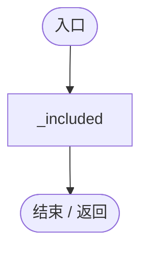
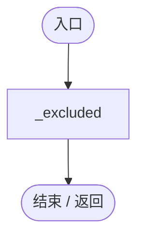
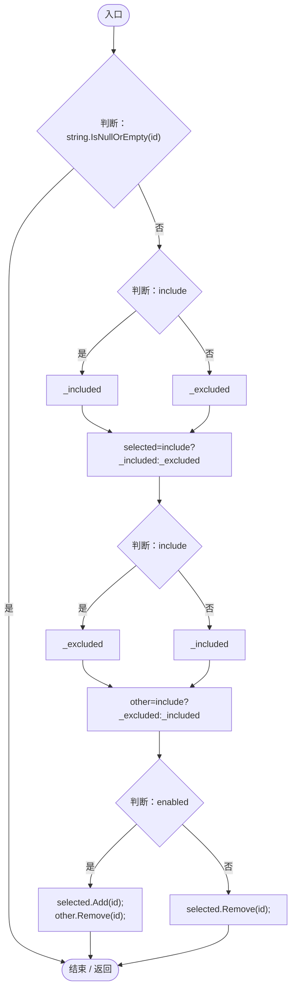
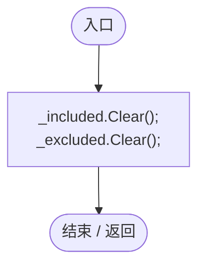
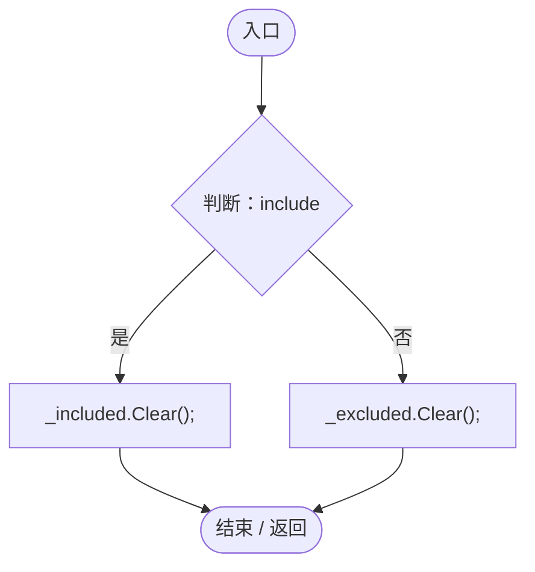
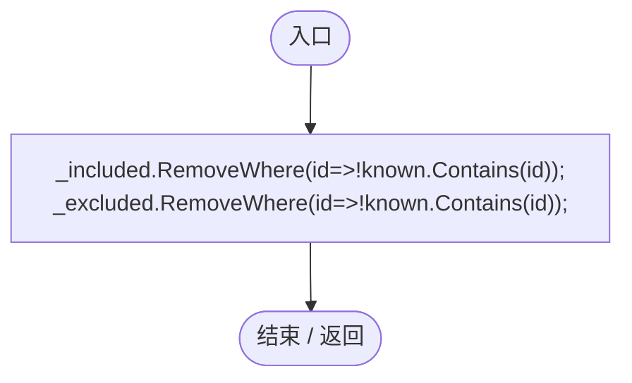
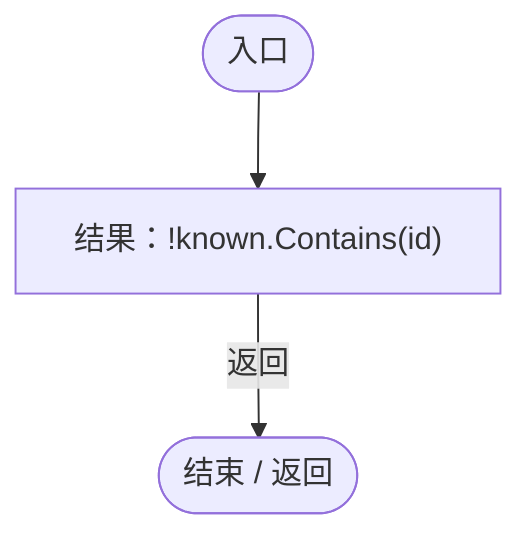
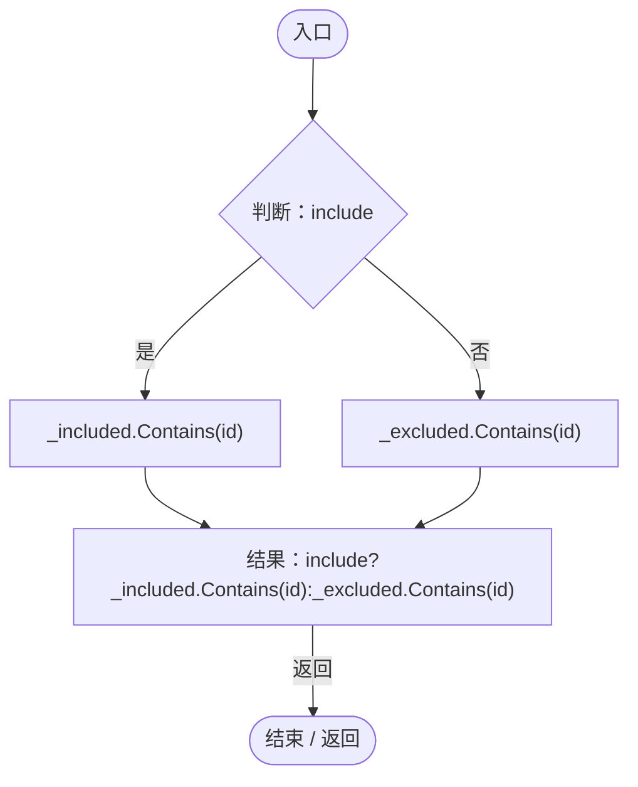
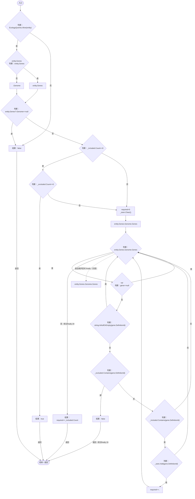

# EntityGeneFilter.cs

[返回总索引](../README.md) · `Runtime` · `Assets/DarwinPark/UI/EntityGeneFilter.cs`

[源文件](../../../Assets/DarwinPark/UI/EntityGeneFilter.cs) · 源码校验：`209a5c88399b10c02a73d9a9c6c36984f9e59643b46dad88910acdc30a8711f0`

方法按源文件位置排列。事件/回调引用不表示立即执行；分支与异常说明见总索引。完整源码与可点击关系图请打开离线手册。

## Included.get · L14

`public IReadOnlyCollection<string> Included`

### Editor / Player · 语法控制结构 / 声明（非CFG）

## Excluded.get · L15

`public IReadOnlyCollection<string> Excluded`

### Editor / Player · 语法控制结构 / 声明（非CFG）

## Set · L16

`public void Set(string id,bool include,bool enabled)`

### Editor / Player · Roslyn编译器控制流

## Clear · L22

`public void Clear()`

### Editor / Player · Roslyn编译器控制流

## Clear · L23

`public void Clear(bool include)`

### Editor / Player · Roslyn编译器控制流

## KeepKnown · L24

`public void KeepKnown(HashSet<string> known)`

### Editor / Player · Roslyn编译器控制流

项目内调用/回调引用：

- [EntityGeneFilter.回调@24 · L24](9ff35fef2ba68deb.md#m3e0040d27b496a8c)（回调/委托）
- [EntityGeneFilter.回调@24 · L24](9ff35fef2ba68deb.md#ma6ff31ddc0c9a028)（回调/委托）

## 回调@24 · L24

`id … => 回调`

### Editor / Player · Roslyn编译器控制流

## 回调@24 · L24

`id … => 回调`

### Editor / Player · Roslyn编译器控制流

## Contains · L25

`public bool Contains(string id,bool include)`

### Editor / Player · Roslyn编译器控制流

## Matches · L27

`public bool Matches(DarwinEntity entity)`

只在UI主线程调用，复用去重集合，避免每个实体分配HashSet或复制完整基因组。

### Editor / Player · Roslyn编译器控制流

项目内调用/回调引用：

- [EcologyQueries.Alive · L38](bdf7ccc2c9c0452f.md#mb2877c487f449970)（方法）
- [DarwinEntity.Genes.get · L14](70798dde169f2e8b.md#m622eb1adf401d431)（访问器）
