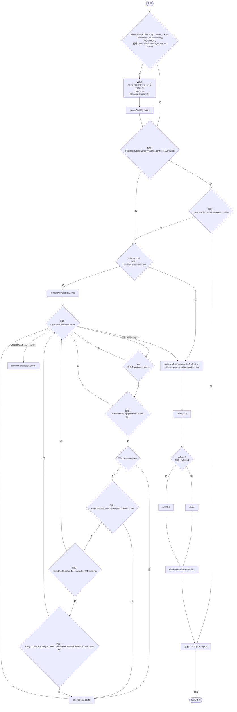
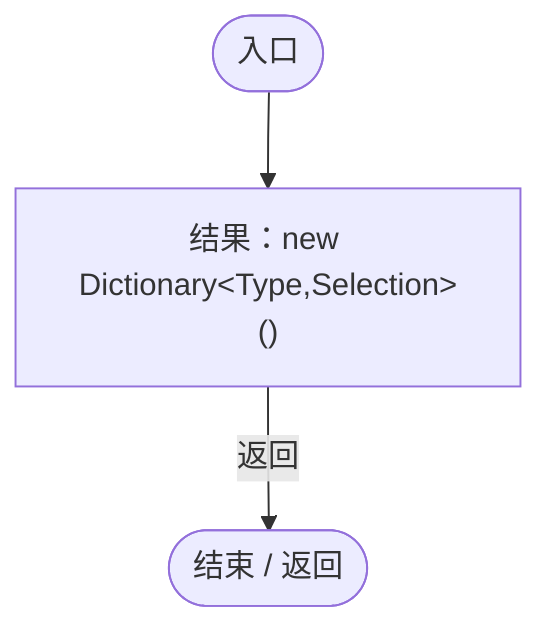

# GeneAuthorityCache.cs

[返回总索引](../README.md) · `Runtime` · `Assets/DarwinPark/Entities/Logic/GeneAuthorityCache.cs`

[源文件](../../../Assets/DarwinPark/Entities/Logic/GeneAuthorityCache.cs) · 源码校验：`c050ad101c2a20994fd5a60fdde7ef80928bd9cf81752dd939414d2ac3932041`

方法按源文件位置排列。事件/回调引用不表示立即执行；分支与异常说明见总索引。完整源码与可点击关系图请打开离线手册。

## IsPrimary · L13

`public static bool IsPrimary<T>(EntityGeneController controller,GeneInstance gene) where T:class,IGeneLogic`

### Editor / Player · Roslyn编译器控制流

项目内调用/回调引用：

- [EntityGeneController.Evaluation.get · L18](7494d53178552f0e.md#mc0039c100a31b455)（访问器）
- [EntityGeneController.LogicRevision.get · L19](7494d53178552f0e.md#me69facc1c0f1e164)（访问器）
- [EntityGeneController.GetLogic · L211](7494d53178552f0e.md#maadb710e89e60395)（方法）
- [GeneAuthorityCache.回调@15 · L15](9ff546df23a8ee4f.md#mc7867c798b2d4e80)（回调/委托）

## 回调@15 · L15

`_ … => 回调`

### Editor / Player · Roslyn编译器控制流

