# CorpseInspectionRegression.cs

[返回总索引](../README.md) · `Editor` · `Assets/DarwinPark/Editor/CorpseInspectionRegression.cs`

[源文件](../../../Assets/DarwinPark/Editor/CorpseInspectionRegression.cs) · 源码校验：`ef2f1c055e88c3ae631508191534db7069c0af841e82d95366942fc7551f6f07`

方法按源文件位置排列。事件/回调引用不表示立即执行；分支与异常说明见总索引。完整源码与可点击关系图请打开离线手册。

## Folder.get · L25

`private static string Folder`

### Editor · 语法控制结构 / 声明（非CFG）

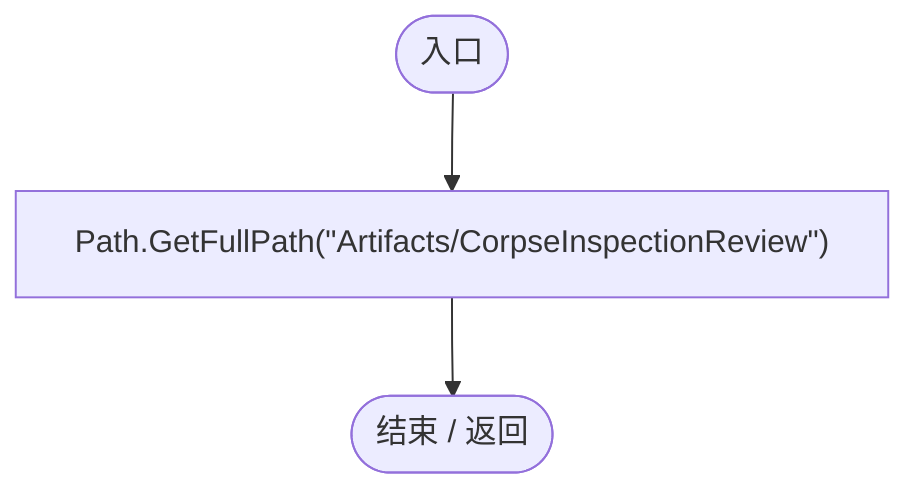

## CorpseInspectionRegression.ctor · L26

`static CorpseInspectionRegression()`

### Editor · Roslyn编译器控制流

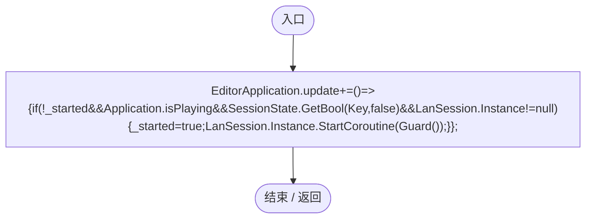

项目内调用/回调引用：

- [CorpseInspectionRegression.回调@26 · L26](a1829d88f72dd1fb.md#m899f4f3578a66b47)（回调/委托）

## 回调@26 · L26

`( … => 回调`

### Editor · Roslyn编译器控制流

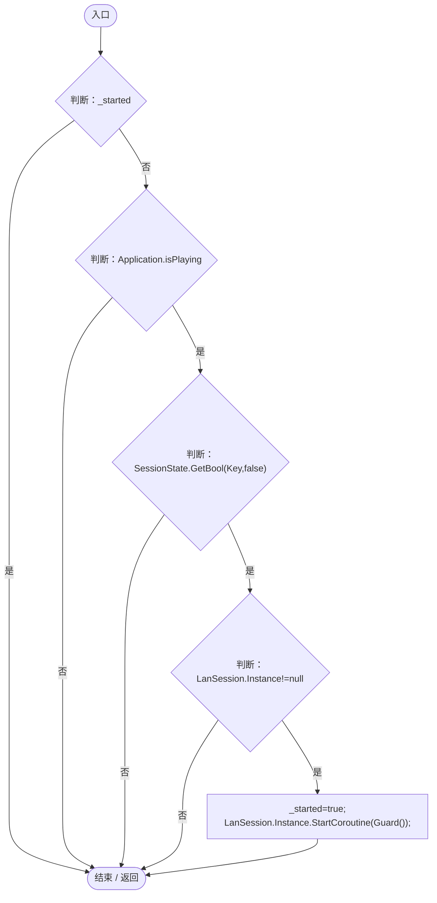

项目内调用/回调引用：

- [LanSession.Instance.get · L23](9fb633eebffe669c.md#mbf83306994878383)（访问器）
- [CorpseInspectionRegression.Guard · L29](a1829d88f72dd1fb.md#m73ce689be2959e27)（方法）

## RunBatch · L27

`public static void RunBatch()`

### Editor · Roslyn编译器控制流

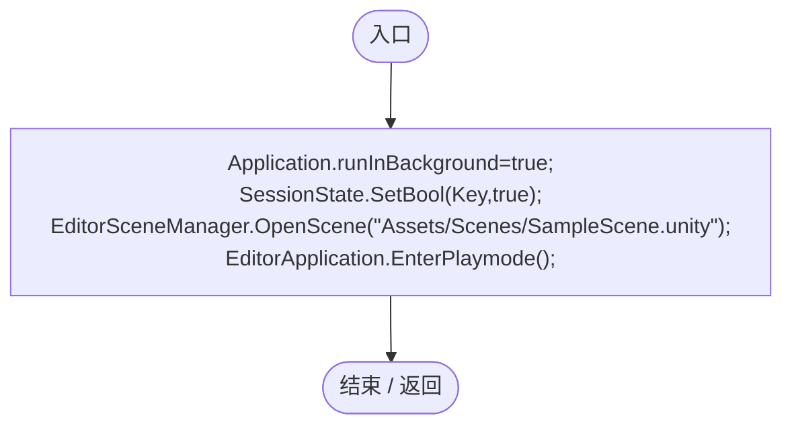

## Check · L28

`private static void Check(bool value,string text)`

### Editor · Roslyn编译器控制流

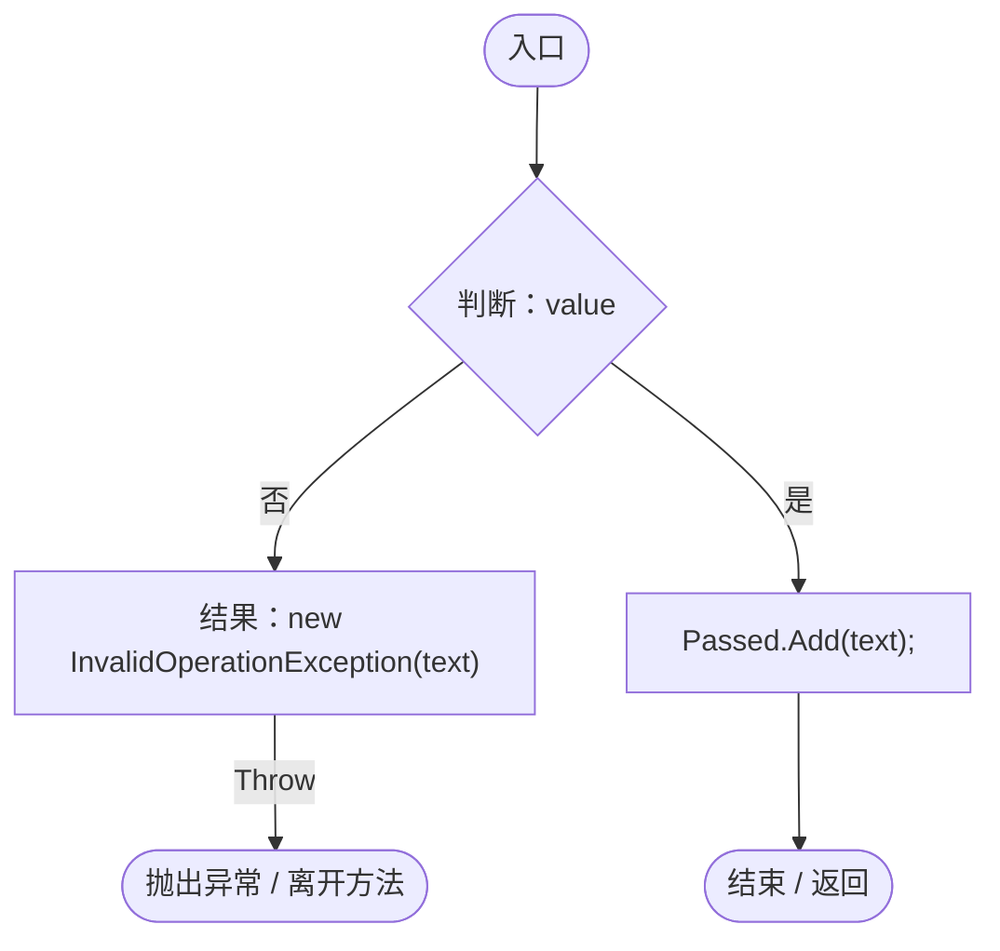

## Guard · L29

`private static IEnumerator Guard()`

### Editor · Roslyn编译器控制流

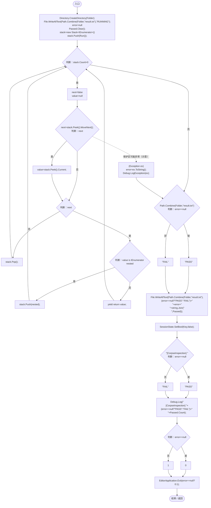

项目内调用/回调引用：

- [CorpseInspectionRegression.Run · L40](a1829d88f72dd1fb.md#m19954c4b89463471)（方法）

## Spawn · L35

`private static DarwinEntity Spawn(Vector3 point,string name)`

### Editor · Roslyn编译器控制流

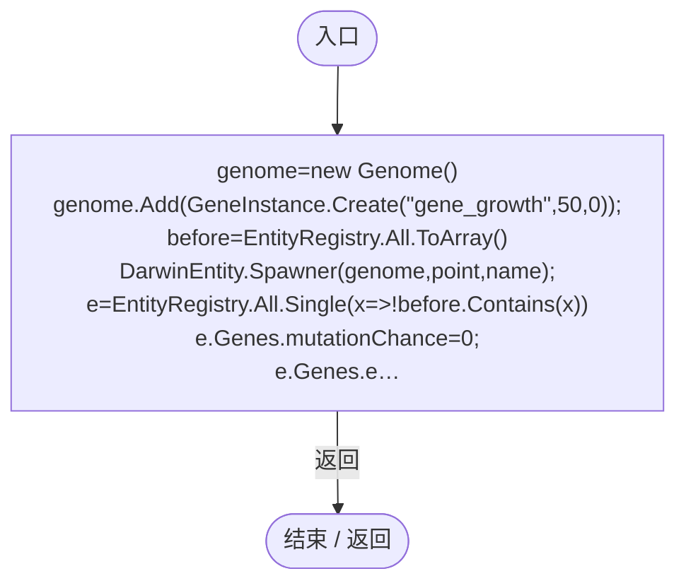

项目内调用/回调引用：

- [Genome.Add · L19](a2ef23f865bc7ee8.md#md9cfdc94b8b8d40f)（方法）
- [GeneInstance.Create · L20](f82e1498d67f5afd.md#m72e94c278de3cf8b)（方法）
- [DarwinEntity.Genes.get · L14](70798dde169f2e8b.md#m622eb1adf401d431)（访问器）
- [EntityLifeCycle.RestoreProgress · L48](9f4138bfbae654b7.md#mfc75121476d49679)（方法）
- [EntityGeneController.RestoreStageState · L51](7494d53178552f0e.md#m6264213de2a5ca6f)（方法）
- [CorpseInspectionRegression.回调@37 · L37](a1829d88f72dd1fb.md#m3561f82afb54003c)（回调/委托）

## 回调@37 · L37

`x … => 回调`

### Editor · Roslyn编译器控制流

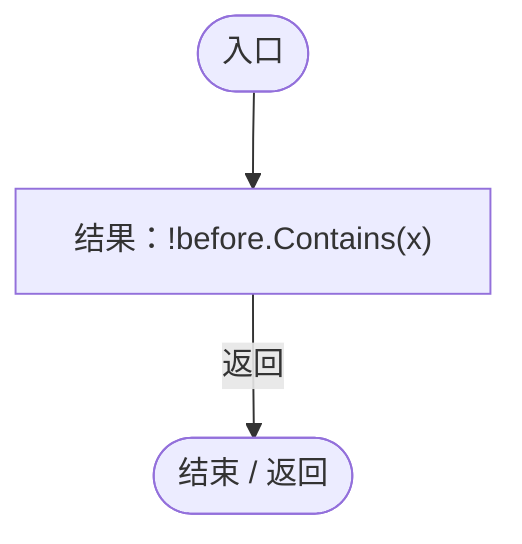

## Capture · L39

`private static IEnumerator Capture(string name)`

### Editor · Roslyn编译器控制流

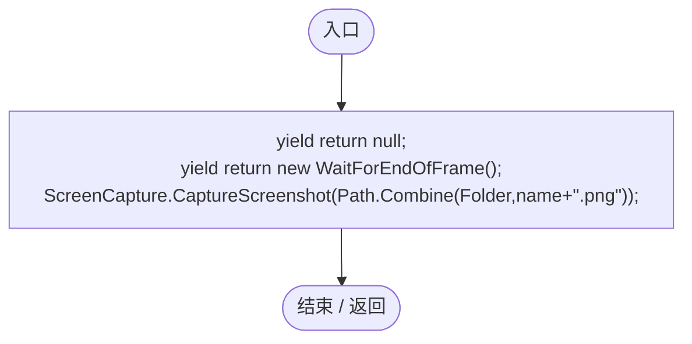

## Run · L40

`private static IEnumerator Run()`

### Editor · Roslyn编译器控制流

```mermaid
flowchart TD
  b0(["入口"])
  b1["yield return null;<br/>WorldRuntimeGate.Ready=true;<br/>typeof(GameMainMenu).GetMethod(&quot;Resume&quot;,BindingFlags.NonPublic&#124;BindingFlags.Instance).Invoke(Object.FindFirstObjectByType&lt;GameMainMenu&gt;(),null);<br/>ServiceLocator.Get&lt;SimulationClock&gt;().Pause();"]
  b2["EntityRegistry.All.ToArray()"]
  b3{"判断：EntityRegistry.All.ToArray()"}
  b4["var<br/>Object.DestroyImmediate(e.gameObject);"]
  b5{"EntityRegistry.All.ToArray()<br/>判断：EntityRegistry.All.ToArray()"}
  b6["EntityRegistry.All.ToArray()"]
  b7["连接 / 离开区域"]
  b8["ColonyResource.ClearWorld();<br/>root=ServiceLocator.Get&lt;UIRoot&gt;()<br/>control=Object.FindFirstObjectByType&lt;SimulationControlPanel&gt;()<br/>stats=root.MainCanvas.transform.Find(&quot;BottomPanel/ContentArea/Page1/MapEntityStatistics&quot;).GetComponent&lt;MapEntit…"]
  b9{"判断：corpse.GetComponent&lt;DarwinEntity&gt;()==null"}
  b10["EntityRegistry.All.Count==1"]
  b11["corpse.GetComponent&lt;DarwinEntity&gt;()==null"]
  b12["Check(corpse.GetComponent&lt;DarwinEntity&gt;()==null&amp;&amp;EntityRegistry.All.Count==1,&quot;深色物体确认为尸体资源，不冒充活体或增加实体总数&quot;);"]
  b13{"判断：corpse.GetComponents&lt;Collider&gt;().Length==0"}
  b14["corpse.GetComponents&lt;Rigidbody&gt;().Length==0"]
  b15["corpse.GetComponents&lt;Collider&gt;().Length==0"]
  b16["Check(corpse.GetComponents&lt;Collider&gt;().Length==0&amp;&amp;corpse.GetComponents&lt;Rigidbody&gt;().Length==0,&quot;拾取修复不新增物理碰撞体或刚体&quot;);"]
  b17{"corpse.transform.Find(&quot;CorpseStatusMark&quot;)<br/>判断：corpse.transform.Find(&quot;CorpseStatusMark&quot;)"}
  b18[".GetComponent&lt;MeshRenderer&gt;()"]
  b19["corpse.transform.Find(&quot;CorpseStatusMark&quot;)"]
  b20{"判断：corpse.transform.Find(&quot;CorpseStatusMark&quot;)?.GetComponent&lt;MeshRenderer&gt;()!=null"}
  b21["corpse.GetComponents&lt;Light&gt;().Length==0"]
  b22["corpse.transform.Find(&quot;CorpseStatusMark&quot;)?.GetComponent&lt;MeshRenderer&gt;()!=null"]
  b23["Check(corpse.transform.Find(&quot;CorpseStatusMark&quot;)?.GetComponent&lt;MeshRenderer&gt;()!=null&amp;&amp;corpse.GetComponents&lt;Light&gt;().Length==0,&quot;尸体增加可见叉号，不增加点光源&quot;);"]
  b24["inspector=Object.FindFirstObjectByType&lt;GeneInspectorUI&gt;()<br/>ray=new Ray(origin+Vector3.back*10,Vector3.forward)"]
  b25{"判断：inspector.InspectAt(ray)"}
  b26{"WorldResourceInspector.Instance<br/>判断：WorldResourceInspector.Instance"}
  b27[".Current"]
  b28["WorldResourceInspector.Instance"]
  b29["WorldResourceInspector.Instance?.Current==corpse"]
  b30["inspector.InspectAt(ray)"]
  b31["Check(inspector.InspectAt(ray)&amp;&amp;WorldResourceInspector.Instance?.Current==corpse,&quot;原右键入口可选中没有碰撞体的尸体&quot;);"]
  b32["panel=root.MainCanvas.transform.Find(&quot;WorldResourcePanel&quot;)"]
  b33{"判断：panel.gameObject.activeSelf"}
  b34{"判断：panel.GetComponentsInChildren&lt;Text&gt;().Any(t=&gt;t.text.Contains(&quot;已死亡&quot;))"}
  b35["panel.GetComponentsInChildren&lt;Text&gt;().Any(t=&gt;t.text.Contains(&quot;被士兵击败的实体&quot;)&amp;&amp;t.text.Contains(&quot;1.75&quot;))"]
  b36["panel.gameObject.activeSelf&amp;&amp;panel.GetComponentsInChildren&lt;Text&gt;().Any(t=&gt;t.text.Contains(&quot;已死亡&quot;))&amp;&amp;panel.GetComponentsInChildren&lt;Text&gt;().Any(t=&gt;t.text.Contains(&quot;被士兵击败的实体&quot;)&amp;&amp;t.text.Contains(&quot;1.75&quot;))"]
  b37["Check(panel.gameObject.activeSelf&amp;&amp;panel.GetComponentsInChildren&lt;Text&gt;().Any(t=&gt;t.text.Contains(&quot;已死亡&quot;))&amp;&amp;panel.GetComponentsInChildren&lt;Text&gt;().Any(t=&gt;t.text.Contains(&quot;被士兵击败的实体&quot;)&amp;&amp;t.text.Contains(&quot;1.75&quot;)),&quot;属性面板明确显示死亡状态、生前名称和体型&quot;);"]
  b38["stats.RefreshNow();"]
  b39{"判断：stats.Total==1"}
  b40["panel.GetComponentsInChildren&lt;InputField&gt;().Length==0"]
  b41["stats.Total==1"]
  b42["Check(stats.Total==1&amp;&amp;panel.GetComponentsInChildren&lt;InputField&gt;().Length==0,&quot;尸体属性只读，存活统计排除尸体&quot;);"]
  b43["camera=Camera.main<br/>camera.GetComponent&lt;OrbitCamera&gt;().enabled=false;<br/>camera.transform.position=origin+new Vector3(2,3,-8);<br/>camera.transform.LookAt(origin+Vector3.right);<br/>ground=GameObject.CreatePrimitive(PrimitiveType.Cube)<br/>ground.name=&quot;…"]
  b44{"判断：inspector.InspectAt(new Ray(live.transform.position+Vector3.back*10,Vector3.forward))"}
  b45{"判断：inspector.CurrentEntity==live"}
  b46["WorldResourceInspector.Instance.Current==null"]
  b47["inspector.InspectAt(new Ray(live.transform.position+Vector3.back*10,Vector3.forward))&amp;&amp;inspector.CurrentEntity==live&amp;&amp;WorldResourceInspector.Instance.Current==null"]
  b48["Check(inspector.InspectAt(new Ray(live.transform.position+Vector3.back*10,Vector3.forward))&amp;&amp;inspector.CurrentEntity==live&amp;&amp;WorldResourceInspector.Instance.Current==null,&quot;右键活体仍打开原基因属性面板并关闭尸体面板&quot;);"]
  b49["blocker=GameObject.CreatePrimitive(PrimitiveType.Cube)<br/>blocker.transform.position=origin+Vector3.back*3;<br/>blocker.transform.localScale=new Vector3(2,2,.2f);<br/>Physics.SyncTransforms();"]
  b50{"判断：inspector.InspectAt(ray)"}
  b51["WorldResourceInspector.Instance.Current==null"]
  b52["!inspector.InspectAt(ray)"]
  b53["Check(!inspector.InspectAt(ray)&amp;&amp;WorldResourceInspector.Instance.Current==null,&quot;尸体拾取遵守地形及实物遮挡，不透墙&quot;);"]
  b54["Object.DestroyImmediate(blocker);<br/>corpse.transform.localScale=new Vector3(2,1,3);"]
  b55{"判断：WorldInspectablePicker.Pick(ray,100,out _,out var scaled)"}
  b56["scaled==corpse"]
  b57["WorldInspectablePicker.Pick(ray,100,out _,out var scaled)"]
  b58["Check(WorldInspectablePicker.Pick(ray,100,out _,out var scaled)&amp;&amp;scaled==corpse,&quot;非均匀缩放尸体仍可准确拾取&quot;);"]
  b59["new ColonyResourceSave{id=Guid.NewGuid().ToString(&quot;N&quot;),group=group,kind=ColonyResourceKind.Energy,energy=12,scale=Vector3.one,local=EcologyQueries.ToLocal(origin+Vector3.right*6)}<br/>id=Guid.NewGuid().ToString(&quot;N&quot;)<br/>group=group<br/>kind=ColonyRe…"]
  b60["energy.transform.rotation=Quaternion.Euler(20,30,10);"]
  b61{"判断：inspector.InspectAt(new Ray(energy.transform.position+Vector3.back*10,Vector3.forward))"}
  b62["WorldResourceInspector.Instance.Current==energy"]
  b63["inspector.InspectAt(new Ray(energy.transform.position+Vector3.back*10,Vector3.forward))"]
  b64["Check(inspector.InspectAt(new Ray(energy.transform.position+Vector3.back*10,Vector3.forward))&amp;&amp;WorldResourceInspector.Instance.Current==energy,&quot;旋转的能量块也可查看只读能量信息&quot;);"]
  b65["outside=new Ray(energy.transform.TransformPoint(new Vector3(.7f,0,-10)),energy.transform.TransformDirection(Vector3.forward))<br/>WorldInspectablePicker.Pick(outside,100,out _,out var miss);<br/>Check(miss!=energy,&quot;旋转方块外侧射线不因包围盒误命中&quot;);<br/>moved=orig…"]
  b66{"判断：inspector.InspectAt(new Ray(moved+Vector3.back*10,Vector3.forward))"}
  b67["WorldResourceInspector.Instance.Current==corpse"]
  b68["inspector.InspectAt(new Ray(moved+Vector3.back*10,Vector3.forward))"]
  b69["Check(inspector.InspectAt(new Ray(moved+Vector3.back*10,Vector3.forward))&amp;&amp;WorldResourceInspector.Instance.Current==corpse,&quot;搬运后立即按新位置拾取&quot;);"]
  b70["Check(Vector3.Dot(corpse.transform.Find(&quot;CorpseStatusMark&quot;).up,EcologyQueries.Up(moved))&gt;.999f,&quot;搬运后叉号沿星球法线对齐&quot;);<br/>saved=corpse.Capture()<br/>path=Path.Combine(Folder,&quot;corpse.json&quot;)<br/>File.WriteAllText(path,JsonUtility.ToJson(saved));<br/>corpse.Remo…"]
  b71{"判断：WorldResourceInspector.Instance.Current==null"}
  b72["!panel.gameObject.activeSelf"]
  b73["WorldResourceInspector.Instance.Current==null"]
  b74["Check(WorldResourceInspector.Instance.Current==null&amp;&amp;!panel.gameObject.activeSelf,&quot;尸体被运走/移除后属性面板自动关闭&quot;);"]
  b75["restored=ColonyResource.Create(JsonUtility.FromJson&lt;ColonyResourceSave&gt;(File.ReadAllText(path)))"]
  b76{"判断：restored.State.sourceName==&quot;被士兵击败的实体&quot;"}
  b77["Mathf.Abs(restored.State.sourceSize-1.75f)&lt;.0001f"]
  b78["restored.State.sourceName==&quot;被士兵击败的实体&quot;"]
  b79["Check(restored.State.sourceName==&quot;被士兵击败的实体&quot;&amp;&amp;Mathf.Abs(restored.State.sourceSize-1.75f)&lt;.0001f,&quot;尸体来源属性实际写盘读取并恢复&quot;);"]
  b80["new ColonyResourceSave{id=Guid.NewGuid().ToString(&quot;N&quot;),group=group,kind=ColonyResourceKind.Corpse,energy=3,scale=Vector3.one,local=EcologyQueries.ToLocal(origin+Vector3.left*3)}<br/>id=Guid.NewGuid().ToString(&quot;N&quot;)<br/>group=group<br/>kind=ColonyReso…"]
  b81["WorldResourceInspector.Instance.Show(legacy);<br/>Check(panel.GetComponentsInChildren&lt;Text&gt;().Any(t=&gt;t.text.Contains(&quot;旧存档未记录&quot;)),&quot;旧存档尸体可查看，不捏造缺失的生前属性&quot;);<br/>Check(legacy.transform.Find(&quot;CorpseStatusMark&quot;).GetComponent&lt;MeshFilter&gt;().sharedMesh==re…"]
  b82{"判断：panel.gameObject.activeSelf"}
  b83["panel.GetComponentsInChildren&lt;InputField&gt;().Length==0"]
  b84["panel.gameObject.activeSelf"]
  b85["Check(panel.gameObject.activeSelf&amp;&amp;panel.GetComponentsInChildren&lt;InputField&gt;().Length==0,&quot;普通联机成员同样可读尸体属性&quot;);"]
  b86["WorldAuthority.CanEdit=true;<br/>state=ColonyWorldState.Capture()<br/>state.resources[0].sourceSize=float.NaN;<br/>rejected=false"]
  b87["ColonyWorldState.Validate(state);"]
  b88["rejected=true;"]
  b89["Check(rejected,&quot;损坏来源体型在恢复世界前被拒绝&quot;);<br/>WorldRuntimeGate.Ready=false;<br/>yield return null;"]
  b90{"判断：WorldResourceInspector.Instance.Current==null"}
  b91["!panel.gameObject.activeSelf"]
  b92["WorldResourceInspector.Instance.Current==null"]
  b93["Check(WorldResourceInspector.Instance.Current==null&amp;&amp;!panel.gameObject.activeSelf,&quot;离开世界关闭资源面板并释放选择引用&quot;);"]
  b94(["结束 / 返回"])
  b0 --> b1
  b1 --> b2
  b2 --> b3
  b3 -->|"是"| b4
  b3 -->|"否 · 经过finally 5"| b8
  b4 --> b3
  b5 -->|"否"| b6
  b5 -->|"是"| b7
  b6 --> b7
  b8 --> b9
  b9 -->|"是"| b10
  b9 -->|"否"| b11
  b10 --> b12
  b11 --> b12
  b12 --> b13
  b13 -->|"是"| b14
  b13 -->|"否"| b15
  b14 --> b16
  b15 --> b16
  b16 --> b17
  b17 -->|"否"| b18
  b17 -->|"是"| b19
  b18 --> b20
  b19 --> b20
  b20 -->|"是"| b21
  b20 -->|"否"| b22
  b21 --> b23
  b22 --> b23
  b23 --> b24
  b24 --> b25
  b25 -->|"是"| b26
  b25 -->|"否"| b30
  b26 -->|"否"| b27
  b26 -->|"是"| b28
  b27 --> b29
  b28 --> b29
  b29 --> b31
  b30 --> b31
  b31 --> b32
  b32 --> b33
  b33 -->|"是"| b34
  b33 -->|"否"| b36
  b34 -->|"是"| b35
  b34 -->|"否"| b36
  b35 --> b37
  b36 --> b37
  b37 --> b38
  b38 --> b39
  b39 -->|"是"| b40
  b39 -->|"否"| b41
  b40 --> b42
  b41 --> b42
  b42 --> b43
  b43 --> b44
  b44 -->|"是"| b45
  b44 -->|"否"| b47
  b45 -->|"是"| b46
  b45 -->|"否"| b47
  b46 --> b48
  b47 --> b48
  b48 --> b49
  b49 --> b50
  b50 -->|"否"| b51
  b50 -->|"是"| b52
  b51 --> b53
  b52 --> b53
  b53 --> b54
  b54 --> b55
  b55 -->|"是"| b56
  b55 -->|"否"| b57
  b56 --> b58
  b57 --> b58
  b58 --> b59
  b59 --> b60
  b60 --> b61
  b61 -->|"是"| b62
  b61 -->|"否"| b63
  b62 --> b64
  b63 --> b64
  b64 --> b65
  b65 --> b66
  b66 -->|"是"| b67
  b66 -->|"否"| b68
  b67 --> b69
  b68 --> b69
  b69 --> b70
  b70 --> b71
  b71 -->|"是"| b72
  b71 -->|"否"| b73
  b72 --> b74
  b73 --> b74
  b74 --> b75
  b75 --> b76
  b76 -->|"是"| b77
  b76 -->|"否"| b78
  b77 --> b79
  b78 --> b79
  b79 --> b80
  b80 --> b81
  b81 --> b82
  b82 -->|"是"| b83
  b82 -->|"否"| b84
  b83 --> b85
  b84 --> b85
  b85 --> b86
  b86 --> b87
  b87 --> b89
  b88 --> b89
  b89 --> b90
  b90 -->|"是"| b91
  b90 -->|"否"| b92
  b91 --> b93
  b92 --> b93
  b93 --> b94
  b3 -. "退出保护区时 finally（示意）" .-> b5
  b87 -. "保护区可能异常（示意）" .-> b88

```

项目内调用/回调引用：

- [SimulationClock.Pause · L79](a8f444aec9614b0a.md#m30929d45a885d0f1)（方法）
- [ServiceLocator.Get · L33](f2fdbe9f9ccd93cb.md#m2ae625299520c56d)（方法）
- [ColonyResource.ClearWorld · L100](293dbaecfff4b585.md#m634e84088b7cf78c)（方法）
- [UIRoot.MainCanvas.get · L14](9c1421378791f0e0.md#maa2cc9baf1248477)（访问器）
- [CorpseInspectionRegression.Check · L28](a1829d88f72dd1fb.md#m7a444b2482ee0e35)（方法）
- [CorpseInspectionRegression.Spawn · L35](a1829d88f72dd1fb.md#m6a5da87c5244a6d6)（方法）
- [EntityStats.Modify · L111](75aa86a368efdf24.md#m9c837be197158240)（方法）
- [ColonyResource.LeaveCorpse · L35](293dbaecfff4b585.md#m4c4f8f3dd2ed1198)（方法）
- [GeneInspectorUI.InspectAt · L309](924e27c34e7b1f0a.md#mb63c3cc7986d7527)（方法）
- [WorldResourceInspector.Instance.get · L12](044d7e948b6de8b7.md#m7d7f466d7959eb79)（访问器）
- [WorldResourceInspector.Current.get · L12](044d7e948b6de8b7.md#mdc035db6f6144659)（访问器）
- [MapEntityStatisticsUI.RefreshNow · L74](da03211264cb6014.md#ma30ab70fe8c10f4f)（方法）
- [MapEntityStatisticsUI.Total.get · L16](da03211264cb6014.md#m2b470c44fd65b06c)（访问器）
- [CorpseInspectionRegression.Capture · L39](a1829d88f72dd1fb.md#m4c7bf7c6abe83cf6)（方法）
- [WorldInspectablePicker.Pick · L10](b30f6db5375f9436.md#m29ceec2fbb2deaa1)（方法）
- [ColonyResource.Create · L42](293dbaecfff4b585.md#ma07be53c3e3fff10)（方法）
- [EcologyQueries.ToLocal · L39](bdf7ccc2c9c0452f.md#m1a07639eacf3aa47)（方法）
- [ColonyResource.CarryTo · L77](293dbaecfff4b585.md#mf1b53d872114d3a5)（方法）
- [EcologyQueries.Up · L41](bdf7ccc2c9c0452f.md#maca7070196f125fd)（方法）
- [ColonyResource.Capture · L101](293dbaecfff4b585.md#m001b2604d9e5f3ee)（方法）
- [ColonyResource.Remove · L99](293dbaecfff4b585.md#m3e346b425034ee3a)（方法）
- [ColonyResource.State.get · L22](293dbaecfff4b585.md#m341a1355f4d657bf)（访问器）
- [WorldResourceInspector.Show · L17](044d7e948b6de8b7.md#mf3baf0bb12ca2a57)（方法）
- [ColonyWorldState.Capture · L15](50d866ed6b21d869.md#m9d6a91b6b3cbf086)（方法）
- [ColonyWorldState.Validate · L16](50d866ed6b21d869.md#m8da7d1a3858b9c67)（方法）
- [CorpseInspectionRegression.回调@52 · L52](a1829d88f72dd1fb.md#m76b43e86bbdeb319)（回调/委托）
- [CorpseInspectionRegression.回调@52 · L52](a1829d88f72dd1fb.md#m9216af523857e8a3)（回调/委托）
- [CorpseInspectionRegression.回调@65 · L65](a1829d88f72dd1fb.md#mde89e669036a68ad)（回调/委托）

## 回调@52 · L52

`t … => 回调`

### Editor · Roslyn编译器控制流

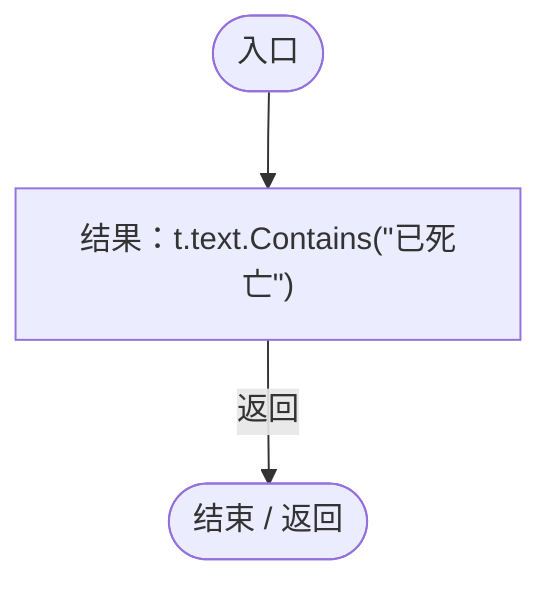

## 回调@52 · L52

`t … => 回调`

### Editor · Roslyn编译器控制流

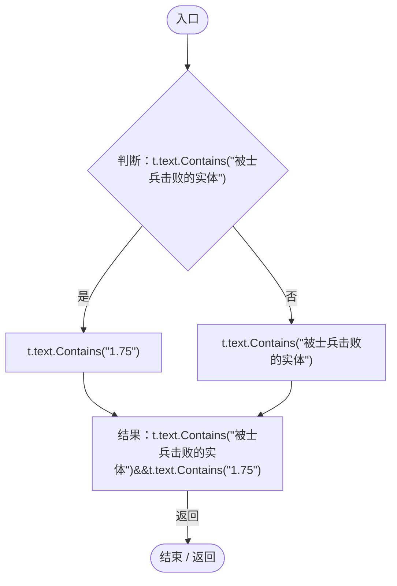

## 回调@65 · L65

`t … => 回调`

### Editor · Roslyn编译器控制流

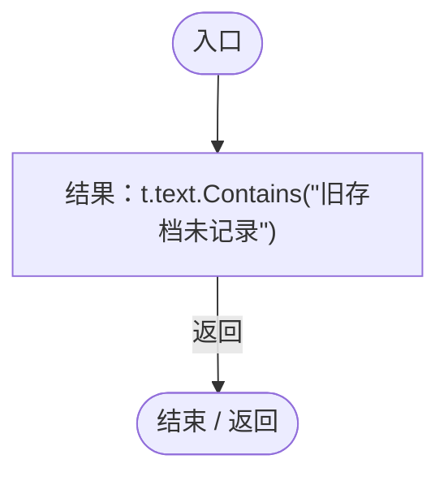
