# GroundPhysicsRegression.cs

[返回总索引](../README.md) · `Editor` · `Assets/DarwinPark/Editor/GroundPhysicsRegression.cs`

[源文件](../../../Assets/DarwinPark/Editor/GroundPhysicsRegression.cs) · 源码校验：`ac9a1dd0fb9eafdb6761da587d2de65c22399184bb37f80b57ad199cf6f135d5`

方法按源文件位置排列。事件/回调引用不表示立即执行；分支与异常说明见总索引。完整源码与可点击关系图请打开离线手册。

## Folder.get · L22

`private static string Folder`

### Editor · 语法控制结构 / 声明（非CFG）

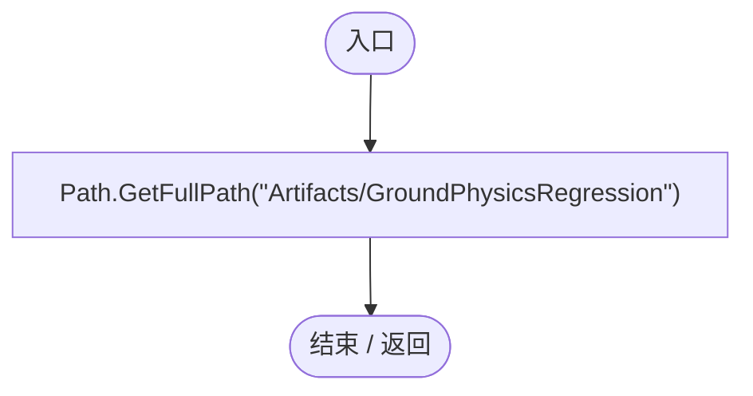

## GroundPhysicsRegression.ctor · L23

`static GroundPhysicsRegression()`

### Editor · Roslyn编译器控制流

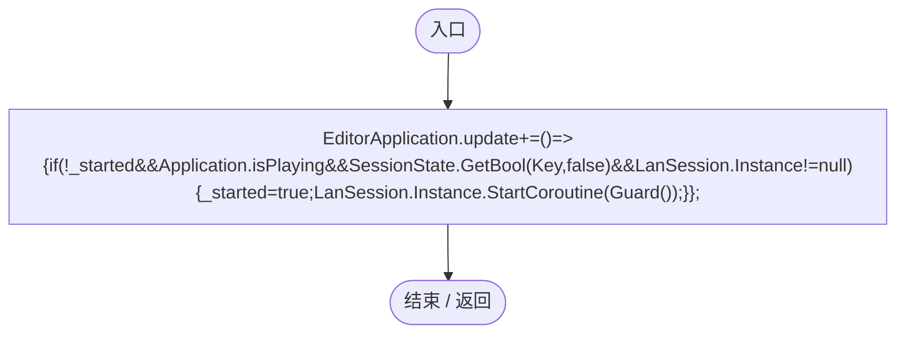

项目内调用/回调引用：

- [GroundPhysicsRegression.回调@23 · L23](a1c4cb548c26ab52.md#ma6e791bcef65ac9d)（回调/委托）

## 回调@23 · L23

`( … => 回调`

### Editor · Roslyn编译器控制流

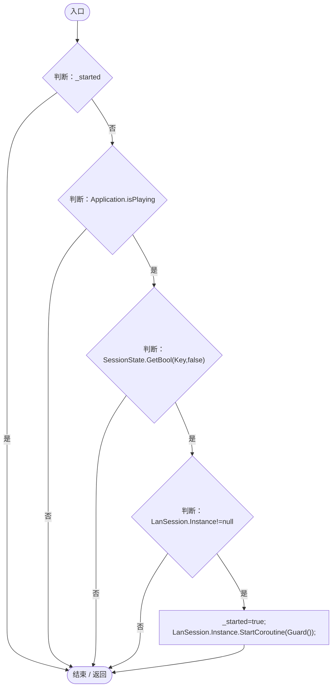

项目内调用/回调引用：

- [LanSession.Instance.get · L23](9fb633eebffe669c.md#mbf83306994878383)（访问器）
- [GroundPhysicsRegression.Guard · L26](a1c4cb548c26ab52.md#mb4d71f368e75fdca)（方法）

## RunBatch · L24

`public static void RunBatch()`

### Editor · Roslyn编译器控制流

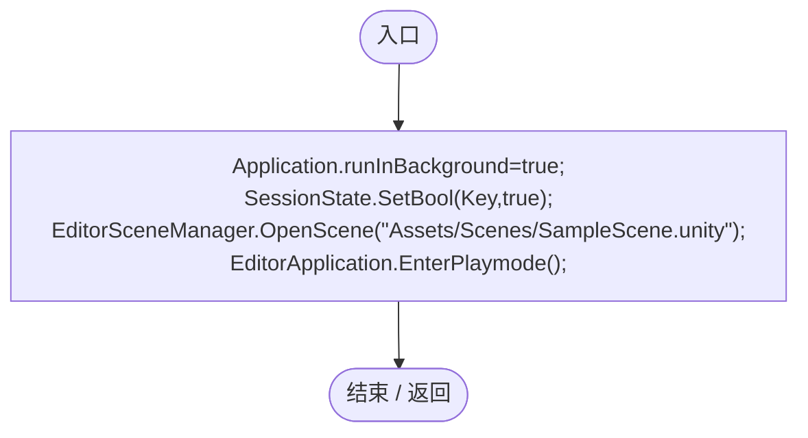

## Check · L25

`private static void Check(bool value,string message)`

### Editor · Roslyn编译器控制流

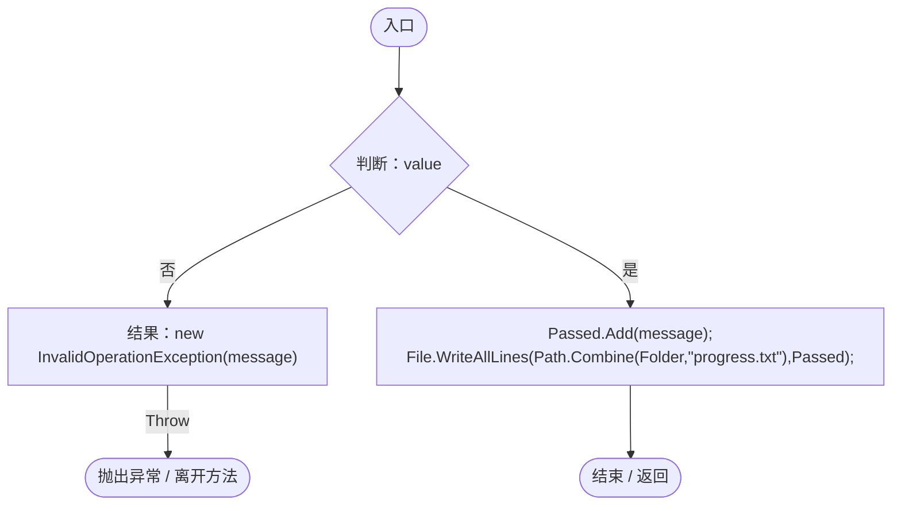

## Guard · L26

`private static IEnumerator Guard()`

### Editor · Roslyn编译器控制流

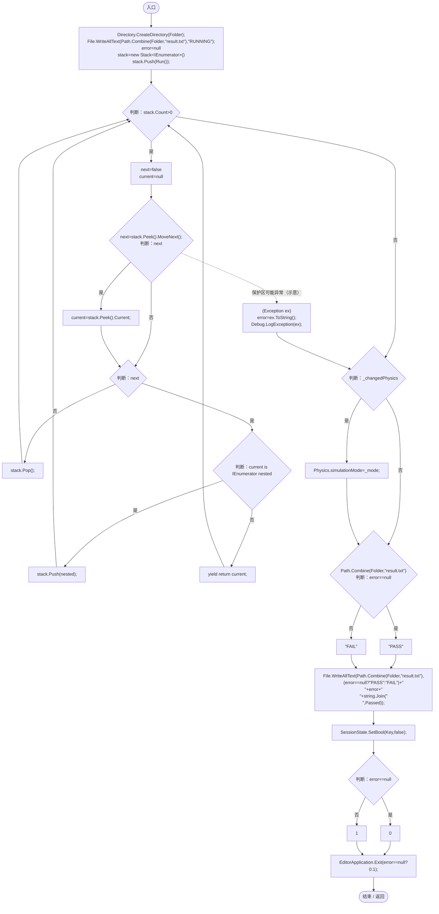

项目内调用/回调引用：

- [GroundPhysicsRegression.Run · L45](a1c4cb548c26ab52.md#m48b14e7e75478006)（方法）

## Wait · L32

`private static IEnumerator Wait(Func<bool> ready)`

### Editor · Roslyn编译器控制流

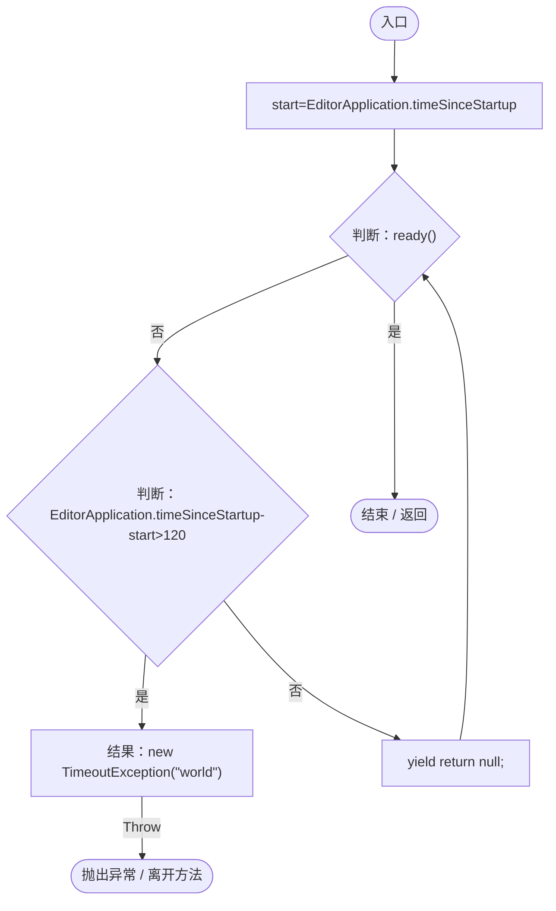

## Compare · L33

`private static void Compare(PlanetTerrainMeshBuilder planet,Vector3 direction)`

### Editor · Roslyn编译器控制流

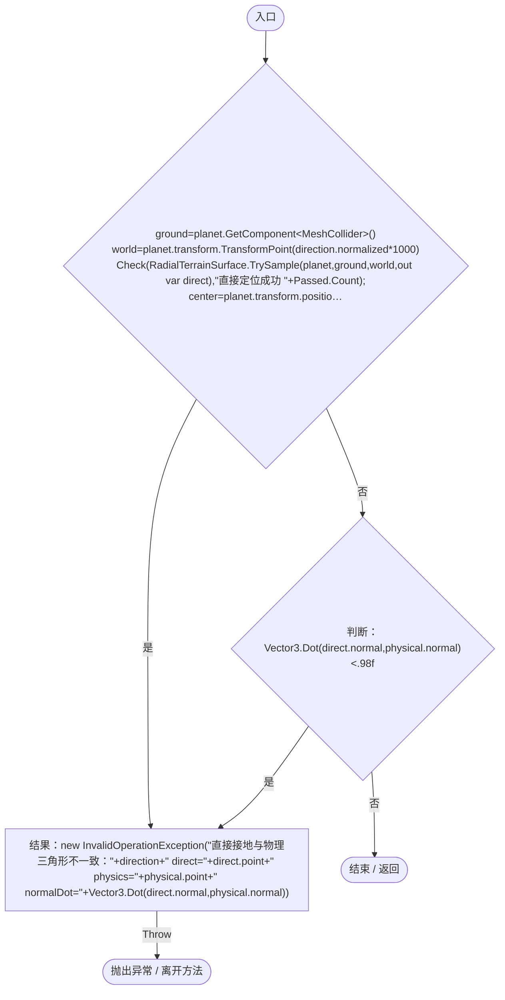

项目内调用/回调引用：

- [GroundPhysicsRegression.Check · L25](a1c4cb548c26ab52.md#md817b80de23acb3c)（方法）
- [RadialTerrainSurface.TrySample · L12](4eb5c0c8143bed20.md#m994c30d4296dac34)（方法）

## Spawn · L39

`private static DarwinEntity Spawn(Vector3 position)`

### Editor · Roslyn编译器控制流

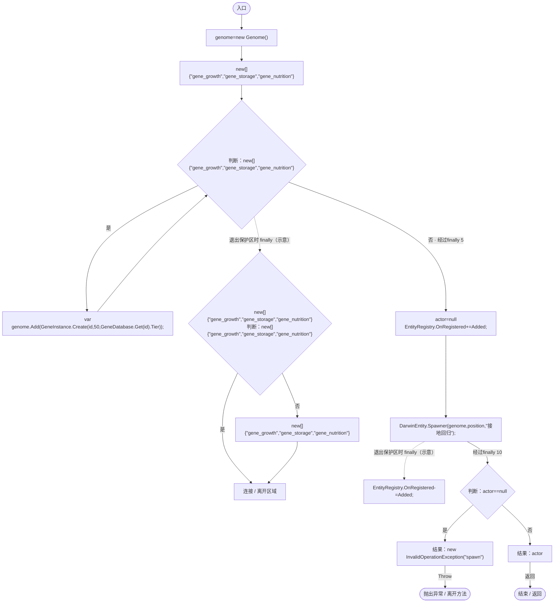

项目内调用/回调引用：

- [Genome.Add · L19](a2ef23f865bc7ee8.md#md9cfdc94b8b8d40f)（方法）
- [GeneInstance.Create · L20](f82e1498d67f5afd.md#m72e94c278de3cf8b)（方法）
- [GeneDatabase.Get · L136](ec0a03483435a863.md#me6a5fefe6c3492f9)（方法）
- [GroundPhysicsRegression.Added · L41](a1c4cb548c26ab52.md#m440a6144281f135b)（局部函数）

## Added · L41

`void Added(DarwinEntity e)`

### Editor · Roslyn编译器控制流

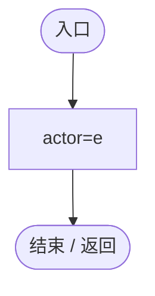

## Step · L43

`private static void Step(DarwinEntity actor,int count)`

### Editor · Roslyn编译器控制流

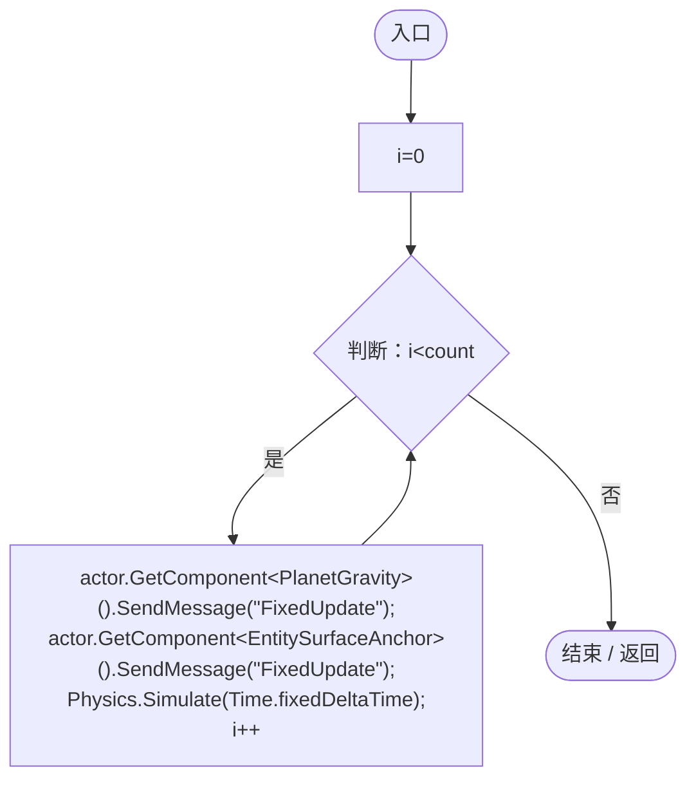

## Run · L45

`private static IEnumerator Run()`

### Editor · Roslyn编译器控制流

```mermaid
flowchart TD
  b0(["入口"])
  b1["session=Object.FindFirstObjectByType&lt;WorldSessionManager&gt;()<br/>session.autoSaveInterval=36000;<br/>planet=Object.FindFirstObjectByType&lt;PlanetTerrainMeshBuilder&gt;()<br/>planet.subdivisions=32;<br/>typeof(WorldSessionManager).GetField(&quot;_initialTerrain&quot;,Bi…"]
  b2["EntityRegistry.All.ToArray()"]
  b3{"判断：EntityRegistry.All.ToArray()"}
  b4["var<br/>Object.DestroyImmediate(entity.gameObject);"]
  b5{"EntityRegistry.All.ToArray()<br/>判断：EntityRegistry.All.ToArray()"}
  b6["EntityRegistry.All.ToArray()"]
  b7["连接 / 离开区域"]
  b8["ColonyResource.ClearWorld();<br/>UnityEngine.Random.InitState(9361);"]
  b9["i=0"]
  b10{"判断：i&lt;120"}
  b11["Compare(planet,UnityEngine.Random.onUnitSphere);<br/>i++"]
  b12["Check(true,&quot;120个随机方向真实三角形位置和法线与PhysX一致&quot;);"]
  b13["new[]{new Vector3(1,1,0),new Vector3(-1,0,1),new Vector3(0,-1,-1),Vector3.one}"]
  b14{"判断：new[]{new Vector3(1,1,0),new Vector3(-1,0,1),new Vector3(0,-1,-1),Vector3.one}"}
  b15["var"]
  b16["point=planet.transform.TransformPoint(direction.normalized*1000)"]
  b17{"判断：RadialTerrainSurface.TrySample(planet,planet.GetComponent&lt;MeshCollider&gt;(),point,out var sample)"}
  b18{"判断：planet.GetComponent&lt;MeshCollider&gt;().Raycast(new Ray(point,(planet.transform.position-point).normalized),out var physical,2000)"}
  b19["Vector3.Distance(sample.point,physical.point)&lt;.01f"]
  b20["RadialTerrainSurface.TrySample(planet,planet.GetComponent&lt;MeshCollider&gt;(),point,out var sample)&amp;&amp;planet.GetComponent&lt;MeshCollider&gt;().Raycast(new Ray(point,(planet.transform.position-point).normalized),out var physical,2000)&amp;&amp;Vector3.Dist…"]
  b21["Check(RadialTerrainSurface.TrySample(planet,planet.GetComponent&lt;MeshCollider&gt;(),point,out var sample)&amp;&amp;planet.GetComponent&lt;MeshCollider&gt;().Raycast(new Ray(point,(planet.transform.position-point).normalized),out var physical,2000)&amp;&amp;Vector…"]
  b22{"new[]{new Vector3(1,1,0),new Vector3(-1,0,1),new Vector3(0,-1,-1),Vector3.one}<br/>判断：new[]{new Vector3(1,1,0),new Vector3(-1,0,1),new Vector3(0,-1,-1),Vector3.one}"}
  b23["new[]{new Vector3(1,1,0),new Vector3(-1,0,1),new Vector3(0,-1,-1),Vector3.one}"]
  b24["连接 / 离开区域"]
  b25["planet.transform.SetPositionAndRotation(new Vector3(12,-7,31),Quaternion.Euler(19,72,31));<br/>planet.transform.localScale=Vector3.one*1.25f;<br/>Physics.SyncTransforms();"]
  b26["i=0"]
  b27{"判断：i&lt;12"}
  b28["Compare(planet,UnityEngine.Random.onUnitSphere);<br/>i++"]
  b29["Check(true,&quot;移动/旋转/均匀缩放后的直接查询与PhysX一致&quot;);<br/>planet.transform.localScale=new Vector3(1,2,1);<br/>Physics.SyncTransforms();<br/>Check(!RadialTerrainSurface.TrySample(planet,planet.GetComponent&lt;MeshCollider&gt;(),planet.transform.position+Vector3.up*1000,…"]
  b30["actor.GetComponents&lt;MonoBehaviour&gt;()"]
  b31{"判断：actor.GetComponents&lt;MonoBehaviour&gt;()"}
  b32{"var<br/>判断：behaviour is not DarwinEntity"}
  b33{"判断：behaviour is not PlanetGravity"}
  b34{"判断：behaviour is not EntitySurfaceAnchor"}
  b35["behaviour.enabled=false;"]
  b36{"actor.GetComponents&lt;MonoBehaviour&gt;()<br/>判断：actor.GetComponents&lt;MonoBehaviour&gt;()"}
  b37["actor.GetComponents&lt;MonoBehaviour&gt;()"]
  b38["连接 / 离开区域"]
  b39["body=actor.GetComponent&lt;Rigidbody&gt;()<br/>body.isKinematic=false;<br/>gravity=actor.GetComponent&lt;PlanetGravity&gt;()<br/>probe=gravity.Grounding<br/>_mode=Physics.simulationMode;<br/>_changedPhysics=true;<br/>Physics.simulationMode=SimulationMode.Script;<br/>clock.Play…"]
  b40{"判断：EntityGroundProbe.DirectSamples==directBefore"}
  b41["EntityGroundProbe.ReusedSamples==reusedBefore+1"]
  b42["EntityGroundProbe.DirectSamples==directBefore"]
  b43["Check(EntityGroundProbe.DirectSamples==directBefore&amp;&amp;EntityGroundProbe.ReusedSamples==reusedBefore+1,&quot;同物理位置的重力/安全网复用一次地面样本&quot;);"]
  b44["body.position+=up*.2f;<br/>probe.Read(planet.transform);<br/>Check(EntityGroundProbe.DirectSamples==directBefore+1,&quot;同一步传送立即失效，不沿用旧接触点&quot;);<br/>Step(actor,400);<br/>Check(StationaryBodyRest.IsResting(body),&quot;真实模拟后非移动实体落地并进入接触验证休眠&quot;);<br/>directBefore=EntityGroun…"]
  b45{"判断：EntityGroundProbe.DirectSamples==directBefore"}
  b46["EntityGroundProbe.RotationWrites==rotations"]
  b47["EntityGroundProbe.DirectSamples==directBefore"]
  b48["Check(EntityGroundProbe.DirectSamples==directBefore&amp;&amp;EntityGroundProbe.RotationWrites==rotations,&quot;休眠实体不再采样地面或重复写旋转&quot;);"]
  b49["body.AddForce(up*4,ForceMode.VelocityChange);<br/>Physics.Simulate(Time.fixedDeltaTime);"]
  b50{"判断：body.IsSleeping()"}
  b51["!StationaryBodyRest.RemainsAsleep(body,actor.Genes)"]
  b52["!body.IsSleeping()"]
  b53["Check(!body.IsSleeping()&amp;&amp;!StationaryBodyRest.RemainsAsleep(body,actor.Genes),&quot;真实外力仍唤醒并保持击退/下落处理&quot;);"]
  b54["Step(actor,300);<br/>Check(StationaryBodyRest.IsResting(body),&quot;击退后重新落地可以再次安全休眠&quot;);<br/>planet.transform.localScale=Vector3.one*1.01f;<br/>Check(!StationaryBodyRest.IsResting(body),&quot;星球缩放立即使旧休眠接触失效&quot;);<br/>planet.transform.localScale=Vector3.one;<br/>Physics.Sy…"]
  b55{"判断：StationaryBodyRest.RemainsAsleep(body,actor.Genes)"}
  b56["!body.IsSleeping()"]
  b57["!StationaryBodyRest.RemainsAsleep(body,actor.Genes)"]
  b58["Check(!StationaryBodyRest.RemainsAsleep(body,actor.Genes)&amp;&amp;!body.IsSleeping(),&quot;获得行动基因立即唤醒，不被零速度缓存冻结&quot;);"]
  b59["clock.Pause();<br/>body.linearVelocity=Vector3.one;<br/>body.angularVelocity=Vector3.one;<br/>gravity.SendMessage(&quot;FixedUpdate&quot;);"]
  b60{"判断：body.linearVelocity==Vector3.zero"}
  b61["body.angularVelocity==Vector3.zero"]
  b62["body.linearVelocity==Vector3.zero"]
  b63["Check(body.linearVelocity==Vector3.zero&amp;&amp;body.angularVelocity==Vector3.zero,&quot;暂停清除真实线速度和角速度&quot;);"]
  b64["writes=EntityGroundProbe.VelocityWrites<br/>gravity.SendMessage(&quot;FixedUpdate&quot;);<br/>Check(EntityGroundProbe.VelocityWrites==writes,&quot;重复暂停不改写已归零速度&quot;);<br/>clock.Play();<br/>body.position=surface.point+up*70;<br/>body.linearVelocity=up*5;<br/>highSample=probe.Read(…"]
  b65{"判断：Vector3.Dot(body.position-surface.point,up)&lt;2"}
  b66["Vector3.Dot(body.linearVelocity,up)&lt;=.0001f"]
  b67["Vector3.Dot(body.position-surface.point,up)&lt;2"]
  b68["Check(// ★ 修复（防Bug回归）：径向投影在不同高地朝向会留下浮点尾差；沿用跳跃检查的微小速度容限，仍要求救回到2米内。 Vector3.Dot(body.position-surface.point,up)&lt;2&amp;&amp;Vector3.Dot(body.linearVelocity,up)&lt;=.0001f,&quot;高空实体仍由安全网救回，向外冲量被清除&quot;);"]
  b69["body.position=surface.point-up*3;<br/>actor.GetComponent&lt;EntitySurfaceAnchor&gt;().SendMessage(&quot;FixedUpdate&quot;);<br/>Check(Vector3.Dot(body.position-surface.point,up)&gt;.4f,&quot;穿入地形仍推回真实三角形表面&quot;);"]
  b70{"actor.GetComponent&lt;EntityJumpMotor&gt;()<br/>判断：actor.GetComponent&lt;EntityJumpMotor&gt;()"}
  b71["actor.GetComponent&lt;EntityJumpMotor&gt;()"]
  b72["actor.gameObject.AddComponent&lt;EntityJumpMotor&gt;()"]
  b73["jump=actor.GetComponent&lt;EntityJumpMotor&gt;()??actor.gameObject.AddComponent&lt;EntityJumpMotor&gt;()"]
  b74["jump.Bind(planet.transform);<br/>body.position=surface.point;<br/>body.linearVelocity=-up;<br/>Physics.SyncTransforms();"]
  b75{"判断：jump.ResolveGroundContact()"}
  b76["Vector3.Dot(body.linearVelocity,up)&gt;=-.0001f"]
  b77["jump.ResolveGroundContact()"]
  b78["Check(jump.ResolveGroundContact()&amp;&amp;Vector3.Dot(body.linearVelocity,up)&gt;=-.0001f,&quot;操控穿地兜底复用地面且去掉向下速度&quot;);"]
  b79["before=probe.Read(planet.transform)<br/>planet.GetComponent&lt;MeshCollider&gt;().enabled=false;"]
  b80{"判断：probe.Read(planet.transform).hasSurface"}
  b81["!StationaryBodyRest.IsResting(body)"]
  b82["!probe.Read(planet.transform).hasSurface"]
  b83["Check(!probe.Read(planet.transform).hasSurface&amp;&amp;!StationaryBodyRest.IsResting(body),&quot;禁用地形碰撞立即撤销接触，不能继续休眠&quot;);"]
  b84["planet.GetComponent&lt;MeshCollider&gt;().enabled=true;<br/>Physics.SyncTransforms();<br/>ocean=planet.Data.Vertices.OrderBy(v=&gt;v.magnitude).First().normalized<br/>body.position=ocean*(planet.WaterRadius-2);<br/>body.linearVelocity=Vector3.Cross(ocean,Vector3…"]
  b85{"判断：Vector3.ProjectOnPlane(body.linearVelocity,ocean).sqrMagnitude&lt;.000001f"}
  b86["Vector3.Dot(body.linearVelocity,ocean)&lt;=0"]
  b87["Vector3.ProjectOnPlane(body.linearVelocity,ocean).sqrMagnitude&lt;.000001f"]
  b88["Check(Vector3.ProjectOnPlane(body.linearVelocity,ocean).sqrMagnitude&lt;.000001f&amp;&amp;Vector3.Dot(body.linearVelocity,ocean)&lt;=0,&quot;水中仍清除陆地切向惯性并保留下沉&quot;);"]
  b89["config=planet.CaptureConfiguration()<br/>config.seed++;<br/>oldData=planet.Data<br/>planet.ApplyGeneratedData(PlanetTerrainGenerator.Generate(config,planet.seaLevelRatio,planet.continentRatio));<br/>Physics.SyncTransforms();<br/>directBefore=EntityGroundPro…"]
  b90{"判断：ReferenceEquals(oldData,planet.Data)"}
  b91["EntityGroundProbe.DirectSamples==directBefore+1"]
  b92["!ReferenceEquals(oldData,planet.Data)"]
  b93["Check(!ReferenceEquals(oldData,planet.Data)&amp;&amp;EntityGroundProbe.DirectSamples==directBefore+1,&quot;重建地形同一步立即刷新共享样本&quot;);"]
  b94["SimulationOptimization.Current.directGroundQueries=false;<br/>rays=EntityGroundProbe.Raycasts<br/>body.position=up*1000;"]
  b95{"判断：probe.Read(planet.transform).hasSurface"}
  b96["EntityGroundProbe.Raycasts==rays+1"]
  b97["probe.Read(planet.transform).hasSurface"]
  b98["Check(probe.Read(planet.transform).hasSurface&amp;&amp;EntityGroundProbe.Raycasts==rays+1,&quot;可热关闭直接查询，仍通过真实射线取得地面&quot;);"]
  b99["SimulationOptimization.Current.directGroundQueries=true;<br/>clock.Pause();<br/>Physics.simulationMode=_mode;<br/>_changedPhysics=false;<br/>session.Open(WorldSaveStore.Read(Path.GetFullPath(&quot;Artifacts/GroundPhysicsReview/input/world.json&quot;)));<br/>yield ret…"]
  b100["i=0"]
  b101{"判断：i&lt;120"}
  b102["Compare(planet,UnityEngine.Random.onUnitSphere);<br/>i++"]
  b103["Check(true,&quot;320细分完整网格120方向与PhysX位置/法线一致&quot;);"]
  b104(["结束 / 返回"])
  b0 --> b1
  b1 --> b2
  b2 --> b3
  b3 -->|"是"| b4
  b3 -->|"否 · 经过finally 5"| b8
  b4 --> b3
  b5 -->|"否"| b6
  b5 -->|"是"| b7
  b6 --> b7
  b8 --> b9
  b9 --> b10
  b10 -->|"是"| b11
  b10 -->|"否"| b12
  b11 --> b10
  b12 --> b13
  b13 --> b14
  b14 -->|"是"| b15
  b14 -->|"否 · 经过finally 22"| b25
  b15 --> b16
  b16 --> b17
  b17 -->|"是"| b18
  b17 -->|"否"| b20
  b18 -->|"是"| b19
  b18 -->|"否"| b20
  b19 --> b21
  b20 --> b21
  b21 --> b14
  b22 -->|"否"| b23
  b22 -->|"是"| b24
  b23 --> b24
  b25 --> b26
  b26 --> b27
  b27 -->|"是"| b28
  b27 -->|"否"| b29
  b28 --> b27
  b29 --> b30
  b30 --> b31
  b31 -->|"是"| b32
  b31 -->|"否 · 经过finally 36"| b39
  b32 -->|"是"| b33
  b32 -->|"否"| b31
  b33 -->|"是"| b34
  b33 -->|"否"| b31
  b34 -->|"是"| b35
  b34 -->|"否"| b31
  b35 --> b31
  b36 -->|"否"| b37
  b36 -->|"是"| b38
  b37 --> b38
  b39 --> b40
  b40 -->|"是"| b41
  b40 -->|"否"| b42
  b41 --> b43
  b42 --> b43
  b43 --> b44
  b44 --> b45
  b45 -->|"是"| b46
  b45 -->|"否"| b47
  b46 --> b48
  b47 --> b48
  b48 --> b49
  b49 --> b50
  b50 -->|"否"| b51
  b50 -->|"是"| b52
  b51 --> b53
  b52 --> b53
  b53 --> b54
  b54 --> b55
  b55 -->|"否"| b56
  b55 -->|"是"| b57
  b56 --> b58
  b57 --> b58
  b58 --> b59
  b59 --> b60
  b60 -->|"是"| b61
  b60 -->|"否"| b62
  b61 --> b63
  b62 --> b63
  b63 --> b64
  b64 --> b65
  b65 -->|"是"| b66
  b65 -->|"否"| b67
  b66 --> b68
  b67 --> b68
  b68 --> b69
  b69 --> b70
  b70 -->|"否"| b71
  b70 -->|"是"| b72
  b71 --> b73
  b72 --> b73
  b73 --> b74
  b74 --> b75
  b75 -->|"是"| b76
  b75 -->|"否"| b77
  b76 --> b78
  b77 --> b78
  b78 --> b79
  b79 --> b80
  b80 -->|"否"| b81
  b80 -->|"是"| b82
  b81 --> b83
  b82 --> b83
  b83 --> b84
  b84 --> b85
  b85 -->|"是"| b86
  b85 -->|"否"| b87
  b86 --> b88
  b87 --> b88
  b88 --> b89
  b89 --> b90
  b90 -->|"否"| b91
  b90 -->|"是"| b92
  b91 --> b93
  b92 --> b93
  b93 --> b94
  b94 --> b95
  b95 -->|"是"| b96
  b95 -->|"否"| b97
  b96 --> b98
  b97 --> b98
  b98 --> b99
  b99 --> b100
  b100 --> b101
  b101 -->|"是"| b102
  b101 -->|"否"| b103
  b102 --> b101
  b103 --> b104
  b3 -. "退出保护区时 finally（示意）" .-> b5
  b14 -. "退出保护区时 finally（示意）" .-> b22
  b31 -. "退出保护区时 finally（示意）" .-> b36

```

项目内调用/回调引用：

- [PlanetClimateMap.Instance.get · L16](b4e9726c1bcf4c37.md#m3add54a419aeef9f)（访问器）
- [PlanetOreSystem.Instance.get · L8](86b3fbb4d9436121.md#m53f6a6af4b6dc252)（访问器）
- [WorldSessionManager.Create · L41](08741c7b7b9d9344.md#m6aadfeee8b90aacd)（方法）
- [GroundPhysicsRegression.Wait · L32](a1c4cb548c26ab52.md#m14706c3f925d6da5)（方法）
- [ServiceLocator.Get · L33](f2fdbe9f9ccd93cb.md#m2ae625299520c56d)（方法）
- [SimulationClock.Pause · L79](a8f444aec9614b0a.md#m30929d45a885d0f1)（方法）
- [PopulationMaintenance.Restore · L162](923ccc4e86c4786c.md#m23ae054ef57d2624)（方法）
- [GameplayTuning.Current.get · L46](db546e5713b32d53.md#m4fa691bd8a3b9618)（访问器）
- [ColonyResource.ClearWorld · L109](293dbaecfff4b585.md#m0aae51a30765b159)（方法）
- [GroundPhysicsRegression.Compare · L33](a1c4cb548c26ab52.md#mf0faf108e405e77b)（方法）
- [GroundPhysicsRegression.Check · L25](a1c4cb548c26ab52.md#md817b80de23acb3c)（方法）
- [RadialTerrainSurface.TrySample · L12](4eb5c0c8143bed20.md#m994c30d4296dac34)（方法）
- [PlanetTerrainMeshBuilder.Data.get · L81](415285cf043354a9.md#m1a65abfe0f34c5d8)（访问器）
- [GroundPhysicsRegression.Spawn · L39](a1c4cb548c26ab52.md#maab8376880bbf802)（方法）
- [SimulationClock.Play · L78](a8f444aec9614b0a.md#m7aa9e64b7de60ed0)（方法）
- [EntityGroundProbe.Read · L20](6cefee808441951d.md#md243671db147a614)（方法）
- [GroundPhysicsRegression.Step · L43](a1c4cb548c26ab52.md#m552454e2c0bd7e8a)（方法）
- [StationaryBodyRest.IsResting · L13](19e6d310d5522440.md#m05a63ddbf1fcc412)（方法）
- [StationaryBodyRest.RemainsAsleep · L20](19e6d310d5522440.md#m53a3fec3ed119634)（方法）
- [DarwinEntity.Genes.get · L14](70798dde169f2e8b.md#m622eb1adf401d431)（访问器）
- [Genome.Add · L19](a2ef23f865bc7ee8.md#md9cfdc94b8b8d40f)（方法）
- [GeneInstance.Create · L20](f82e1498d67f5afd.md#m72e94c278de3cf8b)（方法）
- [EntityGeneController.Recalculate · L120](7494d53178552f0e.md#m7bf63f9a1482db3c)（方法）
- [SimulationClock.IsRunning.get · L22](a8f444aec9614b0a.md#m10f4fe307faca0f0)（访问器）
- [EntityJumpMotor.Bind · L22](fa3269c9da0aa692.md#mc6171e335b954dd5)（方法）
- [EntityJumpMotor.ResolveGroundContact · L59](fa3269c9da0aa692.md#m659d5c175a37d022)（方法）
- [PlanetTerrainMeshBuilder.WaterRadius.get · L99](415285cf043354a9.md#m76719c213b06ba56)（访问器）
- [PlanetTerrainMeshBuilder.CaptureConfiguration · L116](415285cf043354a9.md#m9eddff328d672f73)（方法）
- [PlanetTerrainMeshBuilder.ApplyGeneratedData · L170](415285cf043354a9.md#m2a940ee9ce3364cb)（方法）
- [PlanetTerrainGenerator.Generate · L20](cde9e7b164fab46e.md#m7c6d74a69a660a78)（方法）
- [SimulationOptimization.Current.get · L30](11c9091e70893352.md#mcfa8eb2e650e57b1)（访问器）
- [WorldSessionManager.Open · L60](08741c7b7b9d9344.md#m7bd56ef45131b4e5)（方法）
- [WorldSaveStore.Read · L74](d67a35e5e3814c15.md#mde52fadbe0185af1)（方法）
- [GroundPhysicsRegression.回调@47 · L47](a1c4cb548c26ab52.md#m31f9d34c3167a2b8)（回调/委托）
- [GroundPhysicsRegression.回调@54 · L54](a1c4cb548c26ab52.md#m72c820ade0e41065)（回调/委托）
- [GroundPhysicsRegression.回调@69 · L69](a1c4cb548c26ab52.md#m0596472b406ac3e9)（回调/委托）
- [GroundPhysicsRegression.回调@74 · L74](a1c4cb548c26ab52.md#mc1938dd23365b781)（回调/委托）

## 回调@47 · L47

`( … => 回调`

### Editor · Roslyn编译器控制流

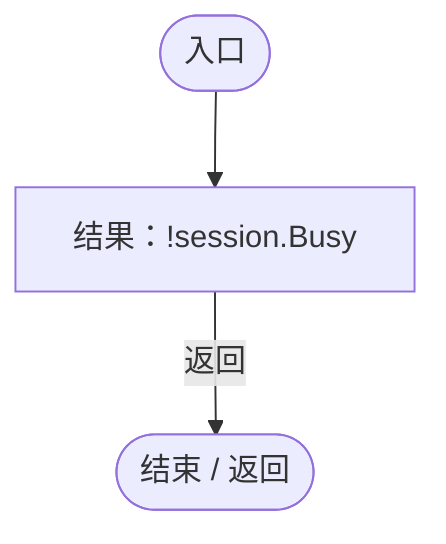

项目内调用/回调引用：

- [WorldSessionManager.Busy.get · L24](08741c7b7b9d9344.md#m4483e2e4f28f7c85)（访问器）

## 回调@54 · L54

`v … => 回调`

### Editor · Roslyn编译器控制流

## 回调@69 · L69

`v … => 回调`

### Editor · Roslyn编译器控制流

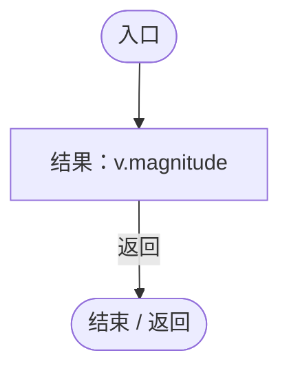

## 回调@74 · L74

`( … => 回调`

### Editor · Roslyn编译器控制流

项目内调用/回调引用：

- [WorldSessionManager.Busy.get · L24](08741c7b7b9d9344.md#m4483e2e4f28f7c85)（访问器）
