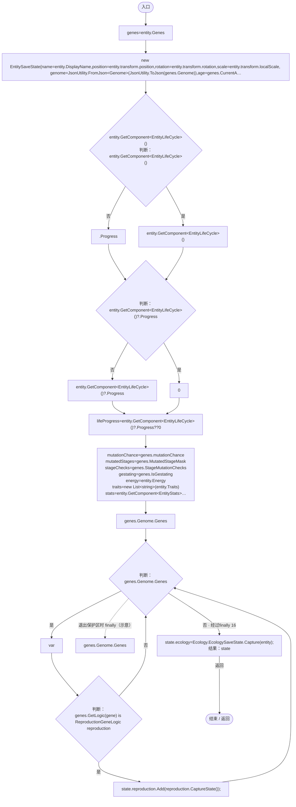
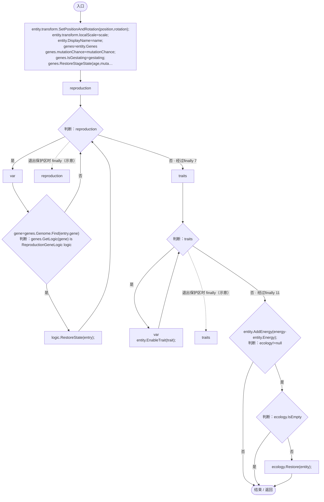

# EntitySaveState.cs

[返回总索引](../README.md) · `Runtime` · `Assets/DarwinPark/Entities/EntitySaveState.cs`

[源文件](../../../Assets/DarwinPark/Entities/EntitySaveState.cs) · 源码校验：`eff3b07a82ee727f6e7f7ff021dc769a74bc87f7f58171bb91542566e18c0140`

方法按源文件位置排列。事件/回调引用不表示立即执行；分支与异常说明见总索引。完整源码与可点击关系图请打开离线手册。

## Capture · L21

`public static EntitySaveState Capture(DarwinEntity entity)`

### Editor / Player · Roslyn编译器控制流

项目内调用/回调引用：

- [DarwinEntity.Genes.get · L14](70798dde169f2e8b.md#m622eb1adf401d431)（访问器）
- [EntityGeneController.CurrentAge.get · L35](7494d53178552f0e.md#mf5bc28691dd4a0f3)（访问器）
- [EntityLifeCycle.Progress.get · L10](9f4138bfbae654b7.md#m178185fd5f5a0d74)（访问器）
- [EntityGeneController.StageMutationChecks.get · L42](7494d53178552f0e.md#m7910c7079ddd1c25)（访问器）
- [EntityStats.CaptureValues · L86](75aa86a368efdf24.md#mbf54fc67f0d07a99)（方法）
- [EntityGeneController.GetLogic · L184](7494d53178552f0e.md#m4f4e58e1a4abadfc)（方法）
- [ReproductionGeneLogic.CaptureState · L33](ac319ea70bd8b723.md#mb3b414bac984dd2e)（方法）
- [EcologySaveState.Capture · L29](dd1dde4b4c192659.md#m25ad9f5dc9a5059e)（方法）

## Restore · L31

`public void Restore(DarwinEntity entity)`

### Editor / Player · Roslyn编译器控制流

项目内调用/回调引用：

- [DarwinEntity.Genes.get · L14](70798dde169f2e8b.md#m622eb1adf401d431)（访问器）
- [EntityGeneController.RestoreStageState · L45](7494d53178552f0e.md#m49489af39061f1a1)（方法）
- [EntityLifeCycle.RestoreProgress · L48](9f4138bfbae654b7.md#mfc75121476d49679)（方法）
- [EntityGeneController.Recalculate · L90](7494d53178552f0e.md#m93744c8f3039b93c)（方法）
- [EntityStats.RestoreValues · L88](75aa86a368efdf24.md#m774f994eaa3183ca)（方法）
- [Genome.Find · L11](a2ef23f865bc7ee8.md#mfd5b2c58563def29)（方法）
- [EntityGeneController.GetLogic · L184](7494d53178552f0e.md#m4f4e58e1a4abadfc)（方法）
- [ReproductionGeneLogic.RestoreState · L35](ac319ea70bd8b723.md#m2e3c6341cef3b9c0)（方法）
- [DarwinEntity.EnableTrait · L34](70798dde169f2e8b.md#meef47c363e5995a8)（方法）
- [DarwinEntity.AddEnergy · L38](70798dde169f2e8b.md#m6d61b27a87e2f477)（方法）
- [EcologySaveState.Restore · L42](dd1dde4b4c192659.md#m91672bc75a4694f7)（方法）
