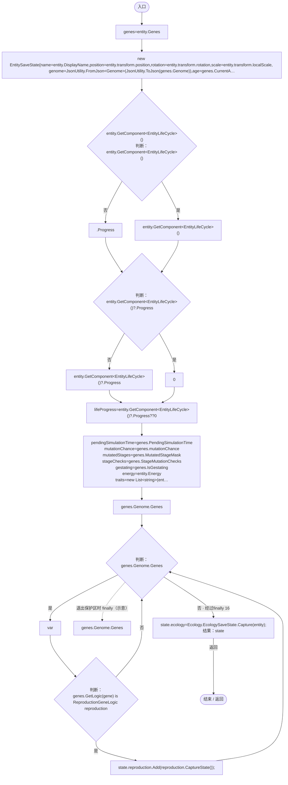
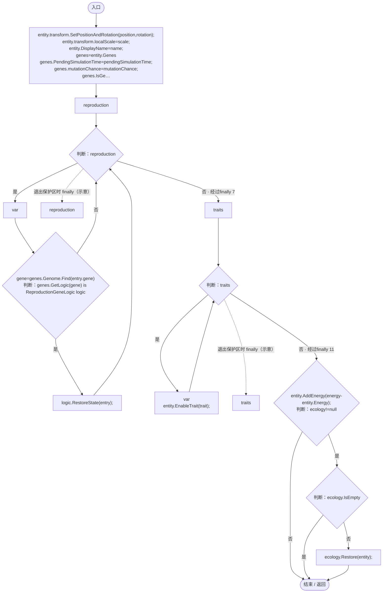

# EntitySaveState.cs

[返回总索引](../README.md) · `Runtime` · `Assets/DarwinPark/Entities/EntitySaveState.cs`

[源文件](../../../Assets/DarwinPark/Entities/EntitySaveState.cs) · 源码校验：`1b61fa482a944a2ce9a89e81979f2d5561892eb2f6738ba51aab30e42787c61d`

方法按源文件位置排列。事件/回调引用不表示立即执行；分支与异常说明见总索引。完整源码与可点击关系图请打开离线手册。

## Capture · L22

`public static EntitySaveState Capture(DarwinEntity entity)`

### Editor / Player · Roslyn编译器控制流

项目内调用/回调引用：

- [DarwinEntity.Genes.get · L14](70798dde169f2e8b.md#m622eb1adf401d431)（访问器）
- [EntityGeneController.CurrentAge.get · L39](7494d53178552f0e.md#m977f52932bb90600)（访问器）
- [EntityLifeCycle.Progress.get · L12](9f4138bfbae654b7.md#md607c90b6934f95f)（访问器）
- [EntityGeneController.StageMutationChecks.get · L55](7494d53178552f0e.md#m9446cee18889c5b7)（访问器）
- [EntityStats.CaptureValues · L89](75aa86a368efdf24.md#m0e1a770efc316d9e)（方法）
- [EntityGeneController.GetLogic · L242](7494d53178552f0e.md#m4620848081f43ecc)（方法）
- [ReproductionGeneLogic.CaptureState · L37](ac319ea70bd8b723.md#m56d6ec1f1c8b2072)（方法）
- [EcologySaveState.Capture · L32](dd1dde4b4c192659.md#m1f9170af35432684)（方法）

## Restore · L32

`public void Restore(DarwinEntity entity)`

### Editor / Player · Roslyn编译器控制流

项目内调用/回调引用：

- [DarwinEntity.Genes.get · L14](70798dde169f2e8b.md#m622eb1adf401d431)（访问器）
- [EntityGeneController.RestoreStageState · L58](7494d53178552f0e.md#m89a02f44ce209b2f)（方法）
- [EntityLifeCycle.RestoreProgress · L53](9f4138bfbae654b7.md#m9ac5190ce2d7c425)（方法）
- [EntityGeneController.Recalculate · L120](7494d53178552f0e.md#m7bf63f9a1482db3c)（方法）
- [EntityStats.RestoreValues · L91](75aa86a368efdf24.md#m7bf34e1f5b2d085a)（方法）
- [Genome.Find · L11](a2ef23f865bc7ee8.md#mfd5b2c58563def29)（方法）
- [EntityGeneController.GetLogic · L242](7494d53178552f0e.md#m4620848081f43ecc)（方法）
- [ReproductionGeneLogic.RestoreState · L39](ac319ea70bd8b723.md#m024a77bf70fc78fe)（方法）
- [DarwinEntity.EnableTrait · L34](70798dde169f2e8b.md#meef47c363e5995a8)（方法）
- [DarwinEntity.AddEnergy · L38](70798dde169f2e8b.md#m6d61b27a87e2f477)（方法）
- [EcologySaveState.Restore · L46](dd1dde4b4c192659.md#m5746348e61d36c4a)（方法）
