# GameMainMenu.cs

[返回总索引](../README.md) · `Runtime` · `Assets/DarwinPark/UI/GameMainMenu.cs`

[源文件](../../../Assets/DarwinPark/UI/GameMainMenu.cs) · 源码校验：`fd1cb80157e2a66a3465751ba37d9201cdf0c3f8193e3984144bbbe1b009f5e5`

方法按源文件位置排列。事件/回调引用不表示立即执行；分支与异常说明见总索引。完整源码与可点击关系图请打开离线手册。

<a id="mf07c61684e1c2ab7"></a>

## SettingsWindowRect.get · L29

`public Rect SettingsWindowRect`


### Editor / Player · 语法控制结构 / 声明（非CFG）

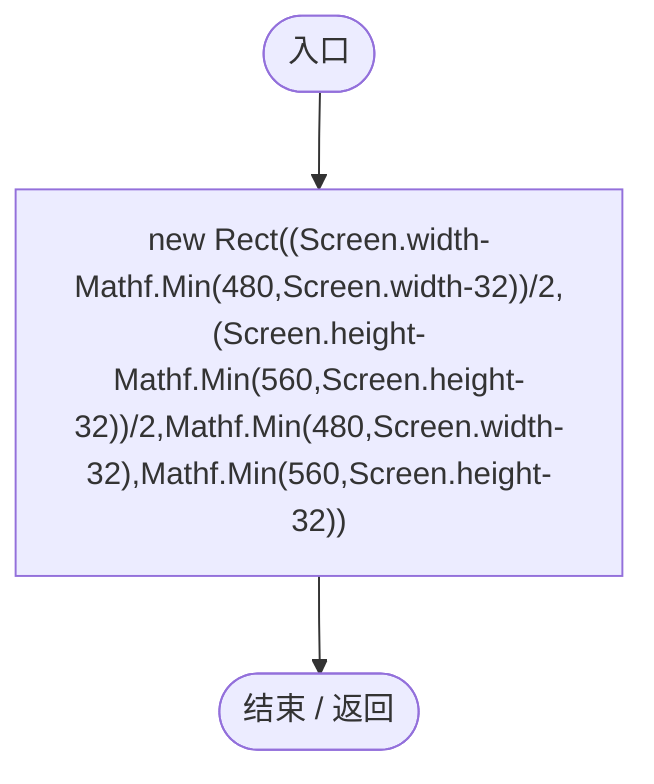

<a id="m311bda42b7bc7374"></a>

## SettingsReturnRect.get · L30

`get`


### Editor / Player · Roslyn编译器控制流

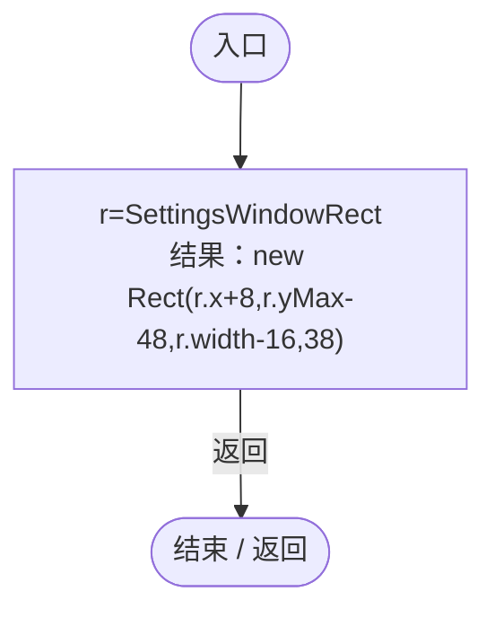

<a id="m8de468fe1cf1eadf"></a>

## Visible.get · L31

`public bool Visible`


### Editor / Player · 语法控制结构 / 声明（非CFG）

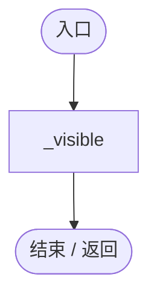

<a id="m719f1c9ef34d6498"></a>

## Awake · L33

`private void Awake()`


### Editor / Player · Roslyn编译器控制流

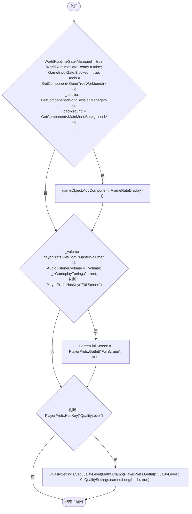

项目内调用/回调引用：

- [GameInputGate.Blocked.set · L8](52955daae7e592ab.md#m578697f6379686f4)（访问器）
- [LanSession.Ensure · L46](9fb633eebffe669c.md#med6a52ada5141c7a)（方法）
- [GameplayTuning.Current.get · L21](db546e5713b32d53.md#m1caba89e7704d239)（访问器）
- [GameMainMenu.OnWorldLoaded · L114](a1f1791f9e7a8035.md#mbda8fdeb3559be83)（方法）
- [GameMainMenu.OnLoadFailed · L115](a1f1791f9e7a8035.md#m45af314b960baf3b)（方法）

<a id="md8e75d0bde7a835d"></a>

## Start · L52

`private void Start()`


### Editor / Player · Roslyn编译器控制流

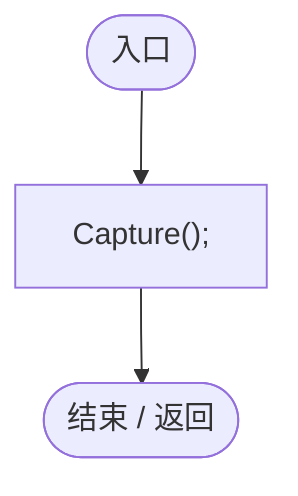

项目内调用/回调引用：

- [GameMainMenu.Capture · L53](a1f1791f9e7a8035.md#m1800bc1734437e89)（方法）

<a id="m1800bc1734437e89"></a>

## Capture · L53

`private void Capture()`


### Editor / Player · Roslyn编译器控制流

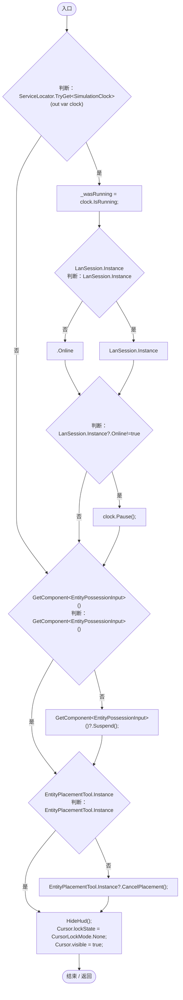

项目内调用/回调引用：

- [ServiceLocator.TryGet · L26](f2fdbe9f9ccd93cb.md#m143b24e6d58471b0)（方法）
- [SimulationClock.IsRunning.get · L22](a8f444aec9614b0a.md#m10f4fe307faca0f0)（访问器）
- [LanSession.Instance.get · L23](9fb633eebffe669c.md#mbf83306994878383)（访问器）
- [SimulationClock.Pause · L79](a8f444aec9614b0a.md#m30929d45a885d0f1)（方法）
- [EntityPossessionInput.Suspend · L98](4c12d3ae76941d37.md#m782dbd96037fc73f)（方法）
- [EntityPlacementTool.Instance.get · L13](2ca993947b0a7e7a.md#mafb26991c0dfcb86)（访问器）
- [EntityPlacementTool.CancelPlacement · L81](2ca993947b0a7e7a.md#m5a9374d2c71f0a2d)（方法）
- [GameMainMenu.HideHud · L61](a1f1791f9e7a8035.md#mec0d0fede2fa9ecd)（方法）

<a id="mec0d0fede2fa9ecd"></a>

## HideHud · L61

`private void HideHud()`


### Editor / Player · Roslyn编译器控制流

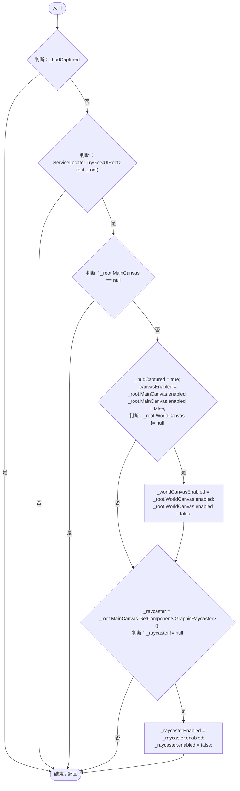

项目内调用/回调引用：

- [ServiceLocator.TryGet · L26](f2fdbe9f9ccd93cb.md#m143b24e6d58471b0)（方法）
- [UIRoot.MainCanvas.get · L14](9c1421378791f0e0.md#maa2cc9baf1248477)（访问器）
- [UIRoot.WorldCanvas.get · L15](9c1421378791f0e0.md#mf389c1a94092ec8a)（访问器）

<a id="m2e1e571798b3b8f0"></a>

## Update · L69

`private void Update()`


### Editor / Player · Roslyn编译器控制流

```mermaid
flowchart TD
  b0(["入口"])
  b1{"GameplayTuning.Poll();<br/>判断：_visible"}
  b2["HideHud();"]
  b3{"LanSession.Instance<br/>判断：LanSession.Instance"}
  b4[".Online"]
  b5["LanSession.Instance"]
  b6{"判断：LanSession.Instance?.Online!=true"}
  b7{"判断：ServiceLocator.TryGet&lt;SimulationClock&gt;(out var clock)"}
  b8{"判断：clock.IsRunning"}
  b9["clock.Pause();"]
  b10{"判断：_controls.Waiting.HasValue"}
  b11{"判断：Input.GetKeyDown(KeyCode.Escape)"}
  b12{"判断：_session.Busy"}
  b13{"判断：WorldRuntimeGate.Loading"}
  b14{"WorldGameSettingsPanel.Instance<br/>判断：WorldGameSettingsPanel.Instance"}
  b15[".Visible"]
  b16["WorldGameSettingsPanel.Instance"]
  b17{"判断：WorldGameSettingsPanel.Instance?.Visible==true"}
  b18{"PopulationWorkbench.Instance<br/>判断：PopulationWorkbench.Instance"}
  b19[".Visible"]
  b20["PopulationWorkbench.Instance"]
  b21{"判断：PopulationWorkbench.Instance?.Visible==true"}
  b22{"RandomSpawnWorkbench.Instance<br/>判断：RandomSpawnWorkbench.Instance"}
  b23[".Visible"]
  b24["RandomSpawnWorkbench.Instance"]
  b25{"判断：RandomSpawnWorkbench.Instance?.Visible==true"}
  b26{"判断：WorldRuntimeGate.Recording"}
  b27{"判断：RuntimeDropdownDismissal.CloseOpenPopups()"}
  b28["GameInputGate.ConsumeEscape();"]
  b29{"判断：_visible"}
  b30{"判断：WorldRuntimeGate.Ready"}
  b31["ShowPause();"]
  b32{"判断：_visible"}
  b33{"判断：_page == &quot;pause&quot;"}
  b34["Resume();"]
  b35{"判断：_visible"}
  b36{"判断：_page == &quot;settings&quot;"}
  b37["ReturnFromSettings();"]
  b38{"判断：_visible"}
  b39{"判断：_page == &quot;multiplayer&quot;"}
  b40{"LanSession.Instance<br/>判断：LanSession.Instance"}
  b41[".Online"]
  b42["LanSession.Instance"]
  b43{"判断：LanSession.Instance?.Online==true"}
  b44["LanSession.Instance.LeaveToMenu(&quot;已取消连接&quot;);"]
  b45{"判断：_visible"}
  b46{"判断：_page == &quot;saves&quot;"}
  b47{"判断：_page == &quot;create&quot;"}
  b48{"判断：_page == &quot;multiplayer&quot;"}
  b49["_page = &quot;main&quot;;"]
  b50["GameInputGate.ConsumeEscape();"]
  b51(["结束 / 返回"])
  b0 --> b1
  b1 -->|"是"| b2
  b1 -->|"否"| b10
  b2 --> b3
  b3 -->|"否"| b4
  b3 -->|"是"| b5
  b4 --> b6
  b5 --> b6
  b6 -->|"是"| b7
  b6 -->|"否"| b10
  b7 -->|"是"| b8
  b7 -->|"否"| b10
  b8 -->|"是"| b9
  b8 -->|"否"| b10
  b9 --> b10
  b10 -->|"否"| b11
  b10 -->|"是"| b51
  b11 -->|"是"| b12
  b11 -->|"否"| b51
  b12 -->|"否"| b13
  b12 -->|"是"| b51
  b13 -->|"否"| b14
  b13 -->|"是"| b51
  b14 -->|"否"| b15
  b14 -->|"是"| b16
  b15 --> b17
  b16 --> b17
  b17 -->|"否"| b18
  b17 -->|"是"| b51
  b18 -->|"否"| b19
  b18 -->|"是"| b20
  b19 --> b21
  b20 --> b21
  b21 -->|"否"| b22
  b21 -->|"是"| b51
  b22 -->|"否"| b23
  b22 -->|"是"| b24
  b23 --> b25
  b24 --> b25
  b25 -->|"否"| b26
  b25 -->|"是"| b51
  b26 -->|"是"| b51
  b26 -->|"否"| b27
  b27 -->|"是"| b28
  b27 -->|"否"| b29
  b28 --> b51
  b29 -->|"否"| b30
  b29 -->|"是"| b32
  b30 -->|"是"| b31
  b30 -->|"否"| b32
  b31 --> b50
  b32 -->|"是"| b33
  b32 -->|"否"| b35
  b33 -->|"是"| b34
  b33 -->|"否"| b35
  b34 --> b50
  b35 -->|"是"| b36
  b35 -->|"否"| b38
  b36 -->|"是"| b37
  b36 -->|"否"| b38
  b37 --> b50
  b38 -->|"是"| b39
  b38 -->|"否"| b45
  b39 -->|"是"| b40
  b39 -->|"否"| b45
  b40 -->|"否"| b41
  b40 -->|"是"| b42
  b41 --> b43
  b42 --> b43
  b43 -->|"是"| b44
  b43 -->|"否"| b45
  b44 --> b50
  b45 -->|"是"| b46
  b45 -->|"否"| b50
  b46 -->|"否"| b47
  b46 -->|"是"| b49
  b47 -->|"否"| b48
  b47 -->|"是"| b49
  b48 -->|"是"| b49
  b48 -->|"否"| b50
  b49 --> b50
  b50 --> b51

```

项目内调用/回调引用：

- [GameplayTuning.Poll · L43](db546e5713b32d53.md#mc1fb9e9bfba9d03c)（方法）
- [GameMainMenu.HideHud · L61](a1f1791f9e7a8035.md#mec0d0fede2fa9ecd)（方法）
- [LanSession.Instance.get · L23](9fb633eebffe669c.md#mbf83306994878383)（访问器）
- [ServiceLocator.TryGet · L26](f2fdbe9f9ccd93cb.md#m143b24e6d58471b0)（方法）
- [SimulationClock.IsRunning.get · L22](a8f444aec9614b0a.md#m10f4fe307faca0f0)（访问器）
- [SimulationClock.Pause · L79](a8f444aec9614b0a.md#m30929d45a885d0f1)（方法）
- [ControlSettingsPage.Waiting.get · L10](110505a600a95d59.md#m2fe9f8e5114b53d5)（访问器）
- [WorldSessionManager.Busy.get · L24](08741c7b7b9d9344.md#m4483e2e4f28f7c85)（访问器）
- [WorldGameSettingsPanel.Instance.get · L11](6df051f7f7177d08.md#mcccf01908bb54d27)（访问器）
- [PopulationWorkbench.Instance.get · L14](6ca6fcae89e529ec.md#m82395c4f7e743e70)（访问器）
- [PopulationWorkbench.Visible.get · L15](6ca6fcae89e529ec.md#mbe13c2d3e85c0b85)（访问器）
- [RandomSpawnWorkbench.Instance.get · L19](0763b7475b3c75db.md#m6f18ab57fe0cbfad)（访问器）
- [RandomSpawnWorkbench.Visible.get · L19](0763b7475b3c75db.md#mfc1adb76149ae015)（访问器）
- [RuntimeDropdownDismissal.CloseOpenPopups · L39](bab72c915cc299c5.md#m4e050bc4c4e0bef0)（方法）
- [GameInputGate.ConsumeEscape · L9](52955daae7e592ab.md#m5b050ac6f014de67)（方法）
- [GameMainMenu.ShowPause · L89](a1f1791f9e7a8035.md#m953d85f379a39458)（方法）
- [GameMainMenu.Resume · L100](a1f1791f9e7a8035.md#m61e63ba022a33302)（方法）
- [GameMainMenu.ReturnFromSettings · L94](a1f1791f9e7a8035.md#mceac32aaa83406bc)（方法）
- [LanSession.LeaveToMenu · L290](9fb633eebffe669c.md#m107974d8a60df554)（方法）

<a id="m953d85f379a39458"></a>

## ShowPause · L89

`public void ShowPause()`


### Editor / Player · Roslyn编译器控制流

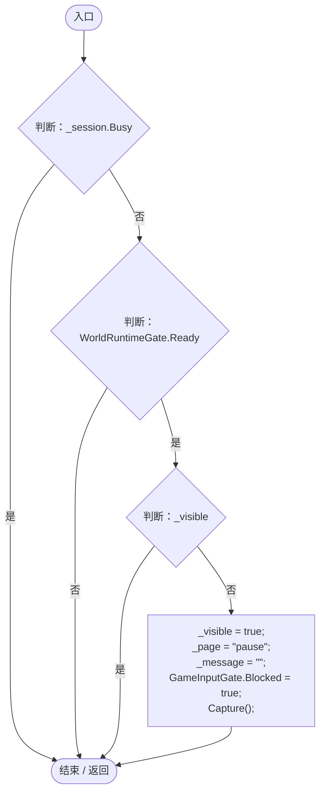

项目内调用/回调引用：

- [WorldSessionManager.Busy.get · L24](08741c7b7b9d9344.md#m4483e2e4f28f7c85)（访问器）
- [GameInputGate.Blocked.set · L8](52955daae7e592ab.md#m578697f6379686f4)（访问器）
- [GameMainMenu.Capture · L53](a1f1791f9e7a8035.md#m1800bc1734437e89)（方法）

<a id="mceac32aaa83406bc"></a>

## ReturnFromSettings · L94

`private void ReturnFromSettings()`


### Editor / Player · Roslyn编译器控制流

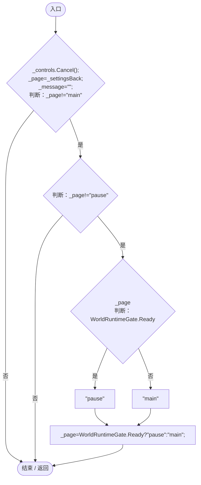

项目内调用/回调引用：

- [ControlSettingsPage.Cancel · L13](110505a600a95d59.md#mffa6612111e4cbb5)（方法）

<a id="m61e63ba022a33302"></a>

## Resume · L100

`private void Resume()`


### Editor / Player · Roslyn编译器控制流

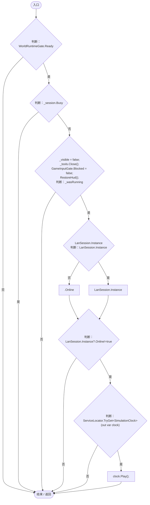

项目内调用/回调引用：

- [WorldSessionManager.Busy.get · L24](08741c7b7b9d9344.md#m4483e2e4f28f7c85)（访问器）
- [GeneTreeWorkbench.Close · L42](7b98ef3da23a85cb.md#m371900e9a4a2fe4c)（方法）
- [GameInputGate.Blocked.set · L8](52955daae7e592ab.md#m578697f6379686f4)（访问器）
- [GameMainMenu.RestoreHud · L107](a1f1791f9e7a8035.md#m1cbbd9835c62c1a6)（方法）
- [LanSession.Instance.get · L23](9fb633eebffe669c.md#mbf83306994878383)（访问器）
- [ServiceLocator.TryGet · L26](f2fdbe9f9ccd93cb.md#m143b24e6d58471b0)（方法）
- [SimulationClock.Play · L78](a8f444aec9614b0a.md#m7aa9e64b7de60ed0)（方法）

<a id="m1cbbd9835c62c1a6"></a>

## RestoreHud · L107

`private void RestoreHud()`


### Editor / Player · Roslyn编译器控制流

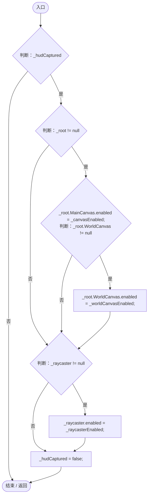

项目内调用/回调引用：

- [UIRoot.MainCanvas.get · L14](9c1421378791f0e0.md#maa2cc9baf1248477)（访问器）
- [UIRoot.WorldCanvas.get · L15](9c1421378791f0e0.md#mf389c1a94092ec8a)（访问器）

<a id="mbda8fdeb3559be83"></a>

## OnWorldLoaded · L114

`private void OnWorldLoaded()`


### Editor / Player · Roslyn编译器控制流

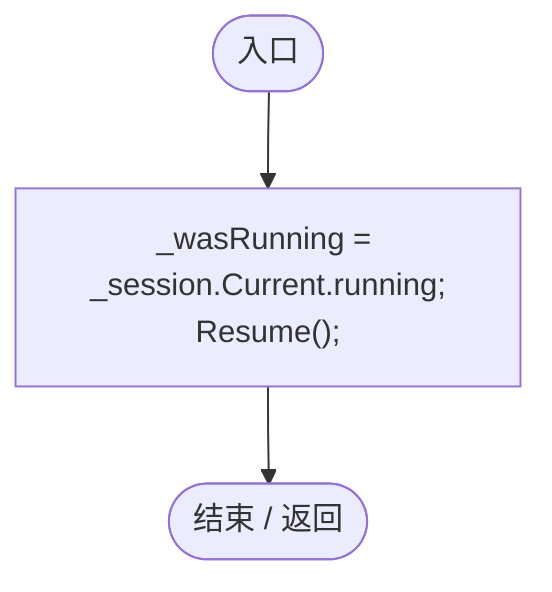

项目内调用/回调引用：

- [WorldSessionManager.Current.get · L21](08741c7b7b9d9344.md#m5d26a5eb846a8504)（访问器）
- [GameMainMenu.Resume · L100](a1f1791f9e7a8035.md#m61e63ba022a33302)（方法）

<a id="m45af314b960baf3b"></a>

## OnLoadFailed · L115

`private void OnLoadFailed(string error)`


### Editor / Player · Roslyn编译器控制流

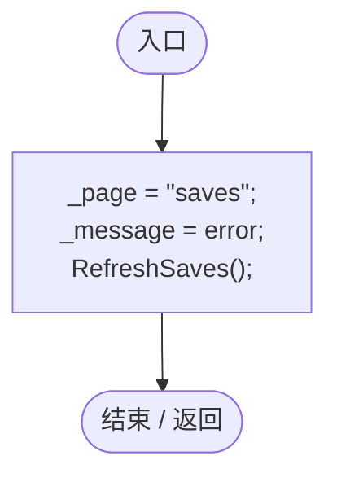

项目内调用/回调引用：

- [GameMainMenu.RefreshSaves · L116](a1f1791f9e7a8035.md#mbe5edac1353df72e)（方法）

<a id="mbe5edac1353df72e"></a>

## RefreshSaves · L116

`private void RefreshSaves()`


### Editor / Player · Roslyn编译器控制流

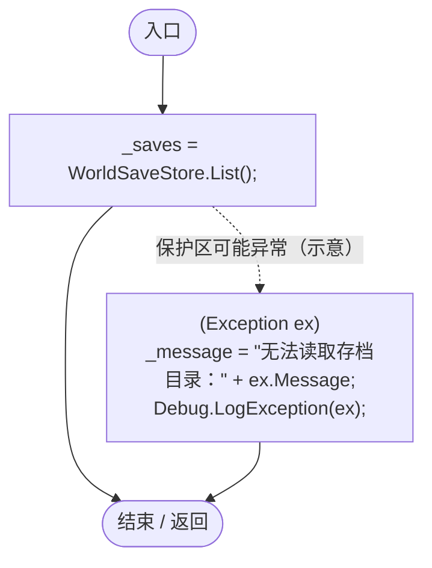

项目内调用/回调引用：

- [WorldSaveStore.List · L54](d67a35e5e3814c15.md#m1c2d4247dd7a0827)（方法）

<a id="m13e606937bdc258e"></a>

## NewWorldForm · L121

`private void NewWorldForm()`


### Editor / Player · Roslyn编译器控制流

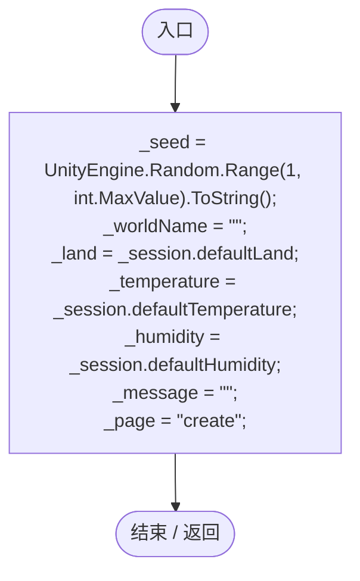

<a id="m218c266a27f732e1"></a>

## TryStart · L127

`private void TryStart(Action action)`


### Editor / Player · Roslyn编译器控制流

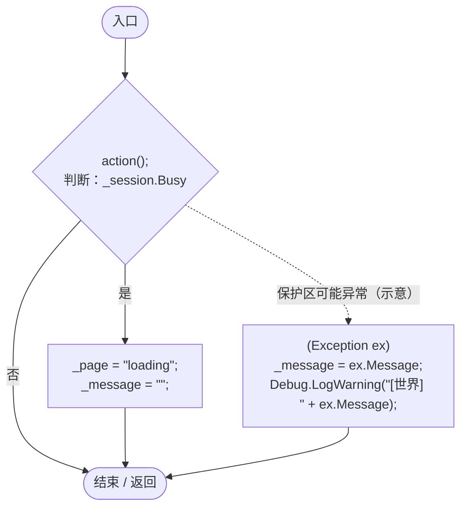

项目内调用/回调引用：

- [WorldSessionManager.Busy.get · L24](08741c7b7b9d9344.md#m4483e2e4f28f7c85)（访问器）

<a id="m605b7ef4caeed389"></a>

## OnGUI · L132

`private void OnGUI()`


### Editor / Player · Roslyn编译器控制流

```mermaid
flowchart TD
  b0(["入口"])
  b1{"判断：WorldRuntimeGate.Recording"}
  b2{"判断：_visible"}
  b3{"判断：_page==&quot;settings&quot;"}
  b4["_controls.HandleEvent(Event.current);"]
  b5["_controls.Cancel();"]
  b6["GUI.depth = -1000;<br/>RuntimeMenuTheme.Apply();"]
  b7{"判断：_session.Current != null"}
  b8["WorldRuntimeGate.Ready"]
  b9["_session.Current != null"]
  b10["inGame = _session.Current != null &amp;&amp; WorldRuntimeGate.Ready"]
  b11{"判断：inGame"}
  b12["_background.Draw(new Rect(0, 0, Screen.width, Screen.height));"]
  b13{"GUI.color<br/>.025f<br/>.04f<br/>.065f<br/>判断：inGame"}
  b14[".62f"]
  b15[".12f"]
  b16["GUI.color = new Color(.025f, .04f, .065f, inGame ? .62f : .12f);"]
  b17{"GUI.DrawTexture(new Rect(0, 0, Screen.width, Screen.height), Texture2D.whiteTexture);<br/>GUI.color = Color.white;<br/>判断：_page==&quot;settings&quot;"}
  b18["DrawSettingsWindow();"]
  b19{"判断：_page == &quot;tools&quot;"}
  b20["_tools.Draw(new Rect(10, 10, Screen.width - 20, Screen.height - 20), () =&gt; { _tools.Close(); _page = &quot;main&quot;; });"]
  b21{"判断：_page == &quot;saves&quot;"}
  b22["650"]
  b23{"判断：_page == &quot;main&quot;"}
  b24["320"]
  b25["480"]
  b26["width = Mathf.Min(_page == &quot;saves&quot; ? 650 : _page == &quot;main&quot; ? 320 : 480, Screen.width - 32)"]
  b27{"判断：_page == &quot;create&quot;"}
  b28{"判断：_page == &quot;saves&quot;"}
  b29["680"]
  b30["560"]
  b31["height = Mathf.Min(_page == &quot;create&quot; &#124;&#124; _page == &quot;saves&quot; ? 680 : 560, Screen.height - 32)"]
  b32{"判断：_page == &quot;main&quot;"}
  b33{"判断：Screen.width &gt;= 900"}
  b34["Screen.width * .06f"]
  b35["(Screen.width - width) / 2"]
  b36["left = _page == &quot;main&quot; &amp;&amp; Screen.width &gt;= 900 ? Screen.width * .06f : (Screen.width - width) / 2"]
  b37{"new Rect(left, (Screen.height - height) / 2, width, height)<br/>判断：_page==&quot;main&quot;"}
  b38["GUIStyle.none"]
  b39["GUI.skin.box"]
  b40["GUILayout.BeginArea(new Rect(left, (Screen.height - height) / 2, width, height), _page==&quot;main&quot;?GUIStyle.none:GUI.skin.box);"]
  b41{"_scroll = GUILayout.BeginScrollView(_scroll);<br/>GUILayout.Space(18);<br/>DrawPageHeading();<br/>GUILayout.Space(22);<br/>判断：_page == &quot;loading&quot;"}
  b42{"判断：_session.Busy"}
  b43["DrawLoading();"]
  b44{"判断：_page == &quot;main&quot;"}
  b45{"判断：RuntimeMenuTheme.MenuButton(&quot;单人游戏 · 存档&quot;,&quot;play&quot;,true)"}
  b46["RefreshSaves();<br/>_page = &quot;saves&quot;;<br/>_message = &quot;&quot;;"]
  b47{"判断：RuntimeMenuTheme.MenuButton(&quot;多人游戏&quot;,&quot;people&quot;)"}
  b48["_page = &quot;multiplayer&quot;;"]
  b49{"判断：RuntimeMenuTheme.MenuButton(&quot;工具 · 基因树编辑器&quot;,&quot;dna&quot;)"}
  b50{"_tools.Open();<br/>判断：_tools.Visible"}
  b51["_page = &quot;tools&quot;;"]
  b52["_message = &quot;基因配置加载失败，请检查 Console&quot;;"]
  b53{"判断：RuntimeMenuTheme.MenuButton(&quot;设置&quot;,&quot;gear&quot;)"}
  b54["_settingsBack = &quot;main&quot;;<br/>_page = &quot;settings&quot;;"]
  b55{"判断：RuntimeMenuTheme.MenuButton(&quot;退出游戏&quot;,&quot;exit&quot;)"}
  b56["Quit();"]
  b57{"判断：_page == &quot;saves&quot;"}
  b58["DrawSaves();"]
  b59{"判断：_page == &quot;create&quot;"}
  b60["DrawCreate();"]
  b61{"判断：_page == &quot;pause&quot;"}
  b62["_session.Current.name<br/>new GUIStyle(RuntimeMenuTheme.Muted) { alignment = TextAnchor.MiddleCenter }<br/>alignment = TextAnchor.MiddleCenter<br/>GUILayout.Label(_session.Current.name, new GUIStyle(RuntimeMenuTheme.Muted) { alignment = TextAnchor.M…"]
  b63{"判断：RuntimeMenuTheme.Button(&quot;返回游戏&quot;,&quot;play&quot;,true,50)"}
  b64["Resume();"]
  b65{"判断：RuntimeMenuTheme.Button(&quot;设置&quot;,&quot;gear&quot;,false,50)"}
  b66["_settingsBack = &quot;pause&quot;;<br/>_page = &quot;settings&quot;;"]
  b67["GetComponent&lt;LanLobbyUI&gt;().DrawPause();"]
  b68{"LanSession.Instance<br/>判断：LanSession.Instance"}
  b69[".IsClient"]
  b70["LanSession.Instance"]
  b71{"判断：LanSession.Instance?.IsClient==true"}
  b72["&quot;离开联机并返回主界面&quot;"]
  b73["&quot;保存并返回主界面&quot;"]
  b74{"判断：RuntimeMenuTheme.Button(LanSession.Instance?.IsClient==true?&quot;离开联机并返回主界面&quot;:&quot;保存并返回主界面&quot;,&quot;home&quot;,false,50)"}
  b75["ReturnToMainMenu();"]
  b76{"判断：RuntimeMenuTheme.Button(&quot;退出游戏&quot;,null,false,50,true)"}
  b77["Quit();"]
  b78["GUILayout.Label(_session.SaveStatus);"]
  b79["&quot;Esc 返回游戏&quot;<br/>new GUIStyle(RuntimeMenuTheme.Muted){alignment=TextAnchor.MiddleCenter}<br/>alignment=TextAnchor.MiddleCenter<br/>GUILayout.Label(&quot;Esc 返回游戏&quot;,new GUIStyle(RuntimeMenuTheme.Muted){alignment=TextAnchor.MiddleCenter});"]
  b80{"判断：_page == &quot;multiplayer&quot;"}
  b81["GetComponent&lt;LanLobbyUI&gt;().DrawJoin();<br/>Back(&quot;main&quot;);"]
  b82{"判断：string.IsNullOrEmpty(_message)"}
  b83["_message<br/>new GUIStyle(GUI.skin.label) { wordWrap = true }<br/>wordWrap = true<br/>GUILayout.Label(_message, new GUIStyle(GUI.skin.label) { wordWrap = true });"]
  b84["GUILayout.EndScrollView();<br/>GUILayout.EndArea();"]
  b85(["结束 / 返回"])
  b0 --> b1
  b1 -->|"否"| b2
  b1 -->|"是"| b85
  b2 -->|"否"| b85
  b2 -->|"是"| b3
  b3 -->|"是"| b4
  b3 -->|"否"| b5
  b4 --> b6
  b5 --> b6
  b6 --> b7
  b7 -->|"是"| b8
  b7 -->|"否"| b9
  b8 --> b10
  b9 --> b10
  b10 --> b11
  b11 -->|"否"| b12
  b11 -->|"是"| b13
  b12 --> b13
  b13 -->|"是"| b14
  b13 -->|"否"| b15
  b14 --> b16
  b15 --> b16
  b16 --> b17
  b17 -->|"是"| b18
  b17 -->|"否"| b19
  b18 --> b85
  b19 -->|"是"| b20
  b19 -->|"否"| b21
  b20 --> b85
  b21 -->|"是"| b22
  b21 -->|"否"| b23
  b22 --> b26
  b23 -->|"是"| b24
  b23 -->|"否"| b25
  b24 --> b26
  b25 --> b26
  b26 --> b27
  b27 -->|"否"| b28
  b27 -->|"是"| b29
  b28 -->|"是"| b29
  b28 -->|"否"| b30
  b29 --> b31
  b30 --> b31
  b31 --> b32
  b32 -->|"是"| b33
  b32 -->|"否"| b35
  b33 -->|"是"| b34
  b33 -->|"否"| b35
  b34 --> b36
  b35 --> b36
  b36 --> b37
  b37 -->|"是"| b38
  b37 -->|"否"| b39
  b38 --> b40
  b39 --> b40
  b40 --> b41
  b41 -->|"否"| b42
  b41 -->|"是"| b43
  b42 -->|"是"| b43
  b42 -->|"否"| b44
  b43 --> b82
  b44 -->|"是"| b45
  b44 -->|"否"| b57
  b45 -->|"是"| b46
  b45 -->|"否"| b47
  b46 --> b47
  b47 -->|"是"| b48
  b47 -->|"否"| b49
  b48 --> b49
  b49 -->|"是"| b50
  b49 -->|"否"| b53
  b50 -->|"是"| b51
  b50 -->|"否"| b52
  b51 --> b53
  b52 --> b53
  b53 -->|"是"| b54
  b53 -->|"否"| b55
  b54 --> b55
  b55 -->|"是"| b56
  b55 -->|"否"| b82
  b56 --> b82
  b57 -->|"是"| b58
  b57 -->|"否"| b59
  b58 --> b82
  b59 -->|"是"| b60
  b59 -->|"否"| b61
  b60 --> b82
  b61 -->|"是"| b62
  b61 -->|"否"| b80
  b62 --> b63
  b63 -->|"是"| b64
  b63 -->|"否"| b65
  b64 --> b65
  b65 -->|"是"| b66
  b65 -->|"否"| b67
  b66 --> b67
  b67 --> b68
  b68 -->|"否"| b69
  b68 -->|"是"| b70
  b69 --> b71
  b70 --> b71
  b71 -->|"是"| b72
  b71 -->|"否"| b73
  b72 --> b74
  b73 --> b74
  b74 -->|"是"| b75
  b74 -->|"否"| b76
  b75 --> b76
  b76 -->|"是"| b77
  b76 -->|"否"| b78
  b77 --> b78
  b78 --> b79
  b79 --> b82
  b80 -->|"是"| b81
  b80 -->|"否"| b82
  b81 --> b82
  b82 -->|"否"| b83
  b82 -->|"是"| b84
  b83 --> b84
  b84 --> b85

```

项目内调用/回调引用：

- [ControlSettingsPage.HandleEvent · L15](110505a600a95d59.md#m6ee8437eb0993617)（方法）
- [ControlSettingsPage.Cancel · L13](110505a600a95d59.md#mffa6612111e4cbb5)（方法）
- [RuntimeMenuTheme.Apply · L39](b9d8455882f2a532.md#m587a63eff5a85605)（方法）
- [WorldSessionManager.Current.get · L21](08741c7b7b9d9344.md#m5d26a5eb846a8504)（访问器）
- [MainMenuBackground.Draw · L46](d7e7fc6417a3da62.md#m4ecdab27ee62d8ee)（方法）
- [GameMainMenu.DrawSettingsWindow · L236](a1f1791f9e7a8035.md#md7c4e03be4f0a350)（方法）
- [GeneTreeWorkbench.Draw · L44](7b98ef3da23a85cb.md#m770bed666a8ac2fd)（方法）
- [GameMainMenu.DrawPageHeading · L180](a1f1791f9e7a8035.md#mb01b57bc0a18ca72)（方法）
- [WorldSessionManager.Busy.get · L24](08741c7b7b9d9344.md#m4483e2e4f28f7c85)（访问器）
- [GameMainMenu.DrawLoading · L229](a1f1791f9e7a8035.md#m99c6c629e9999306)（方法）
- [RuntimeMenuTheme.MenuButton · L99](b9d8455882f2a532.md#m9465db18272cdf01)（方法）
- [GameMainMenu.RefreshSaves · L116](a1f1791f9e7a8035.md#mbe5edac1353df72e)（方法）
- [GeneTreeWorkbench.Open · L36](7b98ef3da23a85cb.md#mb56f2027c48eafaa)（方法）
- [GeneTreeWorkbench.Visible.get · L13](7b98ef3da23a85cb.md#m37844757c7380137)（访问器）
- [GameMainMenu.Quit · L294](a1f1791f9e7a8035.md#mc1ec8a369706b40b)（方法）
- [GameMainMenu.DrawSaves · L191](a1f1791f9e7a8035.md#mc4a0d8b01588f81b)（方法）
- [GameMainMenu.DrawCreate · L217](a1f1791f9e7a8035.md#mba644f4e35367871)（方法）
- [RuntimeMenuTheme.Muted.get · L13](b9d8455882f2a532.md#meeaba271eb4ad2ed)（访问器）
- [RuntimeMenuTheme.Button · L90](b9d8455882f2a532.md#mc7e1580ab0f51b0b)（方法）
- [GameMainMenu.Resume · L100](a1f1791f9e7a8035.md#m61e63ba022a33302)（方法）
- [LanLobbyUI.DrawPause · L24](8878a8bd4aace59a.md#mfc36748ccd3273fc)（方法）
- [LanSession.Instance.get · L23](9fb633eebffe669c.md#mbf83306994878383)（访问器）
- [GameMainMenu.ReturnToMainMenu · L278](a1f1791f9e7a8035.md#m1fdc747e6f1c67d2)（方法）
- [WorldSessionManager.SaveStatus.get · L25](08741c7b7b9d9344.md#m8f6ef5f347766596)（访问器）
- [LanLobbyUI.DrawJoin · L17](8878a8bd4aace59a.md#m176ae006f5009d4b)（方法）
- [GameMainMenu.Back · L276](a1f1791f9e7a8035.md#m844ba79fe7c6dcbe)（方法）
- [GameMainMenu.回调@144 · L144](a1f1791f9e7a8035.md#m43bb7da1b71a6c13)（回调/委托）

<a id="m43bb7da1b71a6c13"></a>

## 回调@144 · L144

`( … => 回调`


### Editor / Player · Roslyn编译器控制流

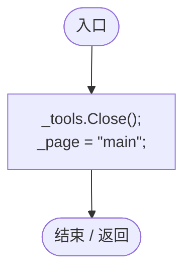

项目内调用/回调引用：

- [GeneTreeWorkbench.Close · L42](7b98ef3da23a85cb.md#m371900e9a4a2fe4c)（方法）

<a id="mb01b57bc0a18ca72"></a>

## DrawPageHeading · L180

`private void DrawPageHeading()`


### Editor / Player · Roslyn编译器控制流

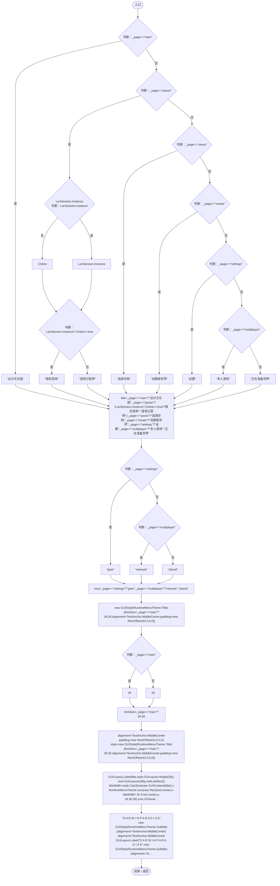

项目内调用/回调引用：

- [LanSession.Instance.get · L23](9fb633eebffe669c.md#mbf83306994878383)（访问器）
- [RuntimeMenuTheme.Title.get · L14](b9d8455882f2a532.md#m0b3a4a9f7e8e69ae)（访问器）
- [RuntimeMenuTheme.Icon · L80](b9d8455882f2a532.md#m6ea7a21a603b9da6)（方法）
- [RuntimeMenuTheme.Subtitle.get · L15](b9d8455882f2a532.md#mbece40912303446f)（访问器）

<a id="mc4a0d8b01588f81b"></a>

## DrawSaves · L191

`private void DrawSaves()`


### Editor / Player · Roslyn编译器控制流

```mermaid
flowchart TD
  b0(["入口"])
  b1{"GUILayout.Label(&quot;选择一个世界，继续演化&quot;,RuntimeMenuTheme.Muted);<br/>判断：RuntimeMenuTheme.Button(&quot;创建新世界&quot;,null,true,44)"}
  b2["NewWorldForm();"]
  b3{"判断：_saves.Count == 0"}
  b4["GUILayout.Label(&quot;还没有存档，创建一个新世界开始游戏。&quot;);"]
  b5["_saves"]
  b6{"判断：_saves"}
  b7["var"]
  b8["GUILayout.BeginVertical(GUI.skin.box);"]
  b9["entry.name<br/>new GUIStyle(GUI.skin.label){fontSize=18,fontStyle=FontStyle.Bold,padding=new RectOffset(30,0,0,0)}<br/>fontSize=18<br/>fontStyle=FontStyle.Bold<br/>padding=new RectOffset(30,0,0,0)<br/>GUILayout.Label(entry.name,new GUIStyle(GUI.skin.label){…"]
  b10{"nameRect=GUILayoutUtility.GetLastRect()<br/>RuntimeMenuTheme.Icon(new Rect(nameRect.x,nameRect.y,24,24),&quot;planet&quot;,UIVisualTheme.Accent);<br/>判断：entry.error != null"}
  b11["GUILayout.Label(&quot;无法读取：&quot; + entry.error);"]
  b12["seedText=&quot;种子 &quot;+entry.data.seed"]
  b13["new GUIStyle(RuntimeMenuTheme.Muted){padding=new RectOffset(26,0,0,0)}<br/>padding=new RectOffset(26,0,0,0)<br/>metadataStyle=new GUIStyle(RuntimeMenuTheme.Muted){padding=new RectOffset(26,0,0,0)}"]
  b14{"GUILayout.Label(seedText+&quot; 游戏时间 &quot;+TimeSpan.FromSeconds(entry.data.gameTime).ToString(@&quot;hh\:mm\:ss&quot;),metadataStyle);<br/>metadataRect=GUILayoutUtility.GetLastRect()<br/>RuntimeMenuTheme.Icon(new Rect(metadataRect.x,metadataRect.y,20,20),&quot;leaf&quot;,UI…"}
  b15["TryStart(() =&gt; _session.Open(WorldSaveStore.Read(entry.path)));"]
  b16["GUILayout.EndVertical();"]
  b17["_saves"]
  b18{"判断：RuntimeMenuTheme.Button(&quot;刷新列表&quot;,&quot;refresh&quot;,false,36)"}
  b19["RefreshSaves();"]
  b20["Back(&quot;main&quot;);"]
  b21(["结束 / 返回"])
  b0 --> b1
  b1 -->|"是"| b2
  b1 -->|"否"| b3
  b2 --> b3
  b3 -->|"是"| b4
  b3 -->|"否"| b5
  b4 --> b5
  b5 --> b6
  b6 -->|"是"| b7
  b6 -->|"否 · 经过finally 17"| b18
  b7 --> b8
  b8 --> b9
  b9 --> b10
  b10 -->|"是"| b11
  b10 -->|"否"| b12
  b11 --> b16
  b12 --> b13
  b13 --> b14
  b14 -->|"是"| b15
  b14 -->|"否"| b16
  b15 --> b16
  b16 --> b6
  b18 -->|"是"| b19
  b18 -->|"否"| b20
  b19 --> b20
  b20 --> b21
  b6 -. "退出保护区时 finally（示意）" .-> b17

```

项目内调用/回调引用：

- [RuntimeMenuTheme.Muted.get · L13](b9d8455882f2a532.md#meeaba271eb4ad2ed)（访问器）
- [RuntimeMenuTheme.Button · L90](b9d8455882f2a532.md#mc7e1580ab0f51b0b)（方法）
- [GameMainMenu.NewWorldForm · L121](a1f1791f9e7a8035.md#m13e606937bdc258e)（方法）
- [RuntimeMenuTheme.Icon · L80](b9d8455882f2a532.md#m6ea7a21a603b9da6)（方法）
- [GameMainMenu.TryStart · L127](a1f1791f9e7a8035.md#m218c266a27f732e1)（方法）
- [GameMainMenu.RefreshSaves · L116](a1f1791f9e7a8035.md#mbe5edac1353df72e)（方法）
- [GameMainMenu.Back · L276](a1f1791f9e7a8035.md#m844ba79fe7c6dcbe)（方法）
- [GameMainMenu.回调@210 · L210](a1f1791f9e7a8035.md#m3e277863acdbb4e0)（回调/委托）

<a id="m3e277863acdbb4e0"></a>

## 回调@210 · L210

`( … => 回调`


### Editor / Player · Roslyn编译器控制流

```mermaid
flowchart TD
  b0(["入口"])
  b1["_session.Open(WorldSaveStore.Read(entry.path))"]
  b2(["结束 / 返回"])
  b0 --> b1
  b1 --> b2

```

项目内调用/回调引用：

- [WorldSessionManager.Open · L58](08741c7b7b9d9344.md#m0a8e69a8a4fbc512)（方法）
- [WorldSaveStore.Read · L72](d67a35e5e3814c15.md#mca362c7675a5800c)（方法）

<a id="mba644f4e35367871"></a>

## DrawCreate · L217

`private void DrawCreate()`


### Editor / Player · Roslyn编译器控制流

```mermaid
flowchart TD
  b0(["入口"])
  b1{"GUILayout.Label(&quot;世界参数&quot;,RuntimeMenuTheme.Muted);<br/>GUILayout.Label(&quot;世界种子（整数或文字）&quot;);<br/>_seed = GUILayout.TextField(_seed, 128);<br/>判断：RuntimeMenuTheme.Button(&quot;随机种子&quot;,&quot;dice&quot;,false,32)"}
  b2["_seed = UnityEngine.Random.Range(1, int.MaxValue).ToString();"]
  b3["GUILayout.Label(&quot;世界名字（留空使用默认名字）&quot;);<br/>_worldName = GUILayout.TextField(_worldName, 128);"]
  b4["&quot;默认：&quot; + WorldSaveStore.DefaultName(WorldSaveStore.SeedFromText(_seed))<br/>new GUIStyle(GUI.skin.label) { wordWrap = true }<br/>wordWrap = true<br/>GUILayout.Label(&quot;默认：&quot; + WorldSaveStore.DefaultName(WorldSaveStore.SeedFromText(_seed)), new GUIStyle(…"]
  b5{"GUILayout.Label(&quot;陆地比例 &quot; + Mathf.RoundToInt(_land * 100) + &quot;%&quot;);<br/>_land = RuntimeMenuTheme.Slider(_land, _session.landRange.x, _session.landRange.y);<br/>GUILayout.Label(&quot;平均温度 &quot; + _temperature.ToString(&quot;F1&quot;) + &quot; °C&quot;);<br/>_temperature = RuntimeMen…"}
  b6["TryStart(() =&gt; _session.Create(_worldName, WorldSaveStore.SeedFromText(_seed), _land, _temperature, _humidity));"]
  b7["Back(&quot;saves&quot;);"]
  b8(["结束 / 返回"])
  b0 --> b1
  b1 -->|"是"| b2
  b1 -->|"否"| b3
  b2 --> b3
  b3 --> b4
  b4 --> b5
  b5 -->|"是"| b6
  b5 -->|"否"| b7
  b6 --> b7
  b7 --> b8

```

项目内调用/回调引用：

- [RuntimeMenuTheme.Muted.get · L13](b9d8455882f2a532.md#meeaba271eb4ad2ed)（访问器）
- [RuntimeMenuTheme.Button · L90](b9d8455882f2a532.md#mc7e1580ab0f51b0b)（方法）
- [WorldSaveStore.DefaultName · L40](d67a35e5e3814c15.md#m6e140cd8b98a845d)（方法）
- [WorldSaveStore.SeedFromText · L42](d67a35e5e3814c15.md#mb9cb09992ef718a3)（方法）
- [RuntimeMenuTheme.Slider · L115](b9d8455882f2a532.md#mbc2a4caeeee89962)（方法）
- [GameMainMenu.TryStart · L127](a1f1791f9e7a8035.md#m218c266a27f732e1)（方法）
- [GameMainMenu.Back · L276](a1f1791f9e7a8035.md#m844ba79fe7c6dcbe)（方法）
- [GameMainMenu.回调@226 · L226](a1f1791f9e7a8035.md#m5f00ef390bca4122)（回调/委托）

<a id="m5f00ef390bca4122"></a>

## 回调@226 · L226

`( … => 回调`


### Editor / Player · Roslyn编译器控制流

```mermaid
flowchart TD
  b0(["入口"])
  b1["_session.Create(_worldName, WorldSaveStore.SeedFromText(_seed), _land, _temperature, _humidity)"]
  b2(["结束 / 返回"])
  b0 --> b1
  b1 --> b2

```

项目内调用/回调引用：

- [WorldSessionManager.Create · L41](08741c7b7b9d9344.md#m6aadfeee8b90aacd)（方法）
- [WorldSaveStore.SeedFromText · L42](d67a35e5e3814c15.md#mb9cb09992ef718a3)（方法）

<a id="m99c6c629e9999306"></a>

## DrawLoading · L229

`private void DrawLoading()`


### Editor / Player · Roslyn编译器控制流

```mermaid
flowchart TD
  b0(["入口"])
  b1["WorldLoadingView.Draw(_session.Status,_session.Progress);"]
  b2{"LanSession.Instance<br/>判断：LanSession.Instance"}
  b3[".IsClient"]
  b4["LanSession.Instance"]
  b5{"判断：LanSession.Instance?.IsClient==true"}
  b6{"判断：RuntimeMenuTheme.Button(&quot;取消加入&quot;,null,false,38)"}
  b7["LanSession.Instance.LeaveToMenu(&quot;已取消加入&quot;);"]
  b8(["结束 / 返回"])
  b0 --> b1
  b1 --> b2
  b2 -->|"否"| b3
  b2 -->|"是"| b4
  b3 --> b5
  b4 --> b5
  b5 -->|"是"| b6
  b5 -->|"否"| b8
  b6 -->|"是"| b7
  b6 -->|"否"| b8
  b7 --> b8

```

项目内调用/回调引用：

- [WorldLoadingView.Draw · L9](4db2e9fa805980b7.md#m78c78e77f9d1d246)（方法）
- [WorldSessionManager.Status.get · L23](08741c7b7b9d9344.md#mc9040fb24bb00a63)（访问器）
- [WorldSessionManager.Progress.get · L22](08741c7b7b9d9344.md#mba9a7bc60b0d1863)（访问器）
- [LanSession.Instance.get · L23](9fb633eebffe669c.md#mbf83306994878383)（访问器）
- [RuntimeMenuTheme.Button · L90](b9d8455882f2a532.md#mc7e1580ab0f51b0b)（方法）
- [LanSession.LeaveToMenu · L290](9fb633eebffe669c.md#m107974d8a60df554)（方法）

<a id="md7c4e03be4f0a350"></a>

## DrawSettingsWindow · L236

`private void DrawSettingsWindow()`


### Editor / Player · Roslyn编译器控制流

```mermaid
flowchart TD
  b0(["入口"])
  b1["rect=SettingsWindowRect<br/>GUI.Box(rect,GUIContent.none);<br/>GUILayout.BeginArea(new Rect(rect.x+8,rect.y+18,rect.width-16,86));<br/>DrawPageHeading();<br/>GUILayout.EndArea();<br/>navWidth=Mathf.Min(104,rect.width*.25f)<br/>bodyHeight=Mathf.Max(100,rect.heig…"]
  b2["i=0"]
  b3{"判断：i&lt;tabs.Length"}
  b4{"tabs[i]<br/>判断：i==_settingsTab"}
  b5["RuntimeMenuTheme.Primary"]
  b6["GUI.skin.button"]
  b7{"判断：GUILayout.Button(tabs[i],i==_settingsTab?RuntimeMenuTheme.Primary:GUI.skin.button,GUILayout.Height(36))"}
  b8["_settingsTab=i;<br/>_settingsScroll=Vector2.zero;<br/>_controls.Cancel();"]
  b9["i++"]
  b10{"GUILayout.EndArea();<br/>GUILayout.BeginArea(new Rect(rect.x+navWidth+18,rect.y+112,rect.width-navWidth-26,bodyHeight));<br/>_settingsScroll=GUILayout.BeginScrollView(_settingsScroll);<br/>判断：_settingsTab==1"}
  b11["_controls.Draw();"]
  b12{"判断：_settingsTab==0"}
  b13["DrawDisplaySettings();"]
  b14["DrawDiagnosticSettings();"]
  b15{"判断：string.IsNullOrEmpty(_message)"}
  b16["_message<br/>new GUIStyle(GUI.skin.label){wordWrap=true}<br/>wordWrap=true<br/>GUILayout.Label(_message,new GUIStyle(GUI.skin.label){wordWrap=true});"]
  b17{"GUILayout.EndScrollView();<br/>GUILayout.EndArea();<br/>判断：GUI.Button(SettingsReturnRect,&quot;← 返回&quot;,GUI.skin.button)"}
  b18["ReturnFromSettings();"]
  b19(["结束 / 返回"])
  b0 --> b1
  b1 --> b2
  b2 --> b3
  b3 -->|"是"| b4
  b3 -->|"否"| b10
  b4 -->|"是"| b5
  b4 -->|"否"| b6
  b5 --> b7
  b6 --> b7
  b7 -->|"是"| b8
  b7 -->|"否"| b9
  b8 --> b9
  b9 --> b3
  b10 -->|"是"| b11
  b10 -->|"否"| b12
  b11 --> b15
  b12 -->|"是"| b13
  b12 -->|"否"| b14
  b13 --> b15
  b14 --> b15
  b15 -->|"否"| b16
  b15 -->|"是"| b17
  b16 --> b17
  b17 -->|"是"| b18
  b17 -->|"否"| b19
  b18 --> b19

```

项目内调用/回调引用：

- [GameMainMenu.DrawPageHeading · L180](a1f1791f9e7a8035.md#mb01b57bc0a18ca72)（方法）
- [RuntimeMenuTheme.Primary.get · L10](b9d8455882f2a532.md#med9b3baaef6ef78a)（访问器）
- [ControlSettingsPage.Cancel · L13](110505a600a95d59.md#mffa6612111e4cbb5)（方法）
- [ControlSettingsPage.Draw · L26](110505a600a95d59.md#m14996c10915bb285)（方法）
- [GameMainMenu.DrawDisplaySettings · L252](a1f1791f9e7a8035.md#mf76537d435bb5a69)（方法）
- [GameMainMenu.DrawDiagnosticSettings · L265](a1f1791f9e7a8035.md#m5bed4dd2cb412fd1)（方法）
- [GameMainMenu.SettingsReturnRect.get · L30](a1f1791f9e7a8035.md#m311bda42b7bc7374)（访问器）
- [GameMainMenu.ReturnFromSettings · L94](a1f1791f9e7a8035.md#mceac32aaa83406bc)（方法）

<a id="mf76537d435bb5a69"></a>

## DrawDisplaySettings · L252

`private void DrawDisplaySettings()`


### Editor / Player · Roslyn编译器控制流

```mermaid
flowchart TD
  b0(["入口"])
  b1["GUILayout.Label(&quot;主音量 &quot; + Mathf.RoundToInt(_volume * 100) + &quot;%&quot;);<br/>_volume = RuntimeMenuTheme.Slider(_volume, 0, 1);<br/>AudioListener.volume = _volume;<br/>GUILayout.BeginHorizontal();<br/>GUILayout.Label(&quot;全屏显示&quot;);<br/>GUILayout.FlexibleSpace();<br/>full=Scre…"]
  b2{"判断：full"}
  b3["&quot;● 开&quot;"]
  b4["&quot;○ 关&quot;"]
  b5{"判断：full"}
  b6["RuntimeMenuTheme.Primary"]
  b7["GUI.skin.button"]
  b8{"判断：GUILayout.Button(full?&quot;● 开&quot;:&quot;○ 关&quot;,full?RuntimeMenuTheme.Primary:GUI.skin.button,GUILayout.Width(80),GUILayout.Height(30))"}
  b9["full=!full;"]
  b10{"GUILayout.EndHorizontal();<br/>判断：full != Screen.fullScreen"}
  b11["Screen.fullScreen = full;"]
  b12["GUILayout.Label(&quot;画质&quot;);<br/>names = QualitySettings.names<br/>quality=QualitySettings.GetQualityLevel()<br/>GUILayout.BeginHorizontal();"]
  b13["i=0"]
  b14{"判断：i&lt;names.Length"}
  b15{"names[i]<br/>判断：i==quality"}
  b16["RuntimeMenuTheme.Primary"]
  b17["GUI.skin.button"]
  b18{"判断：GUILayout.Button(names[i],i==quality?RuntimeMenuTheme.Primary:GUI.skin.button,GUILayout.Height(36))"}
  b19["quality=i;"]
  b20["i++"]
  b21{"GUILayout.EndHorizontal();<br/>判断：quality != QualitySettings.GetQualityLevel()"}
  b22["QualitySettings.SetQualityLevel(quality, true);"]
  b23{"判断：RuntimeMenuTheme.Button(&quot;保存设置&quot;,&quot;save&quot;,true,40)"}
  b24["PlayerPrefs.SetFloat(&quot;MasterVolume&quot;, _volume);"]
  b25{"&quot;FullScreen&quot;<br/>判断：Screen.fullScreen"}
  b26["1"]
  b27["0"]
  b28["PlayerPrefs.SetInt(&quot;FullScreen&quot;, Screen.fullScreen ? 1 : 0);"]
  b29["PlayerPrefs.SetInt(&quot;QualityLevel&quot;, QualitySettings.GetQualityLevel());<br/>PlayerPrefs.Save();<br/>_message = &quot;设置已保存&quot;;"]
  b30["&quot;游戏数值配置：&quot;+GameplayTuning.FilePath<br/>new GUIStyle(RuntimeMenuTheme.Muted){wordWrap=true}<br/>wordWrap=true<br/>GUILayout.Label(&quot;游戏数值配置：&quot;+GameplayTuning.FilePath,new GUIStyle(RuntimeMenuTheme.Muted){wordWrap=true});"]
  b31{"判断：RuntimeMenuTheme.Button(&quot;重新载入数值配置&quot;,null,false,32)"}
  b32["GameplayTuning.Reload();<br/>_message=&quot;已载入有效配置；外部修改也会自动生效&quot;;"]
  b33(["结束 / 返回"])
  b0 --> b1
  b1 --> b2
  b2 -->|"是"| b3
  b2 -->|"否"| b4
  b3 --> b5
  b4 --> b5
  b5 -->|"是"| b6
  b5 -->|"否"| b7
  b6 --> b8
  b7 --> b8
  b8 -->|"是"| b9
  b8 -->|"否"| b10
  b9 --> b10
  b10 -->|"是"| b11
  b10 -->|"否"| b12
  b11 --> b12
  b12 --> b13
  b13 --> b14
  b14 -->|"是"| b15
  b14 -->|"否"| b21
  b15 -->|"是"| b16
  b15 -->|"否"| b17
  b16 --> b18
  b17 --> b18
  b18 -->|"是"| b19
  b18 -->|"否"| b20
  b19 --> b20
  b20 --> b14
  b21 -->|"是"| b22
  b21 -->|"否"| b23
  b22 --> b23
  b23 -->|"是"| b24
  b23 -->|"否"| b30
  b24 --> b25
  b25 -->|"是"| b26
  b25 -->|"否"| b27
  b26 --> b28
  b27 --> b28
  b28 --> b29
  b29 --> b30
  b30 --> b31
  b31 -->|"是"| b32
  b31 -->|"否"| b33
  b32 --> b33

```

项目内调用/回调引用：

- [RuntimeMenuTheme.Slider · L115](b9d8455882f2a532.md#mbc2a4caeeee89962)（方法）
- [RuntimeMenuTheme.Primary.get · L10](b9d8455882f2a532.md#med9b3baaef6ef78a)（访问器）
- [RuntimeMenuTheme.Button · L90](b9d8455882f2a532.md#mc7e1580ab0f51b0b)（方法）
- [RuntimeMenuTheme.Muted.get · L13](b9d8455882f2a532.md#meeaba271eb4ad2ed)（访问器）
- [GameplayTuning.Reload · L31](db546e5713b32d53.md#m10cbcd3bcb0856d1)（方法）

<a id="m5bed4dd2cb412fd1"></a>

## DrawDiagnosticSettings · L265

`private void DrawDiagnosticSettings()`


### Editor / Player · Roslyn编译器控制流

```mermaid
flowchart TD
  b0(["入口"])
  b1{"判断：string.IsNullOrEmpty(RuntimeFileLog.DirectoryPath)"}
  b2["&quot;日志目录：&quot;+RuntimeFileLog.DirectoryPath<br/>new GUIStyle(RuntimeMenuTheme.Muted){wordWrap=true}<br/>wordWrap=true<br/>GUILayout.Label(&quot;日志目录：&quot;+RuntimeFileLog.DirectoryPath,new GUIStyle(RuntimeMenuTheme.Muted){wordWrap=true});"]
  b3{"判断：RuntimeMenuTheme.Button(&quot;打开日志文件夹&quot;,null,false,36)"}
  b4["RuntimeFileLog.OpenDirectory();"]
  b5["RuntimeDiagnosticsUI.Draw();"]
  b6(["结束 / 返回"])
  b0 --> b1
  b1 -->|"否"| b2
  b1 -->|"是"| b5
  b2 --> b3
  b3 -->|"是"| b4
  b3 -->|"否"| b5
  b4 --> b5
  b5 --> b6

```

项目内调用/回调引用：

- [RuntimeMenuTheme.Muted.get · L13](b9d8455882f2a532.md#meeaba271eb4ad2ed)（访问器）
- [RuntimeMenuTheme.Button · L90](b9d8455882f2a532.md#mc7e1580ab0f51b0b)（方法）
- [RuntimeFileLog.OpenDirectory · L58](8080b38a7e1c5585.md#mc6222e29ecbb388e)（方法）
- [RuntimeDiagnosticsUI.Draw · L12](cb25084667099cf5.md#md9f2f1cb9c9aeb24)（方法）

<a id="m844ba79fe7c6dcbe"></a>

## Back · L276

`private void Back(string page)`


### Editor / Player · Roslyn编译器控制流

```mermaid
flowchart TD
  b0(["入口"])
  b1{"判断：RuntimeMenuTheme.Button(&quot;返回&quot;,&quot;back&quot;,false,38)"}
  b2{"判断：_page==&quot;multiplayer&quot;"}
  b3{"LanSession.Instance<br/>判断：LanSession.Instance"}
  b4[".Online"]
  b5["LanSession.Instance"]
  b6{"判断：LanSession.Instance?.Online==true"}
  b7["LanSession.Instance.LeaveToMenu(&quot;已取消连接&quot;);"]
  b8["_page = page;<br/>_message = &quot;&quot;;"]
  b9(["结束 / 返回"])
  b0 --> b1
  b1 -->|"是"| b2
  b1 -->|"否"| b9
  b2 -->|"是"| b3
  b2 -->|"否"| b8
  b3 -->|"否"| b4
  b3 -->|"是"| b5
  b4 --> b6
  b5 --> b6
  b6 -->|"是"| b7
  b6 -->|"否"| b8
  b7 --> b9
  b8 --> b9

```

项目内调用/回调引用：

- [RuntimeMenuTheme.Button · L90](b9d8455882f2a532.md#mc7e1580ab0f51b0b)（方法）
- [LanSession.Instance.get · L23](9fb633eebffe669c.md#mbf83306994878383)（访问器）
- [LanSession.LeaveToMenu · L290](9fb633eebffe669c.md#m107974d8a60df554)（方法）

<a id="m1fdc747e6f1c67d2"></a>

## ReturnToMainMenu · L278

`public void ReturnToMainMenu()`

★ 修复（防Bug回归）：暂停页原先只有退出程序，补齐保存并卸载世界的导航路径。

### Editor / Player · Roslyn编译器控制流

```mermaid
flowchart TD
  b0(["入口"])
  b1{"判断：_visible"}
  b2{"判断：_page!=&quot;pause&quot;"}
  b3{"判断：_session.Busy"}
  b4{"LanSession.Instance<br/>判断：LanSession.Instance"}
  b5[".IsClient"]
  b6["LanSession.Instance"]
  b7{"判断：LanSession.Instance?.IsClient==true"}
  b8["LanSession.Instance.LeaveToMenu();"]
  b9{"LanSession.Instance<br/>判断：LanSession.Instance"}
  b10[".IsHost"]
  b11["LanSession.Instance"]
  b12{"判断：LanSession.Instance?.IsHost==true"}
  b13["LanSession.Instance.CloseHost();"]
  b14["_session.ReturnToMenu(_wasRunning);<br/>_page=&quot;main&quot;;<br/>_settingsBack=&quot;main&quot;;<br/>_message=&quot;世界已保存&quot;;<br/>_scroll=Vector2.zero;<br/>Cursor.lockState=CursorLockMode.None;<br/>Cursor.visible=true;"]
  b15["(Exception ex)<br/>_message=&quot;保存失败，尚未返回主界面：&quot;+ex.Message;<br/>Debug.LogException(ex);"]
  b16(["结束 / 返回"])
  b0 --> b1
  b1 -->|"是"| b2
  b1 -->|"否"| b16
  b2 -->|"否"| b3
  b2 -->|"是"| b16
  b3 -->|"是"| b16
  b3 -->|"否"| b4
  b4 -->|"否"| b5
  b4 -->|"是"| b6
  b5 --> b7
  b6 --> b7
  b7 -->|"是"| b8
  b7 -->|"否"| b9
  b8 --> b16
  b9 -->|"否"| b10
  b9 -->|"是"| b11
  b10 --> b12
  b11 --> b12
  b12 -->|"是"| b13
  b12 -->|"否"| b14
  b13 --> b14
  b14 --> b16
  b15 --> b16
  b14 -. "保护区可能异常（示意）" .-> b15

```

项目内调用/回调引用：

- [WorldSessionManager.Busy.get · L24](08741c7b7b9d9344.md#m4483e2e4f28f7c85)（访问器）
- [LanSession.Instance.get · L23](9fb633eebffe669c.md#mbf83306994878383)（访问器）
- [LanSession.LeaveToMenu · L290](9fb633eebffe669c.md#m107974d8a60df554)（方法）
- [LanSession.CloseHost · L286](9fb633eebffe669c.md#m3103a146e52db72d)（方法）
- [WorldSessionManager.ReturnToMenu · L136](08741c7b7b9d9344.md#m6b1d0d11a045709c)（方法）

<a id="m5ea332104f26fa79"></a>

## ShowNetworkMain · L292

`public void ShowNetworkMain(string message)`

★ 适配：远端断线/离开只卸载副本，不显示“世界已保存”或误写管理员存档。

### Editor / Player · Roslyn编译器控制流

```mermaid
flowchart TD
  b0(["入口"])
  b1["_visible=true;<br/>_page=&quot;main&quot;;<br/>_message=message;<br/>_scroll=Vector2.zero;<br/>GameInputGate.Blocked=true;<br/>Capture();"]
  b2(["结束 / 返回"])
  b0 --> b1
  b1 --> b2

```

项目内调用/回调引用：

- [GameInputGate.Blocked.set · L8](52955daae7e592ab.md#m578697f6379686f4)（访问器）
- [GameMainMenu.Capture · L53](a1f1791f9e7a8035.md#m1800bc1734437e89)（方法）

<a id="mc1ec8a369706b40b"></a>

## Quit · L294

`private void Quit()`


### Editor · Roslyn编译器控制流

```mermaid
flowchart TD
  b0(["入口"])
  b1{"判断：_session.Current != null"}
  b2{"_session<br/>判断：_visible"}
  b3["_wasRunning"]
  b4["(bool?)null"]
  b5["_session.SaveNow(_visible ? _wasRunning : (bool?)null);"]
  b6["(Exception ex)<br/>_message = &quot;保存失败，尚未退出：&quot; + ex.Message;<br/>Debug.LogException(ex);"]
  b7["UnityEditor.EditorApplication.isPlaying = false;"]
  b8(["结束 / 返回"])
  b0 --> b1
  b1 -->|"是"| b2
  b1 -->|"否"| b7
  b2 -->|"是"| b3
  b2 -->|"否"| b4
  b3 --> b5
  b4 --> b5
  b5 --> b7
  b6 --> b8
  b7 --> b8
  b1 -. "保护区可能异常（示意）" .-> b6

```

### Player · Roslyn编译器控制流

```mermaid
flowchart TD
  b0(["入口"])
  b1{"判断：_session.Current != null"}
  b2{"_session<br/>判断：_visible"}
  b3["_wasRunning"]
  b4["(bool?)null"]
  b5["_session.SaveNow(_visible ? _wasRunning : (bool?)null);"]
  b6["(Exception ex)<br/>_message = &quot;保存失败，尚未退出：&quot; + ex.Message;<br/>Debug.LogException(ex);"]
  b7["Application.Quit();"]
  b8(["结束 / 返回"])
  b0 --> b1
  b1 -->|"是"| b2
  b1 -->|"否"| b7
  b2 -->|"是"| b3
  b2 -->|"否"| b4
  b3 --> b5
  b4 --> b5
  b5 --> b7
  b6 --> b8
  b7 --> b8
  b1 -. "保护区可能异常（示意）" .-> b6

```

项目内调用/回调引用：

- [WorldSessionManager.Current.get · L21](08741c7b7b9d9344.md#m5d26a5eb846a8504)（访问器）
- [WorldSessionManager.SaveNow · L157](08741c7b7b9d9344.md#mbecd8b5c222ba46b)（方法）

<a id="m7d193bfeb2db49f2"></a>

## OnDestroy · L305

`private void OnDestroy()`


### Editor / Player · Roslyn编译器控制流

```mermaid
flowchart TD
  b0(["入口"])
  b1{"判断：_session != null"}
  b2["_session.Loaded -= OnWorldLoaded;<br/>_session.Failed -= OnLoadFailed;"]
  b3["GameInputGate.Blocked = false;<br/>RestoreHud();"]
  b4(["结束 / 返回"])
  b0 --> b1
  b1 -->|"是"| b2
  b1 -->|"否"| b3
  b2 --> b3
  b3 --> b4

```

项目内调用/回调引用：

- [GameInputGate.Blocked.set · L8](52955daae7e592ab.md#m578697f6379686f4)（访问器）
- [GameMainMenu.RestoreHud · L107](a1f1791f9e7a8035.md#m1cbbd9835c62c1a6)（方法）
- [GameMainMenu.OnWorldLoaded · L114](a1f1791f9e7a8035.md#mbda8fdeb3559be83)（方法）
- [GameMainMenu.OnLoadFailed · L115](a1f1791f9e7a8035.md#m45af314b960baf3b)（方法）
