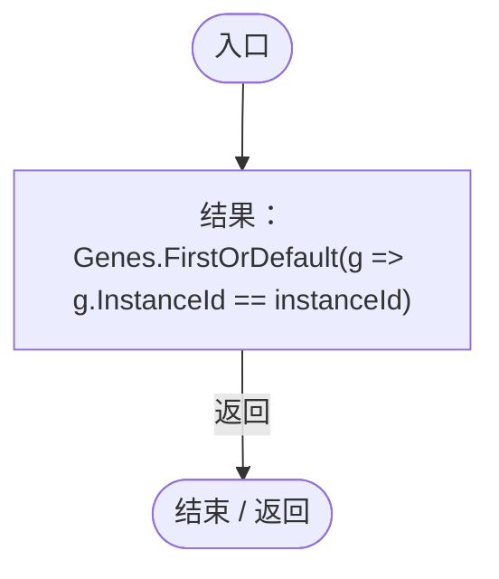
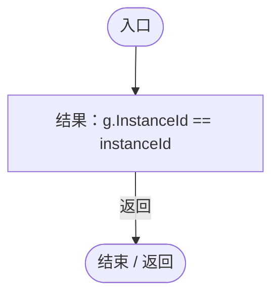
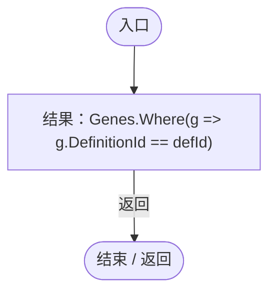
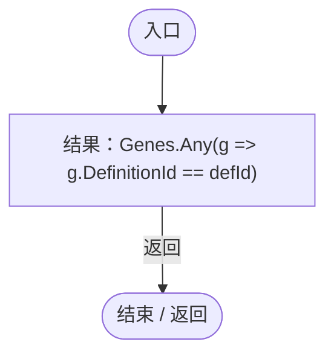
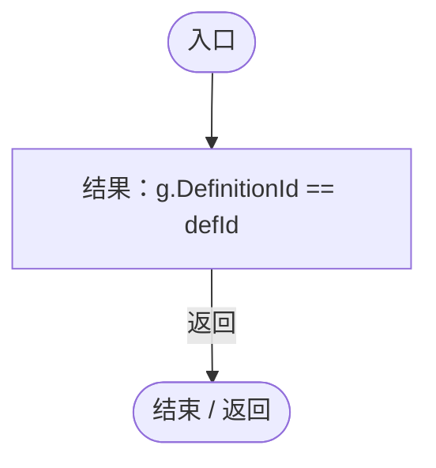
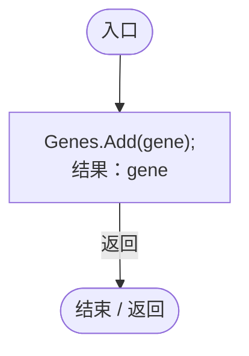
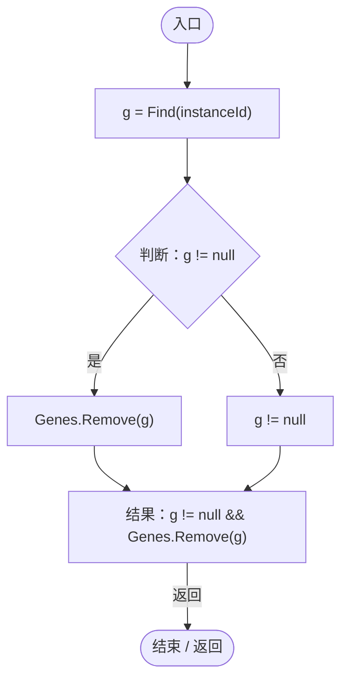

# Genome.cs

[返回总索引](../README.md) · `Runtime` · `Assets/DarwinPark/Genetics/Data/Genome.cs`

[源文件](../../../Assets/DarwinPark/Genetics/Data/Genome.cs) · 源码校验：`678ab0aa28bc040abac5c19dfe60baa5c3b2d85006730177a3fff09d84dfaf97`

方法按源文件位置排列。事件/回调引用不表示立即执行；分支与异常说明见总索引。完整源码与可点击关系图请打开离线手册。

## Find · L11

`public GeneInstance Find(string instanceId)`

### Editor / Player · Roslyn编译器控制流

项目内调用/回调引用：

- [Genome.回调@12 · L12](a2ef23f865bc7ee8.md#m80c4cd885bb6a7ce)（回调/委托）

## 回调@12 · L12

`g … => 回调`

### Editor / Player · Roslyn编译器控制流

## FindByDefinition · L14

`public IEnumerable<GeneInstance> FindByDefinition(string defId)`

### Editor / Player · Roslyn编译器控制流

项目内调用/回调引用：

- [Genome.回调@15 · L15](a2ef23f865bc7ee8.md#m764e12c17e91b2c0)（回调/委托）

## 回调@15 · L15

`g … => 回调`

### Editor / Player · Roslyn编译器控制流

## HasDefinition · L17

`public bool HasDefinition(string defId)`

### Editor / Player · Roslyn编译器控制流

项目内调用/回调引用：

- [Genome.回调@17 · L17](a2ef23f865bc7ee8.md#m2a4ee2ca7e379dd5)（回调/委托）

## 回调@17 · L17

`g … => 回调`

### Editor / Player · Roslyn编译器控制流

## Add · L19

`public GeneInstance Add(GeneInstance gene)`

### Editor / Player · Roslyn编译器控制流

## Remove · L25

`public bool Remove(string instanceId)`

### Editor / Player · Roslyn编译器控制流

项目内调用/回调引用：

- [Genome.Find · L11](a2ef23f865bc7ee8.md#mfd5b2c58563def29)（方法）
