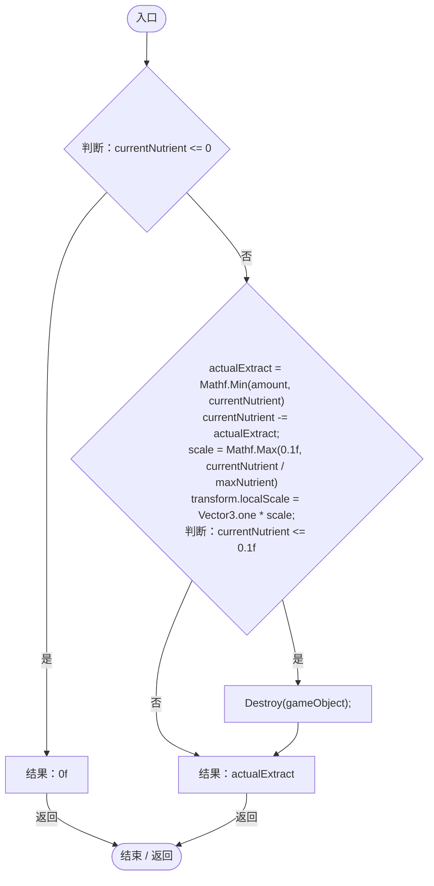

# OreNode.cs

[返回总索引](../README.md) · `Runtime` · `Assets/DarwinPark/Planet/Legacy/OreNode.cs`

[源文件](../../../Assets/DarwinPark/Planet/Legacy/OreNode.cs) · 源码校验：`eb64e4203861d11ede7bfeffc741d707cbe319a117598b49f4508442955c2de5`

方法按源文件位置排列。事件/回调引用不表示立即执行；分支与异常说明见总索引。完整源码与可点击关系图请打开离线手册。

## Extract · L11

`public float Extract(float amount)`

### Editor / Player · Roslyn编译器控制流

