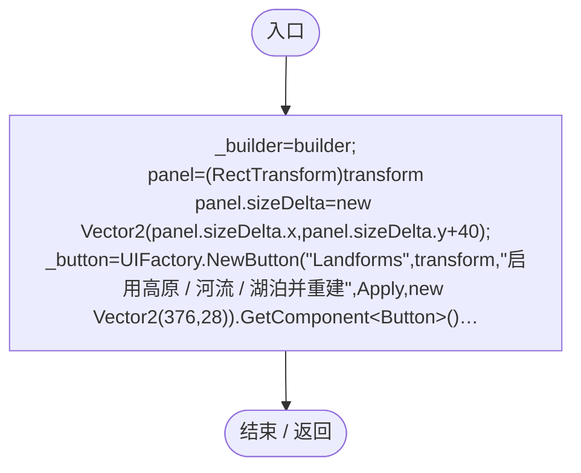
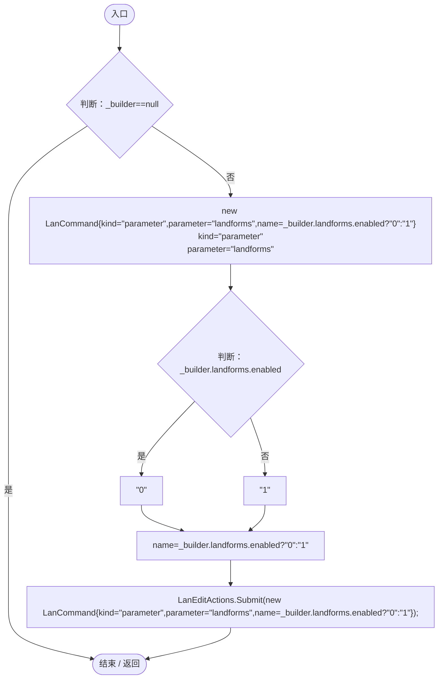
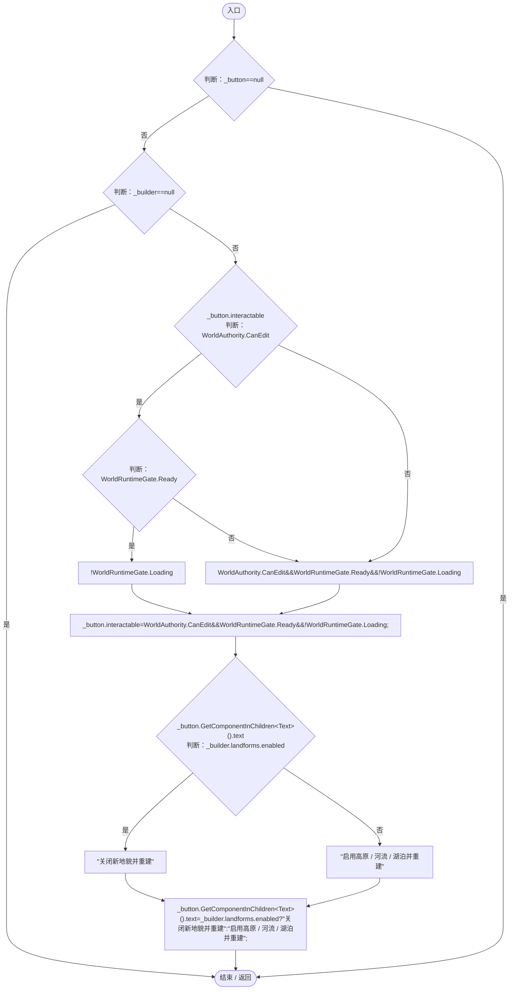
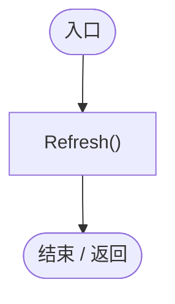
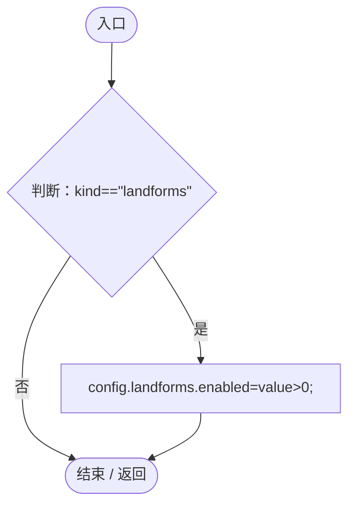

# LandformUpgradeControl.cs

[返回总索引](../README.md) · `Runtime` · `Assets/DarwinPark/UI/LandformUpgradeControl.cs`

[源文件](../../../Assets/DarwinPark/UI/LandformUpgradeControl.cs) · 源码校验：`702f2e21d5740ceffecdc2a47416b499f8aa8733417af0dd50a9aac03487e816`

方法按源文件位置排列。事件/回调引用不表示立即执行；分支与异常说明见总索引。完整源码与可点击关系图请打开离线手册。

## Bind · L11

`public void Bind(PlanetTerrainMeshBuilder builder)`

### Editor / Player · Roslyn编译器控制流

项目内调用/回调引用：

- [UIFactory.NewButton · L73](dd1096a6995423db.md#m5896f1b097c8bdde)（方法）
- [LandformUpgradeControl.Refresh · L17](a492c83bf894e14d.md#m1fe1e35c14b7940d)（方法）
- [LandformUpgradeControl.Apply · L16](a492c83bf894e14d.md#m38b954ddadac03ef)（方法）

## Apply · L16

`private void Apply()`

### Editor / Player · Roslyn编译器控制流

项目内调用/回调引用：

- [LanEditActions.Submit · L16](2816321496f6360e.md#m5411c4b97ac4c898)（方法）

## Refresh · L17

`private void Refresh()`

### Editor / Player · Roslyn编译器控制流

## Update · L18

`private void Update()`

### Editor / Player · Roslyn编译器控制流

项目内调用/回调引用：

- [LandformUpgradeControl.Refresh · L17](a492c83bf894e14d.md#m1fe1e35c14b7940d)（方法）

## Kind · L22

`public static string Kind(string id)`

### Editor / Player · Roslyn编译器控制流

## Apply · L23

`public static void Apply(PlanetTerrainConfig config,string kind,float value)`

### Editor / Player · Roslyn编译器控制流

