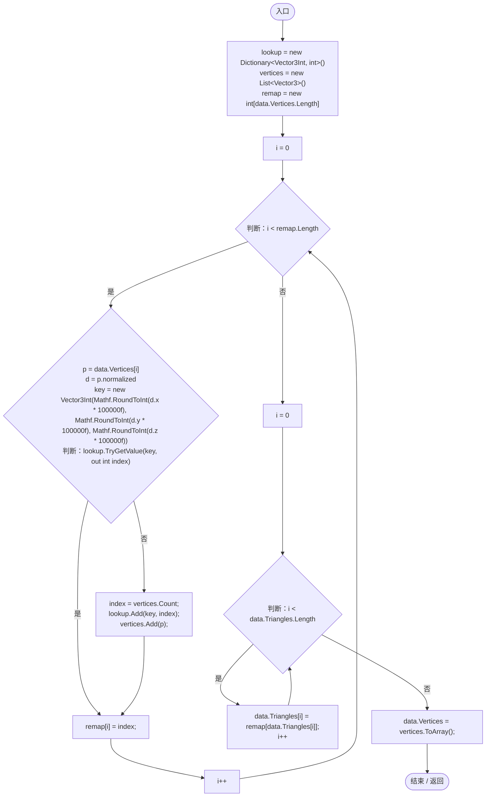

# PlanetMeshTopology.cs

[返回总索引](../README.md) · `Runtime` · `Assets/DarwinPark/Planet/Terrain/PlanetMeshTopology.cs`

[源文件](../../../Assets/DarwinPark/Planet/Terrain/PlanetMeshTopology.cs) · 源码校验：`1a7855b1ffd263e4546bc3bf785d70fae8ec9d2452d1d8b6653c824b3d6dac2d`

方法按源文件位置排列。事件/回调引用不表示立即执行；分支与异常说明见总索引。完整源码与可点击关系图请打开离线手册。

## Weld · L9

`public static void Weld(PlanetTerrainData data)`

### Editor / Player · Roslyn编译器控制流

