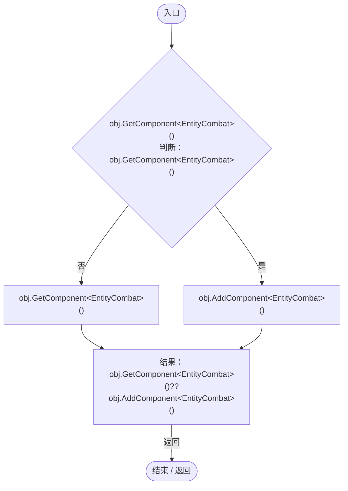

# EntityCombat.cs

[返回总索引](../README.md) · `Runtime` · `Assets/DarwinPark/Entities/Ecology/EntityCombat.cs`

[源文件](../../../Assets/DarwinPark/Entities/Ecology/EntityCombat.cs) · 源码校验：`4d2061357944137f9cfe2cfa56dc0e4ce4a9c529ec093c329d8cd8b375fb4361`

方法按源文件位置排列。事件/回调引用不表示立即执行；分支与异常说明见总索引。完整源码与可点击关系图请打开离线手册。

## Ensure · L11

`public static EntityCombat Ensure(GameObject obj)`

### Editor / Player · Roslyn编译器控制流

## Receive · L12

`public float Receive(DarwinEntity attacker,float damage)`

### Editor / Player · Roslyn编译器控制流

```mermaid
flowchart TD
  b0(["入口"])
  b1{"判断：AntColonyCombat.CanAttack(attacker,GetComponent&lt;DarwinEntity&gt;())"}
  b2["结果：0"]
  b3{"判断：GetComponent&lt;EntityGeneController&gt;()!=null"}
  b4{"判断：GetComponent&lt;CombatIntent&gt;()==null"}
  b5["gameObject.AddComponent&lt;CombatIntent&gt;();"]
  b6{"stats=GetComponent&lt;EntityStats&gt;()<br/>判断：damage&lt;=0"}
  b7{"判断：stats.TryGet(&quot;health&quot;,out float hp)"}
  b8{"判断：hp&lt;=0"}
  b9["结果：0"]
  b10{"GetComponent&lt;TerritoryBehavior&gt;()<br/>判断：GetComponent&lt;TerritoryBehavior&gt;()"}
  b11[".Defense"]
  b12["GetComponent&lt;TerritoryBehavior&gt;()"]
  b13{"判断：GetComponent&lt;TerritoryBehavior&gt;()?.Defense"}
  b14["GetComponent&lt;TerritoryBehavior&gt;()?.Defense"]
  b15["0"]
  b16["defense=GetComponent&lt;TerritoryBehavior&gt;()?.Defense??0"]
  b17{"GetComponent&lt;EggIncubation&gt;()<br/>判断：GetComponent&lt;EggIncubation&gt;()"}
  b18[".Incubating"]
  b19["GetComponent&lt;EggIncubation&gt;()"]
  b20{"判断：GetComponent&lt;EggIncubation&gt;()?.Incubating==true"}
  b21["defense+=GetComponent&lt;EntityGeneController&gt;().GetAttribute(&quot;eggDefense&quot;);"]
  b22{"actual=Mathf.Min(hp,damage/(1+Mathf.Max(0,defense)/100))<br/>stats.Modify(&quot;health&quot;,-actual);<br/>判断：attacker!=null"}
  b23{"Attacked<br/>判断：Attacked"}
  b24["Attacked?.Invoke(attacker,actual);"]
  b25{"判断：actual&gt;=hp"}
  b26["EntityDeathSettlement.Die(GetComponent&lt;DarwinEntity&gt;(),attacker);"]
  b27["结果：actual"]
  b28(["结束 / 返回"])
  b0 --> b1
  b1 -->|"否"| b2
  b1 -->|"是"| b3
  b2 -->|"返回"| b28
  b3 -->|"是"| b4
  b3 -->|"否"| b6
  b4 -->|"是"| b5
  b4 -->|"否"| b6
  b5 --> b6
  b6 -->|"否"| b7
  b6 -->|"是"| b9
  b7 -->|"是"| b8
  b7 -->|"否"| b9
  b8 -->|"是"| b9
  b8 -->|"否"| b10
  b9 -->|"返回"| b28
  b10 -->|"否"| b11
  b10 -->|"是"| b12
  b11 --> b13
  b12 --> b13
  b13 -->|"否"| b14
  b13 -->|"是"| b15
  b14 --> b16
  b15 --> b16
  b16 --> b17
  b17 -->|"否"| b18
  b17 -->|"是"| b19
  b18 --> b20
  b19 --> b20
  b20 -->|"是"| b21
  b20 -->|"否"| b22
  b21 --> b22
  b22 -->|"是"| b23
  b22 -->|"否"| b25
  b23 -->|"否"| b24
  b23 -->|"是"| b25
  b24 --> b25
  b25 -->|"是"| b26
  b25 -->|"否"| b27
  b26 --> b27
  b27 -->|"返回"| b28

```

项目内调用/回调引用：

- [AntColonyCombat.CanAttack · L8](aa858de55ec8e51a.md#mb9453f16f05e083a)（方法）
- [EntityStats.TryGet · L90](75aa86a368efdf24.md#m24ee1433e4a70d94)（方法）
- [EntityGeneController.GetAttribute · L257](7494d53178552f0e.md#m600509f72d274f0c)（方法）
- [EntityStats.Modify · L104](75aa86a368efdf24.md#m858c2a75d852ecc1)（方法）
- [EntityDeathSettlement.Die · L11](07fa6bdaadf50796.md#m700276963777d0a6)（方法）
