# WorldEvolutionRegression.cs

[返回总索引](../README.md) · `Editor` · `Assets/DarwinPark/Editor/WorldEvolutionRegression.cs`

[源文件](../../../Assets/DarwinPark/Editor/WorldEvolutionRegression.cs) · 源码校验：`c46a275931ee74c0a2eb7b48a277e70da483f3e16ccabbdd05810db60a0c6166`

方法按源文件位置排列。事件/回调引用不表示立即执行；分支与异常说明见总索引。完整源码与可点击关系图请打开离线手册。

<a id="m97a89a4f0086371d"></a>

## Folder.get · L25

`private static string Folder`


### Editor · 语法控制结构 / 声明（非CFG）

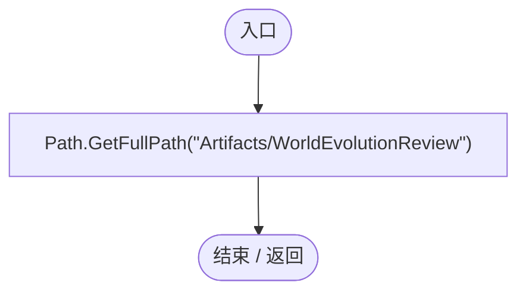

<a id="md59b4d69360f3987"></a>

## WorldEvolutionRegression.ctor · L26

`static WorldEvolutionRegression()`


### Editor · Roslyn编译器控制流

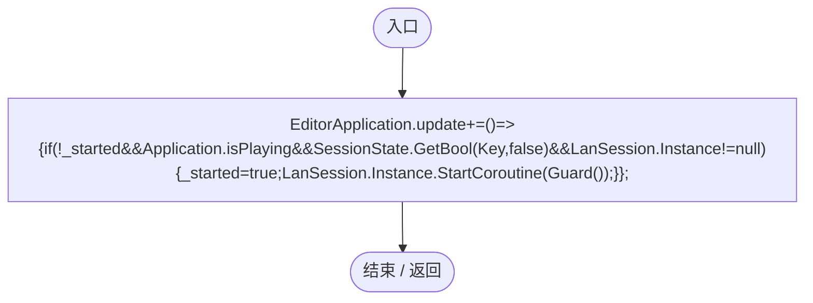

项目内调用/回调引用：

- [WorldEvolutionRegression.回调@26 · L26](a5c430d5c2fdb5ce.md#m2c12b5b7b39165f9)（回调/委托）

<a id="m2c12b5b7b39165f9"></a>

## 回调@26 · L26

`( … => 回调`


### Editor · Roslyn编译器控制流

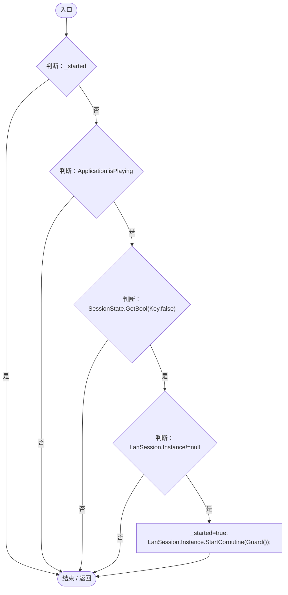

项目内调用/回调引用：

- [LanSession.Instance.get · L23](9fb633eebffe669c.md#mbf83306994878383)（访问器）
- [WorldEvolutionRegression.Guard · L29](a5c430d5c2fdb5ce.md#m77a7d06230d44b05)（方法）

<a id="mecb1d6f5bc2e74eb"></a>

## RunBatch · L27

`public static void RunBatch()`


### Editor · Roslyn编译器控制流

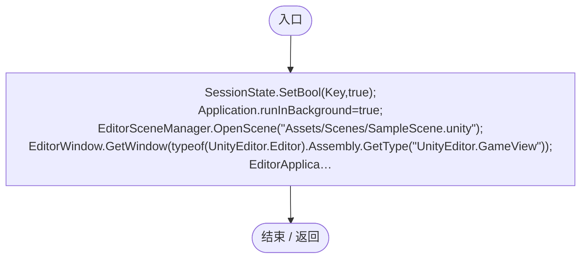

<a id="m083c6225b2d9bc03"></a>

## Check · L28

`private static void Check(bool ok,string text)`


### Editor · Roslyn编译器控制流

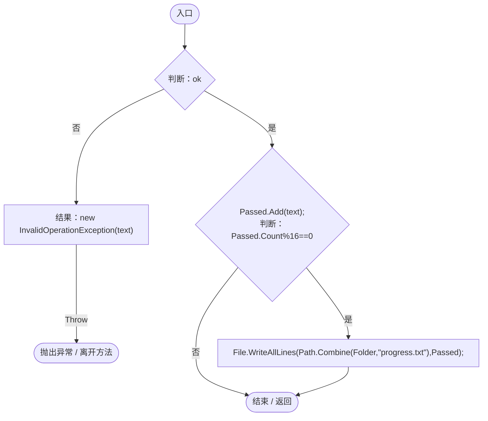

<a id="m77a7d06230d44b05"></a>

## Guard · L29

`private static IEnumerator Guard()`


### Editor · Roslyn编译器控制流

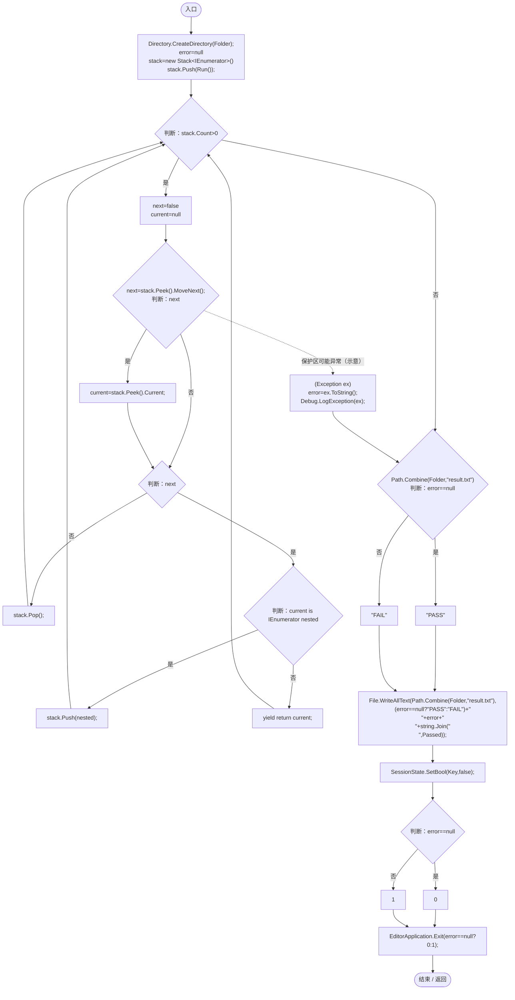

项目内调用/回调引用：

- [WorldEvolutionRegression.Run · L34](a5c430d5c2fdb5ce.md#m6f8e9ee1c4b3d3f6)（方法）

<a id="mb543cc58be838345"></a>

## Wait · L30

`private static IEnumerator Wait(Func<bool> done,string name)`


### Editor · Roslyn编译器控制流

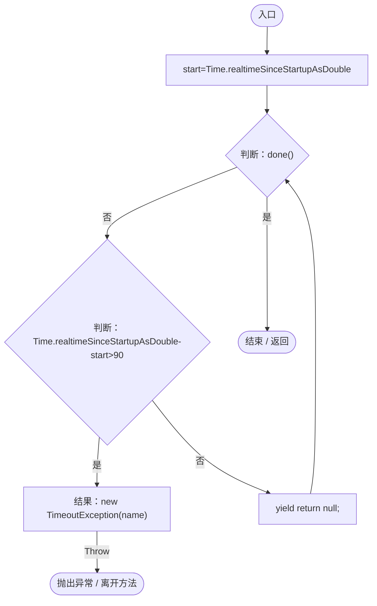

<a id="m04d4bba0f237560c"></a>

## Clear · L31

`private static void Clear()`


### Editor · Roslyn编译器控制流

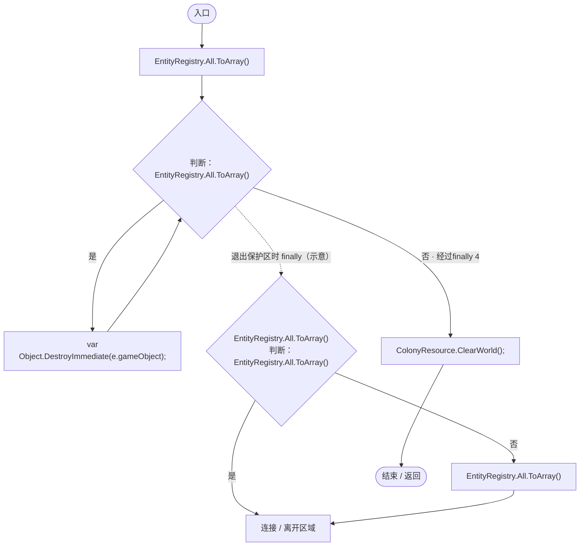

项目内调用/回调引用：

- [ColonyResource.ClearWorld · L109](293dbaecfff4b585.md#mc969798f9562c061)（方法）

<a id="m1ca4c25ebef6517c"></a>

## Spawn · L32

`private static DarwinEntity Spawn(string template,Vector3 point,AgeState age=AgeState.Adult)`


### Editor · Roslyn编译器控制流

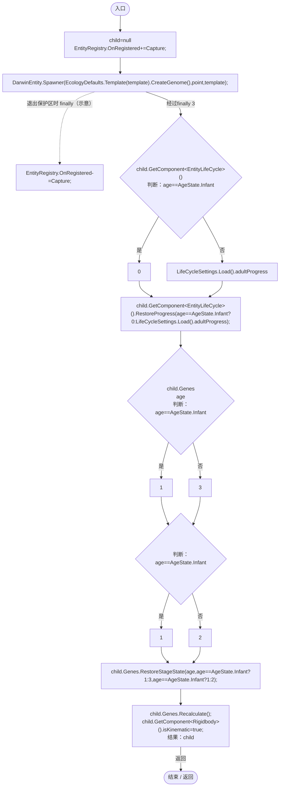

项目内调用/回调引用：

- [RandomSpawnRecipe.CreateGenome · L25](923ccc4e86c4786c.md#m2612c79fe3848e08)（方法）
- [EcologyDefaults.Template · L68](5b565b57de741d98.md#m98d16ffadd19320f)（方法）
- [EntityLifeCycle.RestoreProgress · L51](9f4138bfbae654b7.md#mec34c953ece464ab)（方法）
- [LifeCycleSettings.Load · L16](ace76969fe8f61de.md#m6fe263852e5a8989)（方法）
- [EntityGeneController.RestoreStageState · L56](7494d53178552f0e.md#m37c1dbfa64e7c2ce)（方法）
- [DarwinEntity.Genes.get · L14](70798dde169f2e8b.md#m622eb1adf401d431)（访问器）
- [EntityGeneController.Recalculate · L118](7494d53178552f0e.md#m707d9a56b0c7c609)（方法）
- [WorldEvolutionRegression.Capture · L33](a5c430d5c2fdb5ce.md#m5f6bfaaa22a1b288)（局部函数）

<a id="m5f6bfaaa22a1b288"></a>

## Capture · L33

`void Capture(DarwinEntity e)`


### Editor · Roslyn编译器控制流

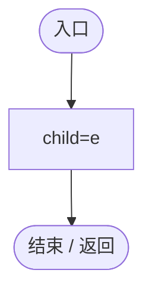

<a id="m6f8e9ee1c4b3d3f6"></a>

## Run · L34

`private static IEnumerator Run()`


### Editor · Roslyn编译器控制流

```mermaid
flowchart TD
  b0(["入口"])
  b1["NaturalPopulationPace.Current.enabled=false;<br/>GameplayTuning.Current.mutationRoundsEnabled=false;<br/>GameplayTuning.Current.populationRatioControlEnabled=false;<br/>session=Object.FindFirstObjectByType&lt;WorldSessionManager&gt;()<br/>session.autoSaveInte…"]
  b2["i=0"]
  b3{"判断：i&lt;512"}
  b4{"d=PlanetTerrainSampler.DirectionFromUV(i*.61803398875f%1,.25f+(i%64)/128f)<br/>p=EcologyQueries.Surface(planet.transform.position+d*(planet.radius+planet.heightScale))<br/>判断：(p-planet.transform.position).magnitude&gt;planet.LocalWaterRadius(p)+3"}
  b5["home=p;"]
  b6["i++"]
  b7["yield return Ore(planet,home);<br/>yield return Food(home);<br/>Clear();<br/>NaturalPopulationPace.Current.enabled=true;<br/>Pace(home);<br/>yield return Navigation(planet);"]
  b8{"判断：planet.Data.Hydrology!=null"}
  b9["planet.Data.Hydrology.RiverCells&gt;0"]
  b10["planet.Data.Hydrology!=null"]
  b11["Check(planet.Data.Hydrology!=null&amp;&amp;planet.Data.Hydrology.RiverCells&gt;0,&quot;新世界生成实际汇流河网&quot;);"]
  b12["Check(planet.Data.Hydrology.LakeCells&gt;0,&quot;优先洪泛保留内陆盆地积水&quot;);<br/>hydro=planet.Data.Hydrology"]
  b13["i=0"]
  b14{"判断：i&lt;hydro.Bed.Length"}
  b15["node=i<br/>steps=0"]
  b16{"判断：hydro.Downstream[node]&gt;=0"}
  b17{"next=hydro.Downstream[node]<br/>Check(hydro.Spill[node]+.00001f&gt;=hydro.Spill[next],&quot;下游水位不高于上游&quot;);<br/>node=next;<br/>判断：++steps&gt;hydro.Bed.Length"}
  b18["结果：new InvalidOperationException(&quot;汇流出现环&quot;)"]
  x18(["抛出异常 / 离开方法"])
  b19["i+=113"]
  b20{"planet.transform.Find(&quot;RiversAndLakes&quot;)<br/>判断：planet.transform.Find(&quot;RiversAndLakes&quot;)"}
  b21[".GetComponent&lt;MeshFilter&gt;().sharedMesh.vertexCount"]
  b22["planet.transform.Find(&quot;RiversAndLakes&quot;)"]
  b23["Check(planet.transform.Find(&quot;RiversAndLakes&quot;)?.GetComponent&lt;MeshFilter&gt;().sharedMesh.vertexCount&gt;0,&quot;河湖合并网格实际挂载并可渲染&quot;);"]
  b24["Check(planet.Data.Vertices.All(v=&gt;float.IsFinite(v.x)&amp;&amp;float.IsFinite(v.y)&amp;&amp;float.IsFinite(v.z)),&quot;地形与河床顶点全部有限&quot;);<br/>cfg=PlanetClimateSystem.Instance.config"]
  b25{"判断：cfg.Classify(28,90,false)==ClimateType.TropicalRain"}
  b26["cfg.Classify(28,55,false)==ClimateType.Savanna"]
  b27["cfg.Classify(28,90,false)==ClimateType.TropicalRain"]
  b28["Check(cfg.Classify(28,90,false)==ClimateType.TropicalRain&amp;&amp;cfg.Classify(28,55,false)==ClimateType.Savanna,&quot;雨林和热带草原按温湿条件区分&quot;);"]
  b29{"判断：cfg.Classify(5,70,false)==ClimateType.Taiga"}
  b30["cfg.Classify(10,20,false)==ClimateType.ColdDesert"]
  b31["cfg.Classify(5,70,false)==ClimateType.Taiga"]
  b32["Check(cfg.Classify(5,70,false)==ClimateType.Taiga&amp;&amp;cfg.Classify(10,20,false)==ClimateType.ColdDesert,&quot;寒带森林及寒冷荒漠可分类&quot;);"]
  b33["Check(Vector3.Distance((Vector4)EarthClimateRules.Color(28,90,cfg),(Vector4)EarthClimateRules.Color(28,55,cfg))&gt;.2f,&quot;雨林深青绿与热带草原金黄有明显色差&quot;);<br/>Check(EarthClimateRules.Humidity(Vector3.forward,cfg)&gt;EarthClimateRules.Humidity(PlanetTerrainSampl…"]
  b34["new ColonyResourceSave{id=Guid.NewGuid().ToString(&quot;N&quot;),kind=ColonyResourceKind.Energy,energy=17,local=EcologyQueries.ToLocal(home),scale=Vector3.one}<br/>id=Guid.NewGuid().ToString(&quot;N&quot;)<br/>kind=ColonyResourceKind.Energy<br/>energy=17<br/>local=EcologyQ…"]
  b35["resourceId=testResource.State.id<br/>alive=EntityRegistry.All.Count<br/>gameTime=clock.GameTime<br/>update=WorldParameterUpdate.Ensure()<br/>Check(update.Request(&quot;landforms&quot;,&quot;0&quot;,out _),&quot;可请求关闭地貌并后台重建&quot;);<br/>yield return Wait(()=&gt;!update.Busy,&quot;关闭地貌更新&quot;);"]
  b36{"判断：planet.Data.Hydrology==null"}
  b37["!planet.landforms.enabled"]
  b38["planet.Data.Hydrology==null"]
  b39["Check(planet.Data.Hydrology==null&amp;&amp;!planet.landforms.enabled,&quot;关闭后恢复原地形生成路径&quot;);"]
  b40{"ColonyResource.Find(resourceId)<br/>判断：ColonyResource.Find(resourceId)"}
  b41[".State.energy"]
  b42["ColonyResource.Find(resourceId)"]
  b43{"判断：ColonyResource.Find(resourceId)?.State.energy==17"}
  b44{"判断：EntityRegistry.All.Count==alive"}
  b45["clock.GameTime==gameTime"]
  b46["ColonyResource.Find(resourceId)?.State.energy==17&amp;&amp;EntityRegistry.All.Count==alive&amp;&amp;clock.GameTime==gameTime"]
  b47["Check(ColonyResource.Find(resourceId)?.State.energy==17&amp;&amp;EntityRegistry.All.Count==alive&amp;&amp;clock.GameTime==gameTime,&quot;重建保留真实资源营养、实体数和日期&quot;);"]
  b48["Check(update.Request(&quot;landforms&quot;,&quot;1&quot;,out _),&quot;旧世界可显式启用新地貌&quot;);<br/>yield return Wait(()=&gt;!update.Busy,&quot;启用地貌更新&quot;);"]
  b49{"判断：planet.Data.Hydrology!=null"}
  b50["planet.landforms.enabled"]
  b51["planet.Data.Hydrology!=null"]
  b52["Check(planet.Data.Hydrology!=null&amp;&amp;planet.landforms.enabled,&quot;显式启用后生成新水系并保存开关&quot;);"]
  b53["Check(JsonUtility.FromJson&lt;PlanetTerrainConfig&gt;(WorldSaveStore.Read(WorldSaveStore.FileFor(session.Current.id)).terrainParameters).landforms.enabled,&quot;地貌开关实际写入存档&quot;);<br/>Clear();<br/>session.Create(&quot;少量自然种源&quot;,742091,.5f,20,44);<br/>yield return Wait(()=…"]
  b54{"判断：EntityRegistry.All.Count==10"}
  b55{"判断：EntityRegistry.All.Count(e=&gt;EcologyEnergyBudget.IsProducer(e.Genes))==7"}
  b56["EntityRegistry.All.Count(e=&gt;e.Genes.GetAttribute(&quot;moveSpeed&quot;)&gt;0)==3"]
  b57["EntityRegistry.All.Count==10&amp;&amp;EntityRegistry.All.Count(e=&gt;EcologyEnergyBudget.IsProducer(e.Genes))==7&amp;&amp;EntityRegistry.All.Count(e=&gt;e.Genes.GetAttribute(&quot;moveSpeed&quot;)&gt;0)==3"]
  b58["Check(EntityRegistry.All.Count==10&amp;&amp;EntityRegistry.All.Count(e=&gt;EcologyEnergyBudget.IsProducer(e.Genes))==7&amp;&amp;EntityRegistry.All.Count(e=&gt;e.Genes.GetAttribute(&quot;moveSpeed&quot;)&gt;0)==3,&quot;新世界一次建立7生产者和3移动种源&quot;);"]
  b59["Check(EntityRegistry.All.All(e=&gt;e.Genes.CurrentAge==AgeState.Infant&amp;&amp;!planet.IsSubmerged(e.transform.position)),&quot;种源均为陆地幼体&quot;);<br/>Check(session.GetComponents&lt;NaturalWorldSeeder&gt;().Length==1,&quot;连续创建复用唯一种源组件&quot;);<br/>session.SaveNow(false);<br/>disk=WorldS…"]
  b60["i=0"]
  b61{"判断：i&lt;15"}
  b62["yield return null;<br/>i++"]
  b63["Check(EntityRegistry.All.Count==10,&quot;旧档重载不重复领取初始种源&quot;);<br/>Clear();"]
  b64["i=0"]
  b65{"判断：i&lt;15"}
  b66["yield return null;<br/>i++"]
  b67["Check(EntityRegistry.All.Count==0,&quot;种群灭绝或清场后不自动补员&quot;);<br/>yield return Visuals(planet);"]
  b68(["结束 / 返回"])
  b0 --> b1
  b1 --> b2
  b2 --> b3
  b3 -->|"是"| b4
  b3 -->|"否"| b7
  b4 -->|"是"| b5
  b4 -->|"否"| b6
  b5 --> b7
  b6 --> b3
  b7 --> b8
  b8 -->|"是"| b9
  b8 -->|"否"| b10
  b9 --> b11
  b10 --> b11
  b11 --> b12
  b12 --> b13
  b13 --> b14
  b14 -->|"是"| b15
  b14 -->|"否"| b20
  b15 --> b16
  b16 -->|"是"| b17
  b16 -->|"否"| b19
  b17 -->|"是"| b18
  b17 -->|"否"| b16
  b18 -->|"Throw"| x18
  b19 --> b14
  b20 -->|"否"| b21
  b20 -->|"是"| b22
  b21 --> b23
  b22 --> b23
  b23 --> b24
  b24 --> b25
  b25 -->|"是"| b26
  b25 -->|"否"| b27
  b26 --> b28
  b27 --> b28
  b28 --> b29
  b29 -->|"是"| b30
  b29 -->|"否"| b31
  b30 --> b32
  b31 --> b32
  b32 --> b33
  b33 --> b34
  b34 --> b35
  b35 --> b36
  b36 -->|"是"| b37
  b36 -->|"否"| b38
  b37 --> b39
  b38 --> b39
  b39 --> b40
  b40 -->|"否"| b41
  b40 -->|"是"| b42
  b41 --> b43
  b42 --> b43
  b43 -->|"是"| b44
  b43 -->|"否"| b46
  b44 -->|"是"| b45
  b44 -->|"否"| b46
  b45 --> b47
  b46 --> b47
  b47 --> b48
  b48 --> b49
  b49 -->|"是"| b50
  b49 -->|"否"| b51
  b50 --> b52
  b51 --> b52
  b52 --> b53
  b53 --> b54
  b54 -->|"是"| b55
  b54 -->|"否"| b57
  b55 -->|"是"| b56
  b55 -->|"否"| b57
  b56 --> b58
  b57 --> b58
  b58 --> b59
  b59 --> b60
  b60 --> b61
  b61 -->|"是"| b62
  b61 -->|"否"| b63
  b62 --> b61
  b63 --> b64
  b64 --> b65
  b65 -->|"是"| b66
  b65 -->|"否"| b67
  b66 --> b65
  b67 --> b68

```

项目内调用/回调引用：

- [NaturalPopulationPace.Current.get · L19](bb501fbca2e1b01f.md#m902ff80ab222d2ce)（访问器）
- [GameplayTuning.Current.get · L46](db546e5713b32d53.md#m4fa691bd8a3b9618)（访问器）
- [PlanetClimateMap.Instance.get · L16](b4e9726c1bcf4c37.md#m3add54a419aeef9f)（访问器）
- [PlanetOreSystem.Instance.get · L8](86b3fbb4d9436121.md#m53f6a6af4b6dc252)（访问器）
- [WorldSessionManager.Create · L41](08741c7b7b9d9344.md#m6aadfeee8b90aacd)（方法）
- [WorldEvolutionRegression.Wait · L30](a5c430d5c2fdb5ce.md#mb543cc58be838345)（方法）
- [ServiceLocator.Get · L33](f2fdbe9f9ccd93cb.md#m2ae625299520c56d)（方法）
- [SimulationClock.Pause · L79](a8f444aec9614b0a.md#m30929d45a885d0f1)（方法）
- [WorldEvolutionRegression.Clear · L31](a5c430d5c2fdb5ce.md#m04d4bba0f237560c)（方法）
- [PlanetTerrainSampler.DirectionFromUV · L13](fd5c1d83b88a7c8b.md#mbb90aecec23f2a42)（方法）
- [EcologyQueries.Surface · L48](bdf7ccc2c9c0452f.md#m40ee3e975d7f5137)（方法）
- [PlanetTerrainMeshBuilder.LocalWaterRadius · L113](415285cf043354a9.md#m5d141fd984c0caf8)（方法）
- [WorldEvolutionRegression.Ore · L73](a5c430d5c2fdb5ce.md#m9497f9ce4c44b75e)（方法）
- [WorldEvolutionRegression.Food · L79](a5c430d5c2fdb5ce.md#mb7a9d634158bfe8b)（方法）
- [WorldEvolutionRegression.Pace · L86](a5c430d5c2fdb5ce.md#m434568e2446f84be)（方法）
- [WorldEvolutionRegression.Navigation · L96](a5c430d5c2fdb5ce.md#mcf6777219184e5f0)（方法）
- [WorldEvolutionRegression.Check · L28](a5c430d5c2fdb5ce.md#m083c6225b2d9bc03)（方法）
- [PlanetTerrainMeshBuilder.Data.get · L81](415285cf043354a9.md#m1a65abfe0f34c5d8)（访问器）
- [PlanetHydrology.RiverCells.get · L12](282937bf06cb5f2a.md#m4f00628f0d856b73)（访问器）
- [PlanetHydrology.LakeCells.get · L12](282937bf06cb5f2a.md#m7813eb616b319fd2)（访问器）
- [PlanetClimateSystem.Instance.get · L33](ba86e31da9b7d0a5.md#md8b21cc929db37b1)（访问器）
- [PlanetClimateConfig.Classify · L131](caa5d97c52b00485.md#m2ea247704d158dca)（方法）
- [EarthClimateRules.Color · L24](6a91ff043f0ebb5f.md#mb76f2ac53689b29e)（方法）
- [EarthClimateRules.Humidity · L17](6a91ff043f0ebb5f.md#m72e3546de2404a6f)（方法）
- [LandformSaveCompatibility.Restore · L23](06c65833631e42f5.md#m3f9f2e62b741ebce)（方法）
- [ColonyResource.Create · L45](293dbaecfff4b585.md#m7e8d2b0e06e1cad5)（方法）
- [EcologyQueries.ToLocal · L40](bdf7ccc2c9c0452f.md#mfa1ace432c73012a)（方法）
- [ColonyResource.State.get · L24](293dbaecfff4b585.md#m41824f1a0e160aa5)（访问器）
- [SimulationClock.GameTime.get · L23](a8f444aec9614b0a.md#m74adfa39a896652f)（访问器）
- [WorldParameterUpdate.Ensure · L27](4087d9be2a65e96f.md#mcefc896cc38899a6)（方法）
- [WorldParameterUpdate.Request · L28](4087d9be2a65e96f.md#m942de54d110fe265)（方法）
- [ColonyResource.Find · L28](293dbaecfff4b585.md#m1324285ab40ac6f4)（方法）
- [WorldSaveStore.Read · L74](d67a35e5e3814c15.md#mde52fadbe0185af1)（方法）
- [WorldSaveStore.FileFor · L50](d67a35e5e3814c15.md#mce4509883be2e47e)（方法）
- [WorldSessionManager.Current.get · L21](08741c7b7b9d9344.md#m5d26a5eb846a8504)（访问器）
- [WorldSessionManager.SaveNow · L169](08741c7b7b9d9344.md#m43f61078d8513f73)（方法）
- [WorldSessionManager.Open · L60](08741c7b7b9d9344.md#m7bd56ef45131b4e5)（方法）
- [WorldEvolutionRegression.Visuals · L56](a5c430d5c2fdb5ce.md#me1c57c58c6938553)（方法）
- [WorldEvolutionRegression.回调@38 · L38](a5c430d5c2fdb5ce.md#m91369b2aa067076d)（回调/委托）
- [WorldEvolutionRegression.回调@43 · L43](a5c430d5c2fdb5ce.md#m5cebd6041decce87)（回调/委托）
- [WorldEvolutionRegression.回调@48 · L48](a5c430d5c2fdb5ce.md#m25264815f6d34ec2)（回调/委托）
- [WorldEvolutionRegression.回调@49 · L49](a5c430d5c2fdb5ce.md#m295993c45b8ca3cf)（回调/委托）
- [WorldEvolutionRegression.回调@50 · L50](a5c430d5c2fdb5ce.md#m09425f369587457d)（回调/委托）
- [WorldEvolutionRegression.回调@51 · L51](a5c430d5c2fdb5ce.md#m35103dc247171c04)（回调/委托）
- [WorldEvolutionRegression.回调@51 · L51](a5c430d5c2fdb5ce.md#m5e780e225103dd54)（回调/委托）
- [WorldEvolutionRegression.回调@51 · L51](a5c430d5c2fdb5ce.md#m97f921db2a4201fb)（回调/委托）
- [WorldEvolutionRegression.回调@52 · L52](a5c430d5c2fdb5ce.md#mcd7459732c291fb8)（回调/委托）

<a id="m91369b2aa067076d"></a>

## 回调@38 · L38

`( … => 回调`


### Editor · Roslyn编译器控制流

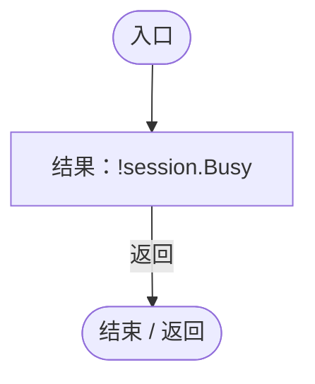

项目内调用/回调引用：

- [WorldSessionManager.Busy.get · L24](08741c7b7b9d9344.md#m4483e2e4f28f7c85)（访问器）

<a id="m5cebd6041decce87"></a>

## 回调@43 · L43

`v … => 回调`


### Editor · Roslyn编译器控制流

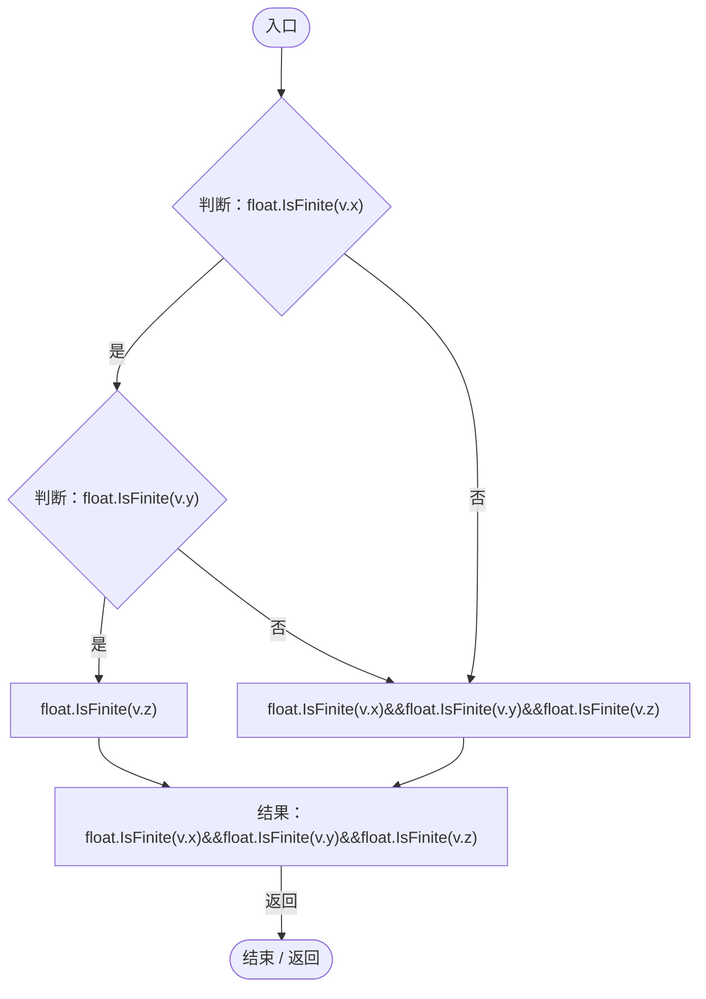

<a id="m25264815f6d34ec2"></a>

## 回调@48 · L48

`( … => 回调`


### Editor · Roslyn编译器控制流


项目内调用/回调引用：

- [WorldParameterUpdate.Busy.get · L20](4087d9be2a65e96f.md#mec2ac85b8ff3f127)（访问器）

<a id="m295993c45b8ca3cf"></a>

## 回调@49 · L49

`( … => 回调`


### Editor · Roslyn编译器控制流


项目内调用/回调引用：

- [WorldParameterUpdate.Busy.get · L20](4087d9be2a65e96f.md#mec2ac85b8ff3f127)（访问器）

<a id="m09425f369587457d"></a>

## 回调@50 · L50

`( … => 回调`


### Editor · Roslyn编译器控制流

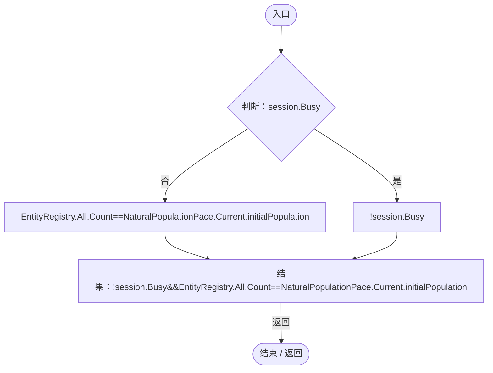

项目内调用/回调引用：

- [WorldSessionManager.Busy.get · L24](08741c7b7b9d9344.md#m4483e2e4f28f7c85)（访问器）
- [NaturalPopulationPace.Current.get · L19](bb501fbca2e1b01f.md#m902ff80ab222d2ce)（访问器）

<a id="m35103dc247171c04"></a>

## 回调@51 · L51

`e … => 回调`


### Editor · Roslyn编译器控制流

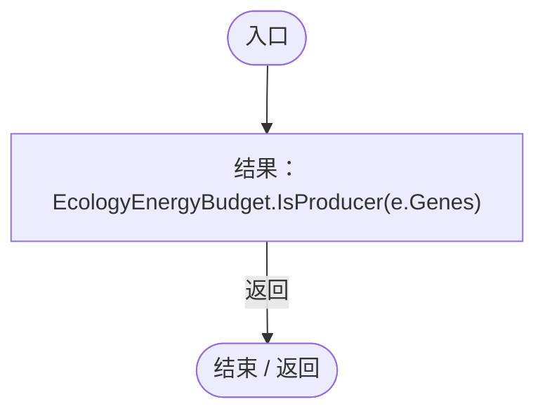

项目内调用/回调引用：

- [EcologyEnergyBudget.IsProducer · L27](06a91c8201f26593.md#mdf11c493dfe1c754)（方法）
- [DarwinEntity.Genes.get · L14](70798dde169f2e8b.md#m622eb1adf401d431)（访问器）

<a id="m5e780e225103dd54"></a>

## 回调@51 · L51

`e … => 回调`


### Editor · Roslyn编译器控制流

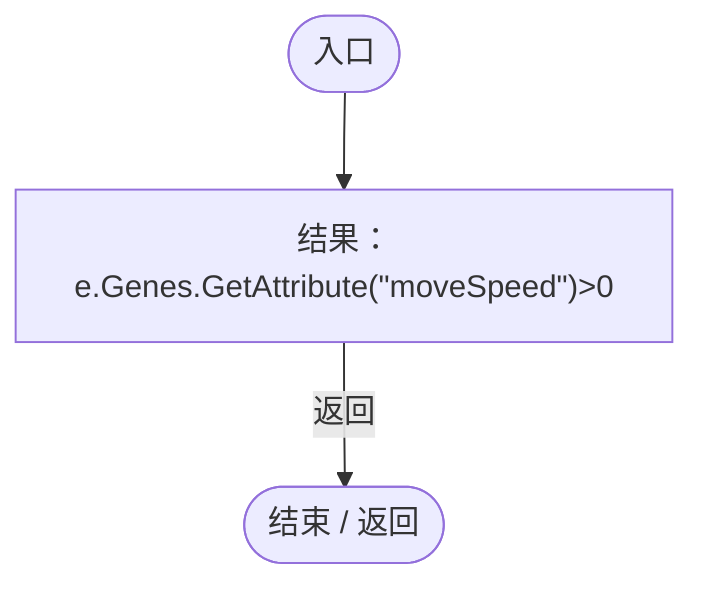

项目内调用/回调引用：

- [EntityGeneController.GetAttribute · L286](7494d53178552f0e.md#m18bff2b38f95b556)（方法）
- [DarwinEntity.Genes.get · L14](70798dde169f2e8b.md#m622eb1adf401d431)（访问器）

<a id="m97f921db2a4201fb"></a>

## 回调@51 · L51

`e … => 回调`


### Editor · Roslyn编译器控制流

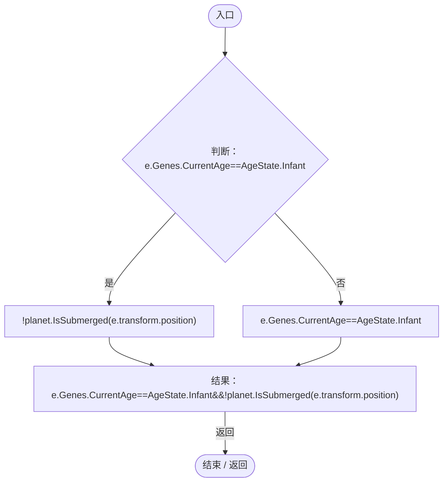

项目内调用/回调引用：

- [EntityGeneController.CurrentAge.get · L37](7494d53178552f0e.md#md08823d8f9a2fa16)（访问器）
- [DarwinEntity.Genes.get · L14](70798dde169f2e8b.md#m622eb1adf401d431)（访问器）
- [PlanetTerrainMeshBuilder.IsSubmerged · L107](415285cf043354a9.md#m77993fefee27a702)（方法）

<a id="mcd7459732c291fb8"></a>

## 回调@52 · L52

`( … => 回调`


### Editor · Roslyn编译器控制流


项目内调用/回调引用：

- [WorldSessionManager.Busy.get · L24](08741c7b7b9d9344.md#m4483e2e4f28f7c85)（访问器）

<a id="me1c57c58c6938553"></a>

## Visuals · L56

`private static IEnumerator Visuals(PlanetTerrainMeshBuilder planet)`

★ 新增：导出真实气候纹理与河湖近景；测试结束前隐藏云/UI，便于检查水面是否被地形遮住。

### Editor · Roslyn编译器控制流

```mermaid
flowchart TD
  b0(["入口"])
  b1["map=PlanetClimateMap.Instance<br/>map.mapResolution=512;<br/>map.GenerateClimateMap();<br/>File.WriteAllBytes(Path.Combine(Folder,&quot;climate-map.png&quot;),map.ClimateTexture.EncodeToPNG());"]
  b2["Object.FindObjectsByType&lt;Canvas&gt;(FindObjectsSortMode.None)"]
  b3{"判断：Object.FindObjectsByType&lt;Canvas&gt;(FindObjectsSortMode.None)"}
  b4["var<br/>canvas.enabled=false;"]
  b5{"Object.FindObjectsByType&lt;Canvas&gt;(FindObjectsSortMode.None)<br/>判断：Object.FindObjectsByType&lt;Canvas&gt;(FindObjectsSortMode.None)"}
  b6["Object.FindObjectsByType&lt;Canvas&gt;(FindObjectsSortMode.None)"]
  b7["连接 / 离开区域"]
  b8["planet.GetComponentsInChildren&lt;Renderer&gt;(true)"]
  b9{"判断：planet.GetComponentsInChildren&lt;Renderer&gt;(true)"}
  b10{"var<br/>判断：renderer.name==&quot;CloudVolume&quot;"}
  b11["renderer.enabled=false;"]
  b12{"planet.GetComponentsInChildren&lt;Renderer&gt;(true)<br/>判断：planet.GetComponentsInChildren&lt;Renderer&gt;(true)"}
  b13["planet.GetComponentsInChildren&lt;Renderer&gt;(true)"]
  b14["连接 / 离开区域"]
  b15{"camera=Camera.main<br/>orbit=camera.GetComponent&lt;OrbitCamera&gt;()<br/>判断：orbit!=null"}
  b16["orbit.enabled=false;"]
  b17["hydro=planet.Data.Hydrology"]
  b18["new[]{false,true}"]
  b19{"判断：new[]{false,true}"}
  b20["bool"]
  b21["cell=-1<br/>best=-1"]
  b22["i=0"]
  b23{"判断：i&lt;hydro.Bed.Length"}
  b24{"判断：lake"}
  b25{"判断：hydro.Lake[i]"}
  b26{"判断：hydro.River[i]"}
  b27{"判断：hydro.Lake[i]"}
  b28{"判断：lake"}
  b29["hydro.Spill[i]-hydro.Bed[i]"]
  b30["hydro.Accumulation[i]"]
  b31["rank=lake?hydro.Spill[i]-hydro.Bed[i]:hydro.Accumulation[i]"]
  b32{"判断：rank&gt;best"}
  b33["cell=i;<br/>best=rank;"]
  b34["i++"]
  b35["Check(cell&gt;=0,&quot;河流和盆地湖泊均有可检查的真实近景&quot;);<br/>dir=hydro.Directions[cell]<br/>ground=PlanetTerrainSampler.SampleHeight(planet.Data,dir)*planet.heightScale+planet.radius<br/>point=planet.transform.TransformPoint(dir*ground)<br/>camera.transform.position=planet.…"]
  b36{"planet.transform<br/>dir<br/>判断：Mathf.Abs(dir.y)&gt;.9f"}
  b37["Vector3.forward"]
  b38["Vector3.up"]
  b39["up=planet.transform.TransformDirection(Vector3.Cross(dir,Mathf.Abs(dir.y)&gt;.9f?Vector3.forward:Vector3.up).normalized)"]
  b40["camera.transform.rotation=Quaternion.LookRotation(point-camera.transform.position,up);<br/>camera.nearClipPlane=.1f;<br/>yield return null;<br/>yield return new WaitForEndOfFrame();"]
  b41{"Folder<br/>判断：lake"}
  b42["&quot;lake-close.png&quot;"]
  b43["&quot;river-close.png&quot;"]
  b44["ScreenCapture.CaptureScreenshot(Path.Combine(Folder,lake?&quot;lake-close.png&quot;:&quot;river-close.png&quot;));"]
  b45["yield return null;"]
  b46{"new[]{false,true}<br/>判断：new[]{false,true}"}
  b47["new[]{false,true}"]
  b48["连接 / 离开区域"]
  b49(["结束 / 返回"])
  b0 --> b1
  b1 --> b2
  b2 --> b3
  b3 -->|"是"| b4
  b3 -->|"否 · 经过finally 5"| b8
  b4 --> b3
  b5 -->|"否"| b6
  b5 -->|"是"| b7
  b6 --> b7
  b8 --> b9
  b9 -->|"是"| b10
  b9 -->|"否 · 经过finally 12"| b15
  b10 -->|"是"| b11
  b10 -->|"否"| b9
  b11 --> b9
  b12 -->|"否"| b13
  b12 -->|"是"| b14
  b13 --> b14
  b15 -->|"是"| b16
  b15 -->|"否"| b17
  b16 --> b17
  b17 --> b18
  b18 --> b19
  b19 -->|"是"| b20
  b19 -->|"否 · 经过finally 46"| b49
  b20 --> b21
  b21 --> b22
  b22 --> b23
  b23 -->|"是"| b24
  b23 -->|"否"| b35
  b24 -->|"是"| b25
  b24 -->|"否"| b26
  b25 -->|"是"| b28
  b25 -->|"否"| b34
  b26 -->|"是"| b27
  b26 -->|"否"| b34
  b27 -->|"否"| b28
  b27 -->|"是"| b34
  b28 -->|"是"| b29
  b28 -->|"否"| b30
  b29 --> b31
  b30 --> b31
  b31 --> b32
  b32 -->|"是"| b33
  b32 -->|"否"| b34
  b33 --> b34
  b34 --> b23
  b35 --> b36
  b36 -->|"是"| b37
  b36 -->|"否"| b38
  b37 --> b39
  b38 --> b39
  b39 --> b40
  b40 --> b41
  b41 -->|"是"| b42
  b41 -->|"否"| b43
  b42 --> b44
  b43 --> b44
  b44 --> b45
  b45 --> b19
  b46 -->|"否"| b47
  b46 -->|"是"| b48
  b47 --> b48
  b3 -. "退出保护区时 finally（示意）" .-> b5
  b9 -. "退出保护区时 finally（示意）" .-> b12
  b19 -. "退出保护区时 finally（示意）" .-> b46

```

项目内调用/回调引用：

- [PlanetClimateMap.Instance.get · L16](b4e9726c1bcf4c37.md#m3add54a419aeef9f)（访问器）
- [PlanetClimateMap.GenerateClimateMap · L78](b4e9726c1bcf4c37.md#m32cde1f109325e93)（方法）
- [PlanetClimateMap.ClimateTexture.get · L23](b4e9726c1bcf4c37.md#m4542608e8858e330)（访问器）
- [PlanetTerrainMeshBuilder.Data.get · L81](415285cf043354a9.md#m1a65abfe0f34c5d8)（访问器）
- [WorldEvolutionRegression.Check · L28](a5c430d5c2fdb5ce.md#m083c6225b2d9bc03)（方法）
- [PlanetTerrainSampler.SampleHeight · L32](fd5c1d83b88a7c8b.md#m759508f0c5a04b21)（方法）

<a id="m9497f9ce4c44b75e"></a>

## Ore · L73

`private static IEnumerator Ore(PlanetTerrainMeshBuilder planet,Vector3 point)`


### Editor · Roslyn编译器控制流

```mermaid
flowchart TD
  b0(["入口"])
  b1["ore=PlanetOreSystem.Instance<br/>ore.RestoreAmounts(Enumerable.Repeat(1f,4096).ToArray(),64);<br/>before=ore.GetOreAmount(point)<br/>taken=0"]
  b2["i=0"]
  b3{"判断：i&lt;1000"}
  b4["taken+=ore.ConsumeOre(point,.01f);<br/>i++"]
  b5["batch=ore.GetComponent&lt;OreTextureUploadBatch&gt;()<br/>count=batch.Uploads<br/>Check(Mathf.Abs(ore.GetOreAmount(point)-(before-taken))&lt;.005f,&quot;连续开采即时扣除CPU真实矿量&quot;);"]
  b6{"判断：batch.Changes&gt;=1000"}
  b7["batch.Uploads==count"]
  b8["batch.Changes&gt;=1000"]
  b9["Check(batch.Changes&gt;=1000&amp;&amp;batch.Uploads==count,&quot;1000次开采没有逐次上传GPU&quot;);"]
  b10["Check(ore.OreMapTexture.GetPixels().All(p=&gt;p.r&gt;.99f),&quot;帧末前纹理仍为上次完整图&quot;);<br/>yield return null;<br/>yield return new WaitForEndOfFrame();<br/>Check(batch.Uploads==count+1,&quot;同帧1000次修改只上传一次&quot;);<br/>Check(ore.OreMapTexture.GetPixels().Any(p=&gt;p.r&lt;.95f),&quot;合并上传反映真实…"]
  b11{"判断：batch.Uploads==count"}
  b12["Mathf.Abs(ore.GetOreAmount(point)-35)&lt;.01f"]
  b13["batch.Uploads==count"]
  b14["Check(batch.Uploads==count&amp;&amp;Mathf.Abs(ore.GetOreAmount(point)-35)&lt;.01f,&quot;恢复矿图取消旧待上传数据&quot;);"]
  b15{"判断：Mathf.Abs(ore.ConsumeOre(point,1000)-35)&lt;.01f"}
  b16["ore.GetOreAmount(point)==0"]
  b17["Mathf.Abs(ore.ConsumeOre(point,1000)-35)&lt;.01f"]
  b18["Check(Mathf.Abs(ore.ConsumeOre(point,1000)-35)&lt;.01f&amp;&amp;ore.GetOreAmount(point)==0,&quot;矿量不足仍只转移真实剩余营养&quot;);"]
  b19(["结束 / 返回"])
  b0 --> b1
  b1 --> b2
  b2 --> b3
  b3 -->|"是"| b4
  b3 -->|"否"| b5
  b4 --> b3
  b5 --> b6
  b6 -->|"是"| b7
  b6 -->|"否"| b8
  b7 --> b9
  b8 --> b9
  b9 --> b10
  b10 --> b11
  b11 -->|"是"| b12
  b11 -->|"否"| b13
  b12 --> b14
  b13 --> b14
  b14 --> b15
  b15 -->|"是"| b16
  b15 -->|"否"| b17
  b16 --> b18
  b17 --> b18
  b18 --> b19

```

项目内调用/回调引用：

- [PlanetOreSystem.Instance.get · L8](86b3fbb4d9436121.md#m53f6a6af4b6dc252)（访问器）
- [PlanetOreSystem.RestoreAmounts · L113](86b3fbb4d9436121.md#m33d29a78484f1df8)（方法）
- [PlanetOreSystem.GetOreAmount · L134](86b3fbb4d9436121.md#mc06b6a6f613fc632)（方法）
- [PlanetOreSystem.ConsumeOre · L143](86b3fbb4d9436121.md#m3ea9baf2479d16a6)（方法）
- [OreTextureUploadBatch.Uploads.get · L8](0ecb91fe75dc1609.md#me55be5611dfc0f2c)（访问器）
- [WorldEvolutionRegression.Check · L28](a5c430d5c2fdb5ce.md#m083c6225b2d9bc03)（方法）
- [OreTextureUploadBatch.Changes.get · L8](0ecb91fe75dc1609.md#m5f3fa4bf63001ec0)（访问器）
- [PlanetOreSystem.OreMapTexture.get · L17](86b3fbb4d9436121.md#ma477eb055a23d504)（访问器）
- [WorldEvolutionRegression.回调@76 · L76](a5c430d5c2fdb5ce.md#mc7d50b0c8effa43b)（回调/委托）
- [WorldEvolutionRegression.回调@76 · L76](a5c430d5c2fdb5ce.md#m53131d6c0e672d40)（回调/委托）

<a id="mc7d50b0c8effa43b"></a>

## 回调@76 · L76

`p … => 回调`


### Editor · Roslyn编译器控制流

```mermaid
flowchart TD
  b0(["入口"])
  b1["结果：p.r&gt;.99f"]
  b2(["结束 / 返回"])
  b0 --> b1
  b1 -->|"返回"| b2

```

<a id="m53131d6c0e672d40"></a>

## 回调@76 · L76

`p … => 回调`


### Editor · Roslyn编译器控制流

```mermaid
flowchart TD
  b0(["入口"])
  b1["结果：p.r&lt;.95f"]
  b2(["结束 / 返回"])
  b0 --> b1
  b1 -->|"返回"| b2

```

<a id="mb7a9d634158bfe8b"></a>

## Food · L79

`private static IEnumerator Food(Vector3 point)`


### Editor · Roslyn编译器控制流

```mermaid
flowchart TD
  b0(["入口"])
  b1["queen=Spawn(&quot;ant_founder&quot;,point)<br/>member=AntColonyMember.Ensure(queen.GetComponent&lt;PopulationBehavior&gt;())<br/>member.Assign(AntRole.Queen,Guid.NewGuid().ToString(&quot;N&quot;));<br/>stats=queen.GetComponent&lt;EntityStats&gt;()<br/>stats.TryGet(&quot;nutrient&quot;,out float…"]
  b2["new ColonyResourceSave{id=Guid.NewGuid().ToString(&quot;N&quot;),group=member.GroupId,kind=ColonyResourceKind.Nursery,energy=10,local=EcologyQueries.ToLocal(point),scale=Vector3.one}<br/>id=Guid.NewGuid().ToString(&quot;N&quot;)<br/>group=member.GroupId<br/>kind=Colony…"]
  b3["first=ColonyFoodSources.Nearest(member,true)<br/>visits=ColonyFoodSources.CandidateVisits<br/>hits=ColonyFoodQueryCache.Hits"]
  b4["i=0"]
  b5{"判断：i&lt;100"}
  b6["Check(ColonyFoodSources.Nearest(member,true)==first,&quot;同帧复用相同有效补给&quot;);<br/>i++"]
  b7{"判断：ColonyFoodSources.CandidateVisits==visits"}
  b8["ColonyFoodQueryCache.Hits&gt;=hits+100"]
  b9["ColonyFoodSources.CandidateVisits==visits"]
  b10["Check(ColonyFoodSources.CandidateVisits==visits&amp;&amp;ColonyFoodQueryCache.Hits&gt;=hits+100,&quot;复用不重复遍历候选&quot;);"]
  b11["nursery.Remove();<br/>Check(ColonyFoodSources.Nearest(member,true)==null,&quot;同帧资源耗尽/移除立即失效&quot;);"]
  b12["new ColonyResourceSave{id=Guid.NewGuid().ToString(&quot;N&quot;),group=member.GroupId,kind=ColonyResourceKind.Supply,energy=10,local=EcologyQueries.ToLocal(point),scale=Vector3.one}<br/>id=Guid.NewGuid().ToString(&quot;N&quot;)<br/>group=member.GroupId<br/>kind=ColonyR…"]
  b13["GameplayTuning.Current.colonyShareBackupFood=false;<br/>Check(ColonyFoodSources.Nearest(member,true)==null,&quot;关闭备用食物时缓存真实无结果&quot;);<br/>GameplayTuning.Current.colonyShareBackupFood=true;<br/>Check(ColonyFoodSources.Nearest(member,true)==supply,&quot;原地修改共享开关使缓…"]
  b14(["结束 / 返回"])
  b0 --> b1
  b1 --> b2
  b2 --> b3
  b3 --> b4
  b4 --> b5
  b5 -->|"是"| b6
  b5 -->|"否"| b7
  b6 --> b5
  b7 -->|"是"| b8
  b7 -->|"否"| b9
  b8 --> b10
  b9 --> b10
  b10 --> b11
  b11 --> b12
  b12 --> b13
  b13 --> b14

```

项目内调用/回调引用：

- [WorldEvolutionRegression.Spawn · L32](a5c430d5c2fdb5ce.md#m1ca4c25ebef6517c)（方法）
- [AntColonyMember.Ensure · L60](baebd85c05598377.md#mafc587b9b93d32ac)（方法）
- [AntColonyMember.Assign · L63](baebd85c05598377.md#mabf4d7fac1b1ac98)（方法）
- [EntityStats.TryGet · L90](75aa86a368efdf24.md#m24ee1433e4a70d94)（方法）
- [EntityStats.Modify · L111](75aa86a368efdf24.md#m9c837be197158240)（方法）
- [ColonyResource.Create · L45](293dbaecfff4b585.md#m7e8d2b0e06e1cad5)（方法）
- [EcologyQueries.ToLocal · L40](bdf7ccc2c9c0452f.md#mfa1ace432c73012a)（方法）
- [ColonyFoodSources.Nearest · L30](4c419a1a067d428c.md#madb4912c0220704c)（方法）
- [ColonyFoodSources.CandidateVisits.get · L14](4c419a1a067d428c.md#m1ba5574cdb12eab4)（访问器）
- [ColonyFoodQueryCache.Hits.get · L16](63cd90165719dbff.md#m999de9122f5b14d2)（访问器）
- [WorldEvolutionRegression.Check · L28](a5c430d5c2fdb5ce.md#m083c6225b2d9bc03)（方法）
- [ColonyResource.Remove · L108](293dbaecfff4b585.md#me59455a847912120)（方法）
- [GameplayTuning.Current.get · L46](db546e5713b32d53.md#m4fa691bd8a3b9618)（访问器）
- [ColonyResource.CarryTo · L85](293dbaecfff4b585.md#m0524c6be86580a92)（方法）

<a id="m434568e2446f84be"></a>

## Pace · L86

`private static void Pace(Vector3 point)`


### Editor · Roslyn编译器控制流

```mermaid
flowchart TD
  b0(["入口"])
  b1["cfg=NaturalPopulationPace.Current<br/>actor=Spawn(&quot;producer&quot;,point,AgeState.Infant)<br/>life=actor.GetComponent&lt;EntityLifeCycle&gt;()<br/>speed=NaturalPopulationPace.LifeSpeed(actor.Genes)"]
  b2{"判断：speed&gt;0"}
  b3{"判断：float.IsFinite(speed)"}
  b4["Mathf.Abs(speed-StationaryCohortKernel.LifeSpeed(actor.Genes))&lt;1e-8f"]
  b5["speed&gt;0&amp;&amp;float.IsFinite(speed)&amp;&amp;Mathf.Abs(speed-StationaryCohortKernel.LifeSpeed(actor.Genes))&lt;1e-8f"]
  b6["Check(speed&gt;0&amp;&amp;float.IsFinite(speed)&amp;&amp;Mathf.Abs(speed-StationaryCohortKernel.LifeSpeed(actor.Genes))&lt;1e-8f,&quot;个体与合并组使用同一自然成长速度&quot;);"]
  b7["life.AdvanceShared(LifeCycleSettings.Load().adultProgress/speed+.001f,speed);<br/>Check(actor.Genes.CurrentAge==AgeState.Adult,&quot;参考成长确实跨入成年阶段&quot;);"]
  b8["new[]{.001f,1,1000}"]
  b9{"判断：new[]{.001f,1,1000}"}
  b10["float"]
  b11["days=EcologyReproductionTiming.GestationSeconds(actor.Genes,size)/LifeCycleSettings.Load().secondsPerDay"]
  b12{"判断：days&gt;=15"}
  b13["days&lt;=360"]
  b14["days&gt;=15"]
  b15["Check(days&gt;=15&amp;&amp;days&lt;=360,&quot;新孕育时长严格处于15到360游戏天&quot;);"]
  b16{"new[]{.001f,1,1000}<br/>判断：new[]{.001f,1,1000}"}
  b17["new[]{.001f,1,1000}"]
  b18["连接 / 离开区域"]
  b19["Check(EcologyReproductionTiming.CooldownSeconds(actor.Genes)==cfg.postpartumYears*365*LifeCycleSettings.Load().secondsPerDay,&quot;自然代际产后间隔按游戏年结算&quot;);<br/>logic=actor.Genes.Genome.Genes.Select(actor.Genes.GetLogic).OfType&lt;ReproductionGeneLogic&gt;().F…"]
  b20["logic<br/>new ReproductionSaveState{gestation=123}<br/>gestation=123<br/>logic.RestoreState(new ReproductionSaveState{gestation=123});"]
  b21["logic.OnUpdate(1);<br/>Check(Mathf.Abs(logic.CaptureState().gestation-122)&lt;.001f,&quot;旧孕育剩余时间不被新时长重置&quot;);<br/>births=new List&lt;double&gt;(Enumerable.Repeat(0d,10))<br/>firstThousand=0"]
  b22["day=0"]
  b23{"判断：day&lt;=60*365"}
  b24{"判断：firstThousand==0"}
  b25["count=births.Count"]
  b26["i=0"]
  b27{"判断：i&lt;count"}
  b28{"age=day-births[i]<br/>interval=cfg.postpartumYears*365+cfg.producerGestationDays<br/>判断：age&lt;cfg.maturityYears*365+cfg.producerGestationDays"}
  b29{"判断：age&gt;=cfg.elderYears*365"}
  b30{"offset=age-cfg.maturityYears*365-cfg.producerGestationDays<br/>判断：Math.Abs(offset%interval)&lt;.1"}
  b31["births.Add(day);"]
  b32["i++"]
  b33{"判断：births.Count(x=&gt;day-x&lt;cfg.lifespanYears*365)&gt;=1000"}
  b34["firstThousand=day/365;"]
  b35["day+=1"]
  b36{"判断：firstThousand&gt;=45"}
  b37["firstThousand&lt;=55"]
  b38["firstThousand&gt;=45"]
  b39["Check(firstThousand&gt;=45&amp;&amp;firstThousand&lt;=55,&quot;理想10个体参考谱系约50年达到1000，非强制人口增长&quot;);"]
  b40["File.WriteAllText(Path.Combine(Folder,&quot;ideal-lineage.txt&quot;),&quot;First1000Years=&quot;+firstThousand+&quot;\n仅理想参考，正式生态受营养、配偶、环境、变异影响。&quot;);"]
  b41(["结束 / 返回"])
  b0 --> b1
  b1 --> b2
  b2 -->|"是"| b3
  b2 -->|"否"| b5
  b3 -->|"是"| b4
  b3 -->|"否"| b5
  b4 --> b6
  b5 --> b6
  b6 --> b7
  b7 --> b8
  b8 --> b9
  b9 -->|"是"| b10
  b9 -->|"否 · 经过finally 16"| b19
  b10 --> b11
  b11 --> b12
  b12 -->|"是"| b13
  b12 -->|"否"| b14
  b13 --> b15
  b14 --> b15
  b15 --> b9
  b16 -->|"否"| b17
  b16 -->|"是"| b18
  b17 --> b18
  b19 --> b20
  b20 --> b21
  b21 --> b22
  b22 --> b23
  b23 -->|"是"| b24
  b23 -->|"否"| b36
  b24 -->|"是"| b25
  b24 -->|"否"| b36
  b25 --> b26
  b26 --> b27
  b27 -->|"是"| b28
  b27 -->|"否"| b33
  b28 -->|"否"| b29
  b28 -->|"是"| b32
  b29 -->|"是"| b32
  b29 -->|"否"| b30
  b30 -->|"是"| b31
  b30 -->|"否"| b32
  b31 --> b32
  b32 --> b27
  b33 -->|"是"| b34
  b33 -->|"否"| b35
  b34 --> b35
  b35 --> b23
  b36 -->|"是"| b37
  b36 -->|"否"| b38
  b37 --> b39
  b38 --> b39
  b39 --> b40
  b40 --> b41
  b9 -. "退出保护区时 finally（示意）" .-> b16

```

项目内调用/回调引用：

- [NaturalPopulationPace.Current.get · L19](bb501fbca2e1b01f.md#m902ff80ab222d2ce)（访问器）
- [WorldEvolutionRegression.Spawn · L32](a5c430d5c2fdb5ce.md#m1ca4c25ebef6517c)（方法）
- [NaturalPopulationPace.LifeSpeed · L43](bb501fbca2e1b01f.md#m7d12dfc0703924bf)（方法）
- [DarwinEntity.Genes.get · L14](70798dde169f2e8b.md#m622eb1adf401d431)（访问器）
- [WorldEvolutionRegression.Check · L28](a5c430d5c2fdb5ce.md#m083c6225b2d9bc03)（方法）
- [StationaryCohortKernel.LifeSpeed · L25](9d3f50e550ab5beb.md#mdb19e021772f12ab)（方法）
- [EntityLifeCycle.AdvanceShared · L29](9f4138bfbae654b7.md#ma29bffd901102e78)（方法）
- [LifeCycleSettings.Load · L16](ace76969fe8f61de.md#m6fe263852e5a8989)（方法）
- [EntityGeneController.CurrentAge.get · L37](7494d53178552f0e.md#md08823d8f9a2fa16)（访问器）
- [EcologyReproductionTiming.GestationSeconds · L11](f834876424538fa9.md#medb66b741c6f0fd2)（方法）
- [EcologyReproductionTiming.CooldownSeconds · L22](f834876424538fa9.md#m4739e32bdedf6120)（方法）
- [EntityGeneController.Recalculate · L118](7494d53178552f0e.md#m707d9a56b0c7c609)（方法）
- [ReproductionGeneLogic.RestoreState · L39](ac319ea70bd8b723.md#m024a77bf70fc78fe)（方法）
- [ReproductionGeneLogic.OnUpdate · L40](ac319ea70bd8b723.md#m7cb6727410b8cffa)（方法）
- [ReproductionGeneLogic.CaptureState · L37](ac319ea70bd8b723.md#m56d6ec1f1c8b2072)（方法）
- [WorldEvolutionRegression.回调@92 · L92](a5c430d5c2fdb5ce.md#mac9c7cf5e655f8b7)（回调/委托）
- [EntityGeneController.GetLogic · L240](7494d53178552f0e.md#m9be6a2566c76c275)（方法）

<a id="mac9c7cf5e655f8b7"></a>

## 回调@92 · L92

`x … => 回调`


### Editor · Roslyn编译器控制流

```mermaid
flowchart TD
  b0(["入口"])
  b1["结果：day-x&lt;cfg.lifespanYears*365"]
  b2(["结束 / 返回"])
  b0 --> b1
  b1 -->|"返回"| b2

```

<a id="mf394d20a7ae00fba"></a>

## Synthetic · L94

`private static PlanetTerrainData Synthetic(Func<Vector3,float> sample)`


### Editor · Roslyn编译器控制流

```mermaid
flowchart TD
  b0(["入口"])
  b1["sub=48"]
  b2["new PlanetTerrainData{Subdivisions=sub,Radius=100,HeightScale=20,SeaLevel=.5f,FaceHeights=new float[6][]}<br/>Subdivisions=sub<br/>Radius=100<br/>HeightScale=20<br/>SeaLevel=.5f<br/>FaceHeights=new float[6][]<br/>data=new PlanetTerrainData{Subdivisions=sub,Radi…"]
  b3["f=0"]
  b4{"判断：f&lt;6"}
  b5["data.FaceHeights[f]=new float[(sub+1)*(sub+1)];"]
  b6["y=0"]
  b7{"判断：y&lt;=sub"}
  b8["x=0"]
  b9{"判断：x&lt;=sub"}
  b10["u=x*2f/sub-1<br/>v=y*2f/sub-1"]
  b11{"判断：f&lt;2"}
  b12{"判断：f==0"}
  b13["1"]
  b14["-1"]
  b15["new Vector3(f==0?1:-1,v,u)"]
  b16{"判断：f&lt;4"}
  b17{"u<br/>判断：f==2"}
  b18["1"]
  b19["-1"]
  b20["new Vector3(u,f==2?1:-1,v)"]
  b21{"u<br/>v<br/>判断：f==4"}
  b22["1"]
  b23["-1"]
  b24["new Vector3(u,v,f==4?1:-1)"]
  b25["dir=(f&lt;2?new Vector3(f==0?1:-1,v,u):f&lt;4?new Vector3(u,f==2?1:-1,v):new Vector3(u,v,f==4?1:-1)).normalized"]
  b26["data.FaceHeights[f][y*(sub+1)+x]=sample(dir);"]
  b27["x++"]
  b28["y++"]
  b29["f++"]
  b30["结果：data"]
  b31(["结束 / 返回"])
  b0 --> b1
  b1 --> b2
  b2 --> b3
  b3 --> b4
  b4 -->|"是"| b5
  b4 -->|"否"| b30
  b5 --> b6
  b6 --> b7
  b7 -->|"是"| b8
  b7 -->|"否"| b29
  b8 --> b9
  b9 -->|"是"| b10
  b9 -->|"否"| b28
  b10 --> b11
  b11 -->|"是"| b12
  b11 -->|"否"| b16
  b12 -->|"是"| b13
  b12 -->|"否"| b14
  b13 --> b15
  b14 --> b15
  b15 --> b25
  b16 -->|"是"| b17
  b16 -->|"否"| b21
  b17 -->|"是"| b18
  b17 -->|"否"| b19
  b18 --> b20
  b19 --> b20
  b20 --> b25
  b21 -->|"是"| b22
  b21 -->|"否"| b23
  b22 --> b24
  b23 --> b24
  b24 --> b25
  b25 --> b26
  b26 --> b27
  b27 --> b9
  b28 --> b7
  b29 --> b4
  b30 -->|"返回"| b31

```

<a id="mcf6777219184e5f0"></a>

## Navigation · L96

`private static IEnumerator Navigation(PlanetTerrainMeshBuilder planet)`


### Editor · Roslyn编译器控制流

```mermaid
flowchart TD
  b0(["入口"])
  b1["new LandNavigationSettings{longitudeCells=64,latitudeCells=32}<br/>longitudeCells=64<br/>latitudeCells=32<br/>settings=new LandNavigationSettings{longitudeCells=64,latitudeCells=32}"]
  b2["data=Synthetic(d=&gt;Mathf.Abs(d.x)&lt;.14f&amp;&amp;Mathf.Abs(d.y)&lt;.14f&amp;&amp;d.z&gt;.9f?.35f:.7f)<br/>data.Navigation=new LandNavigationGraph(data,settings);<br/>graph=data.Navigation<br/>a=new Vector3(-.35f,0,1).normalized<br/>b=new Vector3(.35f,0,1).normalized"]
  b3{"判断：graph.Segment(a,b)"}
  b4["graph.Connected(a,b)"]
  b5["!graph.Segment(a,b)"]
  b6["Check(!graph.Segment(a,b)&amp;&amp;graph.Connected(a,b),&quot;湖泊阻断直线但两侧陆地仍连通&quot;);"]
  b7["old=planet.Data<br/>typeof(PlanetTerrainMeshBuilder).GetProperty(&quot;Data&quot;).SetValue(planet,data);<br/>LandPathScheduler.Configure(planet);<br/>route=new LandRoutePlan()<br/>current=planet.transform.TransformPoint(a*(data.Radius+.7f*data.HeightScale))<br/>targ…"]
  b8{"判断：Vector3.Distance(current,target)&gt;3"}
  b9{"判断：steps++&lt;600"}
  b10{"判断：route.Resolve(planet,current,target,out var waypoint)"}
  b11["local=PlanetTerrainSampler.WorldToLocalDirection(planet.transform,current)<br/>next=PlanetTerrainSampler.WorldToLocalDirection(planet.transform,waypoint)<br/>moved=Vector3.RotateTowards(local,next,.02f,0).normalized<br/>Check(graph.Dry(moved),&quot;绕湖路径每…"]
  b12["yield return null;"]
  b13["Check(Vector3.Distance(current,target)&lt;=3,&quot;全局预算A*真实绕湖抵达目标&quot;);<br/>islands=Synthetic(d=&gt;Mathf.Abs(d.y)&lt;.2f?.3f:.7f)<br/>separated=new LandNavigationGraph(islands,settings)<br/>Check(!separated.Connected(Vector3.up,Vector3.down),&quot;无游泳能力不能跨越海洋连接两块陆地&quot;);<br/>t…"]
  b14(["结束 / 返回"])
  b0 --> b1
  b1 --> b2
  b2 --> b3
  b3 -->|"否"| b4
  b3 -->|"是"| b5
  b4 --> b6
  b5 --> b6
  b6 --> b7
  b7 --> b8
  b8 -->|"是"| b9
  b8 -->|"否"| b13
  b9 -->|"是"| b10
  b9 -->|"否"| b13
  b10 -->|"是"| b11
  b10 -->|"否"| b12
  b11 --> b12
  b12 --> b8
  b13 --> b14

```

项目内调用/回调引用：

- [WorldEvolutionRegression.Synthetic · L94](a5c430d5c2fdb5ce.md#mf394d20a7ae00fba)（方法）
- [LandNavigationGraph.LandNavigationGraph.ctor · L16](6f2590f045ea5d3f.md#m734eccceddc6424c)（构造函数）
- [WorldEvolutionRegression.Check · L28](a5c430d5c2fdb5ce.md#m083c6225b2d9bc03)（方法）
- [LandNavigationGraph.Segment · L25](6f2590f045ea5d3f.md#m1357eb7f0ace9eab)（方法）
- [LandNavigationGraph.Connected · L33](6f2590f045ea5d3f.md#m89fb6b0d5a24f0b5)（方法）
- [PlanetTerrainMeshBuilder.Data.get · L81](415285cf043354a9.md#m1a65abfe0f34c5d8)（访问器）
- [LandPathScheduler.Configure · L12](d357e13967229560.md#mf10aa173bb801c91)（方法）
- [LandRoutePlan.Resolve · L40](d357e13967229560.md#m0fb20ef787b661f4)（方法）
- [PlanetTerrainSampler.WorldToLocalDirection · L76](fd5c1d83b88a7c8b.md#m463193acae2d5044)（方法）
- [LandNavigationGraph.Dry · L23](6f2590f045ea5d3f.md#m9d85cc02f7d54e38)（方法）
- [WorldEvolutionRegression.回调@98 · L98](a5c430d5c2fdb5ce.md#mbf6b5acd81ece80a)（回调/委托）
- [WorldEvolutionRegression.回调@100 · L100](a5c430d5c2fdb5ce.md#m8dfc879a110a462c)（回调/委托）

<a id="mbf6b5acd81ece80a"></a>

## 回调@98 · L98

`d … => 回调`


### Editor · Roslyn编译器控制流

```mermaid
flowchart TD
  b0(["入口"])
  b1{"判断：Mathf.Abs(d.x)&lt;.14f"}
  b2{"判断：Mathf.Abs(d.y)&lt;.14f"}
  b3{"判断：d.z&gt;.9f"}
  b4[".35f"]
  b5[".7f"]
  b6["结果：Mathf.Abs(d.x)&lt;.14f&amp;&amp;Mathf.Abs(d.y)&lt;.14f&amp;&amp;d.z&gt;.9f?.35f:.7f"]
  b7(["结束 / 返回"])
  b0 --> b1
  b1 -->|"是"| b2
  b1 -->|"否"| b5
  b2 -->|"是"| b3
  b2 -->|"否"| b5
  b3 -->|"是"| b4
  b3 -->|"否"| b5
  b4 --> b6
  b5 --> b6
  b6 -->|"返回"| b7

```

<a id="m8dfc879a110a462c"></a>

## 回调@100 · L100

`d … => 回调`


### Editor · Roslyn编译器控制流

```mermaid
flowchart TD
  b0(["入口"])
  b1{"判断：Mathf.Abs(d.y)&lt;.2f"}
  b2[".3f"]
  b3[".7f"]
  b4["结果：Mathf.Abs(d.y)&lt;.2f?.3f:.7f"]
  b5(["结束 / 返回"])
  b0 --> b1
  b1 -->|"是"| b2
  b1 -->|"否"| b3
  b2 --> b4
  b3 --> b4
  b4 -->|"返回"| b5

```
