# FullScenePerformanceRegression.cs

[返回总索引](../README.md) · `Editor` · `Assets/DarwinPark/Editor/FullScenePerformanceRegression.cs`

[源文件](../../../Assets/DarwinPark/Editor/FullScenePerformanceRegression.cs) · 源码校验：`31d2f89e140e2650f9a707487b4c2cd8a177daa37ce434a631ba1d2daa19118b`

方法按源文件位置排列。事件/回调引用不表示立即执行；分支与异常说明见总索引。完整源码与可点击关系图请打开离线手册。

## Folder.get · L23

`private static string Folder`

### Editor · 语法控制结构 / 声明（非CFG）

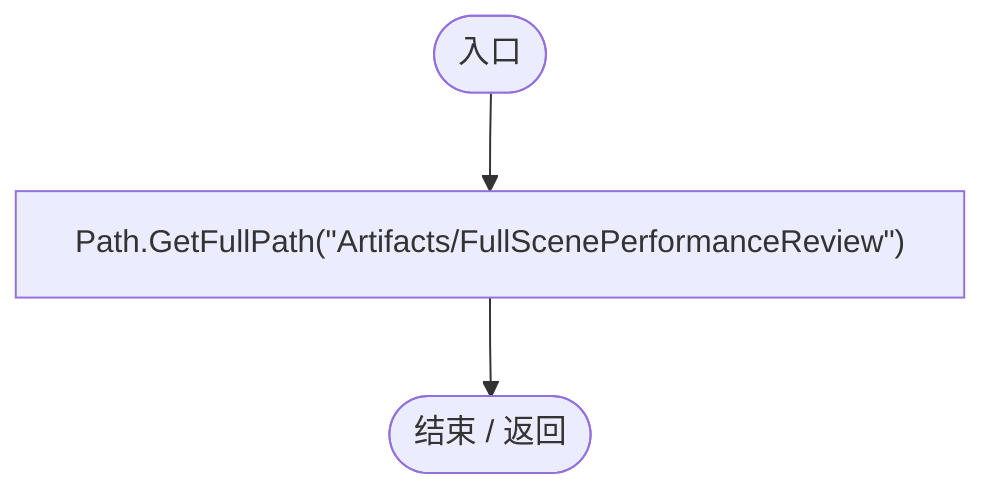

## FullScenePerformanceRegression.ctor · L24

`static FullScenePerformanceRegression()`

### Editor · Roslyn编译器控制流

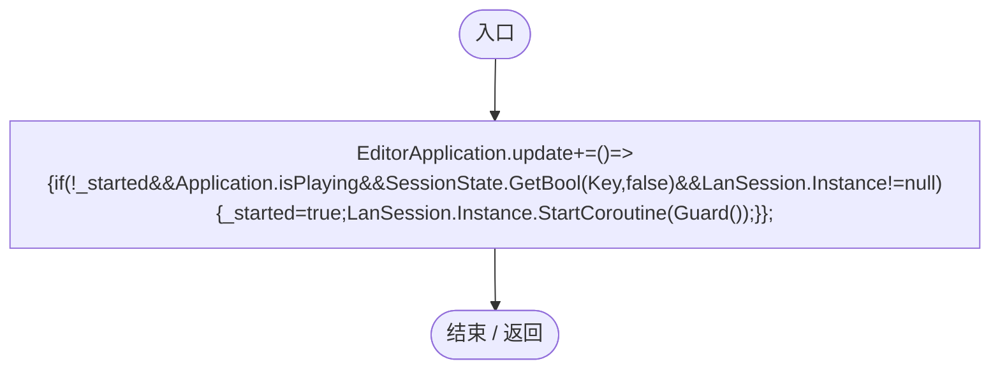

项目内调用/回调引用：

- [FullScenePerformanceRegression.回调@24 · L24](a67300715e60cb81.md#m369cab54a7c409c1)（回调/委托）

## 回调@24 · L24

`( … => 回调`

### Editor · Roslyn编译器控制流

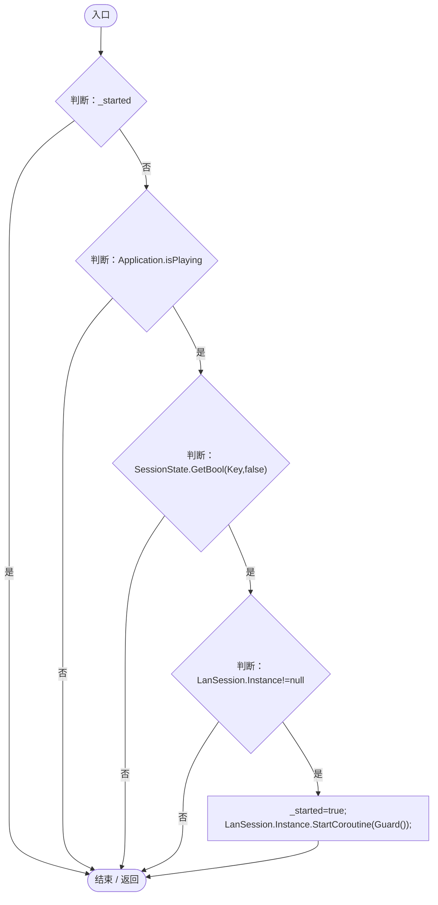

项目内调用/回调引用：

- [LanSession.Instance.get · L23](9fb633eebffe669c.md#mbf83306994878383)（访问器）
- [FullScenePerformanceRegression.Guard · L26](a67300715e60cb81.md#m323117cd46ebf49e)（方法）

## RunBatch · L25

`public static void RunBatch()`

### Editor · Roslyn编译器控制流

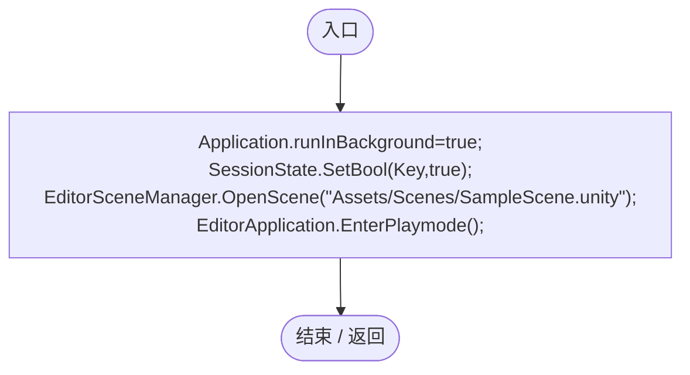

## Guard · L26

`private static IEnumerator Guard()`

### Editor · Roslyn编译器控制流

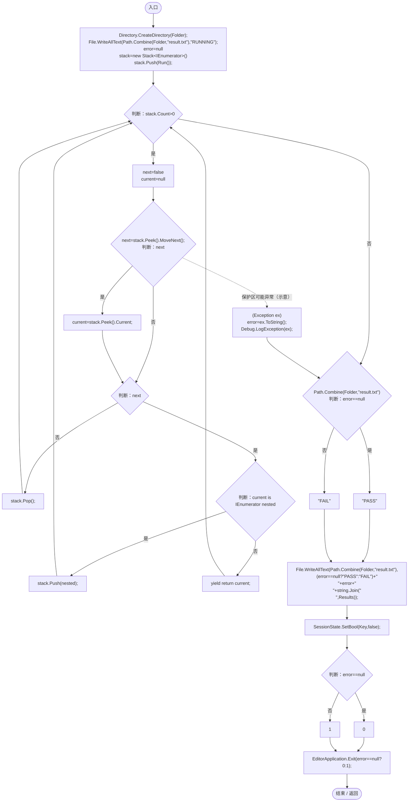

项目内调用/回调引用：

- [FullScenePerformanceRegression.Run · L46](a67300715e60cb81.md#m4b3bc0ad1fd6aaf8)（方法）

## Sample · L32

`private static IEnumerator Sample(string name)`

### Editor · Roslyn编译器控制流

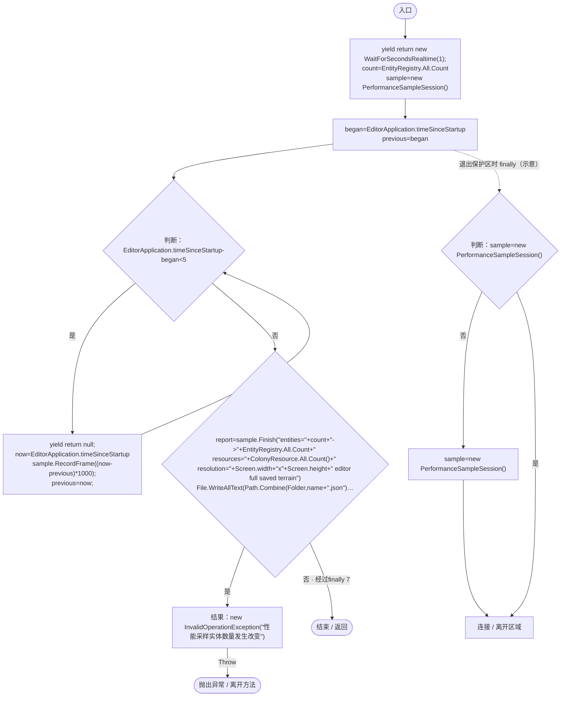

项目内调用/回调引用：

- [PerformanceSampleSession.PerformanceSampleSession.ctor · L42](a8403a4c7503726d.md#m7edb727de35dd4e0)（构造函数）
- [PerformanceSampleSession.RecordFrame · L50](a8403a4c7503726d.md#md8103bcb92ec1d0b)（方法）
- [PerformanceSampleSession.Finish · L54](a8403a4c7503726d.md#mbe1d31dc542eeb76)（方法）

## Allocations · L40

`private static string Allocations(string name,Action action)`

### Editor · Roslyn编译器控制流

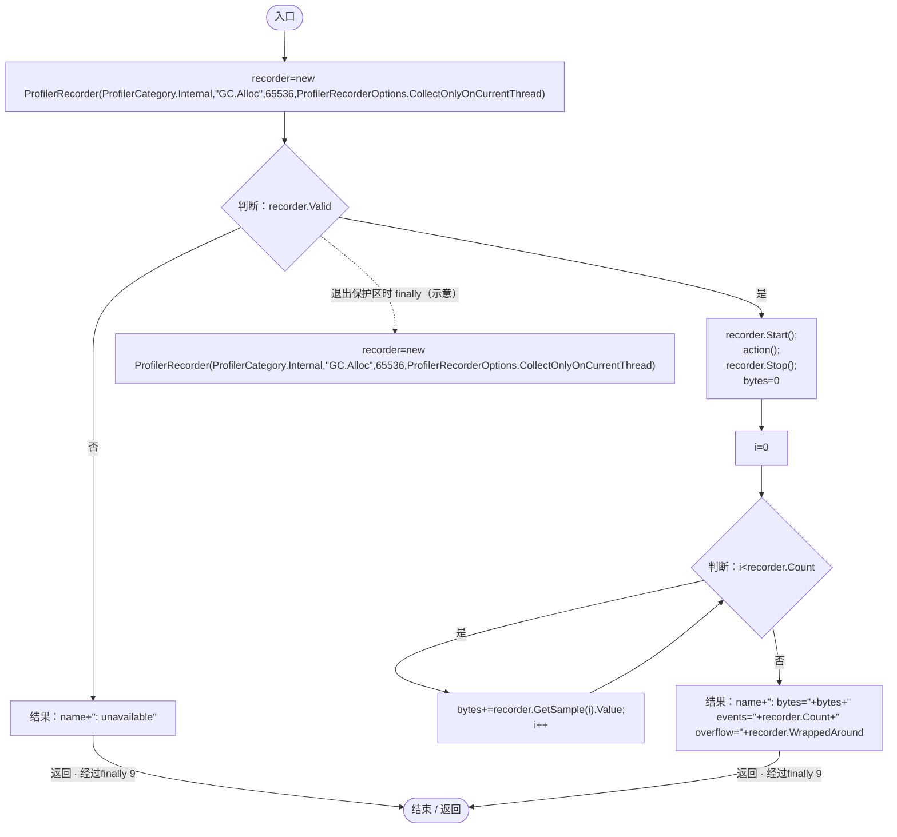

## Run · L46

`private static IEnumerator Run()`

### Editor · Roslyn编译器控制流

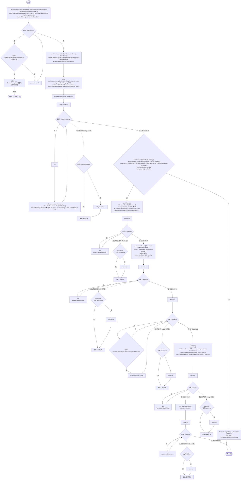

项目内调用/回调引用：

- [WorldSaveStore.Read · L74](d67a35e5e3814c15.md#mde52fadbe0185af1)（方法）
- [WorldSessionManager.Open · L60](08741c7b7b9d9344.md#m7bd56ef45131b4e5)（方法）
- [WorldSessionManager.Busy.get · L24](08741c7b7b9d9344.md#m4483e2e4f28f7c85)（访问器）
- [ServiceLocator.Get · L33](f2fdbe9f9ccd93cb.md#m2ae625299520c56d)（方法）
- [SimulationClock.Pause · L79](a8f444aec9614b0a.md#m30929d45a885d0f1)（方法）
- [PopulationMaintenance.Restore · L157](923ccc4e86c4786c.md#m6eadf366fa1602cc)（方法）
- [EntityPopulationLimit.UseSnapshot · L30](44f717c5df79d270.md#m735185cedc969868)（方法）
- [FramePacingSettings.SetLimit · L19](8a946f816b77d4b6.md#mff17d0cc654b6a7f)（方法）
- [DarwinEntity.Genes.get · L14](70798dde169f2e8b.md#m622eb1adf401d431)（访问器）
- [EntityLifeCycle.RestoreProgress · L52](9f4138bfbae654b7.md#m007c73a0c714c238)（方法）
- [EntityLifeCycle.Progress.get · L10](9f4138bfbae654b7.md#m178185fd5f5a0d74)（访问器）
- [LifeCycleSettings.Load · L16](ace76969fe8f61de.md#mbd2925785484f343)（方法）
- [FullScenePerformanceRegression.Allocations · L40](a67300715e60cb81.md#m2352b5b9e3abd2bf)（方法）
- [FullScenePerformanceRegression.Restore · L53](a67300715e60cb81.md#m63ce9dc2b1547d2b)（局部函数）
- [SimulationClock.Play · L78](a8f444aec9614b0a.md#m7aa9e64b7de60ed0)（方法）
- [FullScenePerformanceRegression.Sample · L32](a67300715e60cb81.md#m0535d97d0364f7b1)（方法）
- [FullScenePerformanceRegression.回调@52 · L52](a67300715e60cb81.md#ma9bd1d81d523ffd0)（回调/委托）
- [FullScenePerformanceRegression.回调@55 · L55](a67300715e60cb81.md#m3a44608e0b4a10ca)（回调/委托）
- [FullScenePerformanceRegression.回调@56 · L56](a67300715e60cb81.md#mfd5e466ac9ca7a61)（回调/委托）
- [FullScenePerformanceRegression.回调@57 · L57](a67300715e60cb81.md#mf431ee4ba1300232)（回调/委托）
- [FullScenePerformanceRegression.回调@58 · L58](a67300715e60cb81.md#mb18eb49e1a9dbae7)（回调/委托）
- [FullScenePerformanceRegression.回调@60 · L60](a67300715e60cb81.md#mcb087cfc94846394)（回调/委托）
- [FullScenePerformanceRegression.回调@68 · L68](a67300715e60cb81.md#m3ce56feab45982dc)（回调/委托）
- [EntitySaveState.Capture · L22](a1ec8fcd9d7d3ddb.md#md994065ded6697b7)（方法）

## 回调@52 · L52

`r … => 回调`

### Editor · Roslyn编译器控制流

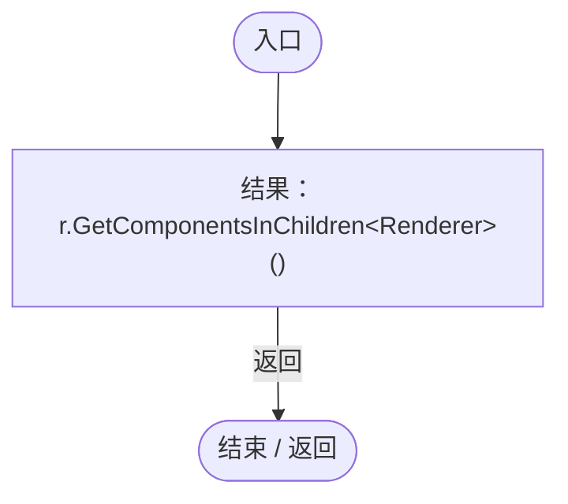

## Restore · L53

`void Restore()`

### Editor · Roslyn编译器控制流

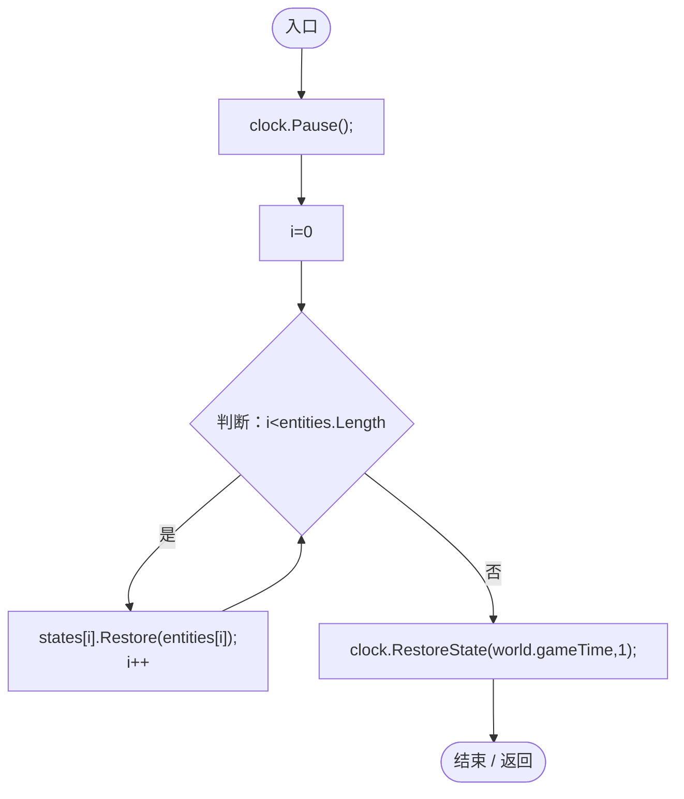

项目内调用/回调引用：

- [SimulationClock.Pause · L79](a8f444aec9614b0a.md#m30929d45a885d0f1)（方法）
- [EntitySaveState.Restore · L32](a1ec8fcd9d7d3ddb.md#md1cca8b8dd3628a4)（方法）
- [SimulationClock.RestoreState · L74](a8f444aec9614b0a.md#m8f617e95e1282846)（方法）

## 回调@55 · L55

`( … => 回调`

### Editor · Roslyn编译器控制流

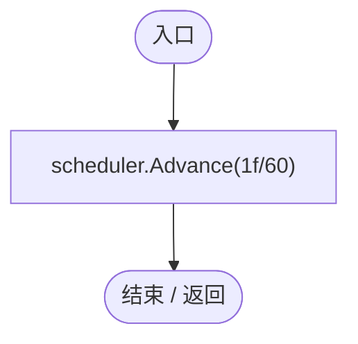

项目内调用/回调引用：

- [EntityWorkScheduler.Advance · L91](465ccdbb260bcac2.md#m3c6be95c9f3f99a5)（方法）

## 回调@56 · L56

`( … => 回调`

### Editor · Roslyn编译器控制流

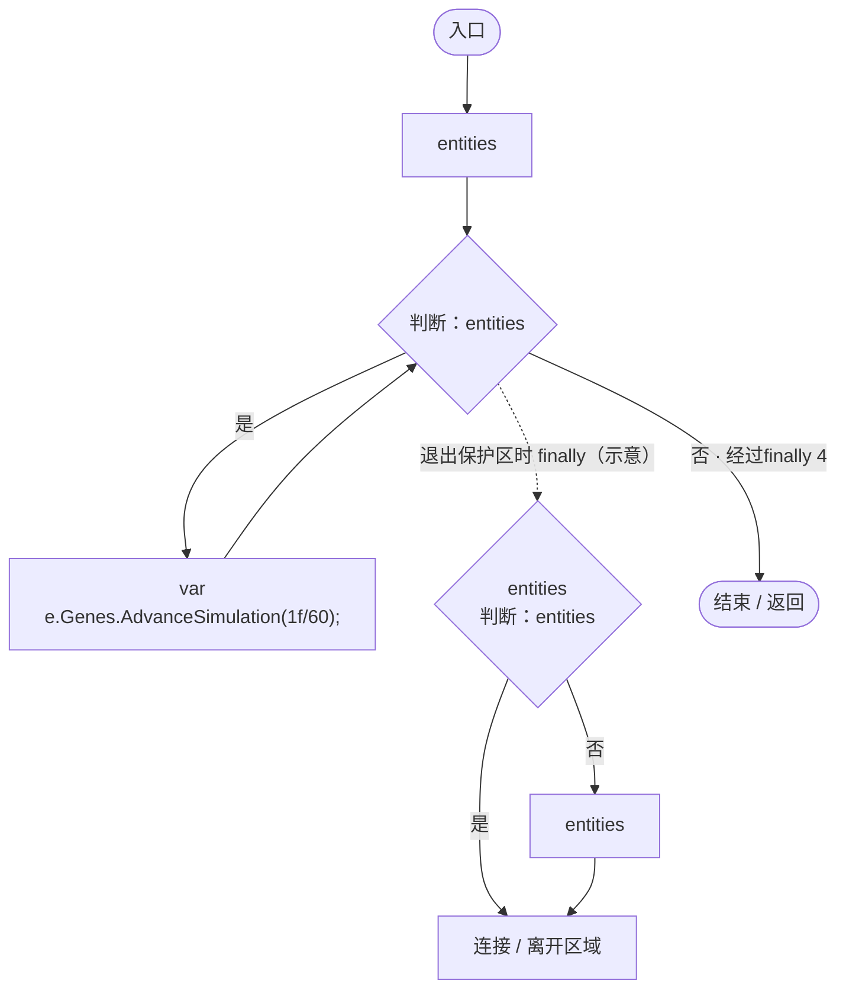

项目内调用/回调引用：

- [EntityGeneController.AdvanceSimulation · L73](7494d53178552f0e.md#m0056817ce3208fda)（方法）
- [DarwinEntity.Genes.get · L14](70798dde169f2e8b.md#m622eb1adf401d431)（访问器）

## 回调@57 · L57

`( … => 回调`

### Editor · Roslyn编译器控制流

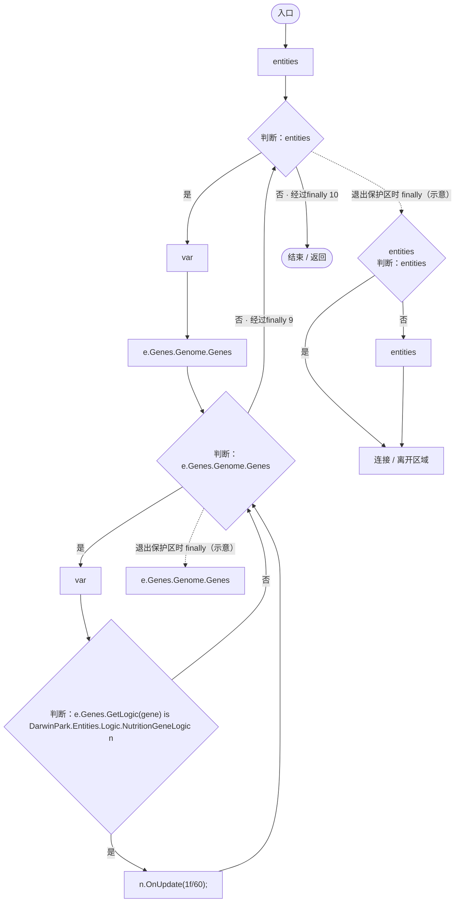

项目内调用/回调引用：

- [DarwinEntity.Genes.get · L14](70798dde169f2e8b.md#m622eb1adf401d431)（访问器）
- [EntityGeneController.GetLogic · L240](7494d53178552f0e.md#m9be6a2566c76c275)（方法）
- [NutritionGeneLogic.OnUpdate · L19](abc9633044732d73.md#m6802e59f8c25c174)（方法）

## 回调@58 · L58

`( … => 回调`

### Editor · Roslyn编译器控制流

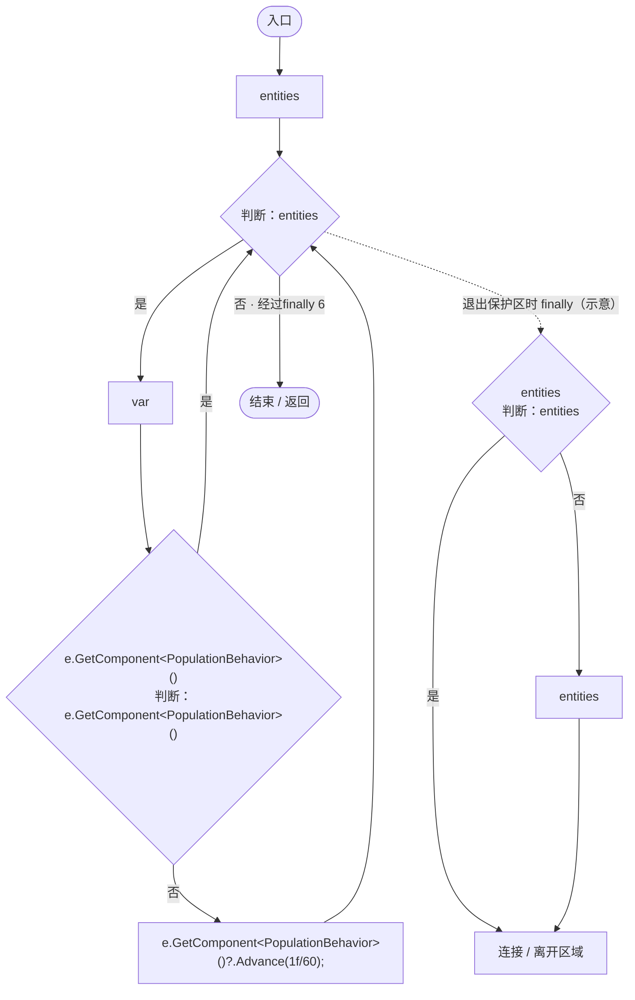

项目内调用/回调引用：

- [PopulationBehavior.Advance · L78](21e4f62f75a9a80f.md#m3b1594d99e3bdf28)（方法）

## 回调@60 · L60

`( … => 回调`

### Editor · Roslyn编译器控制流

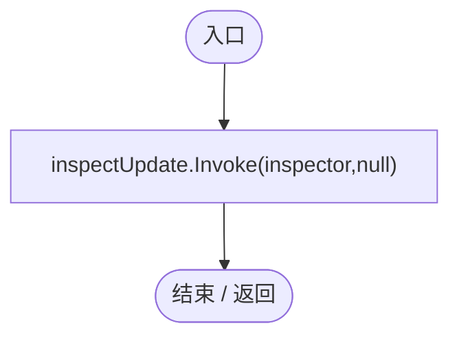

## 回调@68 · L68

`c … => 回调`

### Editor · Roslyn编译器控制流

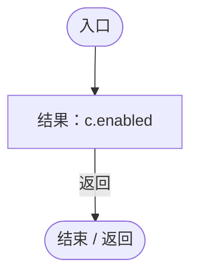
