# EntityManualControl.cs

[返回总索引](../README.md) · `Runtime` · `Assets/DarwinPark/Entities/EntityManualControl.cs`

[源文件](../../../Assets/DarwinPark/Entities/EntityManualControl.cs) · 源码校验：`204d0c4898a2a896a055c4c544c7656fc503af22c642f5f30e0ffe8561f67670`

方法按源文件位置排列。事件/回调引用不表示立即执行；分支与异常说明见总索引。完整源码与可点击关系图请打开离线手册。

## IsControlled.get · L12

`get`

### Editor / Player · 语法控制结构 / 声明（非CFG）

## IsControlled.set · L12

`private set`

### Editor / Player · 语法控制结构 / 声明（非CFG）

## AttackHeld.get · L13

`get`

### Editor / Player · 语法控制结构 / 声明（非CFG）

## AttackHeld.set · L13

`private set`

### Editor / Player · 语法控制结构 / 声明（非CFG）

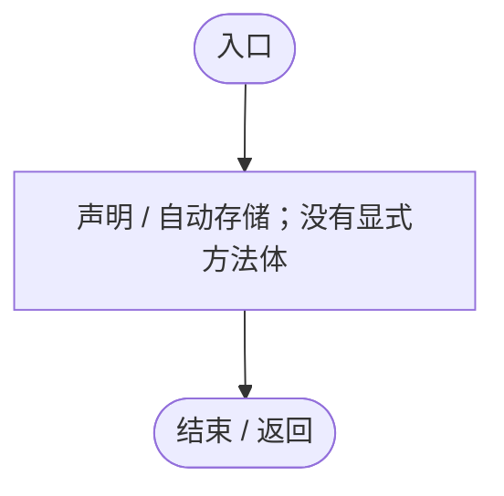

## MoveDirection.get · L14

`get`

### Editor / Player · 语法控制结构 / 声明（非CFG）

## MoveDirection.set · L14

`private set`

### Editor / Player · 语法控制结构 / 声明（非CFG）

## aimRadius.get · L23

`public float aimRadius`

★ 适配：判定框扩大由可编辑游戏配置统一控制，避免旧场景组件残留小半径。

### Editor / Player · 语法控制结构 / 声明（非CFG）

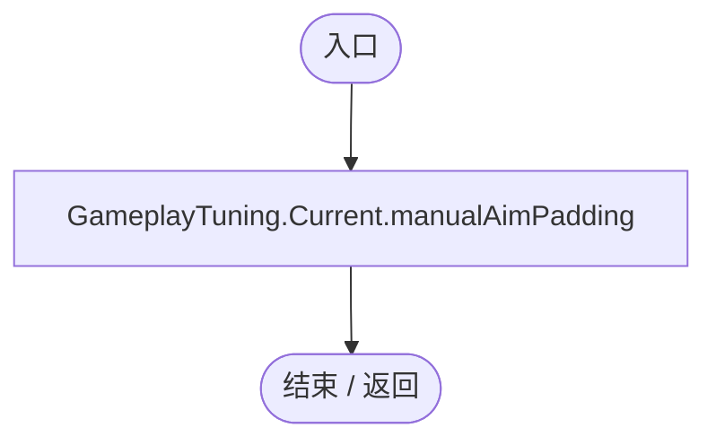

项目内调用/回调引用：

- [GameplayTuning.Current.get · L21](db546e5713b32d53.md#m1caba89e7704d239)（访问器）

## QueueAttack · L24

`public void QueueAttack()`

### Editor / Player · Roslyn编译器控制流

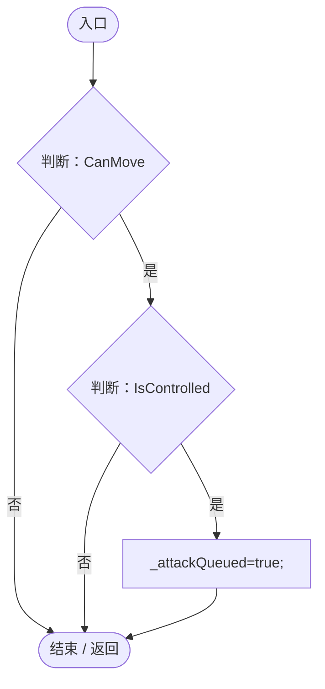

项目内调用/回调引用：

- [EntityManualControl.IsControlled.get · L12](a6969896da35e1f0.md#m125d8f7da7ab33bf)（访问器）

## ConsumeAttack · L25

`public bool ConsumeAttack()`

### Editor / Player · Roslyn编译器控制流

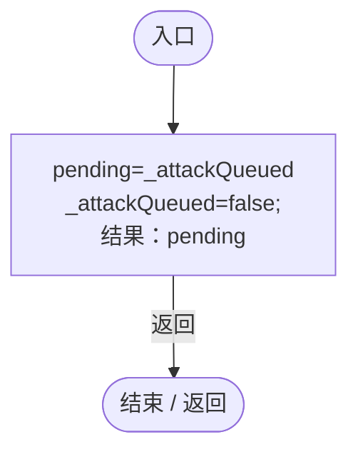

## ClearAttack · L26

`public void ClearAttack()`

### Editor / Player · Roslyn编译器控制流

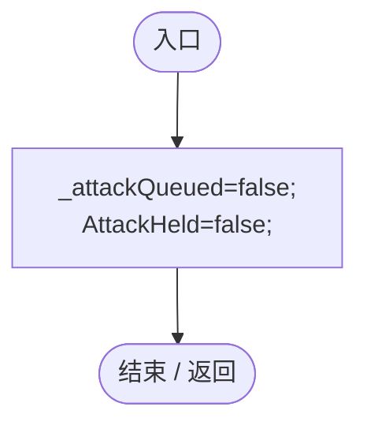

项目内调用/回调引用：

- [EntityManualControl.AttackHeld.set · L13](a6969896da35e1f0.md#mb2d5701268c6df1f)（访问器）

## SetAim · L27

`public void SetAim(Ray ray)`

### Editor / Player · Roslyn编译器控制流

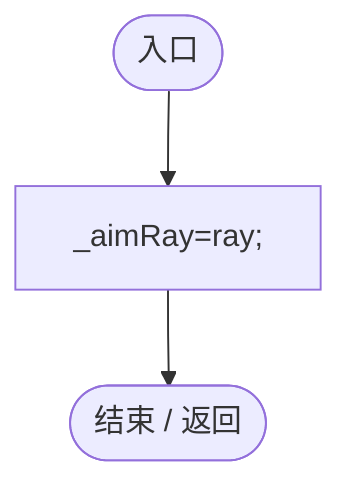

## GetAttackTarget · L28

`public DarwinEntity GetAttackTarget()`

### Editor / Player · Roslyn编译器控制流

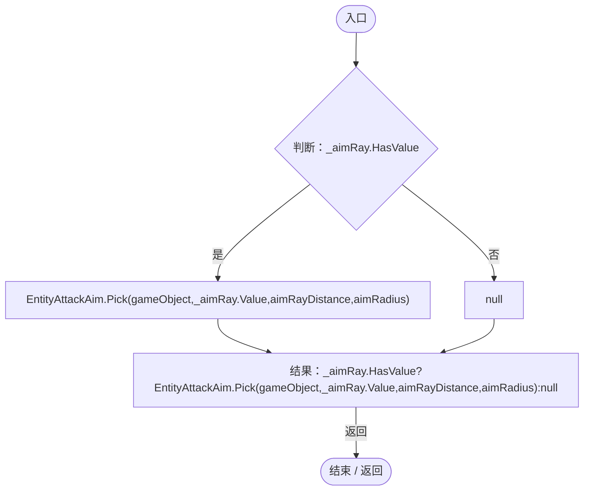

项目内调用/回调引用：

- [EntityAttackAim.Pick · L10](2e9dde897281c303.md#m6a55b6280b6e3053)（方法）

## CanMove.get · L29

`public bool CanMove`

### Editor / Player · 语法控制结构 / 声明（非CFG）

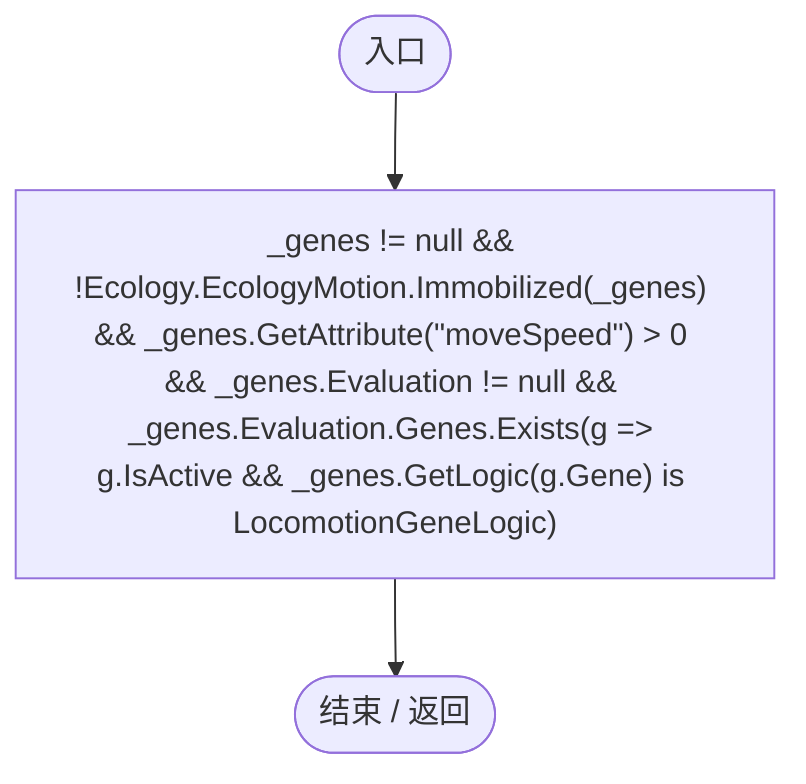

项目内调用/回调引用：

- [EcologyMotion.Immobilized · L9](6ed9d0eedb456d32.md#mff3eeb8fb207a31e)（方法）
- [EntityGeneController.GetAttribute · L257](7494d53178552f0e.md#m600509f72d274f0c)（方法）
- [EntityGeneController.Evaluation.get · L18](7494d53178552f0e.md#mc0039c100a31b455)（访问器）
- [EntityManualControl.回调@30 · L30](a6969896da35e1f0.md#m6ce2935482f342d1)（回调/委托）

## 回调@30 · L30

`g … => 回调`

### Editor / Player · 语法控制结构 / 声明（非CFG）

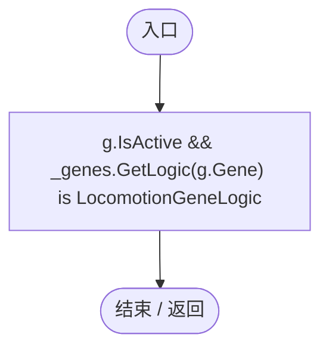

项目内调用/回调引用：

- [EntityGeneController.GetLogic · L211](7494d53178552f0e.md#maadb710e89e60395)（方法）

## Awake · L31

`private void Awake()`

### Editor / Player · Roslyn编译器控制流

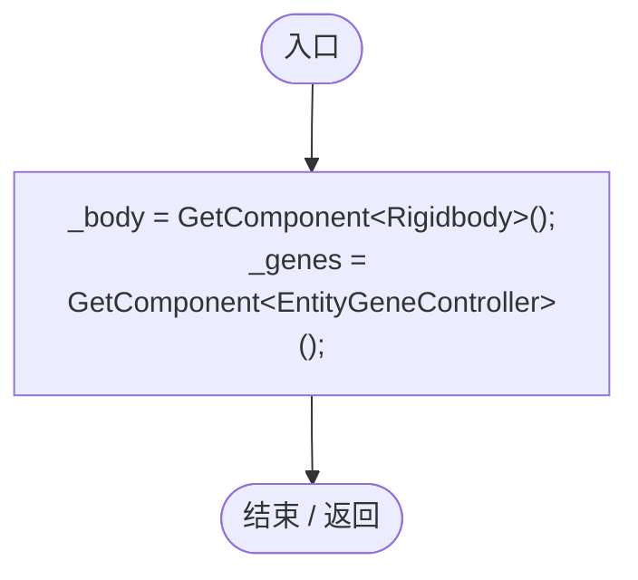

## BeginControl · L32

`public void BeginControl(Transform planet)`

### Editor / Player · Roslyn编译器控制流

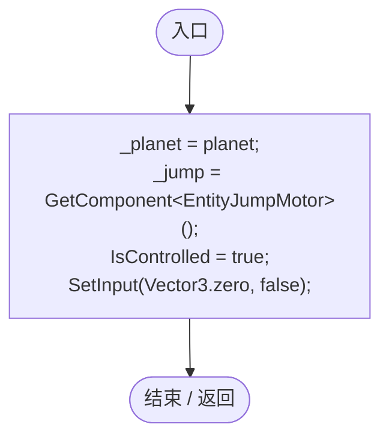

项目内调用/回调引用：

- [EntityManualControl.IsControlled.set · L12](a6969896da35e1f0.md#m2c289b150c05a99b)（访问器）
- [EntityManualControl.SetInput · L33](a6969896da35e1f0.md#m7c7f5613b3bebc74)（方法）

## SetInput · L33

`public void SetInput(Vector3 direction, bool attack)`

### Editor / Player · Roslyn编译器控制流

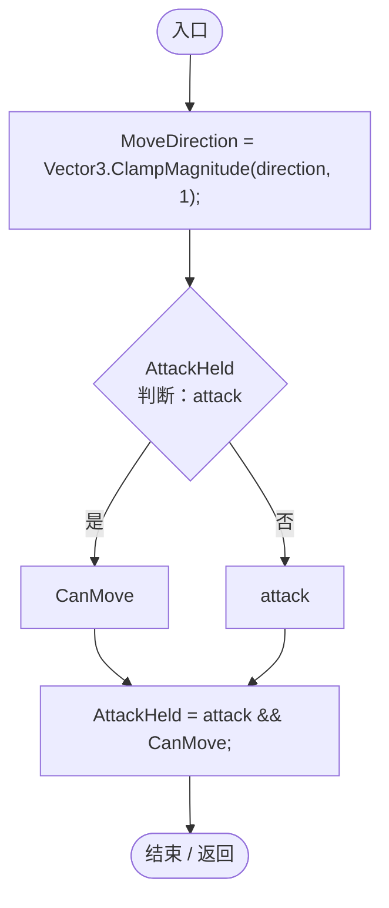

项目内调用/回调引用：

- [EntityManualControl.MoveDirection.set · L14](a6969896da35e1f0.md#mc5b0bd91ea02e054)（访问器）
- [EntityManualControl.AttackHeld.set · L13](a6969896da35e1f0.md#mb2d5701268c6df1f)（访问器）

## Release · L37

`public void Release()`

### Editor / Player · Roslyn编译器控制流

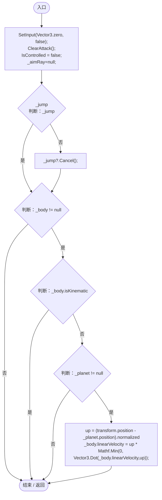

项目内调用/回调引用：

- [EntityManualControl.SetInput · L33](a6969896da35e1f0.md#m7c7f5613b3bebc74)（方法）
- [EntityManualControl.ClearAttack · L26](a6969896da35e1f0.md#m9a16d6f4efae7238)（方法）
- [EntityManualControl.IsControlled.set · L12](a6969896da35e1f0.md#m2c289b150c05a99b)（访问器）
- [EntityJumpMotor.Cancel · L49](fa3269c9da0aa692.md#m74e8ff8f50ccc15b)（方法）

## FixedUpdate · L47

`private void FixedUpdate()`

### Editor / Player · Roslyn编译器控制流

```mermaid
flowchart TD
  b0(["入口"])
  b1{"判断：IsControlled"}
  b2{"判断：_planet == null"}
  b3{"判断：_body == null"}
  b4{"判断：_body.isKinematic"}
  b5{"判断：ServiceLocator.TryGet&lt;SimulationClock&gt;(out var clock)"}
  b6["clock.MotionTimeScale"]
  b7["1"]
  b8["scale = ServiceLocator.TryGet&lt;SimulationClock&gt;(out var clock) ? clock.MotionTimeScale : 1"]
  b9{"判断：scale &lt;= 0"}
  b10["up = (transform.position - _planet.position).normalized"]
  b11{"GetComponent&lt;DarwinPark.Entities.Vitals.EntityEnvironmentHazard&gt;()<br/>判断：GetComponent&lt;DarwinPark.Entities.Vitals.EntityEnvironmentHazard&gt;()"}
  b12[".IsSubmerged"]
  b13["GetComponent&lt;DarwinPark.Entities.Vitals.EntityEnvironmentHazard&gt;()"]
  b14["underwater=GetComponent&lt;DarwinPark.Entities.Vitals.EntityEnvironmentHazard&gt;()?.IsSubmerged == true"]
  b15{"判断：CanMove"}
  b16{"判断：underwater"}
  b17["Vector3.ProjectOnPlane(MoveDirection,up).normalized * MoveDirection.magnitude"]
  b18["Vector3.zero"]
  b19["direction = CanMove &amp;&amp; !underwater ? Vector3.ProjectOnPlane(MoveDirection,up).normalized * MoveDirection.magnitude : Vector3.zero"]
  b20{"判断：_jump == null"}
  b21["_jump = GetComponent&lt;EntityJumpMotor&gt;();"]
  b22{"判断：underwater"}
  b23{"_jump<br/>判断：_jump"}
  b24["_jump?.Cancel();"]
  b25["radial = Vector3.Dot(_body.linearVelocity,up)"]
  b26{"_body.linearVelocity<br/>direction * (_genes.GetAttribute(&quot;moveSpeed&quot;) * scale)<br/>up<br/>判断：_jump != null"}
  b27["_jump.RadialVelocity(up,radial)"]
  b28["Mathf.Min(0,radial)"]
  b29["_body.linearVelocity = direction * (_genes.GetAttribute(&quot;moveSpeed&quot;) * scale) + up * (_jump != null ? _jump.RadialVelocity(up,radial) : Mathf.Min(0,radial));"]
  b30(["结束 / 返回"])
  b0 --> b1
  b1 -->|"是"| b2
  b1 -->|"否"| b30
  b2 -->|"否"| b3
  b2 -->|"是"| b30
  b3 -->|"否"| b4
  b3 -->|"是"| b30
  b4 -->|"是"| b30
  b4 -->|"否"| b5
  b5 -->|"是"| b6
  b5 -->|"否"| b7
  b6 --> b8
  b7 --> b8
  b8 --> b9
  b9 -->|"是"| b30
  b9 -->|"否"| b10
  b10 --> b11
  b11 -->|"否"| b12
  b11 -->|"是"| b13
  b12 --> b14
  b13 --> b14
  b14 --> b15
  b15 -->|"是"| b16
  b15 -->|"否"| b18
  b16 -->|"否"| b17
  b16 -->|"是"| b18
  b17 --> b19
  b18 --> b19
  b19 --> b20
  b20 -->|"是"| b21
  b20 -->|"否"| b22
  b21 --> b22
  b22 -->|"是"| b23
  b22 -->|"否"| b25
  b23 -->|"否"| b24
  b23 -->|"是"| b25
  b24 --> b25
  b25 --> b26
  b26 -->|"是"| b27
  b26 -->|"否"| b28
  b27 --> b29
  b28 --> b29
  b29 --> b30

```

项目内调用/回调引用：

- [EntityManualControl.IsControlled.get · L12](a6969896da35e1f0.md#m125d8f7da7ab33bf)（访问器）
- [ServiceLocator.TryGet · L26](f2fdbe9f9ccd93cb.md#m143b24e6d58471b0)（方法）
- [EntityEnvironmentHazard.IsSubmerged.get · L31](5c434d0ba85333b1.md#mab7b6057b8137739)（访问器）
- [EntityManualControl.MoveDirection.get · L14](a6969896da35e1f0.md#mcdc072c374347467)（访问器）
- [EntityJumpMotor.Cancel · L49](fa3269c9da0aa692.md#m74e8ff8f50ccc15b)（方法）
- [EntityGeneController.GetAttribute · L257](7494d53178552f0e.md#m600509f72d274f0c)（方法）
- [EntityJumpMotor.RadialVelocity · L44](fa3269c9da0aa692.md#ma57633ea7c01dd1a)（方法）

## OnDisable · L64

`private void OnDisable()`

### Editor / Player · Roslyn编译器控制流

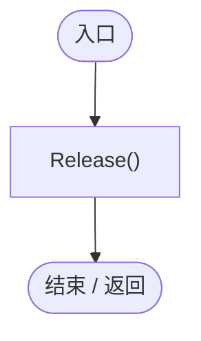

项目内调用/回调引用：

- [EntityManualControl.Release · L37](a6969896da35e1f0.md#m87aa0efacece2c5b)（方法）
