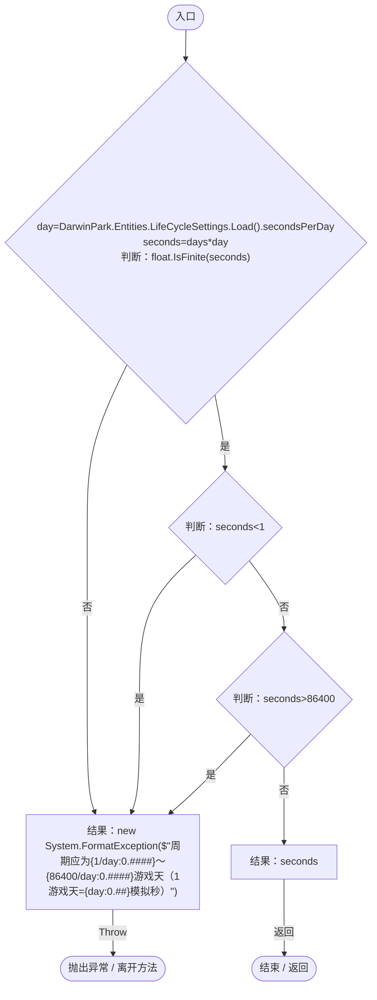
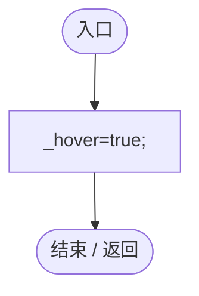
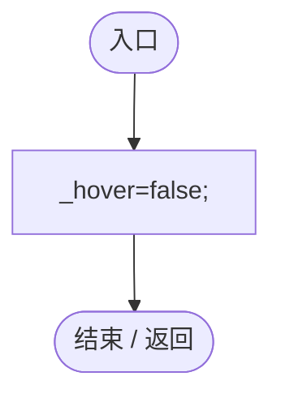
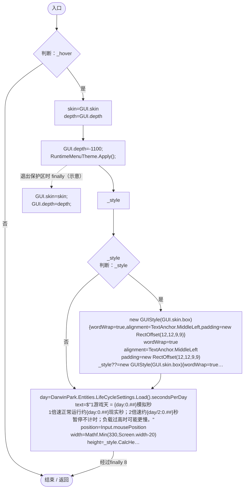

# SimulationTimeHelp.cs

[返回总索引](../README.md) · `Runtime` · `Assets/DarwinPark/UI/SimulationTimeHelp.cs`

[源文件](../../../Assets/DarwinPark/UI/SimulationTimeHelp.cs) · 源码校验：`b6e542177214c85ecc259d89abcedc2cf53b701a4865ff29bfe736807b767fa2`

方法按源文件位置排列。事件/回调引用不表示立即执行；分支与异常说明见总索引。完整源码与可点击关系图请打开离线手册。

## ToSeconds · L10

`public static float ToSeconds(float days)`

★ 新增：界面按天校验并换算，报错也使用玩家当前看到的单位。

### Editor / Player · Roslyn编译器控制流

项目内调用/回调引用：

- [LifeCycleSettings.Load · L16](ace76969fe8f61de.md#mbd2925785484f343)（方法）

## OnPointerEnter · L17

`public void OnPointerEnter(PointerEventData data)`

### Editor / Player · Roslyn编译器控制流

## OnPointerExit · L17

`public void OnPointerExit(PointerEventData data)`

### Editor / Player · Roslyn编译器控制流

## OnDisable · L18

`private void OnDisable()`

### Editor / Player · Roslyn编译器控制流

## OnGUI · L19

`private void OnGUI()`

### Editor / Player · Roslyn编译器控制流

项目内调用/回调引用：

- [RuntimeMenuTheme.Apply · L39](b9d8455882f2a532.md#m587a63eff5a85605)（方法）
- [LifeCycleSettings.Load · L16](ace76969fe8f61de.md#mbd2925785484f343)（方法）
