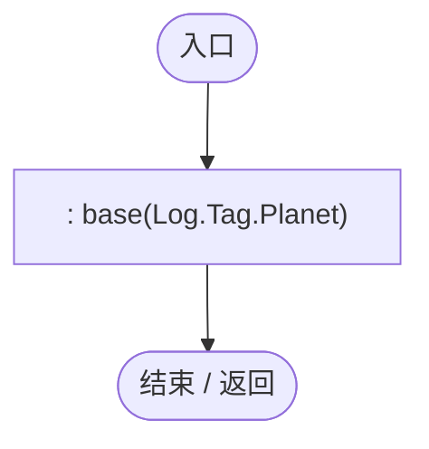
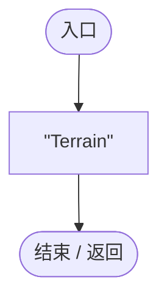
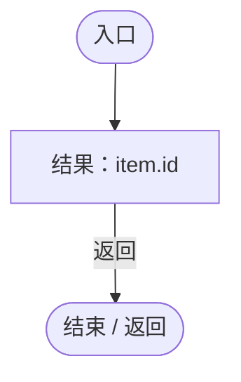
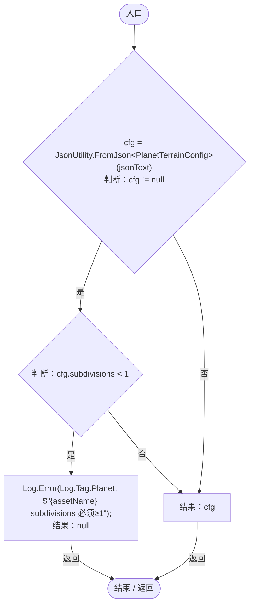

# PlanetTerrainConfigDatabase.cs

[返回总索引](../README.md) · `Runtime` · `Assets/DarwinPark/Planet/Terrain/PlanetTerrainConfigDatabase.cs`

[源文件](../../../Assets/DarwinPark/Planet/Terrain/PlanetTerrainConfigDatabase.cs) · 源码校验：`b301ae99e20da563aef75d2f6d115499c653c5a3a533d3d6d23702e7721473a4`

方法按源文件位置排列。事件/回调引用不表示立即执行；分支与异常说明见总索引。完整源码与可点击关系图请打开离线手册。

## PlanetTerrainConfigDatabase.ctor · L9

`public PlanetTerrainConfigDatabase() : base(Log.Tag.Planet)`

### Editor / Player · Roslyn编译器控制流

项目内调用/回调引用：

- [JsonResourceDatabase.JsonResourceDatabase.ctor · L17](55a3ec07ee308cf8.md#m8faa5713647c7cfe)（构造函数）

## ResourceFolder.get · L11

`protected override string ResourceFolder`

### Editor / Player · 语法控制结构 / 声明（非CFG）

## GetId · L12

`protected override string GetId(PlanetTerrainConfig item)`

### Editor / Player · Roslyn编译器控制流

## ConvertFromJson · L14

`protected override PlanetTerrainConfig ConvertFromJson(string jsonText, string assetName)`

### Editor / Player · Roslyn编译器控制流

项目内调用/回调引用：

- [Log.Error · L43](735e5abf0df2bddc.md#m2addd5e1d74b000d)（方法）
