# RuntimePerformance.cs

[返回总索引](../README.md) · `Runtime` · `Assets/DarwinPark/Core/RuntimePerformance.cs`

[源文件](../../../Assets/DarwinPark/Core/RuntimePerformance.cs) · 源码校验：`0006df4bf93548f1151cdc4e4007a676eac16223fd2a601ccaed8d99812f6006`

方法按源文件位置排列。事件/回调引用不表示立即执行；分支与异常说明见总索引。完整源码与可点击关系图请打开离线手册。

## Capturing.get · L17

`get`

### Editor / Player · 语法控制结构 / 声明（非CFG）

## Capturing.set · L17

`private set`

### Editor / Player · 语法控制结构 / 声明（非CFG）

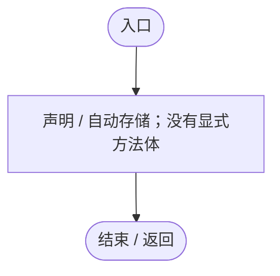

## Scope.ctor · L21

`internal Scope(Area area)`

### Editor / Player · Roslyn编译器控制流

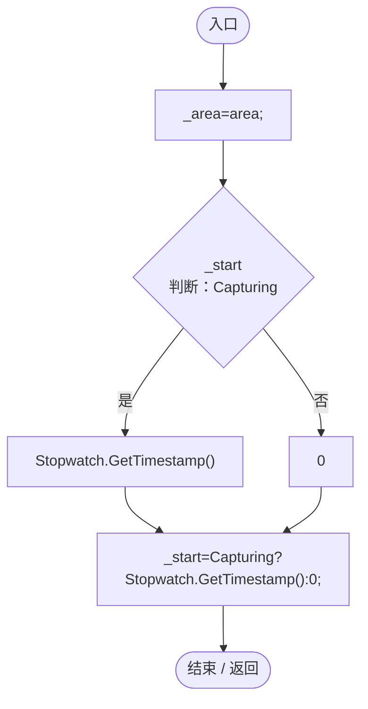

项目内调用/回调引用：

- [PerformanceTimings.Capturing.get · L17](a8403a4c7503726d.md#m9eb45773ec148e2f)（访问器）

## Dispose · L22

`public void Dispose()`

### Editor / Player · Roslyn编译器控制流

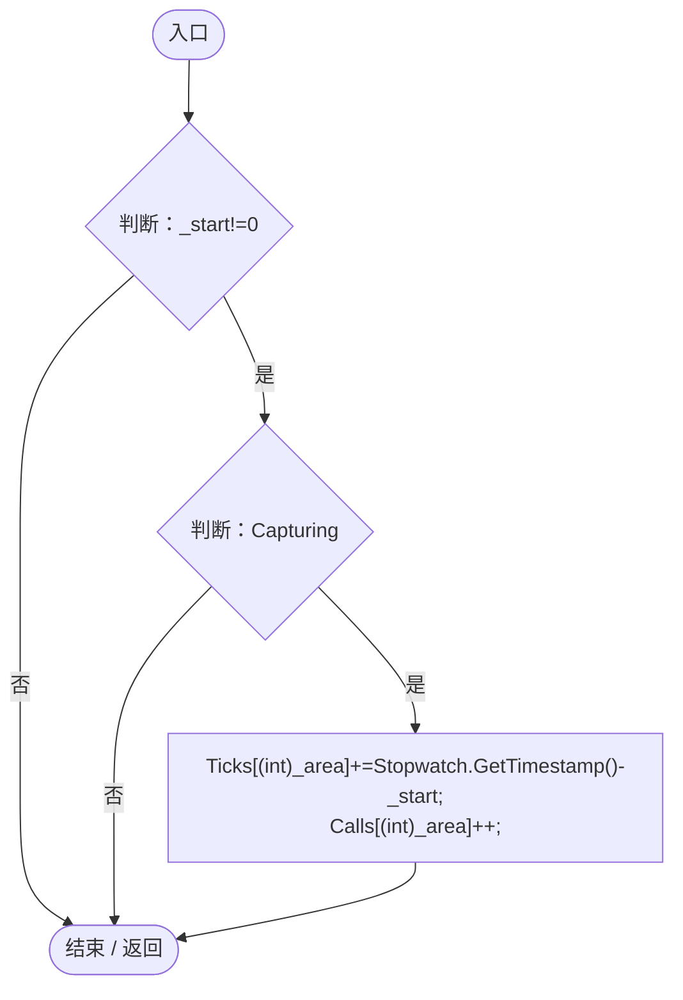

项目内调用/回调引用：

- [PerformanceTimings.Capturing.get · L17](a8403a4c7503726d.md#m9eb45773ec148e2f)（访问器）

## Measure · L24

`public static Scope Measure(Area area)`

### Editor / Player · Roslyn编译器控制流

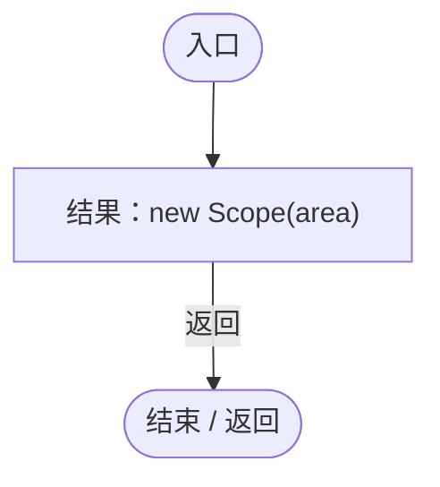

项目内调用/回调引用：

- [PerformanceTimings.Scope.Scope.ctor · L21](a8403a4c7503726d.md#m77acb2713c0526eb)（构造函数）

## Begin · L25

`internal static void Begin()`

### Editor / Player · Roslyn编译器控制流

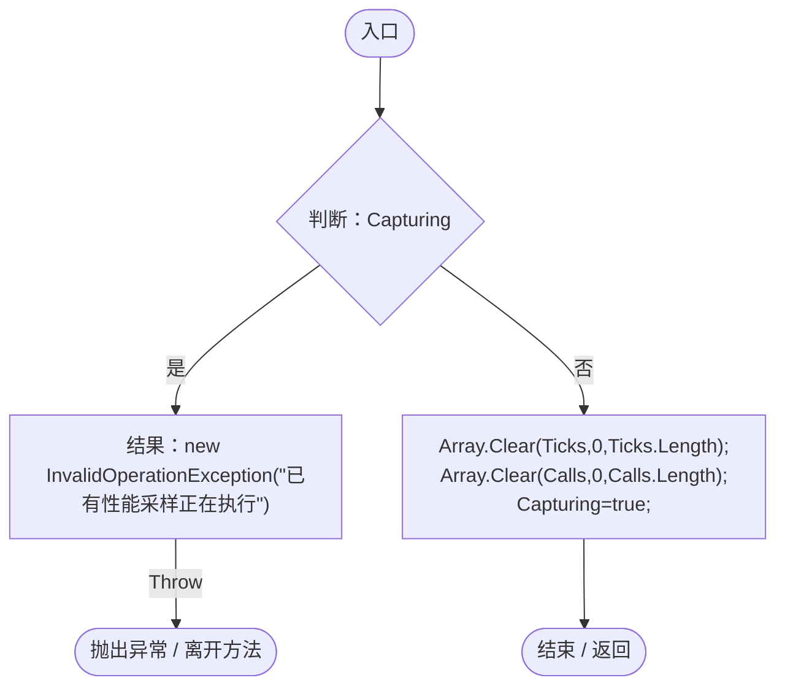

项目内调用/回调引用：

- [PerformanceTimings.Capturing.get · L17](a8403a4c7503726d.md#m9eb45773ec148e2f)（访问器）
- [PerformanceTimings.Capturing.set · L17](a8403a4c7503726d.md#m12baab07ee14d7a7)（访问器）

## End · L26

`internal static void End()`

### Editor / Player · Roslyn编译器控制流

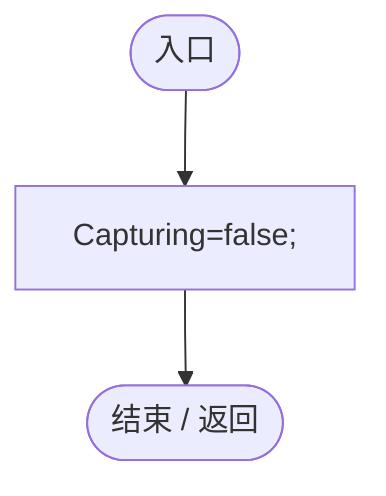

项目内调用/回调引用：

- [PerformanceTimings.Capturing.set · L17](a8403a4c7503726d.md#m12baab07ee14d7a7)（访问器）

## Take · L27

`internal static double Take(int area,out long calls)`

### Editor / Player · Roslyn编译器控制流

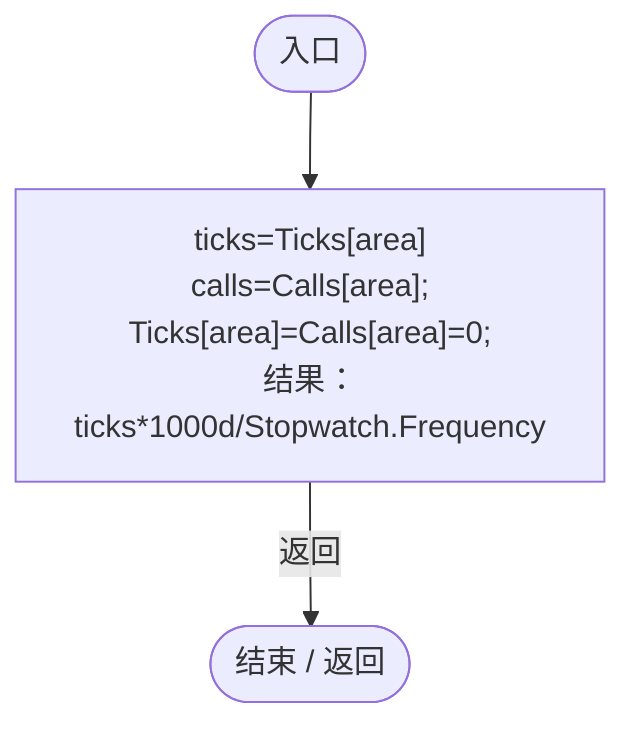

## Reset · L28

`[RuntimeInitializeOnLoadMethod(RuntimeInitializeLoadType.SubsystemRegistration)]private static void Reset()`

### Editor / Player · Roslyn编译器控制流

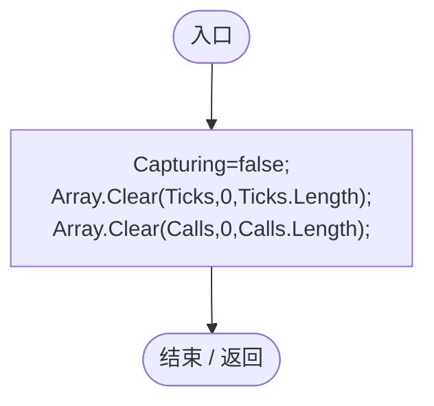

项目内调用/回调引用：

- [PerformanceTimings.Capturing.set · L17](a8403a4c7503726d.md#m12baab07ee14d7a7)（访问器）

## PerformanceSampleSession.ctor · L40

`public PerformanceSampleSession(int capacity=8192)`

### Editor / Player · Roslyn编译器控制流

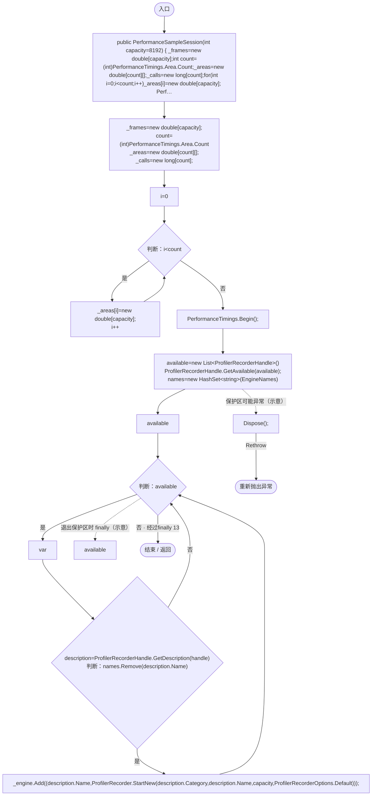

项目内调用/回调引用：

- [PerformanceTimings.Begin · L25](a8403a4c7503726d.md#m763ac776b7695655)（方法）
- [PerformanceSampleSession.Dispose · L61](a8403a4c7503726d.md#m8be34711406567e9)（方法）

## RecordFrame · L47

`public void RecordFrame(double milliseconds)`

### Editor / Player · Roslyn编译器控制流

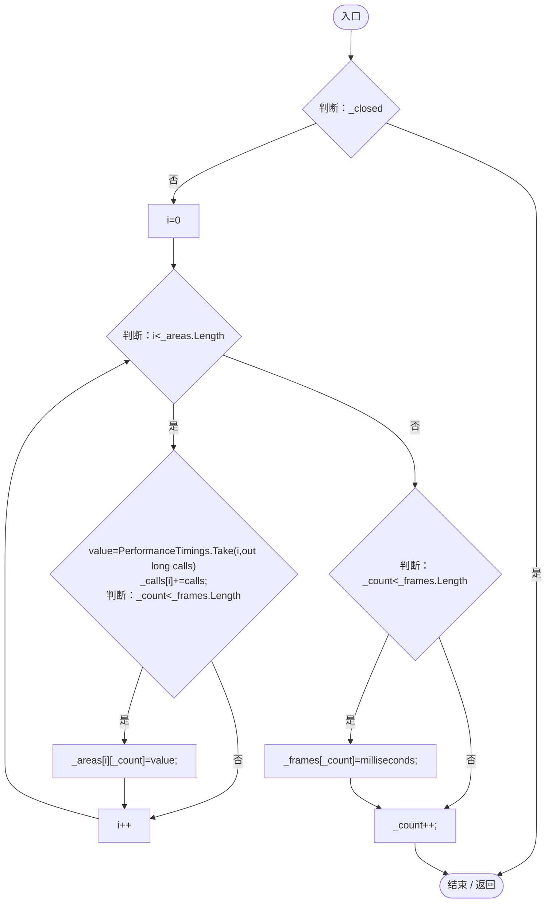

项目内调用/回调引用：

- [PerformanceTimings.Take · L27](a8403a4c7503726d.md#m17e14b4d48373cc6)（方法）

## Metric · L49

`private static PerformanceMetric Metric(string name,string unit,string source,double[] values,int frames,long calls=0)`

### Editor / Player · Roslyn编译器控制流

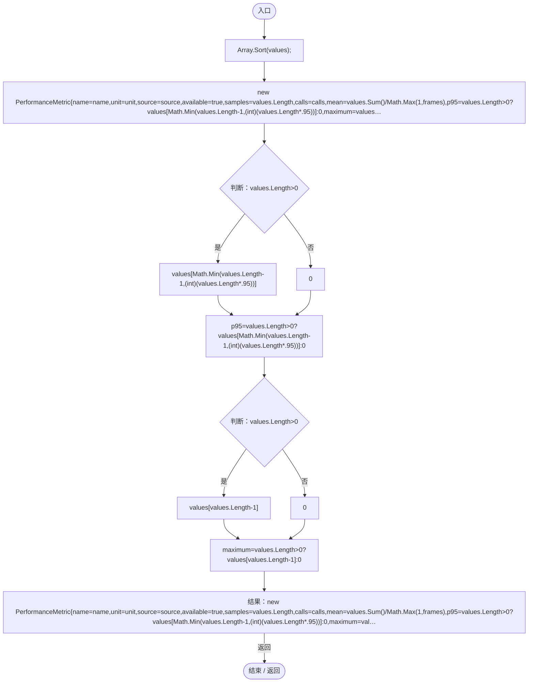

## Finish · L51

`public PerformanceReport Finish(string context)`

### Editor / Player · Roslyn编译器控制流

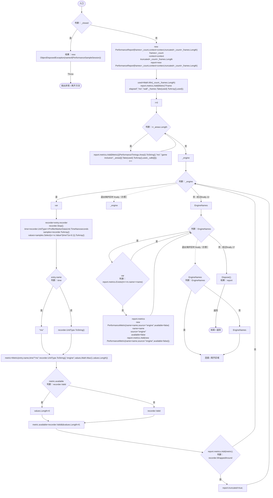

项目内调用/回调引用：

- [PerformanceSampleSession.Metric · L49](a8403a4c7503726d.md#m419451bce5eef4f2)（方法）
- [PerformanceSampleSession.Dispose · L61](a8403a4c7503726d.md#m8be34711406567e9)（方法）
- [PerformanceSampleSession.回调@57 · L57](a8403a4c7503726d.md#m1c3da85a69c6f53c)（回调/委托）
- [PerformanceSampleSession.回调@58 · L58](a8403a4c7503726d.md#m1e25225452a2b693)（回调/委托）

## 回调@57 · L57

`s … => 回调`

### Editor / Player · Roslyn编译器控制流

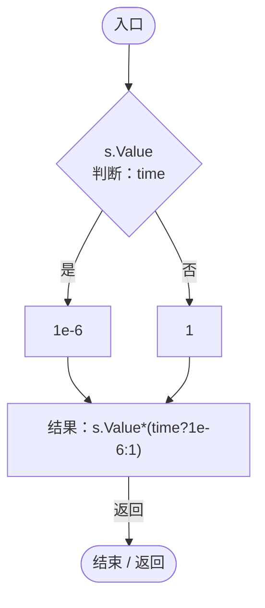

## 回调@58 · L58

`m … => 回调`

### Editor / Player · Roslyn编译器控制流

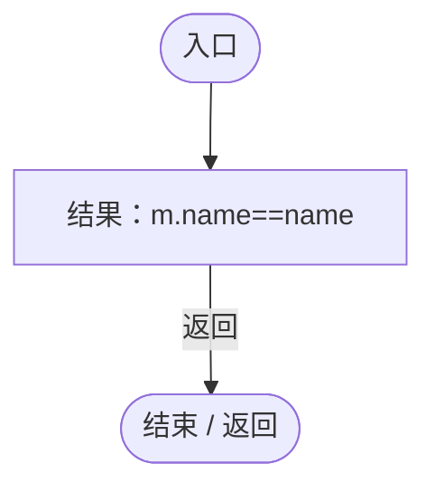

## Dispose · L61

`public void Dispose()`

### Editor / Player · Roslyn编译器控制流

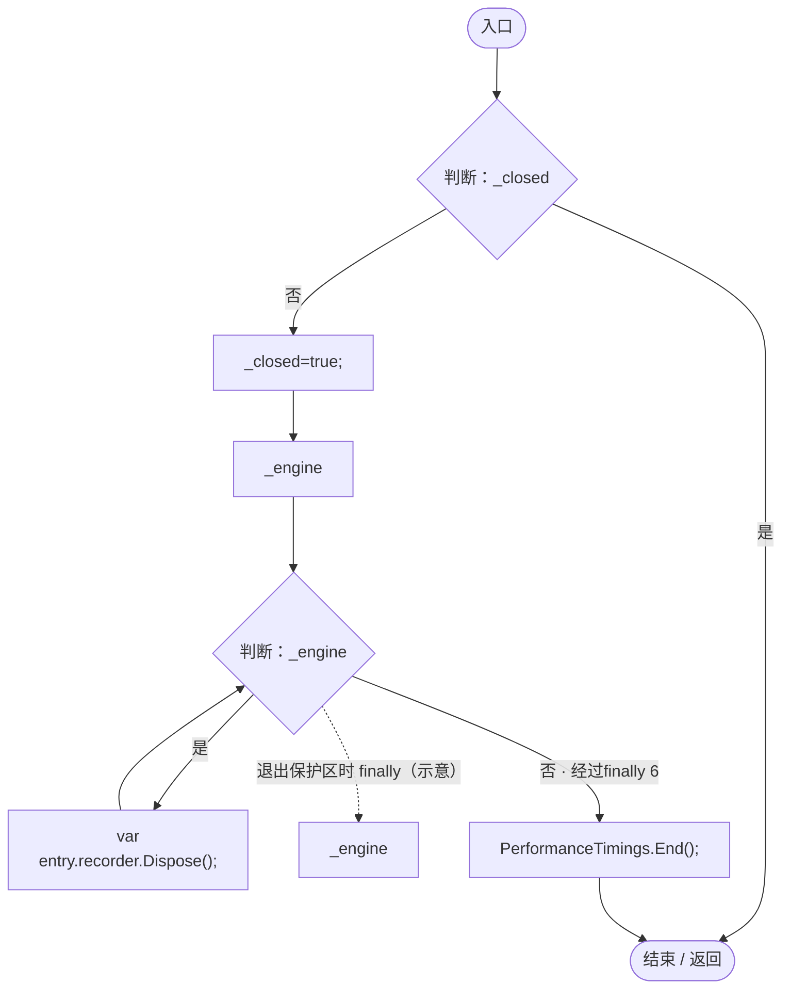

项目内调用/回调引用：

- [PerformanceTimings.End · L26](a8403a4c7503726d.md#m2eb7a0eff2c7f36e)（方法）
