# MergeAlgorithmAuditRegression.cs

[返回总索引](../README.md) · `Editor` · `Assets/DarwinPark/Editor/MergeAlgorithmAuditRegression.cs`

[源文件](../../../Assets/DarwinPark/Editor/MergeAlgorithmAuditRegression.cs) · 源码校验：`3d68cc0e181deae9e8c1af462a2b859a77c9a017dbcd96d72bf562aaee765278`

方法按源文件位置排列。事件/回调引用不表示立即执行；分支与异常说明见总索引。完整源码与可点击关系图请打开离线手册。

## Folder.get · L25

`private static string Folder`

### Editor · 语法控制结构 / 声明（非CFG）

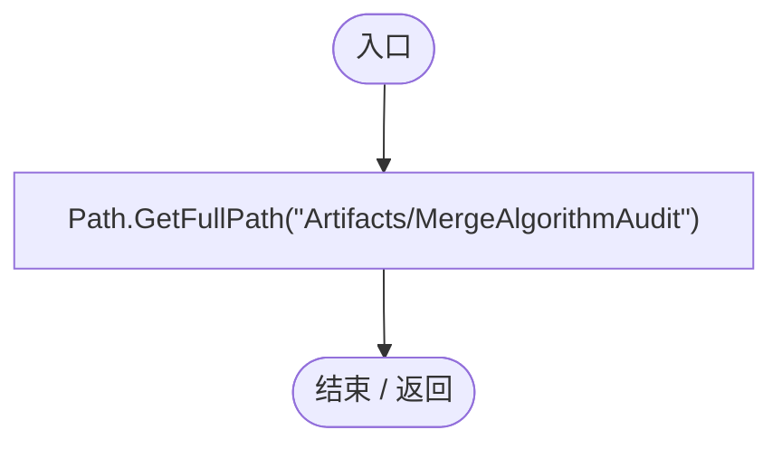

## MergeAlgorithmAuditRegression.ctor · L26

`static MergeAlgorithmAuditRegression()`

### Editor · Roslyn编译器控制流

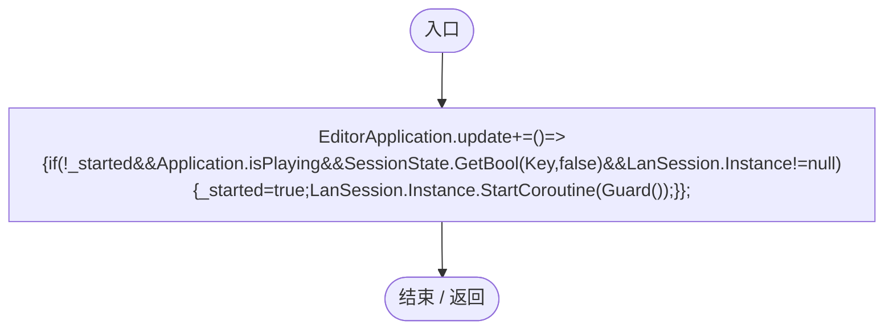

项目内调用/回调引用：

- [MergeAlgorithmAuditRegression.回调@26 · L26](a8573e4637b62b8c.md#mb4392303ce640d68)（回调/委托）

## 回调@26 · L26

`( … => 回调`

### Editor · Roslyn编译器控制流

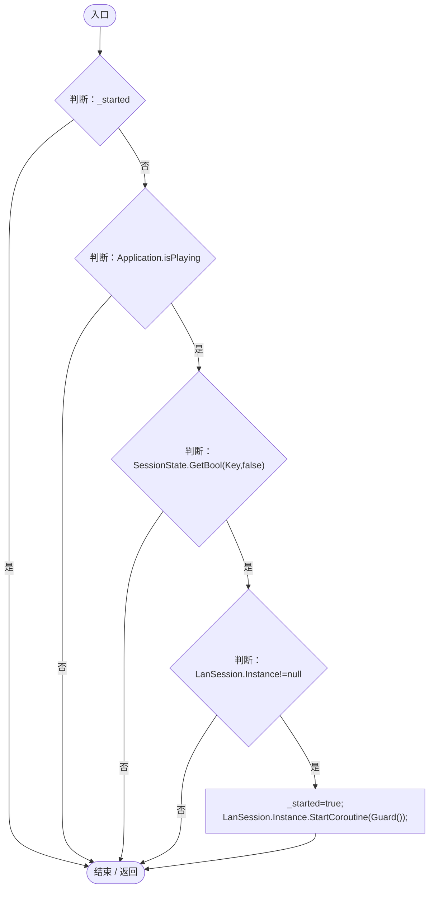

项目内调用/回调引用：

- [LanSession.Instance.get · L23](9fb633eebffe669c.md#mbf83306994878383)（访问器）
- [MergeAlgorithmAuditRegression.Guard · L28](a8573e4637b62b8c.md#me4a45d979ed3a2d2)（方法）

## RunBatch · L27

`public static void RunBatch()`

### Editor · Roslyn编译器控制流

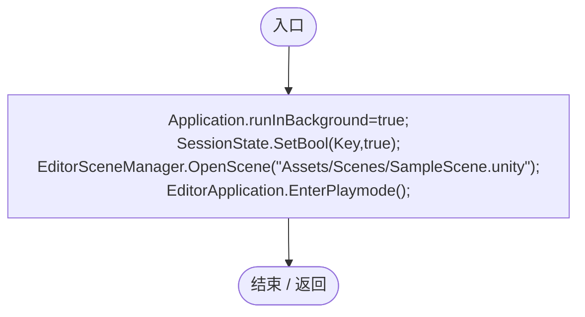

## Guard · L28

`private static IEnumerator Guard()`

### Editor · Roslyn编译器控制流

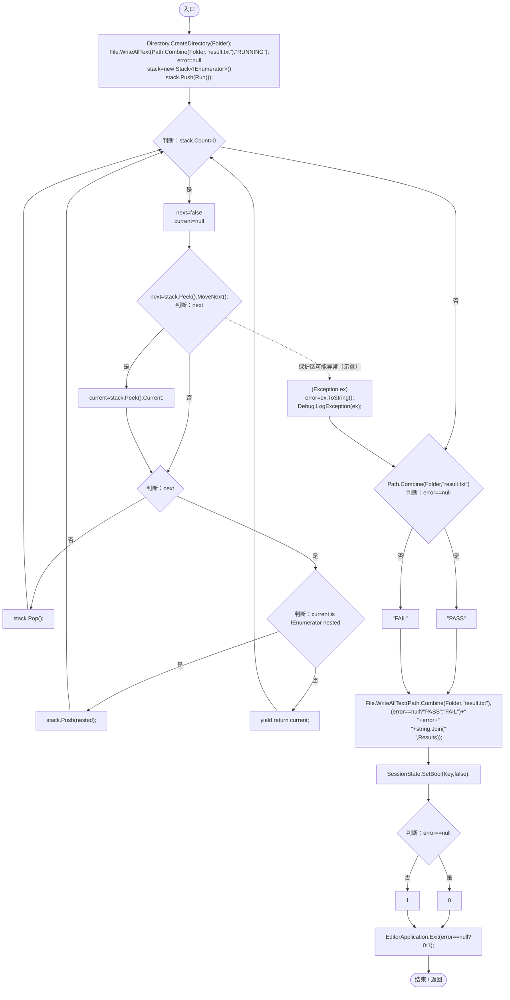

项目内调用/回调引用：

- [MergeAlgorithmAuditRegression.Run · L52](a8573e4637b62b8c.md#m47cf42a3d704cefb)（方法）

## Audit · L34

`private static string Audit(EntityWorkScheduler scheduler)`

### Editor · Roslyn编译器控制流

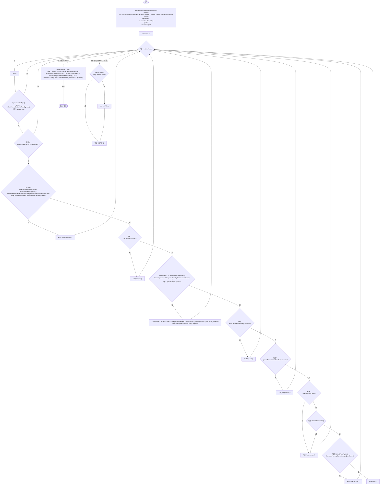

项目内调用/回调引用：

- [MergeAlgorithmAuditRegression.Field · L41](a8573e4637b62b8c.md#m8409b916eea8de1d)（局部函数）
- [EntityGeneController.GetAttribute · L286](7494d53178552f0e.md#m18bff2b38f95b556)（方法）
- [GameplayTuning.Current.get · L46](db546e5713b32d53.md#m4fa691bd8a3b9618)（访问器）
- [MergeAlgorithmAuditRegression.Add · L36](a8573e4637b62b8c.md#m6f9d8541b157516b)（局部函数）
- [EntityStats.CapacityRemaining · L92](75aa86a368efdf24.md#m574f0a6509120d00)（方法）
- [EntityEnvironmentHazard.StressLevel.get · L34](5c434d0ba85333b1.md#m5b49c0526a2393cc)（访问器）
- [EntityEnvironmentHazard.IsDrowning.get · L27](5c434d0ba85333b1.md#md1684c4e763e2899)（访问器）
- [MergeAlgorithmAuditRegression.回调@47 · L47](a8573e4637b62b8c.md#m87b3e10e8b351a3b)（回调/委托）
- [MergeAlgorithmAuditRegression.回调@47 · L47](a8573e4637b62b8c.md#mdd59e1467941fa15)（回调/委托）
- [MergeAlgorithmAuditRegression.回调@50 · L50](a8573e4637b62b8c.md#m7d97e31fafbd47f3)（回调/委托）
- [EntityGeneController.GetLogic · L240](7494d53178552f0e.md#m9be6a2566c76c275)（方法）

## Add · L36

`void Add(string key)`

### Editor · Roslyn编译器控制流

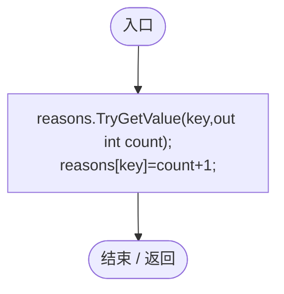

## Field · L41

`object Field(string key)`

### Editor · Roslyn编译器控制流

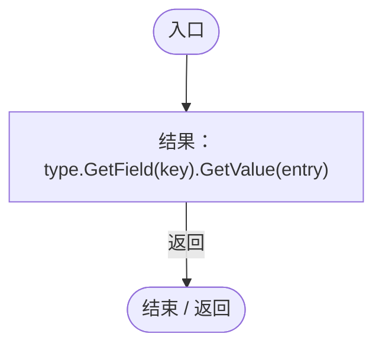

## 回调@47 · L47

`l … => 回调`

### Editor · Roslyn编译器控制流

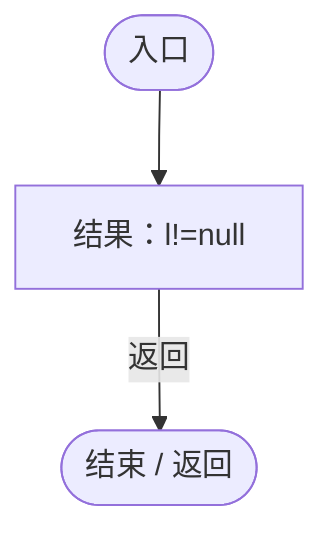

## 回调@47 · L47

`l … => 回调`

### Editor · Roslyn编译器控制流

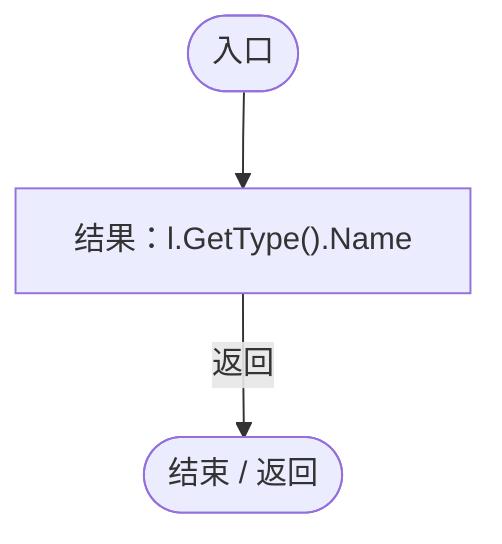

## 回调@50 · L50

`p … => 回调`

### Editor · Roslyn编译器控制流

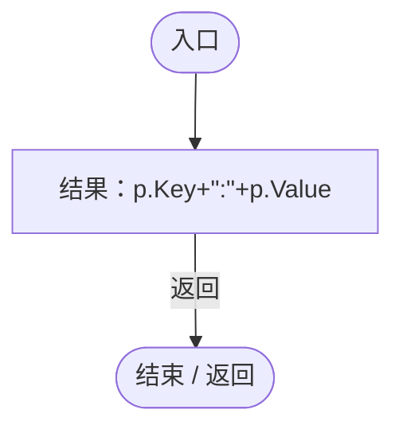

## Run · L52

`private static IEnumerator Run()`

### Editor · Roslyn编译器控制流

```mermaid
flowchart TD
  b0(["入口"])
  b1["original=File.ReadAllText(Path.Combine(Folder,&quot;input/world.json&quot;))"]
  b2["new[]{&quot;all-on&quot;,&quot;static-on&quot;,&quot;static-off&quot;,&quot;static-render-off&quot;,&quot;static300-no-resources-on&quot;,&quot;static300-no-resources-off&quot;}"]
  b3{"判断：new[]{&quot;all-on&quot;,&quot;static-on&quot;,&quot;static-off&quot;,&quot;static-render-off&quot;,&quot;static300-no-resources-on&quot;,&quot;static300-no-resources-off&quot;}"}
  b4["string"]
  b5["world=JsonUtility.FromJson&lt;WorldSaveData&gt;(original)<br/>onlyStatic=name!=&quot;all-on&quot;"]
  b6{"判断：name.EndsWith(&quot;-off&quot;)"}
  b7["name==&quot;static-render-off&quot;"]
  b8["!name.EndsWith(&quot;-off&quot;)"]
  b9["merge=!name.EndsWith(&quot;-off&quot;)&#124;&#124;name==&quot;static-render-off&quot;"]
  b10{"判断：onlyStatic"}
  b11["world.entities=world.entities.Where(e=&gt;!e.genome.Genes.Any(g=&gt;g.DefinitionId==&quot;gene_locomotion&quot;)).ToList();"]
  b12{"判断：name.Contains(&quot;300&quot;)"}
  b13["world.entities=world.entities.Take(300).ToList();<br/>world.colony.resources.Clear();"]
  b14["session=Object.FindFirstObjectByType&lt;WorldSessionManager&gt;()<br/>session.autoSaveInterval=36000;<br/>session.Open(world);<br/>start=EditorApplication.timeSinceStartup"]
  b15{"判断：session.Busy"}
  b16{"判断：EditorApplication.timeSinceStartup-start&gt;300"}
  b17["结果：new TimeoutException(&quot;load &quot;+name)"]
  x17(["抛出异常 / 离开方法"])
  b18["yield return null;"]
  b19["clock=ServiceLocator.Get&lt;SimulationClock&gt;()<br/>clock.Pause();<br/>Object.FindFirstObjectByType&lt;RandomPlanetSpawner&gt;().enabled=false;<br/>PopulationMaintenance.Restore(null);"]
  b20["new WorldGameSettings{entityLimit=EntityRegistry.All.Count}<br/>entityLimit=EntityRegistry.All.Count<br/>EntityPopulationLimit.UseSnapshot(new WorldGameSettings{entityLimit=EntityRegistry.All.Count});"]
  b21["FramePacingSettings.SetLimit(0);<br/>GameplayTuning.Current.mergeStationaryEntities=merge;"]
  b22["EntityRegistry.All"]
  b23{"判断：EntityRegistry.All"}
  b24["var"]
  b25["entity.Genes.mutationChance=0;<br/>life=entity.GetComponent&lt;EntityLifeCycle&gt;()<br/>life.RestoreProgress(Mathf.Min(life.Progress,LifeCycleSettings.Load().deathProgress-10));"]
  b26{"判断：EntityRegistry.All"}
  b27["EntityRegistry.All"]
  b28["连接 / 离开区域"]
  b29{"判断：name==&quot;static-render-off&quot;"}
  b30["ColonyResource.All"]
  b31{"判断：ColonyResource.All"}
  b32["var"]
  b33["resource.GetComponentsInChildren&lt;Renderer&gt;()"]
  b34{"判断：resource.GetComponentsInChildren&lt;Renderer&gt;()"}
  b35["var<br/>renderer.enabled=false;"]
  b36{"resource.GetComponentsInChildren&lt;Renderer&gt;()<br/>判断：resource.GetComponentsInChildren&lt;Renderer&gt;()"}
  b37["resource.GetComponentsInChildren&lt;Renderer&gt;()"]
  b38["连接 / 离开区域"]
  b39{"判断：ColonyResource.All"}
  b40["ColonyResource.All"]
  b41["连接 / 离开区域"]
  b42["clock.RestoreState(world.gameTime,1);<br/>clock.Play();<br/>yield return new WaitForSecondsRealtime(3);<br/>scheduler=Object.FindFirstObjectByType&lt;EntityWorkScheduler&gt;()<br/>shared=scheduler.SharedMemberSteps<br/>reps=scheduler.RepresentativeSteps<br/>count=Ent…"]
  b43{"判断：EditorApplication.timeSinceStartup-start&lt;6"}
  b44["yield return null;<br/>now=EditorApplication.timeSinceStartup<br/>sample.RecordFrame((now-previous)*1000);<br/>previous=now;<br/>dormant+=scheduler.DormantMembers;<br/>frames++;"]
  b45["audit=Audit(scheduler)<br/>report=sample.Finish(name+&quot; entities=&quot;+count+&quot;-&gt;&quot;+EntityRegistry.All.Count+&quot; resources=&quot;+ColonyResource.All.Count()+&quot; merge=&quot;+merge+&quot; dormantMean=&quot;+(dormant/Math.Max(1,frames)).ToString(&quot;F1&quot;)+&quot; reps=&quot;+(scheduler.Re…"]
  b46{"判断：sample=new PerformanceSampleSession()"}
  b47["sample=new PerformanceSampleSession()"]
  b48["连接 / 离开区域"]
  b49{"new[]{&quot;all-on&quot;,&quot;static-on&quot;,&quot;static-off&quot;,&quot;static-render-off&quot;,&quot;static300-no-resources-on&quot;,&quot;static300-no-resources-off&quot;}<br/>判断：new[]{&quot;all-on&quot;,&quot;static-on&quot;,&quot;static-off&quot;,&quot;static-render-off&quot;,&quot;static300-no-resources-on&quot;,&quot;static300-no-resources-off&quot;}"}
  b50["new[]{&quot;all-on&quot;,&quot;static-on&quot;,&quot;static-off&quot;,&quot;static-render-off&quot;,&quot;static300-no-resources-on&quot;,&quot;static300-no-resources-off&quot;}"]
  b51["连接 / 离开区域"]
  b52(["结束 / 返回"])
  b0 --> b1
  b1 --> b2
  b2 --> b3
  b3 -->|"是"| b4
  b3 -->|"否 · 经过finally 49"| b52
  b4 --> b5
  b5 --> b6
  b6 -->|"是"| b7
  b6 -->|"否"| b8
  b7 --> b9
  b8 --> b9
  b9 --> b10
  b10 -->|"是"| b11
  b10 -->|"否"| b12
  b11 --> b12
  b12 -->|"是"| b13
  b12 -->|"否"| b14
  b13 --> b14
  b14 --> b15
  b15 -->|"是"| b16
  b15 -->|"否"| b19
  b16 -->|"是"| b17
  b16 -->|"否"| b18
  b17 -->|"Throw"| x17
  b18 --> b15
  b19 --> b20
  b20 --> b21
  b21 --> b22
  b22 --> b23
  b23 -->|"是"| b24
  b23 -->|"否 · 经过finally 26"| b29
  b24 --> b25
  b25 --> b23
  b26 -->|"否"| b27
  b26 -->|"是"| b28
  b27 --> b28
  b29 -->|"是"| b30
  b29 -->|"否"| b42
  b30 --> b31
  b31 -->|"是"| b32
  b31 -->|"否 · 经过finally 39"| b42
  b32 --> b33
  b33 --> b34
  b34 -->|"是"| b35
  b34 -->|"否 · 经过finally 36"| b31
  b35 --> b34
  b36 -->|"否"| b37
  b36 -->|"是"| b38
  b37 --> b38
  b39 -->|"否"| b40
  b39 -->|"是"| b41
  b40 --> b41
  b42 --> b43
  b43 -->|"是"| b44
  b43 -->|"否"| b45
  b44 --> b43
  b45 -->|"经过finally 46"| b3
  b46 -->|"否"| b47
  b46 -->|"是"| b48
  b47 --> b48
  b49 -->|"否"| b50
  b49 -->|"是"| b51
  b50 --> b51
  b23 -. "退出保护区时 finally（示意）" .-> b26
  b34 -. "退出保护区时 finally（示意）" .-> b36
  b31 -. "退出保护区时 finally（示意）" .-> b39
  b43 -. "退出保护区时 finally（示意）" .-> b46
  b3 -. "退出保护区时 finally（示意）" .-> b49

```

项目内调用/回调引用：

- [WorldSessionManager.Open · L60](08741c7b7b9d9344.md#m7bd56ef45131b4e5)（方法）
- [WorldSessionManager.Busy.get · L24](08741c7b7b9d9344.md#m4483e2e4f28f7c85)（访问器）
- [ServiceLocator.Get · L33](f2fdbe9f9ccd93cb.md#m2ae625299520c56d)（方法）
- [SimulationClock.Pause · L79](a8f444aec9614b0a.md#m30929d45a885d0f1)（方法）
- [PopulationMaintenance.Restore · L162](923ccc4e86c4786c.md#m23ae054ef57d2624)（方法）
- [EntityPopulationLimit.UseSnapshot · L30](44f717c5df79d270.md#m735185cedc969868)（方法）
- [FramePacingSettings.SetLimit · L19](8a946f816b77d4b6.md#mff17d0cc654b6a7f)（方法）
- [GameplayTuning.Current.get · L46](db546e5713b32d53.md#m4fa691bd8a3b9618)（访问器）
- [DarwinEntity.Genes.get · L14](70798dde169f2e8b.md#m622eb1adf401d431)（访问器）
- [EntityLifeCycle.RestoreProgress · L51](9f4138bfbae654b7.md#mec34c953ece464ab)（方法）
- [EntityLifeCycle.Progress.get · L10](9f4138bfbae654b7.md#m178185fd5f5a0d74)（访问器）
- [LifeCycleSettings.Load · L16](ace76969fe8f61de.md#m6fe263852e5a8989)（方法）
- [SimulationClock.RestoreState · L74](a8f444aec9614b0a.md#m8f617e95e1282846)（方法）
- [SimulationClock.Play · L78](a8f444aec9614b0a.md#m7aa9e64b7de60ed0)（方法）
- [EntityWorkScheduler.SharedMemberSteps.get · L63](465ccdbb260bcac2.md#ma2ea17be21511192)（访问器）
- [EntityWorkScheduler.RepresentativeSteps.get · L62](465ccdbb260bcac2.md#mc1634e98de0b9148)（访问器）
- [PerformanceSampleSession.PerformanceSampleSession.ctor · L42](a8403a4c7503726d.md#maededd26d4b1ea6d)（构造函数）
- [PerformanceSampleSession.RecordFrame · L50](a8403a4c7503726d.md#m944443f0b6e1e80b)（方法）
- [EntityWorkScheduler.DormantMembers.get · L64](465ccdbb260bcac2.md#mf38e594d3d450fdf)（访问器）
- [MergeAlgorithmAuditRegression.Audit · L34](a8573e4637b62b8c.md#m6cfc11e490be0b29)（方法）
- [PerformanceSampleSession.Finish · L54](a8403a4c7503726d.md#m2dddffce21e07ed1)（方法）
- [MergeAlgorithmAuditRegression.回调@58 · L58](a8573e4637b62b8c.md#m5b652d17ba41c079)（回调/委托）

## 回调@58 · L58

`e … => 回调`

### Editor · Roslyn编译器控制流

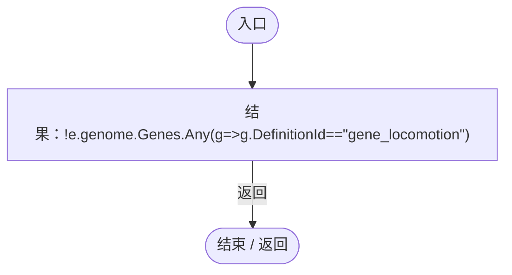

项目内调用/回调引用：

- [MergeAlgorithmAuditRegression.回调@58 · L58](a8573e4637b62b8c.md#me425d36682699429)（回调/委托）

## 回调@58 · L58

`g … => 回调`

### Editor · Roslyn编译器控制流

