# GeneTreeStorage.cs

[返回总索引](../README.md) · `Runtime` · `Assets/DarwinPark/Genetics/GeneTreeStorage.cs`

[源文件](../../../Assets/DarwinPark/Genetics/GeneTreeStorage.cs) · 源码校验：`8062251c390308e23e9936c7a8021876d2ea2a0da74ff62062b9e3e8e9b6c216`

方法按源文件位置排列。事件/回调引用不表示立即执行；分支与异常说明见总索引。完整源码与可点击关系图请打开离线手册。

<a id="m4330d6af5427b828"></a>

## Folder.get · L24

`public static string Folder`


### Editor / Player · 语法控制结构 / 声明（非CFG）

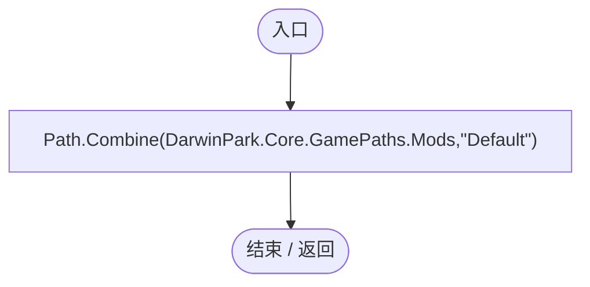

<a id="mc19a5b1d5f28ef3d"></a>

## GenesFolder.get · L25

`public static string GenesFolder`


### Editor / Player · 语法控制结构 / 声明（非CFG）

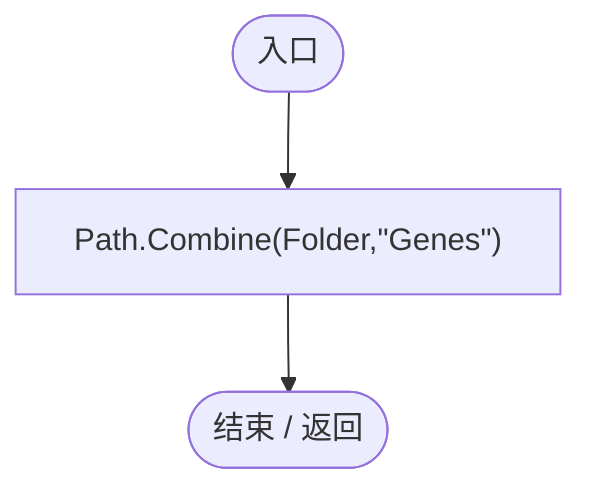

<a id="mcd6b1d82c9cf8f5c"></a>

## Active.get · L26

`get`


### Editor / Player · 语法控制结构 / 声明（非CFG）


<a id="mf0de4f332af140af"></a>

## Active.set · L26

`private set`


### Editor / Player · 语法控制结构 / 声明（非CFG）

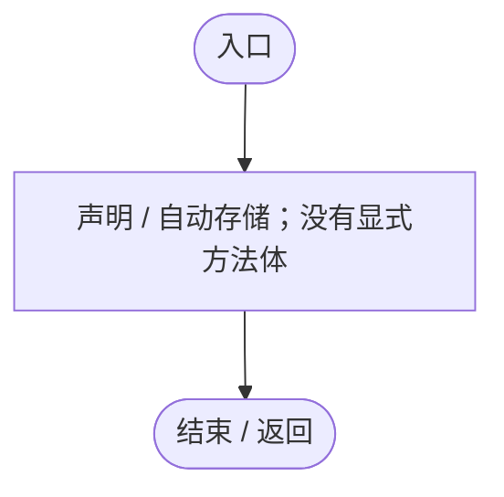

<a id="m89083f320ec287c0"></a>

## ReadCatalog · L27

`public static Dictionary<string,string> ReadCatalog(string directory=null)`


### Editor / Player · Roslyn编译器控制流

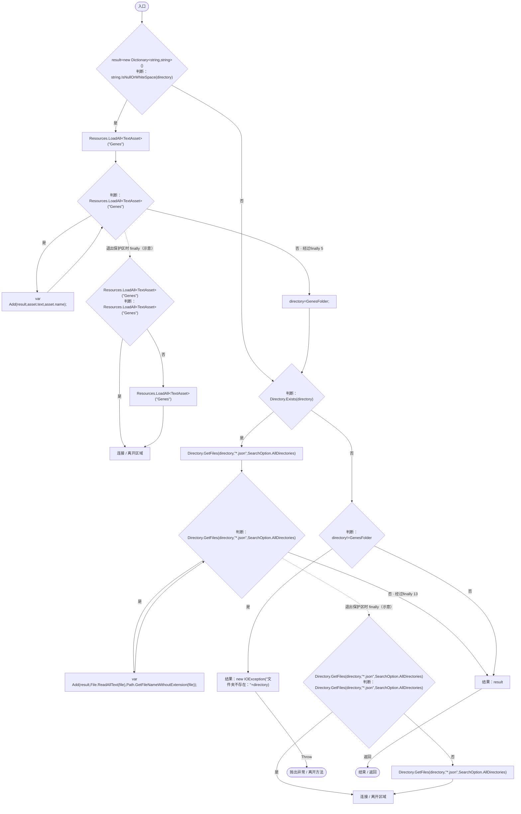

项目内调用/回调引用：

- [GeneTreeStorage.Add · L40](a885bad0d7dedee8.md#mfdfd46dfe0299377)（方法）

<a id="mfdfd46dfe0299377"></a>

## Add · L40

`private static void Add(Dictionary<string,string> map,string text,string name)`


### Editor / Player · Roslyn编译器控制流

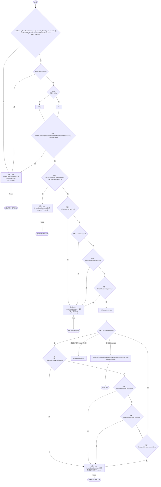

项目内调用/回调引用：

- [EcologyGeneDefaults.Upgrade · L14](ce4f4683a31b001c.md#m0cb614734c6a2d00)（方法）
- [GeneEntityStateTags.Upgrade · L11](d87d75eb0b331d5c.md#m2462e83f788e9dea)（方法）
- [GeneEntityStateTags.Validate · L24](d87d75eb0b331d5c.md#m07abded73ee4a80f)（方法）
- [EntityStateRegistry.Current.get · L41](440408d2db5c7d96.md#m61b7aa1a54b9a56c)（访问器）

<a id="m60e52e1c6f841f94"></a>

## Load · L53

`public static GeneTreeDocument Load()`


### Editor / Player · Roslyn编译器控制流

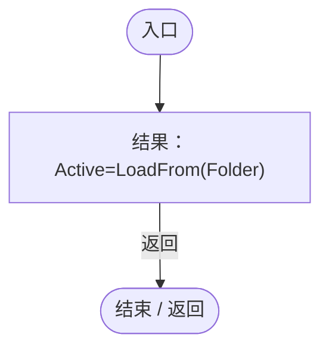

项目内调用/回调引用：

- [GeneTreeStorage.Active.set · L26](a885bad0d7dedee8.md#mf0de4f332af140af)（访问器）
- [GeneTreeStorage.LoadFrom · L54](a885bad0d7dedee8.md#mc2371aed207c1d6a)（方法）

<a id="mc2371aed207c1d6a"></a>

## LoadFrom · L54

`public static GeneTreeDocument LoadFrom(string folder)`


### Editor / Player · Roslyn编译器控制流

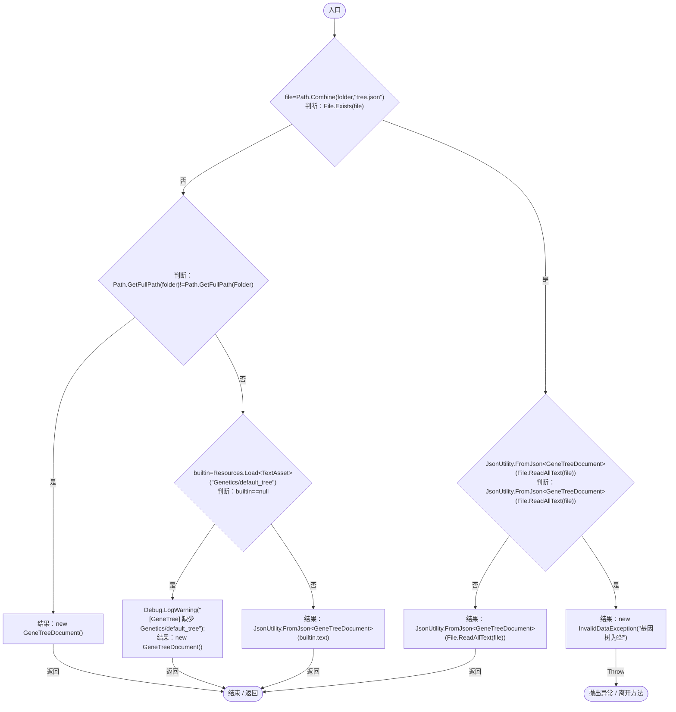

<a id="m3371bf1e3c5ae267"></a>

## Validate · L67

`public static void Validate(GeneTreeDocument doc,Dictionary<string,string> catalog)`


### Editor / Player · Roslyn编译器控制流

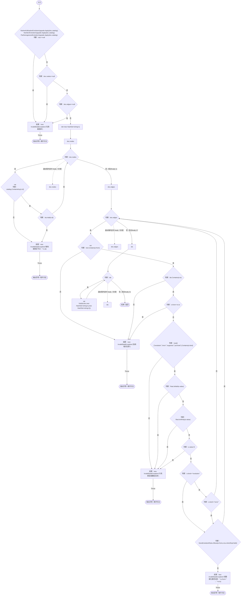

项目内调用/回调引用：

- [NutrientUtilizationEvolutionUpgrade.Apply · L15](31507b5a0e171a28.md#mc03cba57fe71e4fe)（方法）
- [NutritionEvolutionUpgrade.Apply · L10](02dbee4dabe4bc85.md#md1d08580fa5cdf72)（方法）
- [ParthenogenesisEvolutionUpgrade.Apply · L28](9270126d968c1a50.md#m34aca29b443343d1)（方法）
- [GeneEvolutionRules.Allows · L25](95d3abc5e23f05d3.md#m56e7f05bb0fe9159)（方法）
- [GeneTreeStorage.Visit · L85](a885bad0d7dedee8.md#m4ccdebfae3291496)（方法）

<a id="m4ccdebfae3291496"></a>

## Visit · L85

`private static void Visit(string id,GeneTreeDocument doc,HashSet<string> path,HashSet<string> done)`


### Editor / Player · Roslyn编译器控制流

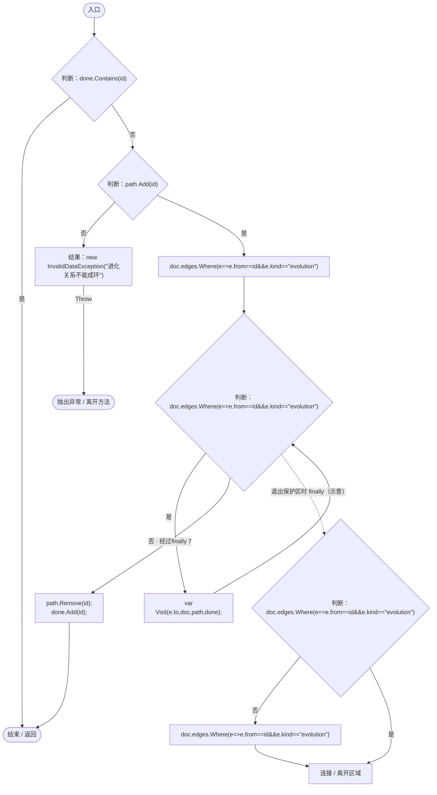

项目内调用/回调引用：

- [GeneTreeStorage.Visit · L85](a885bad0d7dedee8.md#m4ccdebfae3291496)（方法）
- [GeneTreeStorage.回调@89 · L89](a885bad0d7dedee8.md#m6f20e6092cda103f)（回调/委托）

<a id="m6f20e6092cda103f"></a>

## 回调@89 · L89

`e … => 回调`


### Editor / Player · Roslyn编译器控制流

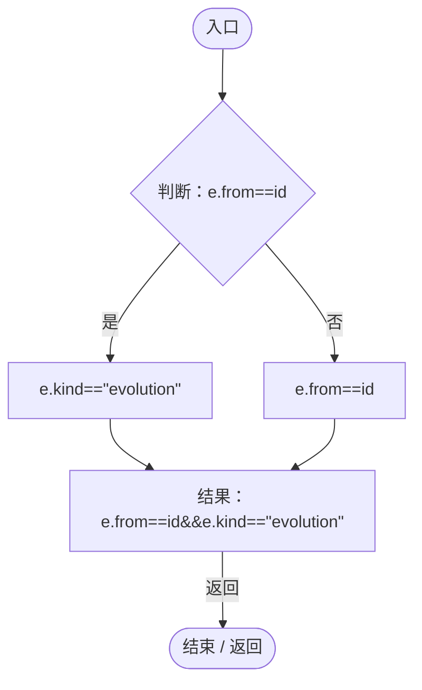

<a id="m92ca7c9be670a39c"></a>

## Save · L92

`public static void Save(GeneTreeDocument doc,Dictionary<string,string> catalog)`


### Editor / Player · Roslyn编译器控制流

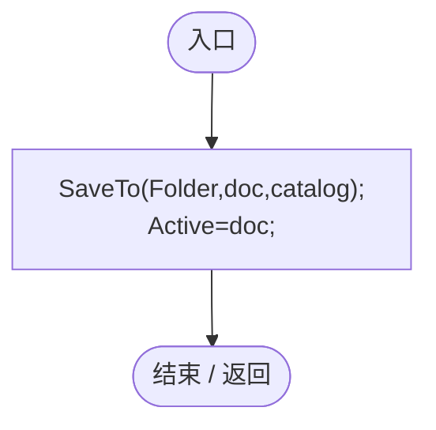

项目内调用/回调引用：

- [GeneTreeStorage.SaveTo · L96](a885bad0d7dedee8.md#m44f80bc754af0f5a)（方法）
- [GeneTreeStorage.Active.set · L26](a885bad0d7dedee8.md#mf0de4f332af140af)（访问器）

<a id="m44f80bc754af0f5a"></a>

## SaveTo · L96

`public static void SaveTo(string folder,GeneTreeDocument doc,Dictionary<string,string> catalog)`


### Editor / Player · Roslyn编译器控制流

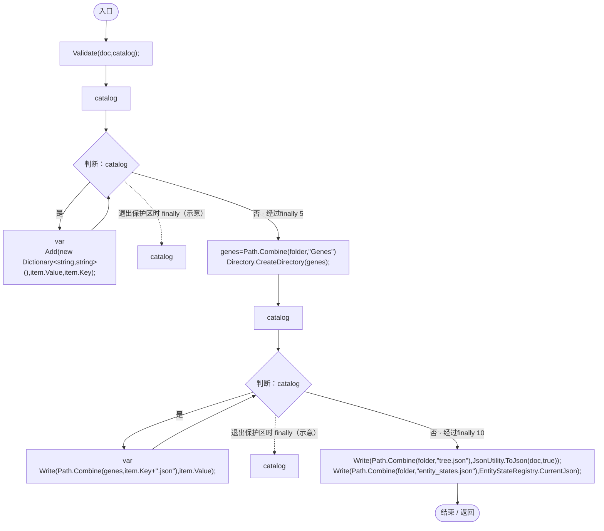

项目内调用/回调引用：

- [GeneTreeStorage.Validate · L67](a885bad0d7dedee8.md#m3371bf1e3c5ae267)（方法）
- [GeneTreeStorage.Add · L40](a885bad0d7dedee8.md#mfdfd46dfe0299377)（方法）
- [GeneTreeStorage.Write · L108](a885bad0d7dedee8.md#m1c51177a976c0727)（方法）
- [EntityStateRegistry.CurrentJson.get · L43](440408d2db5c7d96.md#m32449837062f8705)（访问器）

<a id="m1c51177a976c0727"></a>

## Write · L108

`private static void Write(string path,string text)`


### Editor / Player · Roslyn编译器控制流

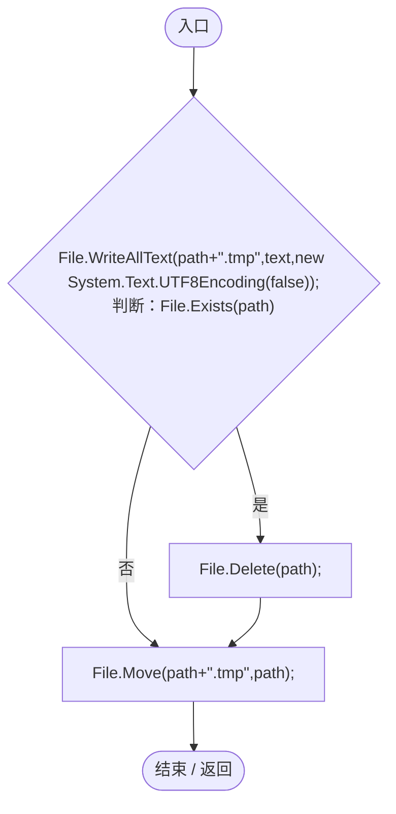

<a id="m3b680cb19d835ce7"></a>

## RuntimeAssets · L110

`public static IEnumerable<TextAsset> RuntimeAssets()`


### Editor / Player · Roslyn编译器控制流

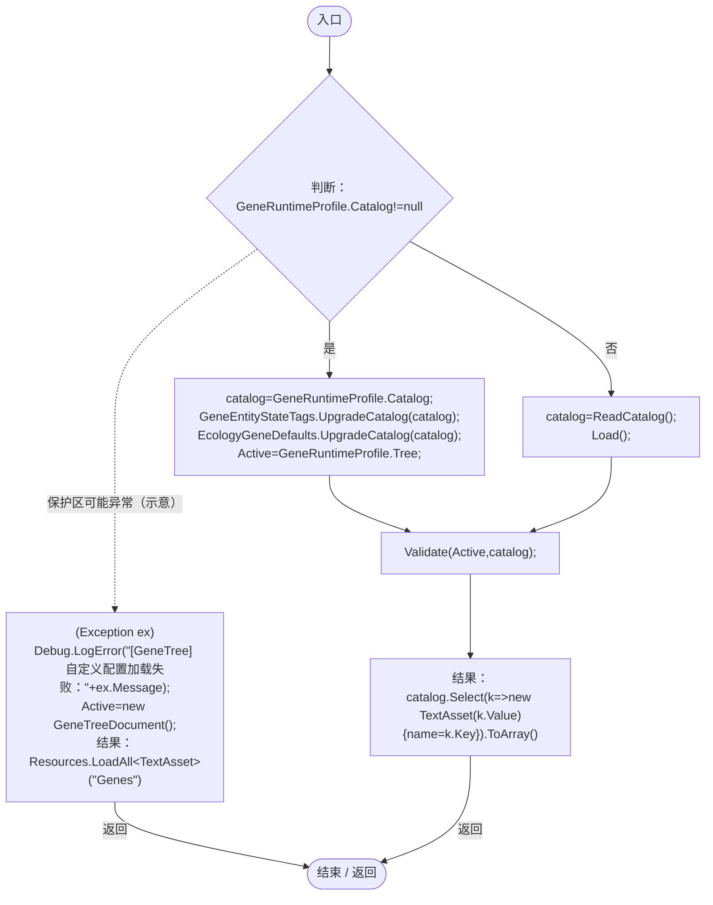

项目内调用/回调引用：

- [GeneEntityStateTags.UpgradeCatalog · L22](d87d75eb0b331d5c.md#m648749d3ce7da216)（方法）
- [EcologyGeneDefaults.UpgradeCatalog · L30](ce4f4683a31b001c.md#mf8204e9a94d6e72f)（方法）
- [GeneTreeStorage.Active.set · L26](a885bad0d7dedee8.md#mf0de4f332af140af)（访问器）
- [GeneTreeStorage.ReadCatalog · L27](a885bad0d7dedee8.md#m89083f320ec287c0)（方法）
- [GeneTreeStorage.Load · L53](a885bad0d7dedee8.md#m60e52e1c6f841f94)（方法）
- [GeneTreeStorage.Validate · L67](a885bad0d7dedee8.md#m3371bf1e3c5ae267)（方法）
- [GeneTreeStorage.Active.get · L26](a885bad0d7dedee8.md#mcd6b1d82c9cf8f5c)（访问器）
- [GeneTreeStorage.回调@115 · L115](a885bad0d7dedee8.md#m7cd441e4771f6a41)（回调/委托）

<a id="m7cd441e4771f6a41"></a>

## 回调@115 · L115

`k … => 回调`


### Editor / Player · Roslyn编译器控制流

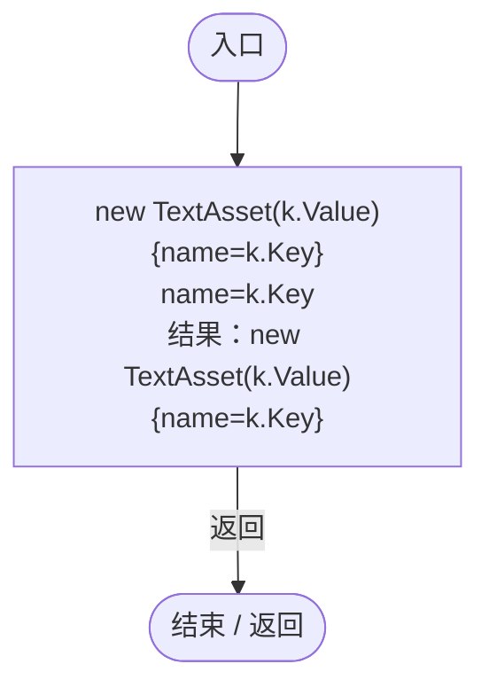

<a id="ma58a13a0fae63ad6"></a>

## ApplyInfluences · L117

`public static void ApplyInfluences(GeneDefinition definition)`


### Editor / Player · Roslyn编译器控制流

```mermaid
flowchart TD
  b0(["入口"])
  b1["Active.edges.Where(e=&gt;e.from==definition.Id&amp;&amp;(e.kind==&quot;suppress&quot;&#124;&#124;e.kind==&quot;promote&quot;))"]
  b2{"判断：Active.edges.Where(e=&gt;e.from==definition.Id&amp;&amp;(e.kind==&quot;suppress&quot;&#124;&#124;e.kind==&quot;promote&quot;))"}
  b3["var"]
  b4["definition.SuppressionRules<br/>new GeneSuppressionRule{TargetGeneId=edge.to,Coefficient=(edge.kind==&quot;promote&quot;?-1:1)*edge.value}<br/>TargetGeneId=edge.to"]
  b5{"判断：edge.kind==&quot;promote&quot;"}
  b6["-1"]
  b7["1"]
  b8["Coefficient=(edge.kind==&quot;promote&quot;?-1:1)*edge.value"]
  b9["definition.SuppressionRules.Add(new GeneSuppressionRule{TargetGeneId=edge.to,Coefficient=(edge.kind==&quot;promote&quot;?-1:1)*edge.value});"]
  b10{"判断：Active.edges.Where(e=&gt;e.from==definition.Id&amp;&amp;(e.kind==&quot;suppress&quot;&#124;&#124;e.kind==&quot;promote&quot;))"}
  b11["Active.edges.Where(e=&gt;e.from==definition.Id&amp;&amp;(e.kind==&quot;suppress&quot;&#124;&#124;e.kind==&quot;promote&quot;))"]
  b12["连接 / 离开区域"]
  b13(["结束 / 返回"])
  b0 --> b1
  b1 --> b2
  b2 -->|"是"| b3
  b2 -->|"否 · 经过finally 10"| b13
  b3 --> b4
  b4 --> b5
  b5 -->|"是"| b6
  b5 -->|"否"| b7
  b6 --> b8
  b7 --> b8
  b8 --> b9
  b9 --> b2
  b10 -->|"否"| b11
  b10 -->|"是"| b12
  b11 --> b12
  b2 -. "退出保护区时 finally（示意）" .-> b10

```

项目内调用/回调引用：

- [GeneTreeStorage.Active.get · L26](a885bad0d7dedee8.md#mcd6b1d82c9cf8f5c)（访问器）
- [GeneTreeStorage.回调@119 · L119](a885bad0d7dedee8.md#md04608867ce82829)（回调/委托）

<a id="md04608867ce82829"></a>

## 回调@119 · L119

`e … => 回调`


### Editor / Player · Roslyn编译器控制流

```mermaid
flowchart TD
  b0(["入口"])
  b1{"判断：e.from==definition.Id"}
  b2{"判断：e.kind==&quot;suppress&quot;"}
  b3["e.kind==&quot;promote&quot;"]
  b4["e.kind==&quot;suppress&quot;"]
  b5["e.from==definition.Id"]
  b6["结果：e.from==definition.Id&amp;&amp;(e.kind==&quot;suppress&quot;&#124;&#124;e.kind==&quot;promote&quot;)"]
  b7(["结束 / 返回"])
  b0 --> b1
  b1 -->|"是"| b2
  b1 -->|"否"| b5
  b2 -->|"否"| b3
  b2 -->|"是"| b4
  b3 --> b6
  b4 --> b6
  b5 --> b6
  b6 -->|"返回"| b7

```

<a id="m5b6c0b3324290975"></a>

## Successor · L122

`public static string Successor(string id,string kind,float sourceValue=float.NaN,Genome genome=null)`


### Editor / Player · Roslyn编译器控制流

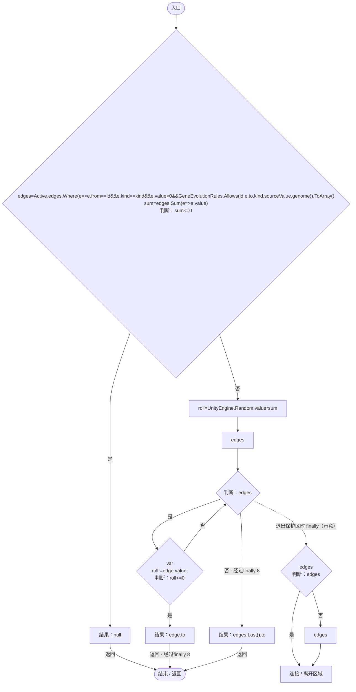

项目内调用/回调引用：

- [GeneTreeStorage.Active.get · L26](a885bad0d7dedee8.md#mcd6b1d82c9cf8f5c)（访问器）
- [GeneTreeStorage.回调@124 · L124](a885bad0d7dedee8.md#m3e2872c2c5ef9ea0)（回调/委托）
- [GeneTreeStorage.回调@125 · L125](a885bad0d7dedee8.md#m4852ecebeaf5997f)（回调/委托）

<a id="m3e2872c2c5ef9ea0"></a>

## 回调@124 · L124

`e … => 回调`


### Editor / Player · Roslyn编译器控制流

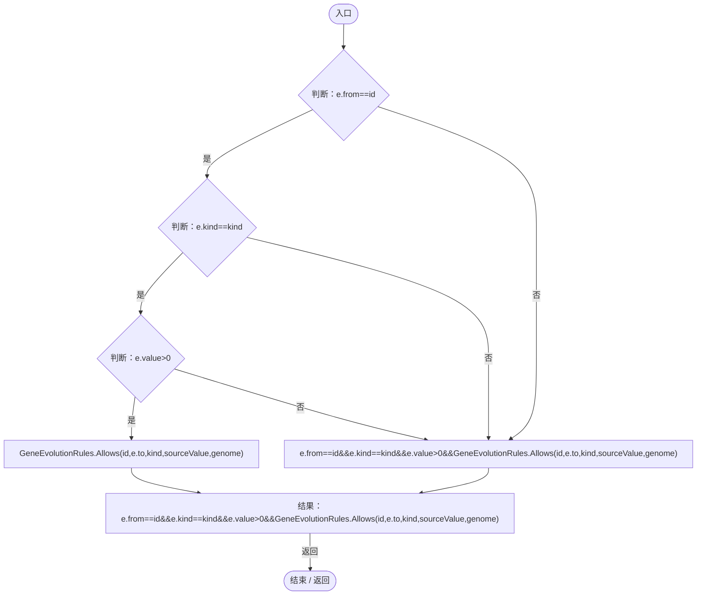

项目内调用/回调引用：

- [GeneEvolutionRules.Allows · L25](95d3abc5e23f05d3.md#m56e7f05bb0fe9159)（方法）

<a id="m4852ecebeaf5997f"></a>

## 回调@125 · L125

`e … => 回调`


### Editor / Player · Roslyn编译器控制流

```mermaid
flowchart TD
  b0(["入口"])
  b1["结果：e.value"]
  b2(["结束 / 返回"])
  b0 --> b1
  b1 -->|"返回"| b2

```
