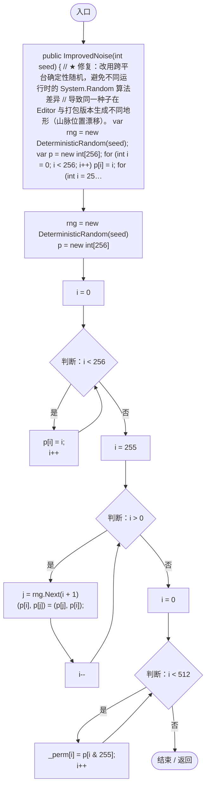
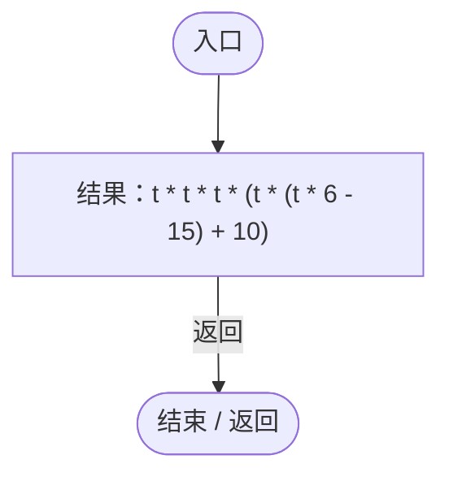
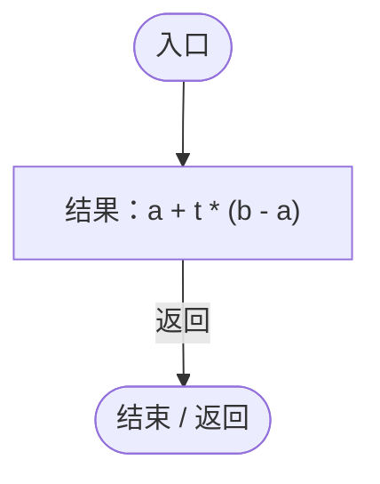
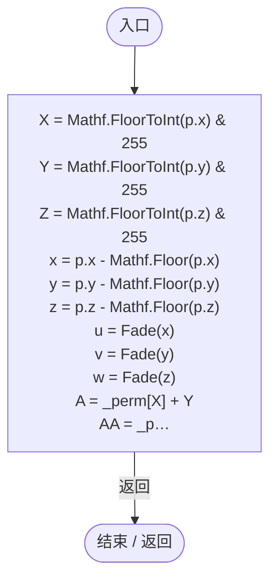
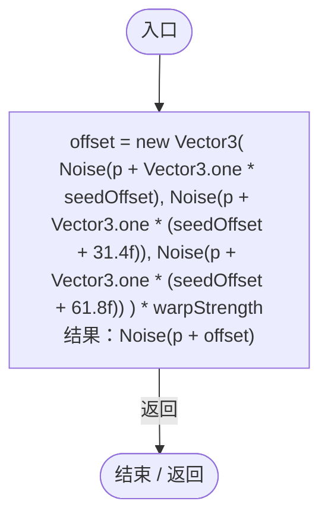

# ImprovedNoise.cs

[返回总索引](../README.md) · `Runtime` · `Assets/DarwinPark/Planet/Noise/ImprovedNoise.cs`

[源文件](../../../Assets/DarwinPark/Planet/Noise/ImprovedNoise.cs) · 源码校验：`dd4f41fa5d3aaebeb445e4208e3d7467643c4b270641d69711415ca91d8f613d`

方法按源文件位置排列。事件/回调引用不表示立即执行；分支与异常说明见总索引。完整源码与可点击关系图请打开离线手册。

## ImprovedNoise.ctor · L13

`public ImprovedNoise(int seed)`

### Editor / Player · Roslyn编译器控制流

项目内调用/回调引用：

- [DeterministicRandom.DeterministicRandom.ctor · L15](0c2b60ffd3650bfd.md#mc863035084287113)（构造函数）
- [DeterministicRandom.Next · L32](0c2b60ffd3650bfd.md#m5fab9b9b1a9df9bf)（方法）

## Fade · L28

`private static float Fade(float t)`

### Editor / Player · Roslyn编译器控制流

## Lerp · L29

`private static float Lerp(float a, float b, float t)`

### Editor / Player · Roslyn编译器控制流

## Grad · L31

`private float Grad(int hash, float x, float y, float z)`

### Editor / Player · Roslyn编译器控制流

```mermaid
flowchart TD
  b0(["入口"])
  b1["h = hash &amp; 15"]
  b2{"判断：h &lt; 8"}
  b3["x"]
  b4["y"]
  b5["u = h &lt; 8 ? x : y"]
  b6{"判断：h &lt; 4"}
  b7["y"]
  b8{"判断：h == 12"}
  b9{"判断：h == 14"}
  b10["x"]
  b11["z"]
  b12["v = h &lt; 4 ? y : (h == 12 &#124;&#124; h == 14 ? x : z)"]
  b13{"判断：(h &amp; 1) == 0"}
  b14["u"]
  b15["-u"]
  b16{"判断：(h &amp; 2) == 0"}
  b17["v"]
  b18["-v"]
  b19["结果：((h &amp; 1) == 0 ? u : -u) + ((h &amp; 2) == 0 ? v : -v)"]
  b20(["结束 / 返回"])
  b0 --> b1
  b1 --> b2
  b2 -->|"是"| b3
  b2 -->|"否"| b4
  b3 --> b5
  b4 --> b5
  b5 --> b6
  b6 -->|"是"| b7
  b6 -->|"否"| b8
  b7 --> b12
  b8 -->|"否"| b9
  b8 -->|"是"| b10
  b9 -->|"是"| b10
  b9 -->|"否"| b11
  b10 --> b12
  b11 --> b12
  b12 --> b13
  b13 -->|"是"| b14
  b13 -->|"否"| b15
  b14 --> b16
  b15 --> b16
  b16 -->|"是"| b17
  b16 -->|"否"| b18
  b17 --> b19
  b18 --> b19
  b19 -->|"返回"| b20

```

## Noise · L39

`public float Noise(Vector3 p)`

### Editor / Player · Roslyn编译器控制流

项目内调用/回调引用：

- [ImprovedNoise.Fade · L28](a8f42417442eeb03.md#m973539c613d76bc3)（方法）
- [ImprovedNoise.Lerp · L29](a8f42417442eeb03.md#mc4aa61bd08c627ba)（方法）
- [ImprovedNoise.Grad · L31](a8f42417442eeb03.md#m60bdcb50bfede923)（方法）

## WarpedNoise · L58

`public float WarpedNoise(Vector3 p, float warpStrength, int seedOffset)`

### Editor / Player · Roslyn编译器控制流

项目内调用/回调引用：

- [ImprovedNoise.Noise · L39](a8f42417442eeb03.md#m683c13216672e25c)（方法）
