# SimulationClock.cs

[返回总索引](../README.md) · `Runtime` · `Assets/DarwinPark/Core/Time/SimulationClock.cs`

[源文件](../../../Assets/DarwinPark/Core/Time/SimulationClock.cs) · 源码校验：`5e16487decc995ccf3f0ca5fb03d20a8d237588fe80079071ec6491e0dab3816`

方法按源文件位置排列。事件/回调引用不表示立即执行；分支与异常说明见总索引。完整源码与可点击关系图请打开离线手册。

<a id="m747e2a1454fa30a9"></a>

## PendingGameTime.get · L18

`public double PendingGameTime`


### Editor / Player · 语法控制结构 / 声明（非CFG）

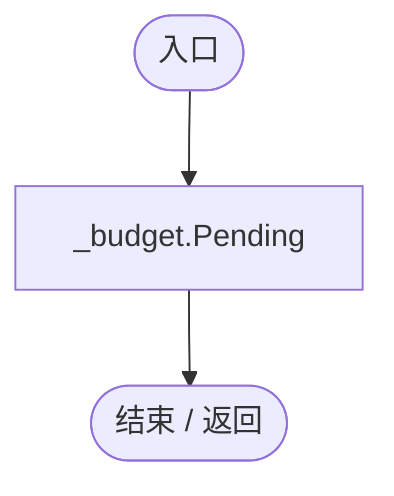

项目内调用/回调引用：

- [SimulationStepBudget.Pending.get · L8](0ec4b354aeb329c1.md#mbafae1240ee9766b)（访问器）

<a id="m45e51a0a28c12970"></a>

## MotionTimeScale.get · L20

`public float MotionTimeScale`

★ 适配：过载帧的物理行动也按实际交付时间缩放，避免日历限速而实体仍全速移动。

### Editor / Player · 语法控制结构 / 声明（非CFG）

```mermaid
flowchart TD
  n2(["入口"])
  n1["!IsRunning?0:WorldAuthority.IsReplica&#124;&#124;!_budgetedFrame?_timeScale:GameDeltaTime/Mathf.Max(.0001f,Time.unscaledDeltaTime)"]
  n0(["结束 / 返回"])
  n1 --> n0
  n2 --> n1

```

项目内调用/回调引用：

- [SimulationClock.IsRunning.get · L22](a8f444aec9614b0a.md#m10f4fe307faca0f0)（访问器）
- [SimulationClock.GameDeltaTime.get · L26](a8f444aec9614b0a.md#me7f11abae18a4f2d)（访问器）

<a id="m10f4fe307faca0f0"></a>

## IsRunning.get · L22

`get`


### Editor / Player · 语法控制结构 / 声明（非CFG）


<a id="m8b3d4b75faf1271d"></a>

## IsRunning.set · L22

`private set`


### Editor / Player · 语法控制结构 / 声明（非CFG）


<a id="m74adfa39a896652f"></a>

## GameTime.get · L23

`get`


### Editor / Player · 语法控制结构 / 声明（非CFG）


<a id="med946ddd67629dc6"></a>

## GameTime.set · L23

`private set`


### Editor / Player · 语法控制结构 / 声明（非CFG）


<a id="me7f11abae18a4f2d"></a>

## GameDeltaTime.get · L26

`get`


### Editor / Player · 语法控制结构 / 声明（非CFG）

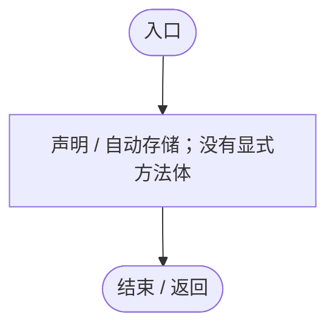

<a id="mb66b5773a7b44c8f"></a>

## GameDeltaTime.set · L26

`private set`


### Editor / Player · 语法控制结构 / 声明（非CFG）


<a id="mee60f4f9aa306a1b"></a>

## TimeScale.get · L27

`public float TimeScale`


### Editor / Player · 语法控制结构 / 声明（非CFG）

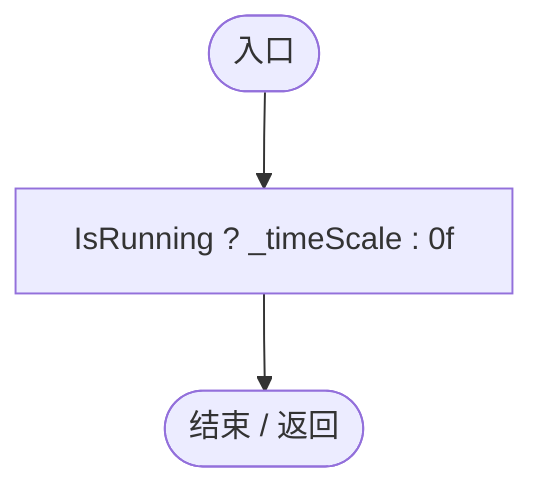

项目内调用/回调引用：

- [SimulationClock.IsRunning.get · L22](a8f444aec9614b0a.md#m10f4fe307faca0f0)（访问器）

<a id="m1760262d3a24905c"></a>

## ConfiguredTimeScale.get · L28

`public float ConfiguredTimeScale`


### Editor / Player · 语法控制结构 / 声明（非CFG）

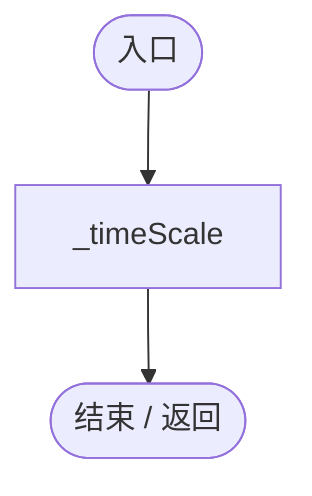

<a id="m0c6d9c663fea16e1"></a>

## Awake · L33

`private void Awake()`


### Editor / Player · Roslyn编译器控制流

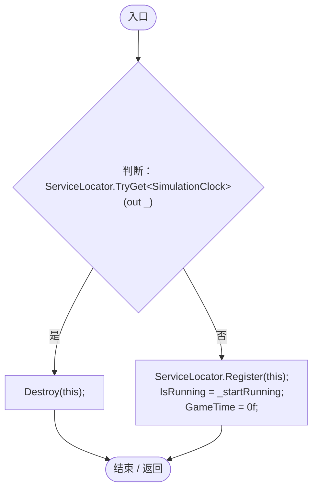

项目内调用/回调引用：

- [ServiceLocator.TryGet · L26](f2fdbe9f9ccd93cb.md#m143b24e6d58471b0)（方法）
- [ServiceLocator.Register · L16](f2fdbe9f9ccd93cb.md#m26753aeca74b231e)（方法）
- [SimulationClock.IsRunning.set · L22](a8f444aec9614b0a.md#m8b3d4b75faf1271d)（访问器）
- [SimulationClock.GameTime.set · L23](a8f444aec9614b0a.md#med946ddd67629dc6)（访问器）

<a id="mc8171e05c0b32629"></a>

## Start · L45

`private void Start()`


### Editor / Player · Roslyn编译器控制流

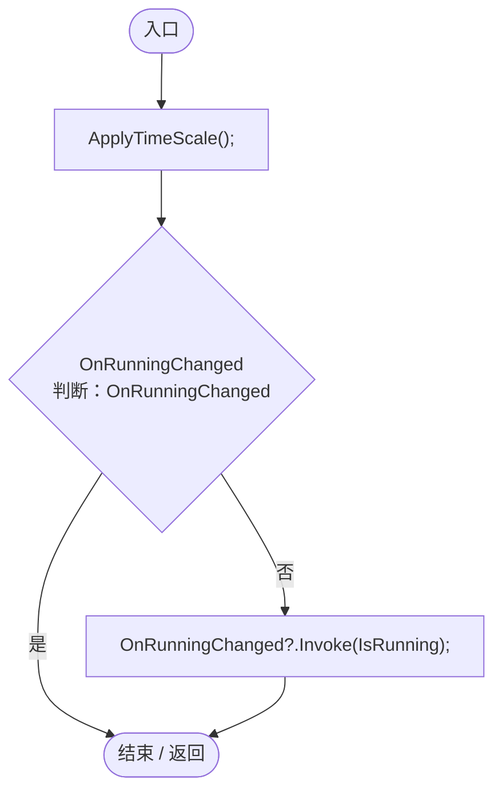

项目内调用/回调引用：

- [SimulationClock.ApplyTimeScale · L83](a8f444aec9614b0a.md#m895847b83de7397f)（方法）
- [SimulationClock.IsRunning.get · L22](a8f444aec9614b0a.md#m10f4fe307faca0f0)（访问器）

<a id="m42a4cfef431ba20e"></a>

## Update · L51

`private void Update()`


### Editor / Player · Roslyn编译器控制流

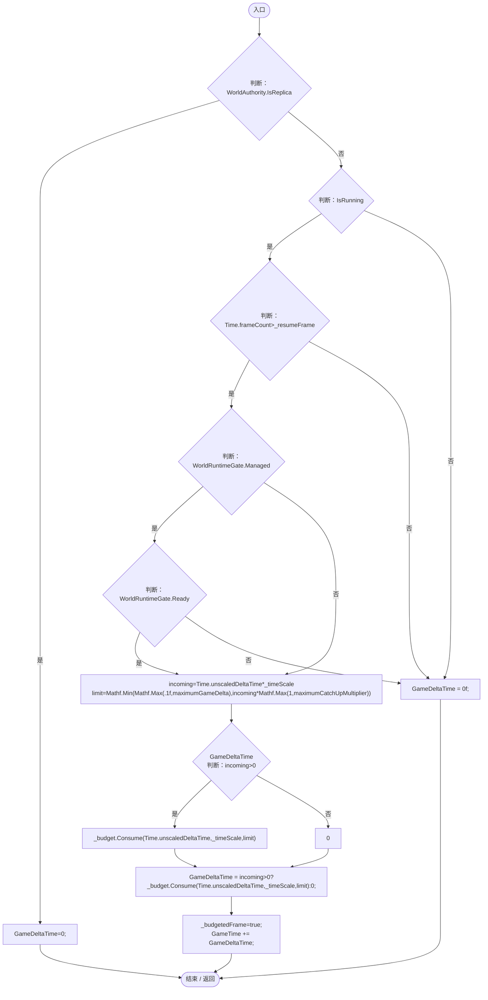

项目内调用/回调引用：

- [SimulationClock.GameDeltaTime.set · L26](a8f444aec9614b0a.md#mb66b5773a7b44c8f)（访问器）
- [SimulationClock.IsRunning.get · L22](a8f444aec9614b0a.md#m10f4fe307faca0f0)（访问器）
- [SimulationStepBudget.Consume · L9](0ec4b354aeb329c1.md#me5418cddb06e3e3b)（方法）
- [SimulationClock.GameTime.set · L23](a8f444aec9614b0a.md#med946ddd67629dc6)（访问器）
- [SimulationClock.GameTime.get · L23](a8f444aec9614b0a.md#m74adfa39a896652f)（访问器）
- [SimulationClock.GameDeltaTime.get · L26](a8f444aec9614b0a.md#me7f11abae18a4f2d)（访问器）

<a id="m8f617e95e1282846"></a>

## RestoreState · L74

`public void RestoreState(float time,float scale)`

★ 适配：存档恢复总时间和倍率，加载过程始终保持暂停。

### Editor / Player · Roslyn编译器控制流

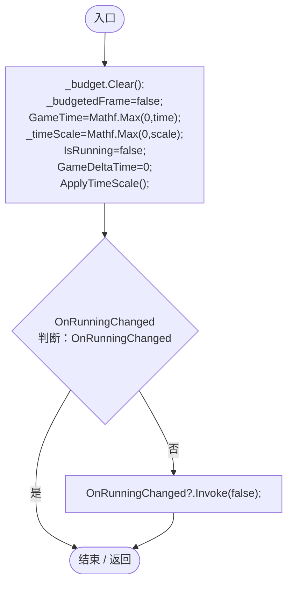

项目内调用/回调引用：

- [SimulationStepBudget.Clear · L16](0ec4b354aeb329c1.md#m16ff6b64c0b744d1)（方法）
- [SimulationClock.GameTime.set · L23](a8f444aec9614b0a.md#med946ddd67629dc6)（访问器）
- [SimulationClock.IsRunning.set · L22](a8f444aec9614b0a.md#m8b3d4b75faf1271d)（访问器）
- [SimulationClock.GameDeltaTime.set · L26](a8f444aec9614b0a.md#mb66b5773a7b44c8f)（访问器）
- [SimulationClock.ApplyTimeScale · L83](a8f444aec9614b0a.md#m895847b83de7397f)（方法）

<a id="m2a1c12e8c6ba769d"></a>

## ApplyRemoteState · L76

`public void ApplyRemoteState(float time,float scale,bool running)`

★ 适配：只读网络时钟不经本地启停请求，避免收到同步时再次向服务端发包。

### Editor / Player · Roslyn编译器控制流

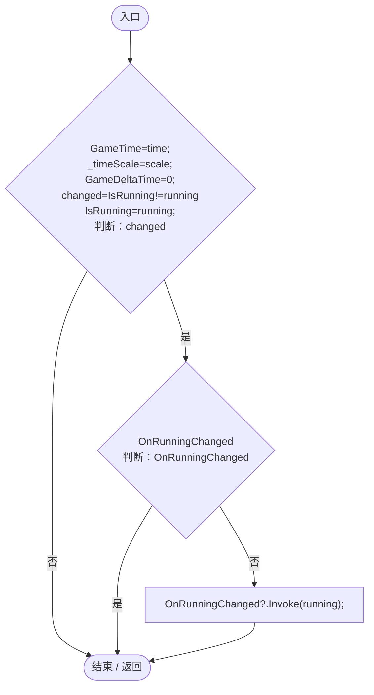

项目内调用/回调引用：

- [SimulationClock.GameTime.set · L23](a8f444aec9614b0a.md#med946ddd67629dc6)（访问器）
- [SimulationClock.GameDeltaTime.set · L26](a8f444aec9614b0a.md#mb66b5773a7b44c8f)（访问器）
- [SimulationClock.IsRunning.get · L22](a8f444aec9614b0a.md#m10f4fe307faca0f0)（访问器）
- [SimulationClock.IsRunning.set · L22](a8f444aec9614b0a.md#m8b3d4b75faf1271d)（访问器）

<a id="m7aa9e64b7de60ed0"></a>

## Play · L78

`public void Play()`

★ 修复（防Bug回归）：加载结束的当前帧 delta 仍包含磁盘/上传等待，下一帧才开始玩家时间。

### Editor / Player · Roslyn编译器控制流

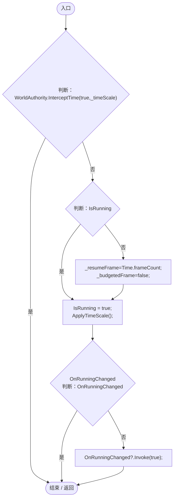

项目内调用/回调引用：

- [WorldAuthority.InterceptTime · L12](2361e41ab2baa157.md#m16eb90e6dc9a6c6e)（方法）
- [SimulationClock.IsRunning.get · L22](a8f444aec9614b0a.md#m10f4fe307faca0f0)（访问器）
- [SimulationClock.IsRunning.set · L22](a8f444aec9614b0a.md#m8b3d4b75faf1271d)（访问器）
- [SimulationClock.ApplyTimeScale · L83](a8f444aec9614b0a.md#m895847b83de7397f)（方法）

<a id="m30929d45a885d0f1"></a>

## Pause · L79

`public void Pause()`


### Editor / Player · Roslyn编译器控制流

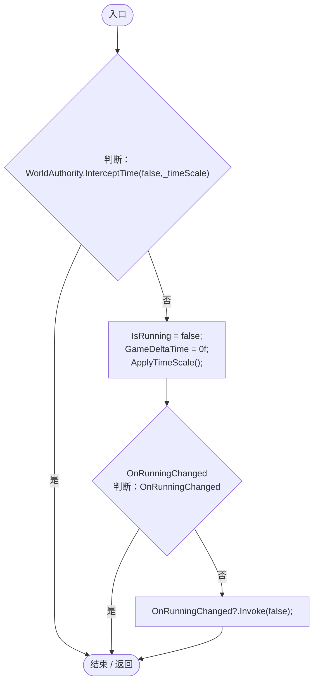

项目内调用/回调引用：

- [WorldAuthority.InterceptTime · L12](2361e41ab2baa157.md#m16eb90e6dc9a6c6e)（方法）
- [SimulationClock.IsRunning.set · L22](a8f444aec9614b0a.md#m8b3d4b75faf1271d)（访问器）
- [SimulationClock.GameDeltaTime.set · L26](a8f444aec9614b0a.md#mb66b5773a7b44c8f)（访问器）
- [SimulationClock.ApplyTimeScale · L83](a8f444aec9614b0a.md#m895847b83de7397f)（方法）

<a id="m2d6d7d27573d58b8"></a>

## Toggle · L80

`public void Toggle()`


### Editor / Player · Roslyn编译器控制流

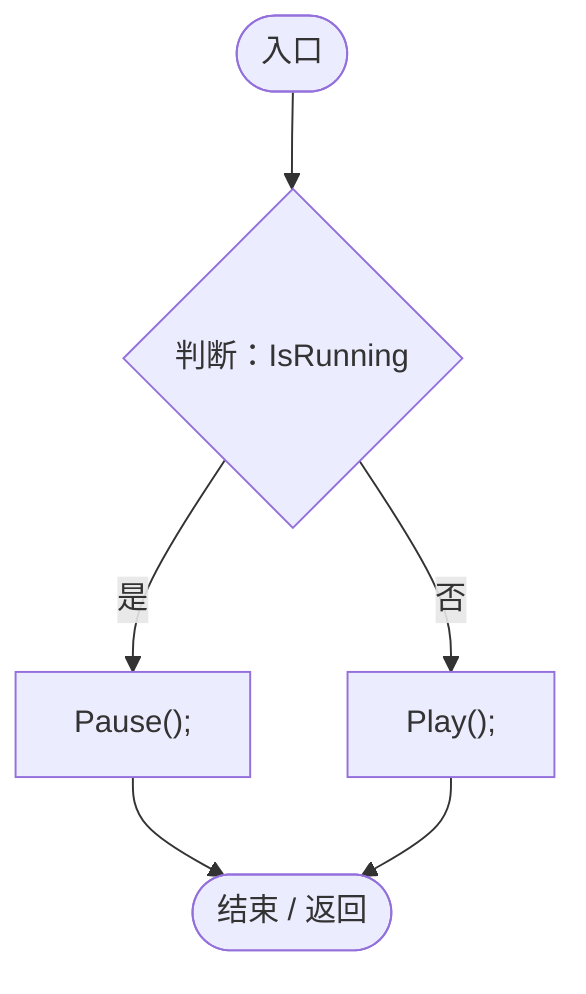

项目内调用/回调引用：

- [SimulationClock.IsRunning.get · L22](a8f444aec9614b0a.md#m10f4fe307faca0f0)（访问器）
- [SimulationClock.Pause · L79](a8f444aec9614b0a.md#m30929d45a885d0f1)（方法）
- [SimulationClock.Play · L78](a8f444aec9614b0a.md#m7aa9e64b7de60ed0)（方法）

<a id="mecaa463a0561aca3"></a>

## SetTimeScale · L81

`public void SetTimeScale(float s)`


### Editor / Player · Roslyn编译器控制流

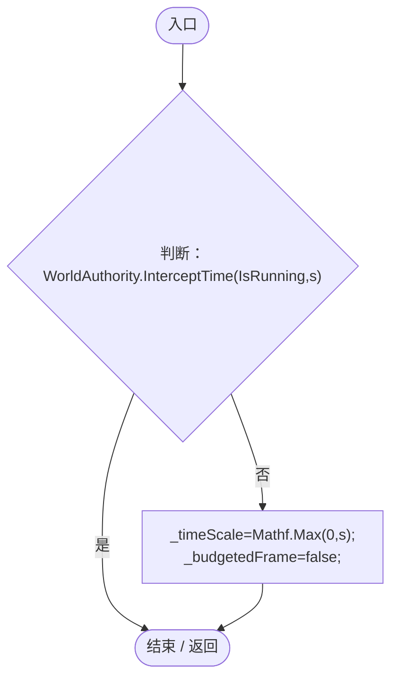

项目内调用/回调引用：

- [WorldAuthority.InterceptTime · L12](2361e41ab2baa157.md#m16eb90e6dc9a6c6e)（方法）
- [SimulationClock.IsRunning.get · L22](a8f444aec9614b0a.md#m10f4fe307faca0f0)（访问器）

<a id="m895847b83de7397f"></a>

## ApplyTimeScale · L83

`private void ApplyTimeScale()`


### Editor / Player · Roslyn编译器控制流

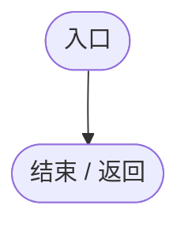

<a id="mc9abd7a17906339a"></a>

## OnDisable · L89

`private void OnDisable()`


### Editor / Player · Roslyn编译器控制流

```mermaid
flowchart TD
  b0(["入口"])
  b1["ServiceLocator.Unregister&lt;SimulationClock&gt;()"]
  b2(["结束 / 返回"])
  b0 --> b1
  b1 --> b2

```

项目内调用/回调引用：

- [ServiceLocator.Unregister · L24](f2fdbe9f9ccd93cb.md#m24b4fe5c1600b5cf)（方法）
