# NutritionReplicaPresentation.cs

[返回总索引](../README.md) · `Runtime` · `Assets/DarwinPark/UI/NutritionReplicaPresentation.cs`

[源文件](../../../Assets/DarwinPark/UI/NutritionReplicaPresentation.cs) · 源码校验：`733fda7c947afd0079c7ec0757ad7e78deaa2723d44cd7001519a0a02c5fe354`

方法按源文件位置排列。事件/回调引用不表示立即执行；分支与异常说明见总索引。完整源码与可点击关系图请打开离线手册。

## Apply · L14

`public static void Apply(DarwinEntity entity,EcologySaveState state)`

### Editor / Player · Roslyn编译器控制流

```mermaid
flowchart TD
  b0(["入口"])
  b1{"entity.GetComponent&lt;NutritionReplicaPresentation&gt;()<br/>判断：entity.GetComponent&lt;NutritionReplicaPresentation&gt;()"}
  b2["entity.GetComponent&lt;NutritionReplicaPresentation&gt;()"]
  b3["entity.gameObject.AddComponent&lt;NutritionReplicaPresentation&gt;()"]
  b4["view=entity.GetComponent&lt;NutritionReplicaPresentation&gt;()??entity.gameObject.AddComponent&lt;NutritionReplicaPresentation&gt;()"]
  b5{"state<br/>判断：state"}
  b6[".nutritionParasite"]
  b7{"判断：.nutritionParasite"}
  b8[".host"]
  b9["state?.nutritionParasite?.host"]
  b10["hidden=!string.IsNullOrEmpty(state?.nutritionParasite?.host)"]
  b11["view.parasites"]
  b12{"state<br/>判断：state"}
  b13[".nutritionParasiteCount"]
  b14["state"]
  b15{"判断：state?.nutritionParasiteCount"}
  b16["state?.nutritionParasiteCount"]
  b17["0"]
  b18["view.parasites=state?.nutritionParasiteCount??0;"]
  b19["view.foreignEggs"]
  b20{"state<br/>判断：state"}
  b21[".foreignEggs"]
  b22{"判断：.foreignEggs"}
  b23[".Count"]
  b24["state?.foreignEggs?.Count"]
  b25{"判断：state?.foreignEggs?.Count"}
  b26["state?.foreignEggs?.Count"]
  b27["0"]
  b28["view.foreignEggs=state?.foreignEggs?.Count??0;"]
  b29{"判断：view.attached==hidden"}
  b30{"view.attached=hidden;<br/>判断：hidden"}
  b31["entity.GetComponentsInChildren&lt;Renderer&gt;(true)"]
  b32{"判断：entity.GetComponentsInChildren&lt;Renderer&gt;(true)"}
  b33["var<br/>view._renderers[renderer]=renderer.enabled;<br/>renderer.enabled=false;"]
  b34{"entity.GetComponentsInChildren&lt;Renderer&gt;(true)<br/>判断：entity.GetComponentsInChildren&lt;Renderer&gt;(true)"}
  b35["entity.GetComponentsInChildren&lt;Renderer&gt;(true)"]
  b36["连接 / 离开区域"]
  b37["entity.GetComponentsInChildren&lt;Collider&gt;(true)"]
  b38{"判断：entity.GetComponentsInChildren&lt;Collider&gt;(true)"}
  b39["var<br/>view._colliders[collider]=collider.enabled;<br/>collider.enabled=false;"]
  b40{"entity.GetComponentsInChildren&lt;Collider&gt;(true)<br/>判断：entity.GetComponentsInChildren&lt;Collider&gt;(true)"}
  b41["entity.GetComponentsInChildren&lt;Collider&gt;(true)"]
  b42["连接 / 离开区域"]
  b43["view._renderers"]
  b44{"判断：view._renderers"}
  b45{"var<br/>判断：item.Key!=null"}
  b46["item.Key.enabled=item.Value;"]
  b47["view._renderers"]
  b48["view._renderers.Clear();"]
  b49["view._colliders"]
  b50{"判断：view._colliders"}
  b51{"var<br/>判断：item.Key!=null"}
  b52["item.Key.enabled=item.Value;"]
  b53["view._colliders"]
  b54["view._colliders.Clear();"]
  b55(["结束 / 返回"])
  b0 --> b1
  b1 -->|"否"| b2
  b1 -->|"是"| b3
  b2 --> b4
  b3 --> b4
  b4 --> b5
  b5 -->|"否"| b6
  b5 -->|"是"| b9
  b6 --> b7
  b7 -->|"否"| b8
  b7 -->|"是"| b9
  b8 --> b10
  b9 --> b10
  b10 --> b11
  b11 --> b12
  b12 -->|"否"| b13
  b12 -->|"是"| b14
  b13 --> b15
  b14 --> b15
  b15 -->|"否"| b16
  b15 -->|"是"| b17
  b16 --> b18
  b17 --> b18
  b18 --> b19
  b19 --> b20
  b20 -->|"否"| b21
  b20 -->|"是"| b24
  b21 --> b22
  b22 -->|"否"| b23
  b22 -->|"是"| b24
  b23 --> b25
  b24 --> b25
  b25 -->|"否"| b26
  b25 -->|"是"| b27
  b26 --> b28
  b27 --> b28
  b28 --> b29
  b29 -->|"是"| b55
  b29 -->|"否"| b30
  b30 -->|"是"| b31
  b30 -->|"否"| b43
  b31 --> b32
  b32 -->|"是"| b33
  b32 -->|"否 · 经过finally 34"| b37
  b33 --> b32
  b34 -->|"否"| b35
  b34 -->|"是"| b36
  b35 --> b36
  b37 --> b38
  b38 -->|"是"| b39
  b38 -->|"否 · 经过finally 40"| b55
  b39 --> b38
  b40 -->|"否"| b41
  b40 -->|"是"| b42
  b41 --> b42
  b43 --> b44
  b44 -->|"是"| b45
  b44 -->|"否 · 经过finally 47"| b48
  b45 -->|"是"| b46
  b45 -->|"否"| b44
  b46 --> b44
  b48 --> b49
  b49 --> b50
  b50 -->|"是"| b51
  b50 -->|"否 · 经过finally 53"| b54
  b51 -->|"是"| b52
  b51 -->|"否"| b50
  b52 --> b50
  b54 --> b55
  b32 -. "退出保护区时 finally（示意）" .-> b34
  b38 -. "退出保护区时 finally（示意）" .-> b40
  b44 -. "退出保护区时 finally（示意）" .-> b47
  b50 -. "退出保护区时 finally（示意）" .-> b53

```

