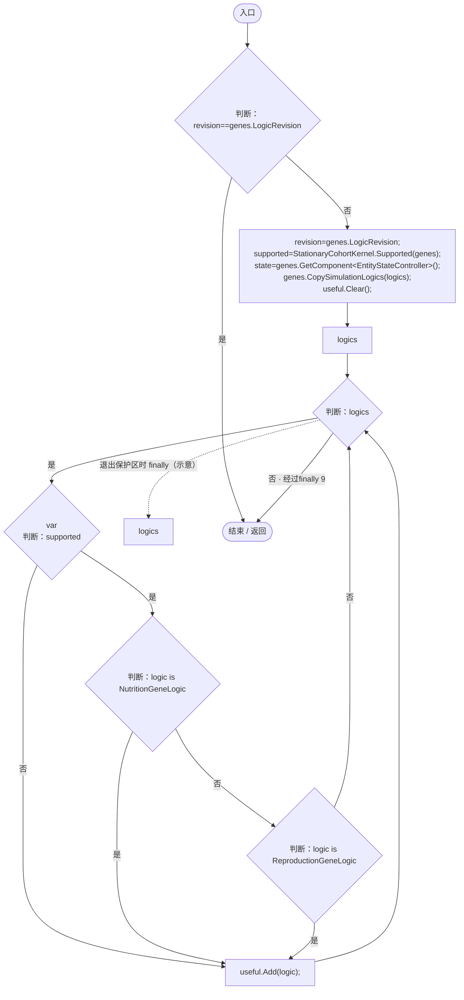
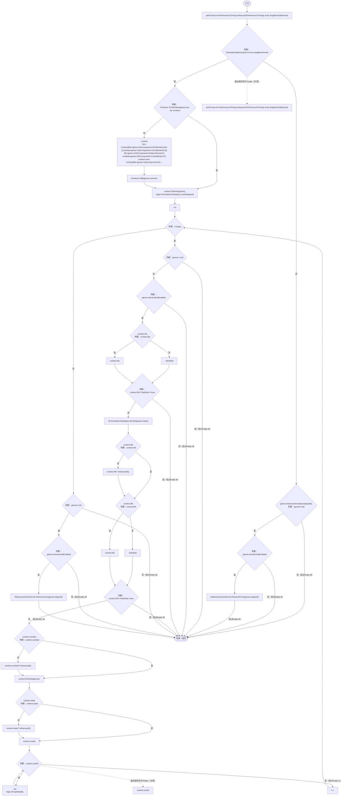
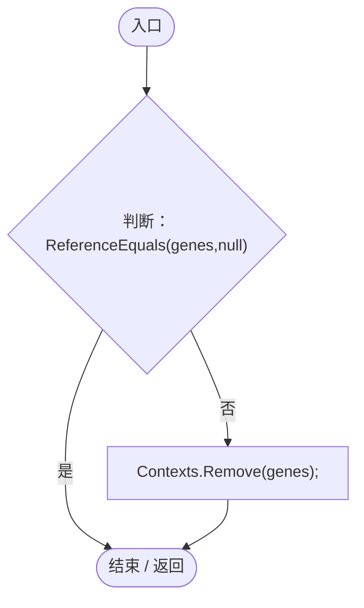
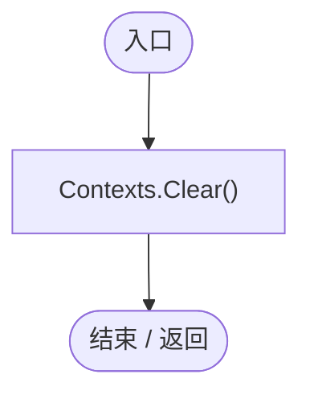
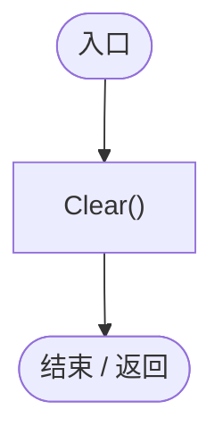

# SingletonSettlement.cs

[返回总索引](../README.md) · `Runtime` · `Assets/DarwinPark/Entities/Simulation/SingletonSettlement.cs`

[源文件](../../../Assets/DarwinPark/Entities/Simulation/SingletonSettlement.cs) · 源码校验：`8ffdb1681a72d38436bd377215e0616feac460c0b5196e430ec285c1e975eccf`

方法按源文件位置排列。事件/回调引用不表示立即执行；分支与异常说明见总索引。完整源码与可点击关系图请打开离线手册。

## Refresh · L15

`public void Refresh(EntityGeneController genes)`

### Editor / Player · Roslyn编译器控制流

项目内调用/回调引用：

- [EntityGeneController.LogicRevision.get · L19](7494d53178552f0e.md#me69facc1c0f1e164)（访问器）
- [StationaryCohortKernel.Supported · L12](9d3f50e550ab5beb.md#mc9ba7d3589415ea3)（方法）
- [EntityGeneController.CopySimulationLogics · L238](7494d53178552f0e.md#m4079524c4b532db4)（方法）

## Advance · L22

`public static void Advance(EntityGeneController genes,float elapsed)`

### Editor / Player · Roslyn编译器控制流

项目内调用/回调引用：

- [PerformanceTimings.Measure · L24](a8403a4c7503726d.md#mb452516394f3ebae)（方法）
- [SimulationOptimization.Current.get · L25](11c9091e70893352.md#mde7abfdc18429e4a)（访问器）
- [EntityGeneController.AdvanceSimulation · L73](7494d53178552f0e.md#m0056817ce3208fda)（方法）
- [StationaryCohortKernel.AdvanceCore · L43](9d3f50e550ab5beb.md#mcdd84fc49043442b)（方法）
- [SingletonSettlement.Context.Refresh · L15](aa60fc9f4553ae15.md#mb57899adca1fb030)（方法）
- [SimulationSubsteps.Count · L10](44755274b83df7ba.md#m9b3c9def7f9642d1)（方法）
- [EntityLifeCycle.HasDied.get · L11](9f4138bfbae654b7.md#mf2406e6830e0007e)（访问器）
- [SimulationSubsteps.Slice · L11](44755274b83df7ba.md#ma075f8159da64c99)（方法）
- [EntityLifeCycle.Advance · L27](9f4138bfbae654b7.md#m8f4e4e844a17662e)（方法）
- [CombatIntent.Advance · L19](34193b994b2c0894.md#mcfb3109714c0797f)（方法）
- [EntityStateController.Advance · L42](0f8869eb7018091e.md#m91aba0abc40405b5)（方法）
- [IGeneLogic.OnUpdate · L9](5304fdad773967f8.md#m829188d65276f8e5)（方法）

## Remove · L39

`public static void Remove(EntityGeneController genes)`

### Editor / Player · Roslyn编译器控制流

## Clear · L40

`public static void Clear()`

### Editor / Player · Roslyn编译器控制流

## Reset · L41

`[RuntimeInitializeOnLoadMethod(RuntimeInitializeLoadType.SubsystemRegistration)]private static void Reset()`

### Editor / Player · Roslyn编译器控制流

项目内调用/回调引用：

- [SingletonSettlement.Clear · L40](aa60fc9f4553ae15.md#md37a0eec93de9957)（方法）
