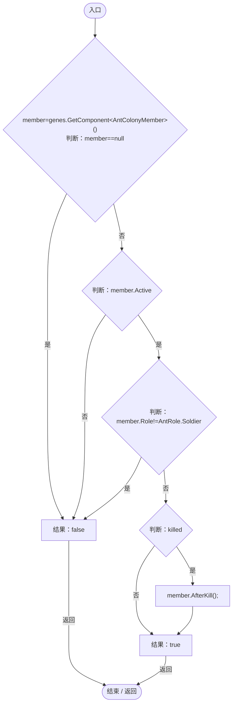

```mermaid
flowchart TD
  b0(["入口"])
  b1{"判断：attacker==null"}
  b2{"判断：target==null"}
  b3["结果：true"]
  b4{"attacker.GetComponent&lt;PopulationBehavior&gt;()<br/>判断：attacker.GetComponent&lt;PopulationBehavior&gt;()"}
  b5[".SameGroup(target)"]
  b6["attacker.GetComponent&lt;PopulationBehavior&gt;()"]
  b7{"判断：attacker.GetComponent&lt;PopulationBehavior&gt;()?.SameGroup(target)==true"}
  b8["结果：false"]
  b9["member=attacker.GetComponent&lt;AntColonyMember&gt;()"]
  b10{"判断：member==null"}
  b11{"判断：member.Active"}
  b12{"判断：member.Role==AntRole.None"}
  b13{"判断：member.Role==AntRole.Soldier"}
  b14["!member.Young"]
  b15["member.Role==AntRole.Soldier"]
  b16["member==null&#124;&#124;!member.Active&#124;&#124;member.Role==AntRole.None&#124;&#124;member.Role==AntRole.Soldier&amp;&amp;!member.Young"]
  b17["结果：member==null&#124;&#124;!member.Active&#124;&#124;member.Role==AntRole.None&#124;&#124;member.Role==AntRole.Soldier&amp;&amp;!member.Young"]
  b18(["结束 / 返回"])
  b0 --> b1
  b1 -->|"否"| b2
  b1 -->|"是"| b3
  b2 -->|"是"| b3
  b2 -->|"否"| b4
  b3 -->|"返回"| b18
  b4 -->|"否"| b5
  b4 -->|"是"| b6
  b5 --> b7
  b6 --> b7
  b7 -->|"是"| b8
  b7 -->|"否"| b9
  b8 -->|"返回"| b18
  b9 --> b10
  b10 -->|"否"| b11
  b10 -->|"是"| b16
  b11 -->|"是"| b12
  b11 -->|"否"| b16
  b12 -->|"否"| b13
  b12 -->|"是"| b16
  b13 -->|"是"| b14
  b13 -->|"否"| b15
  b14 --> b17
  b15 --> b17
  b16 --> b17
  b17 -->|"返回"| b18

```

# AntColonyCombat.cs

[返回总索引](../README.md) · `Runtime` · `Assets/DarwinPark/Entities/Ecology/AntColonyCombat.cs`

[源文件](../../../Assets/DarwinPark/Entities/Ecology/AntColonyCombat.cs) · 源码校验：`f96babea1642c4dbd2f25ca40ce1ed55fd7625db2a3964f25a83ab5db08d0732`

方法按源文件位置排列。事件/回调引用不表示立即执行；分支与异常说明见总索引。完整源码与可点击关系图请打开离线手册。

## CanAttack · L8

`public static bool CanAttack(DarwinEntity attacker,DarwinEntity target)`

### Editor / Player · Roslyn编译器控制流

项目内调用/回调引用：

- [PopulationBehavior.SameGroup · L123](21e4f62f75a9a80f.md#m7a9d850e1d8967d4)（方法）
- [AntColonyMember.Role.get · L33](baebd85c05598377.md#mdf6df89f7116c7a3)（访问器）

## SettleSoldierAttack · L15

`public static bool SettleSoldierAttack(EntityGeneController genes,DarwinEntity target,bool killed)`

### Editor / Player · Roslyn编译器控制流

项目内调用/回调引用：

- [AntColonyMember.Role.get · L33](baebd85c05598377.md#mdf6df89f7116c7a3)（访问器）
- [AntColonyMember.AfterKill · L133](baebd85c05598377.md#m3e2bbeb3787f6e75)（方法）
