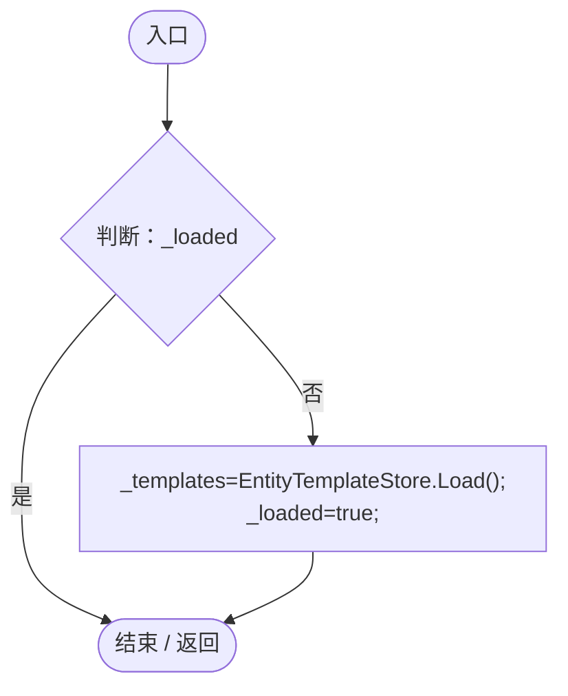
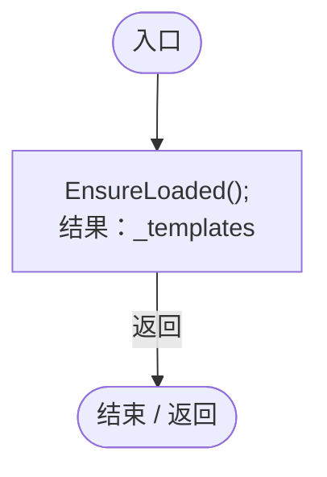
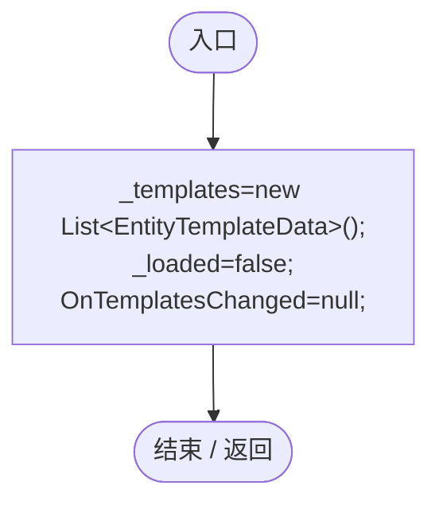
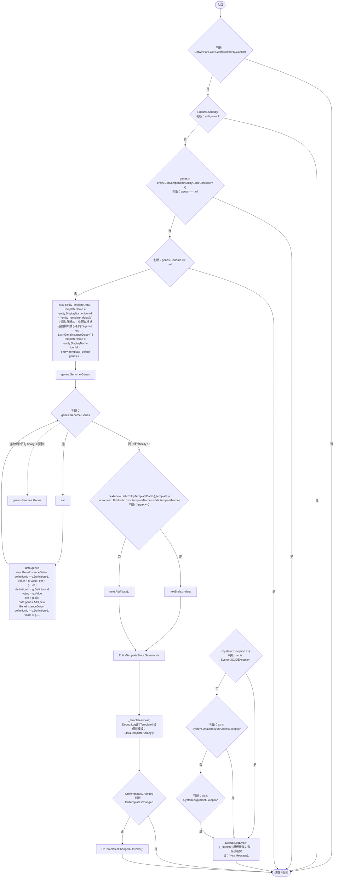
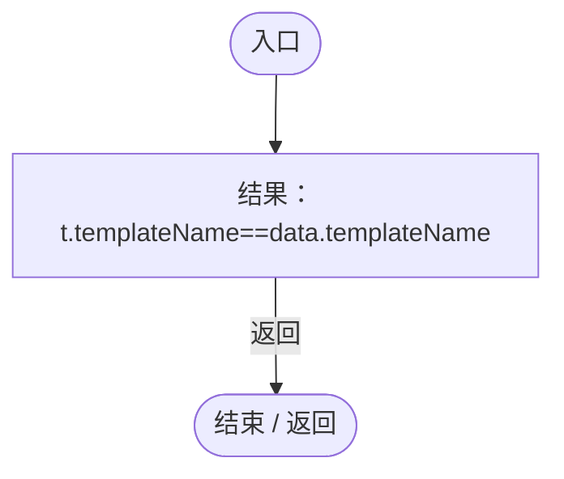

# EntityTemplateManager.cs

[返回总索引](../README.md) · `Runtime` · `Assets/DarwinPark/UI/EntityTemplateManager.cs`

[源文件](../../../Assets/DarwinPark/UI/EntityTemplateManager.cs) · 源码校验：`3417e0b5280d6866dc0dc46895d79ae0d32f68da765418f769fe348d08197b58`

方法按源文件位置排列。事件/回调引用不表示立即执行；分支与异常说明见总索引。完整源码与可点击关系图请打开离线手册。

## EnsureLoaded · L22

`private static void EnsureLoaded()`

### Editor / Player · Roslyn编译器控制流

项目内调用/回调引用：

- [EntityTemplateStore.Load · L34](2a560a9e3c003e7b.md#m8c4dc64a4aa5668b)（方法）

## Templates.get · L23

`get`

### Editor / Player · Roslyn编译器控制流

项目内调用/回调引用：

- [EntityTemplateManager.EnsureLoaded · L22](ab5e6457e8a7aba0.md#ma2466c9cfd1d4691)（方法）

## Reset · L24

`[RuntimeInitializeOnLoadMethod(RuntimeInitializeLoadType.SubsystemRegistration)] private static void Reset()`

### Editor / Player · Roslyn编译器控制流

## SaveTemplate · L30

`public static void SaveTemplate(DarwinEntity entity)`

### Editor / Player · Roslyn编译器控制流

项目内调用/回调引用：

- [EntityTemplateManager.EnsureLoaded · L22](ab5e6457e8a7aba0.md#ma2466c9cfd1d4691)（方法）
- [EntityTemplateStore.Save · L51](2a560a9e3c003e7b.md#m853c3cfd96f490b9)（方法）
- [EntityTemplateManager.回调@57 · L57](ab5e6457e8a7aba0.md#md64977b2b60a65b0)（回调/委托）

## 回调@57 · L57

`t … => 回调`

### Editor / Player · Roslyn编译器控制流

