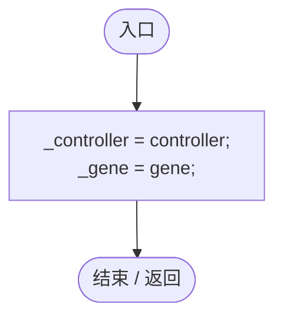
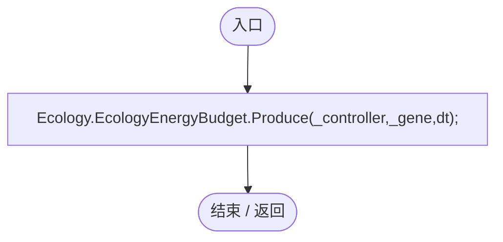
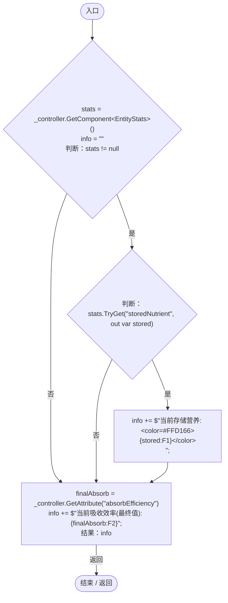

# NutritionGeneLogic.cs

[返回总索引](../README.md) · `Runtime` · `Assets/DarwinPark/Entities/Logic/NutritionGeneLogic.cs`

[源文件](../../../Assets/DarwinPark/Entities/Logic/NutritionGeneLogic.cs) · 源码校验：`4dc25c1b8a70b659da0e8de4b4083d08f879379327f2111f39fb421aafbb7c61`

方法按源文件位置排列。事件/回调引用不表示立即执行；分支与异常说明见总索引。完整源码与可点击关系图请打开离线手册。

## Initialize · L13

`public void Initialize(EntityGeneController controller, GeneInstance gene)`

### Editor / Player · Roslyn编译器控制流

## OnUpdate · L19

`public void OnUpdate(float dt)`

### Editor / Player · Roslyn编译器控制流

项目内调用/回调引用：

- [EcologyEnergyBudget.Produce · L41](06a91c8201f26593.md#m4a14756ba859448f)（方法）

## GetTooltipInfo · L25

`public string GetTooltipInfo()`

### Editor / Player · Roslyn编译器控制流

项目内调用/回调引用：

- [EntityStats.TryGet · L90](75aa86a368efdf24.md#m24ee1433e4a70d94)（方法）
- [EntityGeneController.GetAttribute · L257](7494d53178552f0e.md#m600509f72d274f0c)（方法）
