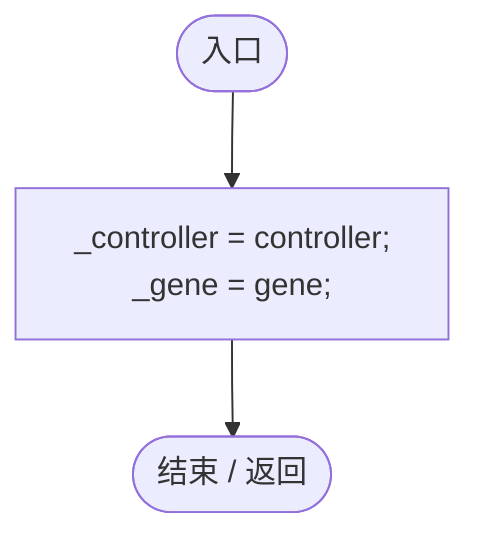
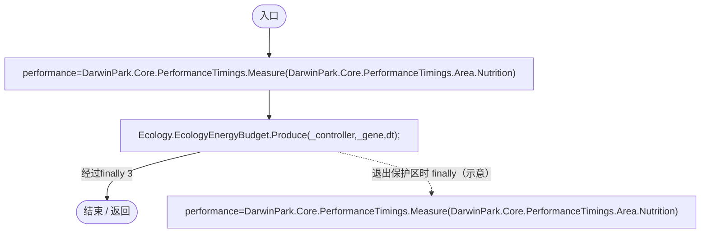
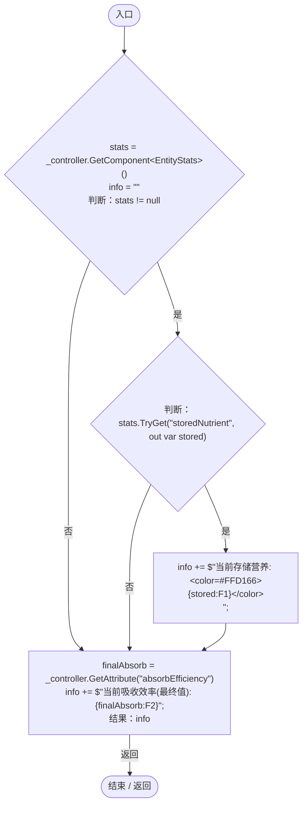

# NutritionGeneLogic.cs

[返回总索引](../README.md) · `Runtime` · `Assets/DarwinPark/Entities/Logic/NutritionGeneLogic.cs`

[源文件](../../../Assets/DarwinPark/Entities/Logic/NutritionGeneLogic.cs) · 源码校验：`725d7a740b7db632956a7cca3ef64b4ab473dd08839bf3a45d21ade3b89830a7`

方法按源文件位置排列。事件/回调引用不表示立即执行；分支与异常说明见总索引。完整源码与可点击关系图请打开离线手册。

## Initialize · L13

`public void Initialize(EntityGeneController controller, GeneInstance gene)`

### Editor / Player · Roslyn编译器控制流

## OnUpdate · L19

`public void OnUpdate(float dt)`

### Editor / Player · Roslyn编译器控制流

项目内调用/回调引用：

- [PerformanceTimings.Measure · L24](a8403a4c7503726d.md#m592e16f2b6513efd)（方法）
- [EcologyEnergyBudget.Produce · L33](06a91c8201f26593.md#me449544ad222016c)（方法）

## GetTooltipInfo · L27

`public string GetTooltipInfo()`

### Editor / Player · Roslyn编译器控制流

项目内调用/回调引用：

- [EntityStats.TryGet · L93](75aa86a368efdf24.md#m03cef847022eee28)（方法）
- [EntityGeneController.GetAttribute · L288](7494d53178552f0e.md#m45127bcdd833aaf5)（方法）
