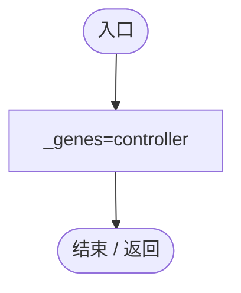
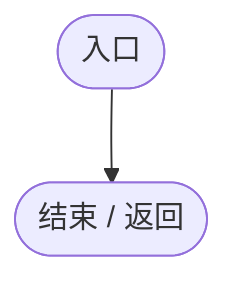
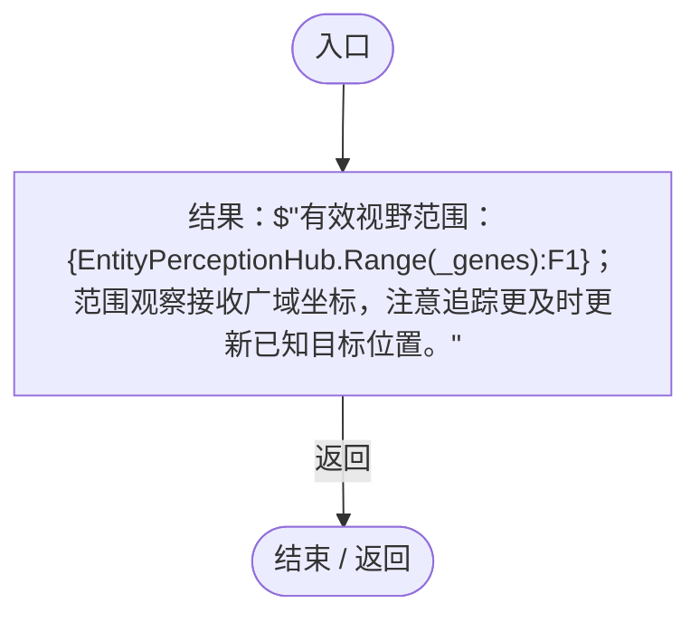

# ObservationGeneLogic.cs

[返回总索引](../README.md) · `Runtime` · `Assets/DarwinPark/Entities/Logic/ObservationGeneLogic.cs`

[源文件](../../../Assets/DarwinPark/Entities/Logic/ObservationGeneLogic.cs) · 源码校验：`e6f409db0e42265d1dc0206b5920e501f7c99f9483a08b2eafbbeb793e819f43`

方法按源文件位置排列。事件/回调引用不表示立即执行；分支与异常说明见总索引。完整源码与可点击关系图请打开离线手册。

## Initialize · L9

`public void Initialize(EntityGeneController controller,GeneInstance gene)`

### Editor / Player · Roslyn编译器控制流

## OnUpdate · L10

`public void OnUpdate(float dt)`

### Editor / Player · Roslyn编译器控制流

## GetTooltipInfo · L11

`public string GetTooltipInfo()`

### Editor / Player · Roslyn编译器控制流

项目内调用/回调引用：

- [EntityPerceptionHub.Range · L40](aeecc36cb2c3cc24.md#m82b4d3ee35795aa8)（方法）
