# ReproductionGeneLogic.cs

[返回总索引](../README.md) · `Runtime` · `Assets/DarwinPark/Entities/Logic/ReproductionGeneLogic.cs`

[源文件](../../../Assets/DarwinPark/Entities/Logic/ReproductionGeneLogic.cs) · 源码校验：`d05773a5de241e7569bd0f89cebc2693b6e35da090347330f4b179add1c024bd`

方法按源文件位置排列。事件/回调引用不表示立即执行；分支与异常说明见总索引。完整源码与可点击关系图请打开离线手册。

## Initialize · L25

`public void Initialize(EntityGeneController controller, GeneInstance gene)`

### Editor / Player · Roslyn编译器控制流

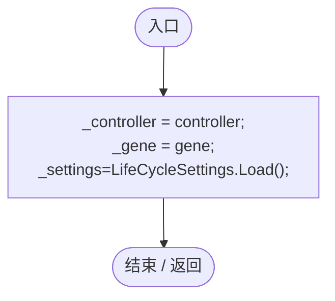

项目内调用/回调引用：

- [LifeCycleSettings.Load · L16](ace76969fe8f61de.md#mbd2925785484f343)（方法）

## CaptureState · L33

`public ReproductionSaveState CaptureState()`

★ 适配：孕育计时、产后冷却与配偶基因组一起保存，不能读档后立即生产或丢失后代遗传。

### Editor / Player · Roslyn编译器控制流

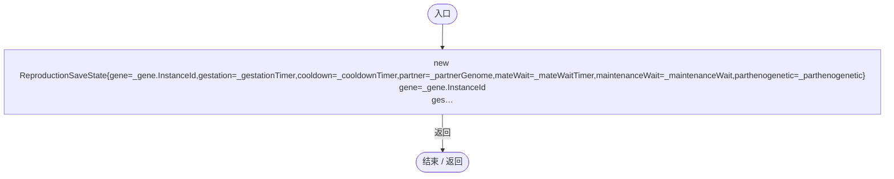

## RestoreState · L35

`public void RestoreState(ReproductionSaveState state)`

★ 修复（防Bug回归）：Unity内联序列化可能把null配偶恢复为空Genome，不能因此把单亲孕育误判为有性。

### Editor / Player · Roslyn编译器控制流

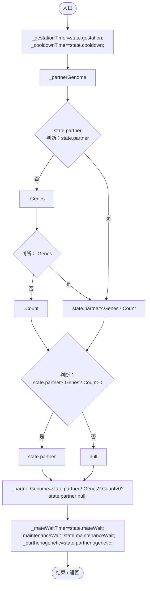

## OnUpdate · L36

`public void OnUpdate(float dt)`

### Editor / Player · Roslyn编译器控制流

```mermaid
flowchart TD
  b0(["入口"])
  b1{"判断：dt&lt;=0"}
  b2{"判断：DarwinPark.Core.WorldAuthority.IsReplica"}
  b3{"判断：Ecology.AntColonyReproduction.BlocksOrdinary(_controller)"}
  b4["_mateWaitTimer=0;"]
  b5{"判断：GeneBehaviorAuthority.IsPrimary&lt;ReproductionGeneLogic&gt;(_controller,_gene)"}
  b6["_mateWaitTimer=0;"]
  b7{"stats = _controller.GetComponent&lt;EntityStats&gt;()<br/>判断：stats == null"}
  b8{"判断：_cooldownTimer &gt; 0"}
  b9["_mateWaitTimer=0;<br/>_cooldownTimer -= dt;"]
  b10{"判断：_controller.IsGestating"}
  b11{"_mateWaitTimer=0;<br/>判断：_gestationTimer&lt;=0"}
  b12{"判断：EntityPopulationLimit.CanSpawn"}
  b13{"_gestationTimer -= dt;<br/>stats.Modify(&quot;nutrient&quot;, -Ecology.EcologyBalanceSettings.Current.gestationFoodPerSecond * dt);<br/>判断：_gestationTimer &lt;= 0f"}
  b14{"判断：SpawnOffspring()"}
  b15["_controller.IsGestating = false;<br/>_controller.Recalculate();<br/>_cooldownTimer = Ecology.EcologyReproductionTiming.CooldownSeconds(_controller);<br/>stats.Modify(&quot;nutrient&quot;, -Ecology.EcologyBalanceSettings.Current.birthFoodCost);<br/>_partnerGenome …"]
  b16{"判断：_controller.CurrentAge != AgeState.Adult"}
  b17["_maintenanceWait=0;<br/>_mateWaitTimer=0;<br/>Ecology.EcologyDiagnostics.Blocked(Ecology.EcologyDiagnostics.ReproductionBlock.Age);"]
  b18{"size = 1f<br/>判断：stats.TryGet(&quot;size&quot;, out var s)"}
  b19["size = Mathf.Max(Ecology.EcologyBalanceSettings.Current.minimumReproductionSize, s);"]
  b20["requiredNutrient = _settings.nutrientCost * size<br/>maintenanceReady=PopulationMaintenance.BreedingReady(_controller,ref _maintenanceWait,dt)<br/>repDef = GeneDatabase.Get(_gene.DefinitionId)"]
  b21{"repDef<br/>判断：repDef"}
  b22[".ResolveState(_gene.Value, _gene.MissingStateIds)"]
  b23["repDef"]
  b24["repState = repDef?.ResolveState(_gene.Value, _gene.MissingStateIds)"]
  b25{"repState<br/>判断：repState"}
  b26[".StateId"]
  b27["repState"]
  b28["sexual=repState?.StateId==&quot;sexual&quot;"]
  b29{"判断：ParthenogenesisCondition.Enabled(_controller)"}
  b30{"判断：stats.TryGet(&quot;storedNutrient&quot;,out float available)"}
  b31{"判断：available&lt;requiredNutrient"}
  b32["Ecology.EcologyDiagnostics.Blocked(Ecology.EcologyDiagnostics.ReproductionBlock.Reserve);"]
  b33{"判断：sexual"}
  b34["FindMate(requiredNutrient)"]
  b35["null"]
  b36["mate=sexual?FindMate(requiredNutrient):null"]
  b37{"_controller<br/>_mateWaitTimer<br/>判断：sexual"}
  b38["mate!=null"]
  b39["!sexual"]
  b40["parthenogenetic=ParthenogenesisCondition.Advance(_controller,ref _mateWaitTimer,!sexual&#124;&#124;mate!=null,dt)"]
  b41{"判断：sexual"}
  b42{"判断：mate==null"}
  b43{"判断：parthenogenetic"}
  b44["Ecology.EcologyDiagnostics.Blocked(Ecology.EcologyDiagnostics.ReproductionBlock.Mate);"]
  b45{"判断：EntityPopulationLimit.CanSpawn"}
  b46{"判断：stats.TryGet(&quot;storedNutrient&quot;, out var stored)"}
  b47{"判断：stored &lt; requiredNutrient"}
  b48["Ecology.EcologyDiagnostics.Blocked(Ecology.EcologyDiagnostics.ReproductionBlock.Reserve);"]
  b49{"判断：maintenanceReady"}
  b50{"判断：repState != null"}
  b51{"判断：repState.StateId == &quot;asexual&quot;"}
  b52{"判断：parthenogenetic"}
  b53["stats.Modify(&quot;storedNutrient&quot;,-requiredNutrient);<br/>StartGestation(stats, null, size,parthenogenetic);"]
  b54{"判断：repState != null"}
  b55{"判断：repState.StateId == &quot;sexual&quot;"}
  b56{"判断：mate != null"}
  b57{"mateStats = mate.GetComponent&lt;EntityStats&gt;()<br/>判断：mateStats != null"}
  b58{"判断：mateStats.TryGet(&quot;storedNutrient&quot;, out var mateStored)"}
  b59{"判断：mateStored &gt;= requiredNutrient"}
  b60["stats.Modify(&quot;storedNutrient&quot;, -requiredNutrient);<br/>mateStats.Modify(&quot;storedNutrient&quot;, -requiredNutrient);<br/>mateGeneCtrl = mate.GetComponent&lt;EntityGeneController&gt;()<br/>StartGestation(stats, mateGeneCtrl.Genome, size);"]
  b61(["结束 / 返回"])
  b0 --> b1
  b1 -->|"否"| b2
  b1 -->|"是"| b61
  b2 -->|"是"| b61
  b2 -->|"否"| b3
  b3 -->|"是"| b4
  b3 -->|"否"| b5
  b4 --> b61
  b5 -->|"否"| b6
  b5 -->|"是"| b7
  b6 --> b61
  b7 -->|"是"| b61
  b7 -->|"否"| b8
  b8 -->|"是"| b9
  b8 -->|"否"| b10
  b9 --> b61
  b10 -->|"是"| b11
  b10 -->|"否"| b16
  b11 -->|"是"| b12
  b11 -->|"否"| b13
  b12 -->|"否"| b61
  b12 -->|"是"| b13
  b13 -->|"是"| b14
  b13 -->|"否"| b61
  b14 -->|"否"| b61
  b14 -->|"是"| b15
  b15 --> b61
  b16 -->|"是"| b17
  b16 -->|"否"| b18
  b17 --> b61
  b18 -->|"是"| b19
  b18 -->|"否"| b20
  b19 --> b20
  b20 --> b21
  b21 -->|"否"| b22
  b21 -->|"是"| b23
  b22 --> b24
  b23 --> b24
  b24 --> b25
  b25 -->|"否"| b26
  b25 -->|"是"| b27
  b26 --> b28
  b27 --> b28
  b28 --> b29
  b29 -->|"否"| b30
  b29 -->|"是"| b33
  b30 -->|"是"| b31
  b30 -->|"否"| b32
  b31 -->|"是"| b32
  b31 -->|"否"| b33
  b32 --> b61
  b33 -->|"是"| b34
  b33 -->|"否"| b35
  b34 --> b36
  b35 --> b36
  b36 --> b37
  b37 -->|"是"| b38
  b37 -->|"否"| b39
  b38 --> b40
  b39 --> b40
  b40 --> b41
  b41 -->|"是"| b42
  b41 -->|"否"| b45
  b42 -->|"是"| b43
  b42 -->|"否"| b45
  b43 -->|"否"| b44
  b43 -->|"是"| b45
  b44 --> b61
  b45 -->|"否"| b61
  b45 -->|"是"| b46
  b46 -->|"是"| b47
  b46 -->|"否"| b48
  b47 -->|"是"| b48
  b47 -->|"否"| b49
  b48 --> b61
  b49 -->|"否"| b61
  b49 -->|"是"| b50
  b50 -->|"是"| b51
  b50 -->|"否"| b54
  b51 -->|"否"| b52
  b51 -->|"是"| b53
  b52 -->|"是"| b53
  b52 -->|"否"| b54
  b53 --> b61
  b54 -->|"是"| b55
  b54 -->|"否"| b61
  b55 -->|"是"| b56
  b55 -->|"否"| b61
  b56 -->|"是"| b57
  b56 -->|"否"| b61
  b57 -->|"是"| b58
  b57 -->|"否"| b61
  b58 -->|"是"| b59
  b58 -->|"否"| b61
  b59 -->|"是"| b60
  b59 -->|"否"| b61
  b60 --> b61

```

项目内调用/回调引用：

- [AntColonyReproduction.BlocksOrdinary · L12](c22084eac4e522ed.md#m8e86301468932b34)（方法）
- [GeneBehaviorAuthority.IsPrimary · L10](be83fa896bbe02ae.md#me2fc1f2e16fcd073)（方法）
- [EntityStats.Modify · L104](75aa86a368efdf24.md#m858c2a75d852ecc1)（方法）
- [EcologyBalanceSettings.Current.get · L29](5a37bc79f15f6238.md#md33d4c4b8f82540b)（访问器）
- [ReproductionGeneLogic.SpawnOffspring · L187](ac319ea70bd8b723.md#m0acaa25125fcd465)（方法）
- [EntityGeneController.Recalculate · L90](7494d53178552f0e.md#m93744c8f3039b93c)（方法）
- [EcologyReproductionTiming.CooldownSeconds · L21](f834876424538fa9.md#md8fcb789a14c5e5c)（方法）
- [EntityGeneController.CurrentAge.get · L35](7494d53178552f0e.md#mf5bc28691dd4a0f3)（访问器）
- [EcologyDiagnostics.Blocked · L10](fc141d865eda1284.md#m50a1830a008f59a0)（方法）
- [EntityStats.TryGet · L90](75aa86a368efdf24.md#m24ee1433e4a70d94)（方法）
- [PopulationMaintenance.BreedingReady · L108](923ccc4e86c4786c.md#m6443aed2cb3ff306)（方法）
- [GeneDatabase.Get · L135](ec0a03483435a863.md#m8f3bbfb35f3ca397)（方法）
- [GeneDefinition.ResolveState · L83](07f99d5784e3dadb.md#mbaf2c5b1eb1045c5)（方法）
- [ParthenogenesisCondition.Enabled · L240](ac319ea70bd8b723.md#m499205f07a802d45)（方法）
- [ReproductionGeneLogic.FindMate · L156](ac319ea70bd8b723.md#m4ec186963d1a2ab6)（方法）
- [ParthenogenesisCondition.Advance · L241](ac319ea70bd8b723.md#m9459f12c1abb4ab0)（方法）
- [ReproductionGeneLogic.StartGestation · L134](ac319ea70bd8b723.md#m38a8d176e49e1020)（方法）

## StartGestation · L134

`private void StartGestation(EntityStats stats, Genome partnerGenome, float size,bool parthenogenetic=false)`

### Editor / Player · Roslyn编译器控制流

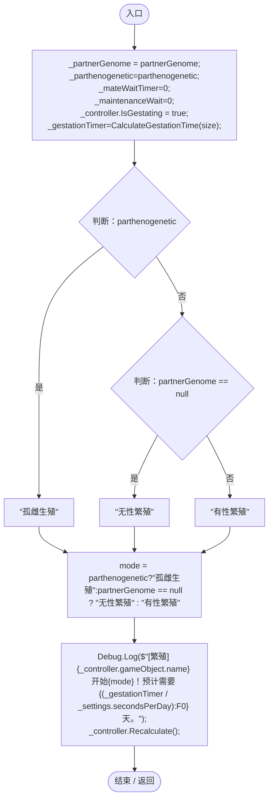

项目内调用/回调引用：

- [ReproductionGeneLogic.CalculateGestationTime · L150](ac319ea70bd8b723.md#m1d2dd13f863c0d75)（方法）
- [EntityGeneController.Recalculate · L90](7494d53178552f0e.md#m93744c8f3039b93c)（方法）

## CalculateGestationTime · L150

`public float CalculateGestationTime(float size)`

★ 修复（防Bug回归）：体型/生长影响仍保留，但总孕育时长必须处于 7～30 个游戏日。

### Editor / Player · Roslyn编译器控制流

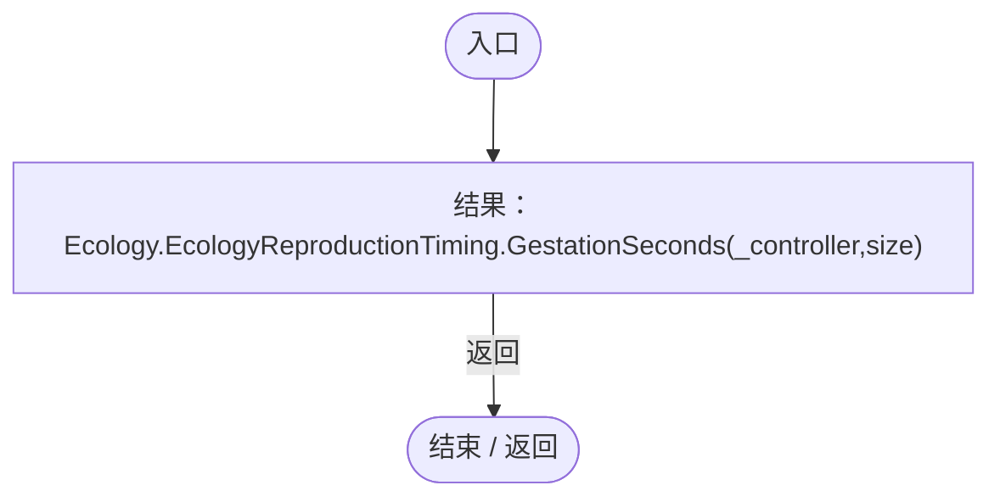

项目内调用/回调引用：

- [EcologyReproductionTiming.GestationSeconds · L11](f834876424538fa9.md#medb66b741c6f0fd2)（方法）

## FindMate · L156

`private DarwinEntity FindMate(float requiredNutrient)`

### Editor / Player · Roslyn编译器控制流

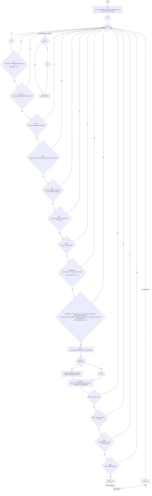

项目内调用/回调引用：

- [EcologyQueries.Alive · L38](bdf7ccc2c9c0452f.md#mb2877c487f449970)（方法）
- [AntColonyReproduction.BlocksOrdinary · L12](c22084eac4e522ed.md#m8e86301468932b34)（方法）
- [DarwinEntity.Genes.get · L14](70798dde169f2e8b.md#m622eb1adf401d431)（访问器）
- [EntityStats.TryGet · L90](75aa86a368efdf24.md#m24ee1433e4a70d94)（方法）
- [GeneDatabase.Get · L135](ec0a03483435a863.md#m8f3bbfb35f3ca397)（方法）
- [GeneDefinition.ResolveState · L83](07f99d5784e3dadb.md#mbaf2c5b1eb1045c5)（方法）
- [EntityGeneController.CurrentAge.get · L35](7494d53178552f0e.md#mf5bc28691dd4a0f3)（访问器）
- [ReproductionGeneLogic.回调@170 · L170](ac319ea70bd8b723.md#m2f968b18b82cb90f)（回调/委托）

## 回调@170 · L170

`g … => 回调`

### Editor / Player · Roslyn编译器控制流

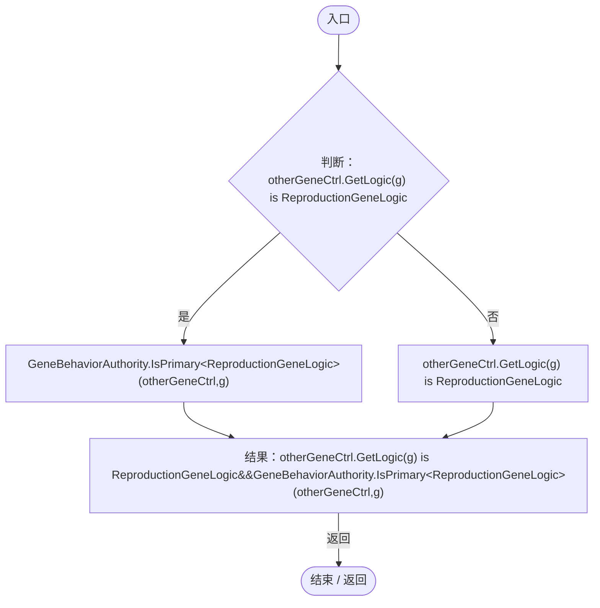

项目内调用/回调引用：

- [EntityGeneController.GetLogic · L184](7494d53178552f0e.md#m4f4e58e1a4abadfc)（方法）
- [GeneBehaviorAuthority.IsPrimary · L10](be83fa896bbe02ae.md#me2fc1f2e16fcd073)（方法）

## SpawnOffspring · L187

`private bool SpawnOffspring()`

### Editor / Player · Roslyn编译器控制流

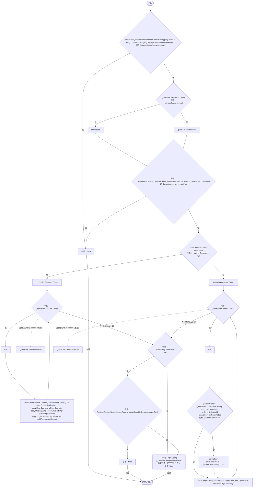

项目内调用/回调引用：

- [EntityGeneController.Evaluation.get · L19](7494d53178552f0e.md#m2cb74e57d810ca42)（访问器）
- [OffspringPlacement.TryGetPosition · L9](eeef5e6fb7a6f46b.md#mcf47222366c0f594)（方法）
- [GeneInstance.Create · L20](f82e1498d67f5afd.md#m72e94c278de3cf8b)（方法）
- [Genome.Add · L19](a2ef23f865bc7ee8.md#md9cfdc94b8b8d40f)（方法）
- [EcologyReproduction.Spawn · L9](eaaa574d7ae50e29.md#mc64a3524363ab773)（方法）
- [ReproductionGeneLogic.回调@189 · L189](ac319ea70bd8b723.md#m8fb791d353ef4185)（回调/委托）
- [ReproductionGeneLogic.回调@206 · L206](ac319ea70bd8b723.md#m041ab79bbafa76a1)（回调/委托）

## 回调@189 · L189

`g … => 回调`

### Editor / Player · Roslyn编译器控制流

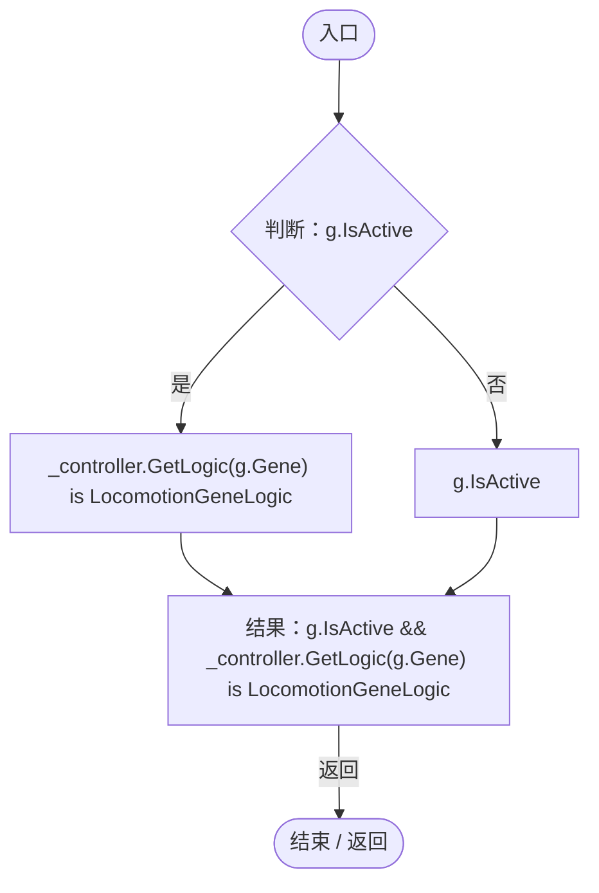

项目内调用/回调引用：

- [EntityGeneController.GetLogic · L184](7494d53178552f0e.md#m4f4e58e1a4abadfc)（方法）

## 回调@206 · L206

`g … => 回调`

### Editor / Player · Roslyn编译器控制流

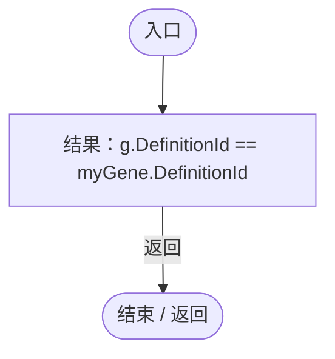

## GetTooltipInfo · L224

`public string GetTooltipInfo()`

### Editor / Player · Roslyn编译器控制流

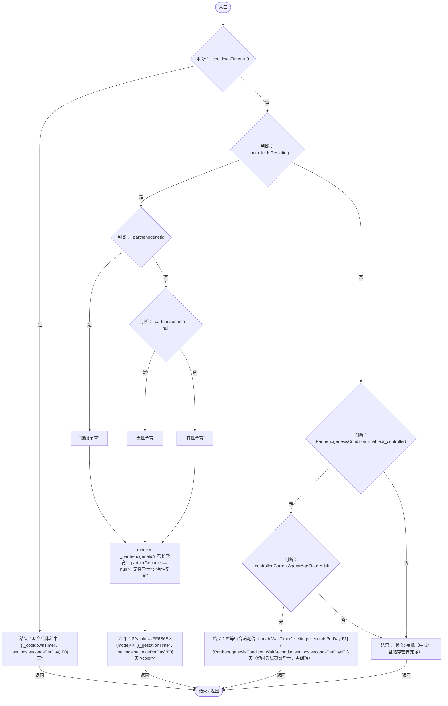

项目内调用/回调引用：

- [ParthenogenesisCondition.Enabled · L240](ac319ea70bd8b723.md#m499205f07a802d45)（方法）
- [EntityGeneController.CurrentAge.get · L35](7494d53178552f0e.md#mf5bc28691dd4a0f3)（访问器）

## WaitSeconds.get · L239

`public static float WaitSeconds`

### Editor / Player · 语法控制结构 / 声明（非CFG）

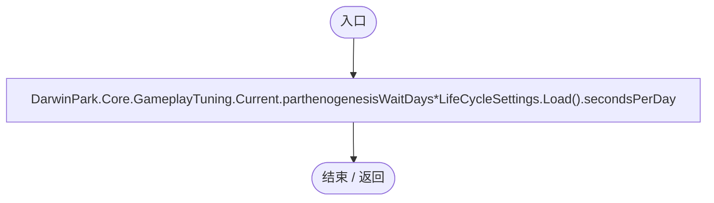

项目内调用/回调引用：

- [GameplayTuning.Current.get · L21](db546e5713b32d53.md#m1caba89e7704d239)（访问器）
- [LifeCycleSettings.Load · L16](ace76969fe8f61de.md#mbd2925785484f343)（方法）

## Enabled · L240

`public static bool Enabled(EntityGeneController genes)`

### Editor / Player · Roslyn编译器控制流

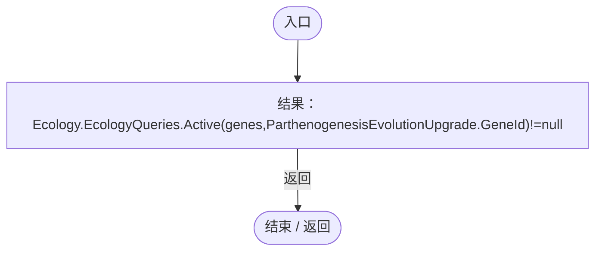

项目内调用/回调引用：

- [EcologyQueries.Active · L28](bdf7ccc2c9c0452f.md#m4fb10ad424167e3b)（方法）

## Advance · L241

`public static bool Advance(EntityGeneController genes,ref float elapsed,bool hasMate,float dt)`

### Editor / Player · Roslyn编译器控制流

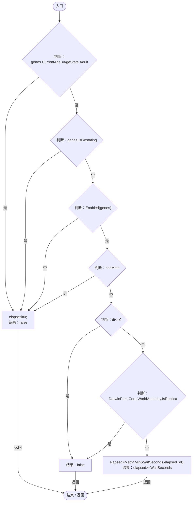

项目内调用/回调引用：

- [EntityGeneController.CurrentAge.get · L35](7494d53178552f0e.md#mf5bc28691dd4a0f3)（访问器）
- [ParthenogenesisCondition.Enabled · L240](ac319ea70bd8b723.md#m499205f07a802d45)（方法）
