# ReproductionGeneLogic.cs

[返回总索引](../README.md) · `Runtime` · `Assets/DarwinPark/Entities/Logic/ReproductionGeneLogic.cs`

[源文件](../../../Assets/DarwinPark/Entities/Logic/ReproductionGeneLogic.cs) · 源码校验：`1f98896ccfaf5e3c07a95f5e23153d8674d9aed3e860720124a0b250a2077305`

方法按源文件位置排列。事件/回调引用不表示立即执行；分支与异常说明见总索引。完整源码与可点击关系图请打开离线手册。

## Initialize · L29

`public void Initialize(EntityGeneController controller, GeneInstance gene)`

### Editor / Player · Roslyn编译器控制流

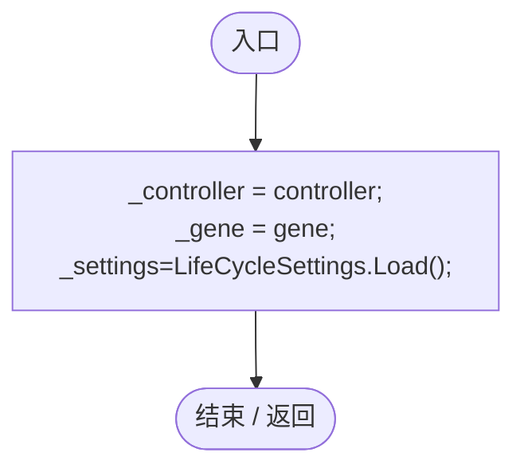

项目内调用/回调引用：

- [LifeCycleSettings.Load · L16](ace76969fe8f61de.md#m6fe263852e5a8989)（方法）

## CaptureState · L37

`public ReproductionSaveState CaptureState()`

★ 适配：孕育计时、产后冷却与配偶基因组一起保存，不能读档后立即生产或丢失后代遗传。

### Editor / Player · Roslyn编译器控制流

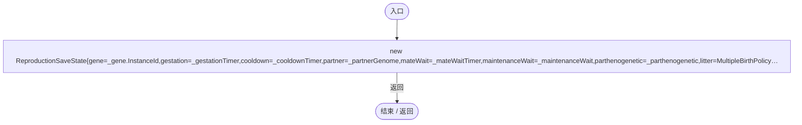

项目内调用/回调引用：

- [MultipleBirthPolicy.Copy · L21](337309de03d51a54.md#m4c36ca81eae50dc0)（方法）

## RestoreState · L39

`public void RestoreState(ReproductionSaveState state)`

★ 修复（防Bug回归）：Unity内联序列化可能把null配偶恢复为空Genome，不能因此把单亲孕育误判为有性。

### Editor / Player · Roslyn编译器控制流

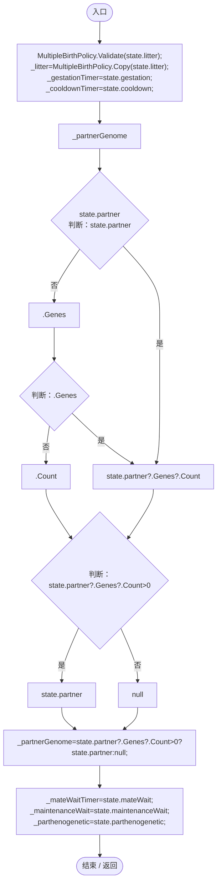

项目内调用/回调引用：

- [MultipleBirthPolicy.Validate · L22](337309de03d51a54.md#m7658bbc276e60f89)（方法）
- [MultipleBirthPolicy.Copy · L21](337309de03d51a54.md#m4c36ca81eae50dc0)（方法）

## OnUpdate · L40

`public void OnUpdate(float dt)`

### Editor / Player · Roslyn编译器控制流

```mermaid
flowchart TD
  b0(["入口"])
  b1["performance=DarwinPark.Core.PerformanceTimings.Measure(DarwinPark.Core.PerformanceTimings.Area.Reproduction)"]
  b2{"判断：dt&lt;=0"}
  b3{"判断：DarwinPark.Core.WorldAuthority.IsReplica"}
  b4{"_mateCoordinates.Advance(dt);<br/>判断：Ecology.AntColonyReproduction.BlocksOrdinary(_controller)"}
  b5["_mateWaitTimer=0;"]
  b6{"判断：GeneBehaviorAuthority.IsPrimary&lt;ReproductionGeneLogic&gt;(_controller,_gene)"}
  b7["_mateWaitTimer=0;"]
  b8{"stats = ActiveSimulationBatch.Read&lt;EntityStats&gt;(_controller)<br/>判断：stats == null"}
  b9{"判断：_cooldownTimer &gt; 0"}
  b10["_mateWaitTimer=0;<br/>_cooldownTimer -= dt;"]
  b11{"判断：_controller.IsGestating"}
  b12{"_mateWaitTimer=0;<br/>判断：_gestationTimer&lt;=0"}
  b13{"判断：Ecology.ColonyContinuityPriority.CanSpawn(_controller)"}
  b14{"_gestationTimer -= dt;<br/>stats.Modify(&quot;nutrient&quot;, -Ecology.EcologyBalanceSettings.Current.gestationFoodPerSecond * dt*DarwinPark.Core.GameplayTuning.Current.baseMetabolismMultiplier);<br/>判断：_gestationTimer &lt;= 0f"}
  b15{"判断：MultipleBirthPolicy.Deliver(ref _litter,SpawnOffspring,()=&gt;stats.Modify(&quot;nutrient&quot;,-Ecology.EcologyBalanceSettings.Current.birthFoodCost))"}
  b16["_controller.IsGestating = false;<br/>_controller.Recalculate();<br/>_cooldownTimer = Ecology.EcologyReproductionTiming.CooldownSeconds(_controller);<br/>_litter=null;<br/>_partnerGenome = null;<br/>_parthenogenetic=false;"]
  b17{"判断：_controller.CurrentAge != AgeState.Adult"}
  b18["_maintenanceWait=0;<br/>_mateWaitTimer=0;<br/>Ecology.EcologyDiagnostics.Blocked(Ecology.EcologyDiagnostics.ReproductionBlock.Age);"]
  b19{"size = 1f<br/>判断：stats.TryGet(&quot;size&quot;, out var s)"}
  b20["size = Mathf.Max(Ecology.EcologyBalanceSettings.Current.minimumReproductionSize, s);"]
  b21["requiredNutrient = _settings.nutrientCost * size * MultipleBirthPolicy.Count(_controller)<br/>maintenanceReady=PopulationMaintenance.BreedingReady(_controller,ref _maintenanceWait,dt)<br/>repDef = GeneDatabase.Get(_gene.DefinitionId)"]
  b22{"repDef<br/>判断：repDef"}
  b23[".ResolveState(_gene.Value, _gene.MissingStateIds)"]
  b24["repDef"]
  b25["repState = repDef?.ResolveState(_gene.Value, _gene.MissingStateIds)"]
  b26{"repState<br/>判断：repState"}
  b27[".StateId"]
  b28["repState"]
  b29["sexual=repState?.StateId==&quot;sexual&quot;"]
  b30{"判断：ParthenogenesisCondition.Enabled(_controller)"}
  b31{"判断：stats.TryGet(&quot;storedNutrient&quot;,out float available)"}
  b32{"判断：available&lt;requiredNutrient"}
  b33["Ecology.EcologyDiagnostics.Blocked(Ecology.EcologyDiagnostics.ReproductionBlock.Reserve);"]
  b34{"判断：sexual"}
  b35["FindMate(requiredNutrient)"]
  b36["null"]
  b37["mate=sexual?FindMate(requiredNutrient):null"]
  b38{"_controller<br/>_mateWaitTimer<br/>判断：sexual"}
  b39["mate!=null"]
  b40["!sexual"]
  b41["parthenogenetic=ParthenogenesisCondition.Advance(_controller,ref _mateWaitTimer,!sexual&#124;&#124;mate!=null,dt)"]
  b42{"判断：sexual"}
  b43{"判断：mate==null"}
  b44{"判断：parthenogenetic"}
  b45["Ecology.EcologyDiagnostics.Blocked(Ecology.EcologyDiagnostics.ReproductionBlock.Mate);"]
  b46{"判断：Ecology.ColonyContinuityPriority.CanSpawn(_controller)"}
  b47{"判断：stats.TryGet(&quot;storedNutrient&quot;, out var stored)"}
  b48{"判断：stored &lt; requiredNutrient"}
  b49["Ecology.EcologyDiagnostics.Blocked(Ecology.EcologyDiagnostics.ReproductionBlock.Reserve);"]
  b50{"判断：maintenanceReady"}
  b51{"判断：repState != null"}
  b52{"判断：repState.StateId == &quot;asexual&quot;"}
  b53{"判断：parthenogenetic"}
  b54["stats.Modify(&quot;storedNutrient&quot;,-requiredNutrient);<br/>StartGestation(stats, null, size,parthenogenetic);"]
  b55{"判断：repState != null"}
  b56{"判断：repState.StateId == &quot;sexual&quot;"}
  b57{"判断：mate != null"}
  b58{"mateStats = mate.GetComponent&lt;EntityStats&gt;()<br/>判断：mateStats != null"}
  b59{"判断：mateStats.TryGet(&quot;storedNutrient&quot;, out var mateStored)"}
  b60{"判断：mateStored &gt;= requiredNutrient"}
  b61["stats.Modify(&quot;storedNutrient&quot;, -requiredNutrient);<br/>mateStats.Modify(&quot;storedNutrient&quot;, -requiredNutrient);<br/>mateGeneCtrl = mate.GetComponent&lt;EntityGeneController&gt;()<br/>StartGestation(stats, mateGeneCtrl.Genome, size);"]
  b62["performance=DarwinPark.Core.PerformanceTimings.Measure(DarwinPark.Core.PerformanceTimings.Area.Reproduction)"]
  b63(["结束 / 返回"])
  b0 --> b1
  b1 --> b2
  b2 -->|"否"| b3
  b2 -->|"是 · 经过finally 62"| b63
  b3 -->|"是 · 经过finally 62"| b63
  b3 -->|"否"| b4
  b4 -->|"是"| b5
  b4 -->|"否"| b6
  b5 -->|"经过finally 62"| b63
  b6 -->|"否"| b7
  b6 -->|"是"| b8
  b7 -->|"经过finally 62"| b63
  b8 -->|"是 · 经过finally 62"| b63
  b8 -->|"否"| b9
  b9 -->|"是"| b10
  b9 -->|"否"| b11
  b10 -->|"经过finally 62"| b63
  b11 -->|"是"| b12
  b11 -->|"否"| b17
  b12 -->|"是"| b13
  b12 -->|"否"| b14
  b13 -->|"否 · 经过finally 62"| b63
  b13 -->|"是"| b14
  b14 -->|"是"| b15
  b14 -->|"否 · 经过finally 62"| b63
  b15 -->|"否 · 经过finally 62"| b63
  b15 -->|"是"| b16
  b16 -->|"经过finally 62"| b63
  b17 -->|"是"| b18
  b17 -->|"否"| b19
  b18 -->|"经过finally 62"| b63
  b19 -->|"是"| b20
  b19 -->|"否"| b21
  b20 --> b21
  b21 --> b22
  b22 -->|"否"| b23
  b22 -->|"是"| b24
  b23 --> b25
  b24 --> b25
  b25 --> b26
  b26 -->|"否"| b27
  b26 -->|"是"| b28
  b27 --> b29
  b28 --> b29
  b29 --> b30
  b30 -->|"否"| b31
  b30 -->|"是"| b34
  b31 -->|"是"| b32
  b31 -->|"否"| b33
  b32 -->|"是"| b33
  b32 -->|"否"| b34
  b33 -->|"经过finally 62"| b63
  b34 -->|"是"| b35
  b34 -->|"否"| b36
  b35 --> b37
  b36 --> b37
  b37 --> b38
  b38 -->|"是"| b39
  b38 -->|"否"| b40
  b39 --> b41
  b40 --> b41
  b41 --> b42
  b42 -->|"是"| b43
  b42 -->|"否"| b46
  b43 -->|"是"| b44
  b43 -->|"否"| b46
  b44 -->|"否"| b45
  b44 -->|"是"| b46
  b45 -->|"经过finally 62"| b63
  b46 -->|"否 · 经过finally 62"| b63
  b46 -->|"是"| b47
  b47 -->|"是"| b48
  b47 -->|"否"| b49
  b48 -->|"是"| b49
  b48 -->|"否"| b50
  b49 -->|"经过finally 62"| b63
  b50 -->|"否 · 经过finally 62"| b63
  b50 -->|"是"| b51
  b51 -->|"是"| b52
  b51 -->|"否"| b55
  b52 -->|"否"| b53
  b52 -->|"是"| b54
  b53 -->|"是"| b54
  b53 -->|"否"| b55
  b54 -->|"经过finally 62"| b63
  b55 -->|"是"| b56
  b55 -->|"否 · 经过finally 62"| b63
  b56 -->|"是"| b57
  b56 -->|"否 · 经过finally 62"| b63
  b57 -->|"是"| b58
  b57 -->|"否 · 经过finally 62"| b63
  b58 -->|"是"| b59
  b58 -->|"否 · 经过finally 62"| b63
  b59 -->|"是"| b60
  b59 -->|"否 · 经过finally 62"| b63
  b60 -->|"是"| b61
  b60 -->|"否 · 经过finally 62"| b63
  b61 -->|"经过finally 62"| b63
  b2 -. "退出保护区时 finally（示意）" .-> b62

```

项目内调用/回调引用：

- [PerformanceTimings.Measure · L24](a8403a4c7503726d.md#m592e16f2b6513efd)（方法）
- [MateCoordinates.Advance · L13](c0c58c738d12bfd2.md#m3afa74def74c096e)（方法）
- [AntColonyReproduction.BlocksOrdinary · L13](c22084eac4e522ed.md#m64e9441596fe1f19)（方法）
- [GeneBehaviorAuthority.IsPrimary · L10](be83fa896bbe02ae.md#me2fc1f2e16fcd073)（方法）
- [ActiveSimulationBatch.Read · L57](ac63422a085684a6.md#mc77e063d3598b3fd)（方法）
- [ColonyContinuityPriority.CanSpawn · L18](dbd1eb8a8137aa05.md#mc10b0878cf116782)（方法）
- [EntityStats.Modify · L107](75aa86a368efdf24.md#mf17c464aaa04f6f2)（方法）
- [EcologyBalanceSettings.Current.get · L29](5a37bc79f15f6238.md#md33d4c4b8f82540b)（访问器）
- [GameplayTuning.Current.get · L46](db546e5713b32d53.md#m4fa691bd8a3b9618)（访问器）
- [MultipleBirthPolicy.Deliver · L28](337309de03d51a54.md#m35382b130970384c)（方法）
- [EntityGeneController.Recalculate · L120](7494d53178552f0e.md#m7bf63f9a1482db3c)（方法）
- [EcologyReproductionTiming.CooldownSeconds · L22](f834876424538fa9.md#m4739e32bdedf6120)（方法）
- [EntityGeneController.CurrentAge.get · L39](7494d53178552f0e.md#m977f52932bb90600)（访问器）
- [EcologyDiagnostics.Blocked · L10](fc141d865eda1284.md#m50a1830a008f59a0)（方法）
- [EntityStats.TryGet · L93](75aa86a368efdf24.md#m03cef847022eee28)（方法）
- [MultipleBirthPolicy.Count · L13](337309de03d51a54.md#m0fef88a7307367ee)（方法）
- [PopulationMaintenance.BreedingReady · L131](923ccc4e86c4786c.md#md1977da4fc65ce94)（方法）
- [GeneDatabase.Get · L136](ec0a03483435a863.md#me6a5fefe6c3492f9)（方法）
- [GeneDefinition.ResolveState · L85](07f99d5784e3dadb.md#mf00205d71765b81f)（方法）
- [ParthenogenesisCondition.Enabled · L223](ac319ea70bd8b723.md#m0ce0d64c31725613)（方法）
- [ReproductionGeneLogic.FindMate · L164](ac319ea70bd8b723.md#m4e3d69a0e7411cfc)（方法）
- [ParthenogenesisCondition.Advance · L224](ac319ea70bd8b723.md#m285c59d59155e077)（方法）
- [ReproductionGeneLogic.StartGestation · L141](ac319ea70bd8b723.md#m2f6e9e7a774d92b7)（方法）
- [ReproductionGeneLogic.回调@66 · L66](ac319ea70bd8b723.md#m40b9687f38b4e397)（回调/委托）
- [ReproductionGeneLogic.SpawnOffspring · L170](ac319ea70bd8b723.md#m4d8ebca5ce194099)（方法）

## 回调@66 · L66

`( … => 回调`

### Editor / Player · Roslyn编译器控制流

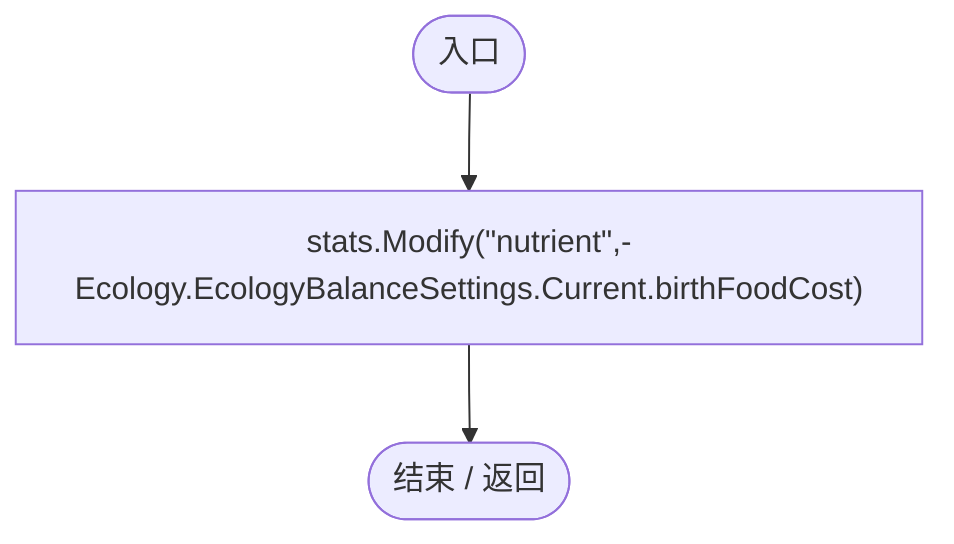

项目内调用/回调引用：

- [EntityStats.Modify · L107](75aa86a368efdf24.md#mf17c464aaa04f6f2)（方法）
- [EcologyBalanceSettings.Current.get · L29](5a37bc79f15f6238.md#md33d4c4b8f82540b)（访问器）

## StartGestation · L141

`private void StartGestation(EntityStats stats, Genome partnerGenome, float size,bool parthenogenetic=false)`

### Editor / Player · Roslyn编译器控制流

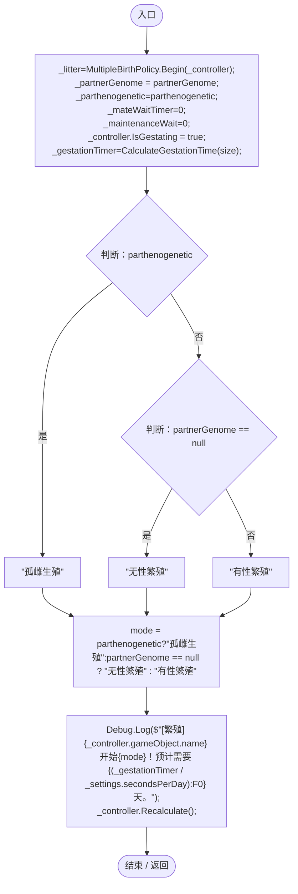

项目内调用/回调引用：

- [MultipleBirthPolicy.Begin · L20](337309de03d51a54.md#mc4aee4b72ab5db35)（方法）
- [ReproductionGeneLogic.CalculateGestationTime · L158](ac319ea70bd8b723.md#m1c9ad2c7abd6542b)（方法）
- [EntityGeneController.Recalculate · L120](7494d53178552f0e.md#m7bf63f9a1482db3c)（方法）

## CalculateGestationTime · L158

`public float CalculateGestationTime(float size)`

★ 修复（防Bug回归）：体型/生长影响仍保留，但总孕育时长必须处于配置的15～360个游戏日。

### Editor / Player · Roslyn编译器控制流

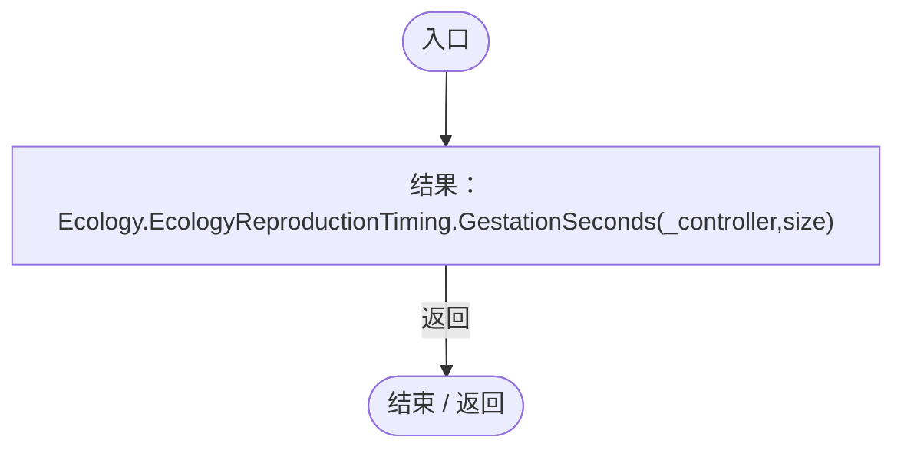

项目内调用/回调引用：

- [EcologyReproductionTiming.GestationSeconds · L11](f834876424538fa9.md#medb66b741c6f0fd2)（方法）

## FindMate · L164

`private DarwinEntity FindMate(float requiredNutrient)`

### Editor / Player · Roslyn编译器控制流

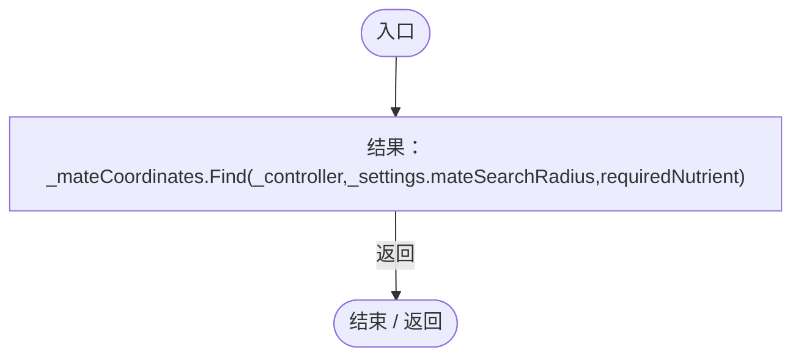

项目内调用/回调引用：

- [MateCoordinates.Find · L21](c0c58c738d12bfd2.md#m1929025f2180b77c)（方法）

## SpawnOffspring · L170

`private bool SpawnOffspring()`

### Editor / Player · Roslyn编译器控制流

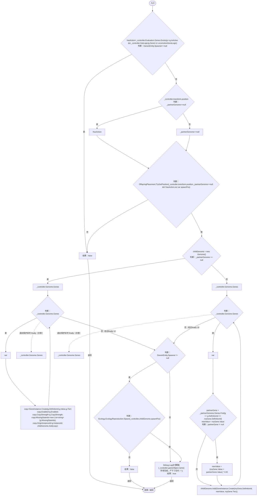

项目内调用/回调引用：

- [EntityGeneController.Evaluation.get · L20](7494d53178552f0e.md#mf275f100ea21601a)（访问器）
- [OffspringPlacement.TryGetPosition · L9](eeef5e6fb7a6f46b.md#mcf47222366c0f594)（方法）
- [GeneInstance.Create · L20](f82e1498d67f5afd.md#m72e94c278de3cf8b)（方法）
- [Genome.Add · L19](a2ef23f865bc7ee8.md#md9cfdc94b8b8d40f)（方法）
- [EcologyReproduction.Spawn · L10](eaaa574d7ae50e29.md#m80cc35c4a2829f3d)（方法）
- [ReproductionGeneLogic.回调@172 · L172](ac319ea70bd8b723.md#mc2ad4ab31f04ff41)（回调/委托）
- [ReproductionGeneLogic.回调@189 · L189](ac319ea70bd8b723.md#m4b2d664b3cda9da8)（回调/委托）

## 回调@172 · L172

`g … => 回调`

### Editor / Player · Roslyn编译器控制流

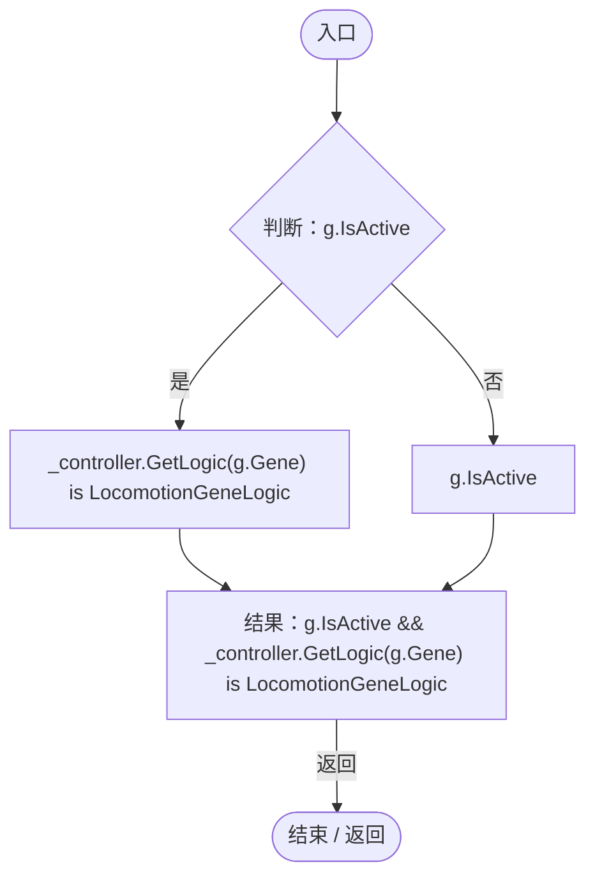

项目内调用/回调引用：

- [EntityGeneController.GetLogic · L242](7494d53178552f0e.md#m4620848081f43ecc)（方法）

## 回调@189 · L189

`g … => 回调`

### Editor / Player · Roslyn编译器控制流

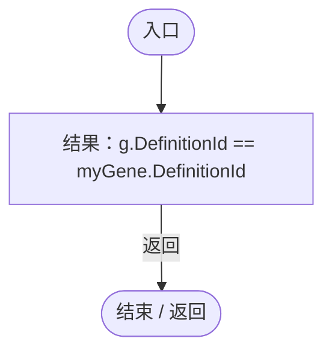

## GetTooltipInfo · L207

`public string GetTooltipInfo()`

### Editor / Player · Roslyn编译器控制流

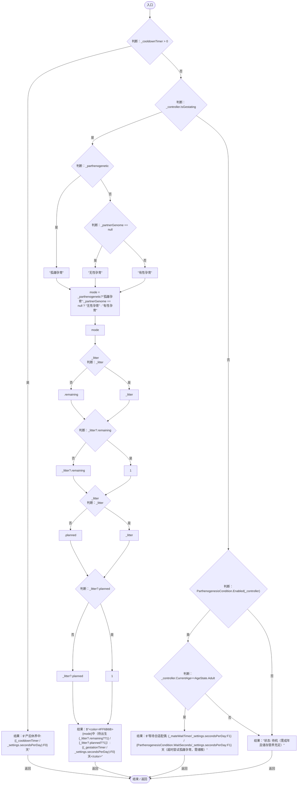

项目内调用/回调引用：

- [ParthenogenesisCondition.Enabled · L223](ac319ea70bd8b723.md#m0ce0d64c31725613)（方法）
- [EntityGeneController.CurrentAge.get · L39](7494d53178552f0e.md#m977f52932bb90600)（访问器）

## WaitSeconds.get · L222

`public static float WaitSeconds`

### Editor / Player · 语法控制结构 / 声明（非CFG）

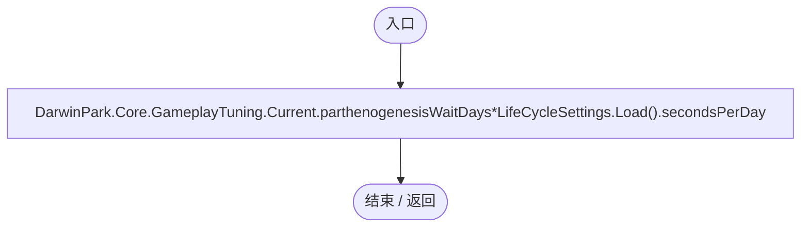

项目内调用/回调引用：

- [GameplayTuning.Current.get · L46](db546e5713b32d53.md#m4fa691bd8a3b9618)（访问器）
- [LifeCycleSettings.Load · L16](ace76969fe8f61de.md#m6fe263852e5a8989)（方法）

## Enabled · L223

`public static bool Enabled(EntityGeneController genes)`

### Editor / Player · Roslyn编译器控制流

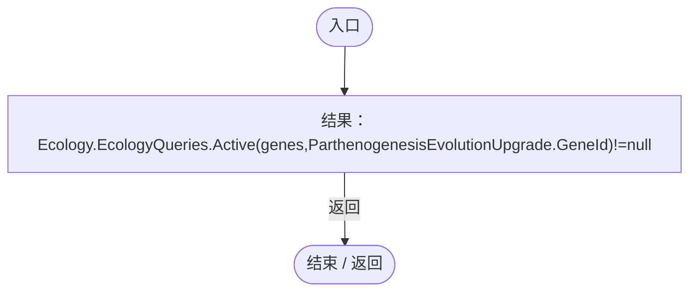

项目内调用/回调引用：

- [EcologyQueries.Active · L29](bdf7ccc2c9c0452f.md#m200839bb9db5ec55)（方法）

## Advance · L224

`public static bool Advance(EntityGeneController genes,ref float elapsed,bool hasMate,float dt)`

### Editor / Player · Roslyn编译器控制流

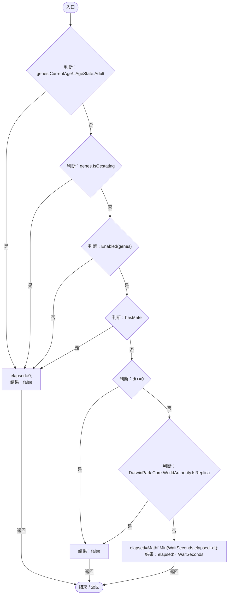

项目内调用/回调引用：

- [EntityGeneController.CurrentAge.get · L39](7494d53178552f0e.md#m977f52932bb90600)（访问器）
- [ParthenogenesisCondition.Enabled · L223](ac319ea70bd8b723.md#m0ce0d64c31725613)（方法）
