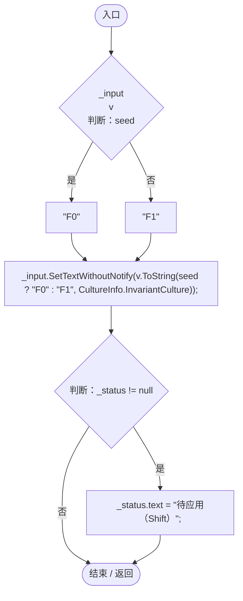
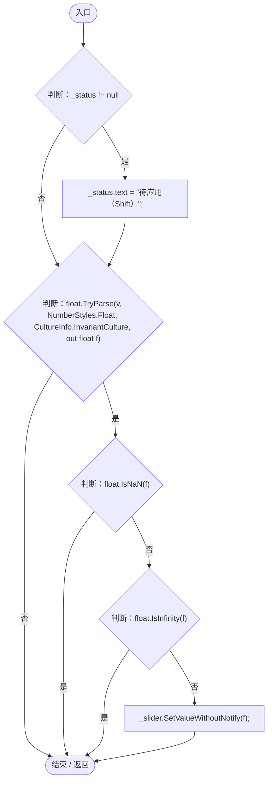
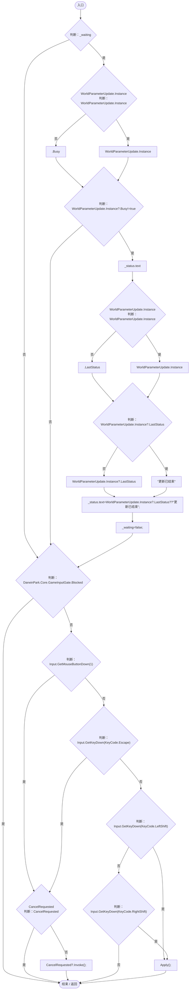
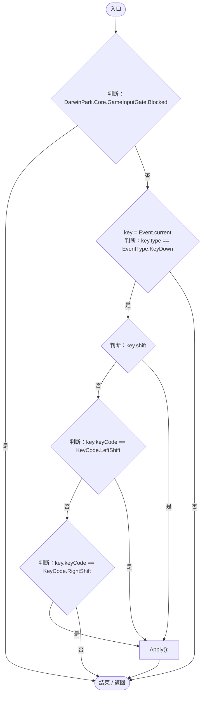
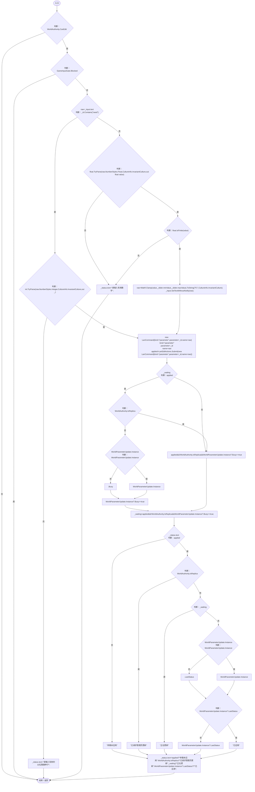

```mermaid
flowchart TD
  b0(["入口"])
  b1["_id = id;<br/>_builder = Object.FindFirstObjectByType&lt;PlanetTerrainMeshBuilder&gt;();<br/>seed = id.Contains(&quot;seed&quot;)<br/>temp = id.Contains(&quot;temp&quot;)<br/>terrain=id.Contains(&quot;terrain&quot;)<br/>GetComponent&lt;RectTransform&gt;().sizeDelta = new Vector2(400, 102);"]
  b2{"transform.Find(&quot;Title&quot;).GetComponent&lt;Text&gt;().text<br/>&quot;设定&quot; + label<br/>判断：seed"}
  b3["&quot;&quot;"]
  b4{"判断：terrain"}
  b5["&quot;（陆地比例 %）&quot;"]
  b6["&quot;（全年平均）&quot;"]
  b7["transform.Find(&quot;Title&quot;).GetComponent&lt;Text&gt;().text = &quot;设定&quot; + label + (seed ? &quot;&quot; : terrain?&quot;（陆地比例 %）&quot;:&quot;（全年平均）&quot;);"]
  b8{"判断：seed"}
  b9{"判断：_builder != null"}
  b10["_builder.seed"]
  b11["0"]
  b12["(_builder != null ? _builder.seed : 0).ToString()"]
  b13{"判断：terrain"}
  b14{"判断：_builder!=null"}
  b15["_builder.continentRatio*100"]
  b16["50"]
  b17{"判断：temp"}
  b18["ClimateDataHub.BaseTemperature"]
  b19["ClimateDataHub.BaseHumidity"]
  b20["(terrain?(_builder!=null?_builder.continentRatio*100:50):temp ? ClimateDataHub.BaseTemperature : ClimateDataHub.BaseHumidity).ToString(&quot;F1&quot;, CultureInfo.InvariantCulture)"]
  b21["initial = seed ? (_builder != null ? _builder.seed : 0).ToString() : (terrain?(_builder!=null?_builder.continentRatio*100:50):temp ? ClimateDataHub.BaseTemperature : ClimateDataHub.BaseHumidity).ToString(&quot;F1&quot;, CultureInfo.InvariantCulture)"]
  b22["inputGO = UIFactory.NewRect(&quot;ValueInput&quot;, transform, typeof(Image), typeof(InputField))<br/>irt = inputGO.GetComponent&lt;RectTransform&gt;()<br/>irt.anchorMin = irt.anchorMax = new Vector2(0, 0);<br/>irt.pivot = Vector2.zero;<br/>irt.anchoredPosition = new V…"]
  b23{"_input.contentType<br/>判断：seed"}
  b24["InputField.ContentType.IntegerNumber"]
  b25["InputField.ContentType.DecimalNumber"]
  b26["_input.contentType = seed ? InputField.ContentType.IntegerNumber : InputField.ContentType.DecimalNumber;"]
  b27["_input.text = initial;"]
  b28{"判断：seed"}
  b29["seedSliderMin"]
  b30{"判断：terrain"}
  b31["landPercentRange.x"]
  b32{"判断：temp"}
  b33["temperatureMin"]
  b34["0"]
  b35["min = seed ? seedSliderMin : terrain?landPercentRange.x:temp ? temperatureMin : 0"]
  b36{"判断：seed"}
  b37["seedSliderMax"]
  b38{"判断：terrain"}
  b39["landPercentRange.y"]
  b40{"判断：temp"}
  b41["temperatureMax"]
  b42["100"]
  b43["max = seed ? seedSliderMax : terrain?landPercentRange.y:temp ? temperatureMax : 100"]
  b44["float.TryParse(initial, NumberStyles.Float, CultureInfo.InvariantCulture, out float current);<br/>_slider = UIFactory.NewSlider(&quot;Parameter&quot;, transform, &quot;&quot;, min, max, current, 252, out _);<br/>row = _slider.transform.parent.GetComponent&lt;RectTrans…"]
  b45(["结束 / 返回"])
  b0 --> b1
  b1 --> b2
  b2 -->|"是"| b3
  b2 -->|"否"| b4
  b3 --> b7
  b4 -->|"是"| b5
  b4 -->|"否"| b6
  b5 --> b7
  b6 --> b7
  b7 --> b8
  b8 -->|"是"| b9
  b8 -->|"否"| b13
  b9 -->|"是"| b10
  b9 -->|"否"| b11
  b10 --> b12
  b11 --> b12
  b12 --> b21
  b13 -->|"是"| b14
  b13 -->|"否"| b17
  b14 -->|"是"| b15
  b14 -->|"否"| b16
  b15 --> b20
  b16 --> b20
  b17 -->|"是"| b18
  b17 -->|"否"| b19
  b18 --> b20
  b19 --> b20
  b20 --> b21
  b21 --> b22
  b22 --> b23
  b23 -->|"是"| b24
  b23 -->|"否"| b25
  b24 --> b26
  b25 --> b26
  b26 --> b27
  b27 --> b28
  b28 -->|"是"| b29
  b28 -->|"否"| b30
  b29 --> b35
  b30 -->|"是"| b31
  b30 -->|"否"| b32
  b31 --> b35
  b32 -->|"是"| b33
  b32 -->|"否"| b34
  b33 --> b35
  b34 --> b35
  b35 --> b36
  b36 -->|"是"| b37
  b36 -->|"否"| b38
  b37 --> b43
  b38 -->|"是"| b39
  b38 -->|"否"| b40
  b39 --> b43
  b40 -->|"是"| b41
  b40 -->|"否"| b42
  b41 --> b43
  b42 --> b43
  b43 --> b44
  b44 --> b45

```

# PlanetParameterEditor.cs

[返回总索引](../README.md) · `Runtime` · `Assets/DarwinPark/UI/PlanetParameterEditor.cs`

[源文件](../../../Assets/DarwinPark/UI/PlanetParameterEditor.cs) · 源码校验：`6f3c2722eb5ca009a2ea942f2bc43d2adea24c1bd7ef432971147ac28b7b0d27`

方法按源文件位置排列。事件/回调引用不表示立即执行；分支与异常说明见总索引。完整源码与可点击关系图请打开离线手册。

## Initialize · L22

`public void Initialize(string id, string label)`

### Editor / Player · Roslyn编译器控制流

项目内调用/回调引用：

- [UIFactory.NewRect · L33](dd1096a6995423db.md#med612116f3152344)（方法）
- [UIVisualTheme.Paint · L58](ca525a798a08f966.md#m2d61a6b26ab24980)（方法）
- [UIFactory.NewText · L57](dd1096a6995423db.md#m9dbccb5f0c38189e)（方法）
- [UIFactory.Stretch · L150](dd1096a6995423db.md#m11d8f6c6d00cc047)（方法）
- [UIFactory.NewSlider · L92](dd1096a6995423db.md#mce30ddeb0160c416)（方法）
- [UIFactory.NewButton · L73](dd1096a6995423db.md#m5896f1b097c8bdde)（方法）
- [UIVisualTheme.StyleButton · L67](ca525a798a08f966.md#mf2e64598de5115f3)（方法）
- [PlanetParameterEditor.回调@52 · L52](ac36b95043305d58.md#m67611e597a2c8429)（回调/委托）
- [PlanetParameterEditor.回调@57 · L57](ac36b95043305d58.md#m4c1c2ef60d50a6fa)（回调/委托）
- [PlanetParameterEditor.Apply · L88](ac36b95043305d58.md#m5c1e8487916976ec)（方法）

## 回调@52 · L52

`v … => 回调`

### Editor / Player · Roslyn编译器控制流

## 回调@57 · L57

`v … => 回调`

### Editor / Player · Roslyn编译器控制流

## Update · L71

`private void Update()`

### Editor / Player · Roslyn编译器控制流

项目内调用/回调引用：

- [WorldParameterUpdate.Instance.get · L19](4087d9be2a65e96f.md#m32aebfe3914ccd0e)（访问器）
- [WorldParameterUpdate.Busy.get · L20](4087d9be2a65e96f.md#mec2ac85b8ff3f127)（访问器）
- [WorldParameterUpdate.LastStatus.get · L21](4087d9be2a65e96f.md#m9aff979be84ce935)（访问器）
- [GameInputGate.Blocked.get · L8](52955daae7e592ab.md#m765763b665829633)（访问器）
- [PlanetParameterEditor.Apply · L88](ac36b95043305d58.md#m5c1e8487916976ec)（方法）

## OnGUI · L80

`private void OnGUI()`

### Editor / Player · Roslyn编译器控制流

项目内调用/回调引用：

- [GameInputGate.Blocked.get · L8](52955daae7e592ab.md#m765763b665829633)（访问器）
- [PlanetParameterEditor.Apply · L88](ac36b95043305d58.md#m5c1e8487916976ec)（方法）

## Apply · L88

`public void Apply()`

### Editor / Player · Roslyn编译器控制流

项目内调用/回调引用：

- [GameInputGate.Blocked.get · L8](52955daae7e592ab.md#m765763b665829633)（访问器）
- [LanEditActions.Submit · L16](2816321496f6360e.md#m5411c4b97ac4c898)（方法）
- [WorldParameterUpdate.Instance.get · L19](4087d9be2a65e96f.md#m32aebfe3914ccd0e)（访问器）
- [WorldParameterUpdate.Busy.get · L20](4087d9be2a65e96f.md#mec2ac85b8ff3f127)（访问器）
- [WorldParameterUpdate.LastStatus.get · L21](4087d9be2a65e96f.md#m9aff979be84ce935)（访问器）
