# ActiveSimulationPlan.cs

[返回总索引](../README.md) · `Runtime` · `Assets/DarwinPark/Entities/Simulation/ActiveSimulationPlan.cs`

[源文件](../../../Assets/DarwinPark/Entities/Simulation/ActiveSimulationPlan.cs) · 源码校验：`b32717e93203594542f79c04eb157ff16a1cf53657566934bfebdc3d842f3261`

方法按源文件位置排列。事件/回调引用不表示立即执行；分支与异常说明见总索引。完整源码与可点击关系图请打开离线手册。

## KnownOnly.get · L13

`get`

### Editor / Player · 语法控制结构 / 声明（非CFG）

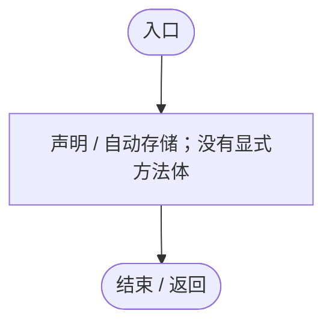

## KnownOnly.set · L13

`private set`

### Editor / Player · 语法控制结构 / 声明（非CFG）

## Invalidate · L15

`public void Invalidate()`

### Editor / Player · Roslyn编译器控制流

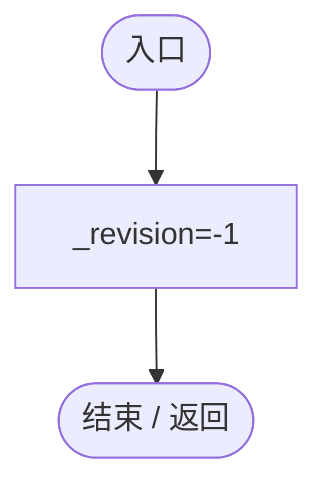

## Passive · L16

`private static bool Passive(Type type)`

### Editor / Player · Roslyn编译器控制流

```mermaid
flowchart TD
  b0(["入口"])
  b1{"判断：type==typeof(GrowthGeneLogic)"}
  b2{"判断：type==typeof(RepairGeneLogic)"}
  b3{"判断：type==typeof(StorageGeneLogic)"}
  b4{"判断：type==typeof(EnvironmentAdaptationGeneLogic)"}
  b5{"判断：type==typeof(ObservationGeneLogic)"}
  b6{"判断：type==typeof(HeterotrophyGeneLogic)"}
  b7{"判断：type==typeof(ScavengingGeneLogic)"}
  b8["type==typeof(ParasiticGeneLogic)"]
  b9["type==typeof(GrowthGeneLogic)&#124;&#124;type==typeof(RepairGeneLogic)&#124;&#124;type==typeof(StorageGeneLogic)&#124;&#124;type==typeof(EnvironmentAdaptationGeneLogic)&#124;&#124;type==typeof(ObservationGeneLogic)&#124;&#124;type==typeof(HeterotrophyGeneLogic)&#124;&#124;type==typeof(ScavengingG…"]
  b10["结果：type==typeof(GrowthGeneLogic)&#124;&#124;type==typeof(RepairGeneLogic)&#124;&#124;type==typeof(StorageGeneLogic)&#124;&#124;type==typeof(EnvironmentAdaptationGeneLogic)&#124;&#124;type==typeof(ObservationGeneLogic)&#124;&#124;type==typeof(HeterotrophyGeneLogic)&#124;&#124;type==typeof(Scavengi…"]
  b11(["结束 / 返回"])
  b0 --> b1
  b1 -->|"否"| b2
  b1 -->|"是"| b9
  b2 -->|"否"| b3
  b2 -->|"是"| b9
  b3 -->|"否"| b4
  b3 -->|"是"| b9
  b4 -->|"否"| b5
  b4 -->|"是"| b9
  b5 -->|"否"| b6
  b5 -->|"是"| b9
  b6 -->|"否"| b7
  b6 -->|"是"| b9
  b7 -->|"否"| b8
  b7 -->|"是"| b9
  b8 --> b10
  b9 --> b10
  b10 -->|"返回"| b11

```

## Known · L17

`private static bool Known(Type type)`

### Editor / Player · Roslyn编译器控制流

```mermaid
flowchart TD
  b0(["入口"])
  b1{"判断：Passive(type)"}
  b2{"判断：type==typeof(NutritionGeneLogic)"}
  b3{"判断：type==typeof(EnergyBlockGeneLogic)"}
  b4{"判断：type==typeof(LocomotionGeneLogic)"}
  b5{"判断：type==typeof(TerritoryGeneLogic)"}
  b6{"判断：type==typeof(PopulationGeneLogic)"}
  b7{"判断：type==typeof(ReproductionGeneLogic)"}
  b8{"判断：type==typeof(OviparousGeneLogic)"}
  b9{"判断：type==typeof(MultipleBirthGeneLogic)"}
  b10["type==typeof(EggParasiticGeneLogic)"]
  b11["Passive(type)&#124;&#124;type==typeof(NutritionGeneLogic)&#124;&#124;type==typeof(EnergyBlockGeneLogic)&#124;&#124;type==typeof(LocomotionGeneLogic)&#124;&#124;type==typeof(TerritoryGeneLogic)&#124;&#124;type==typeof(PopulationGeneLogic)&#124;&#124;type==typeof(ReproductionGeneLogic)&#124;&#124;type==typeo…"]
  b12["结果：Passive(type)&#124;&#124;type==typeof(NutritionGeneLogic)&#124;&#124;type==typeof(EnergyBlockGeneLogic)&#124;&#124;type==typeof(LocomotionGeneLogic)&#124;&#124;type==typeof(TerritoryGeneLogic)&#124;&#124;type==typeof(PopulationGeneLogic)&#124;&#124;type==typeof(ReproductionGeneLogic)&#124;&#124;type==ty…"]
  b13(["结束 / 返回"])
  b0 --> b1
  b1 -->|"否"| b2
  b1 -->|"是"| b11
  b2 -->|"否"| b3
  b2 -->|"是"| b11
  b3 -->|"否"| b4
  b3 -->|"是"| b11
  b4 -->|"否"| b5
  b4 -->|"是"| b11
  b5 -->|"否"| b6
  b5 -->|"是"| b11
  b6 -->|"否"| b7
  b6 -->|"是"| b11
  b7 -->|"否"| b8
  b7 -->|"是"| b11
  b8 -->|"否"| b9
  b8 -->|"是"| b11
  b9 -->|"否"| b10
  b9 -->|"是"| b11
  b10 --> b12
  b11 --> b12
  b12 -->|"返回"| b13

```

项目内调用/回调引用：

- [ActiveSimulationPlan.Passive · L16](ac63422a085684a6.md#mf7250966d85a8dac)（方法）

## Prepare · L18

`public void Prepare(EntityGeneController owner,IReadOnlyList<IGeneLogic> logics)`

### Editor / Player · Roslyn编译器控制流

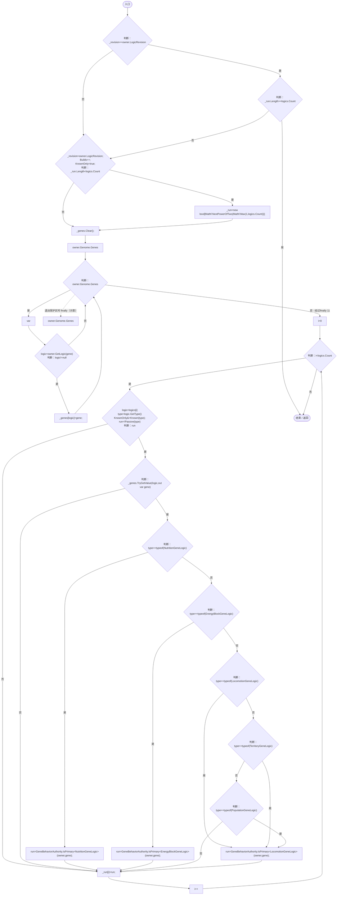

项目内调用/回调引用：

- [EntityGeneController.LogicRevision.get · L19](7494d53178552f0e.md#me69facc1c0f1e164)（访问器）
- [ActiveSimulationPlan.KnownOnly.set · L13](ac63422a085684a6.md#me3fb188327578c58)（访问器）
- [EntityGeneController.GetLogic · L240](7494d53178552f0e.md#m9be6a2566c76c275)（方法）
- [ActiveSimulationPlan.KnownOnly.get · L13](ac63422a085684a6.md#m1ed86b674f03aacf)（访问器）
- [ActiveSimulationPlan.Known · L17](ac63422a085684a6.md#md3bc4ac80b7ca53d)（方法）
- [ActiveSimulationPlan.Passive · L16](ac63422a085684a6.md#mf7250966d85a8dac)（方法）
- [GeneBehaviorAuthority.IsPrimary · L10](be83fa896bbe02ae.md#me2fc1f2e16fcd073)（方法）

## Run · L35

`public void Run(EntityGeneController owner,IReadOnlyList<IGeneLogic> logics,float dt)`

### Editor / Player · Roslyn编译器控制流

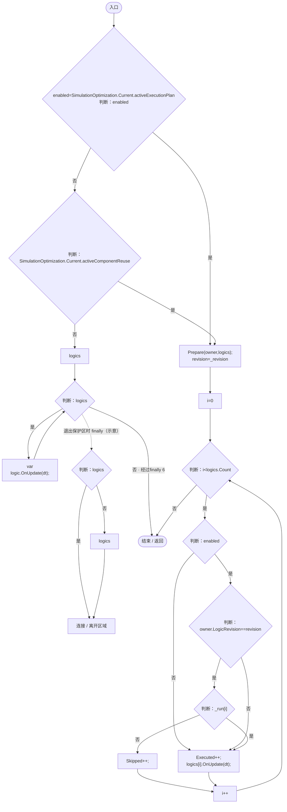

项目内调用/回调引用：

- [SimulationOptimization.Current.get · L25](11c9091e70893352.md#mde7abfdc18429e4a)（访问器）
- [IGeneLogic.OnUpdate · L9](5304fdad773967f8.md#m829188d65276f8e5)（方法）
- [ActiveSimulationPlan.Prepare · L18](ac63422a085684a6.md#m5803c8392b641c09)（方法）
- [EntityGeneController.LogicRevision.get · L19](7494d53178552f0e.md#me69facc1c0f1e164)（访问器）

## Reset · L47

`[RuntimeInitializeOnLoadMethod(RuntimeInitializeLoadType.SubsystemRegistration)]private static void Reset()`

### Editor / Player · Roslyn编译器控制流

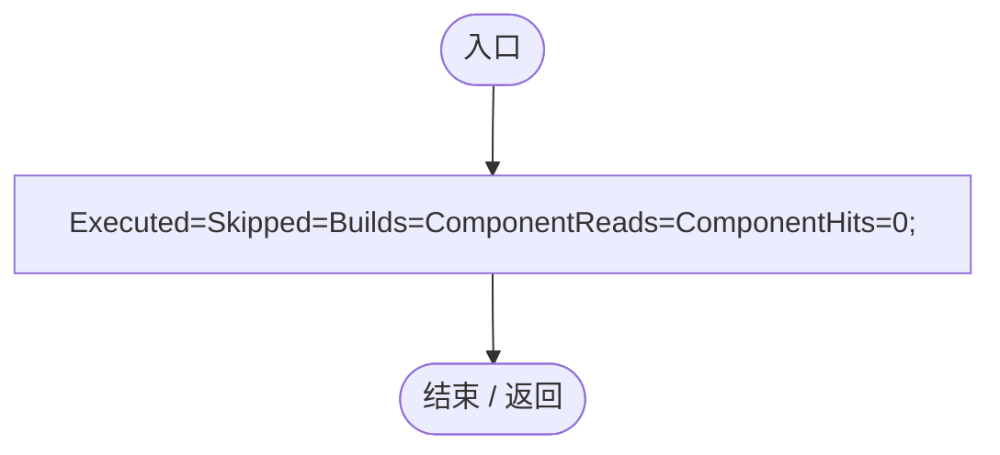

## Begin · L54

`public static void Begin(EntityGeneController owner,ActiveSimulationPlan plan)`

### Editor / Player · Roslyn编译器控制流

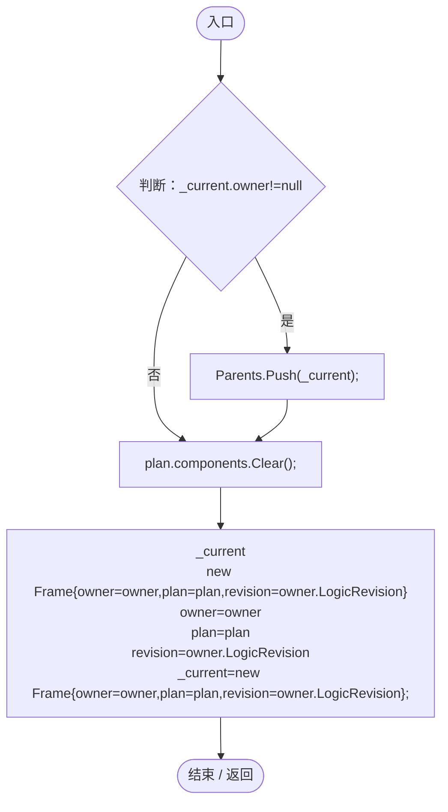

项目内调用/回调引用：

- [EntityGeneController.LogicRevision.get · L19](7494d53178552f0e.md#me69facc1c0f1e164)（访问器）

## End · L55

`public static void End(EntityGeneController owner)`

### Editor / Player · Roslyn编译器控制流

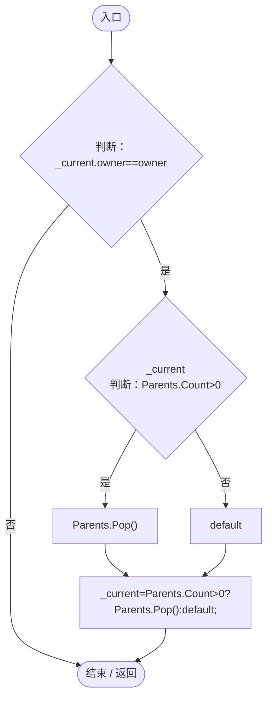

## Invalidate · L56

`public static void Invalidate(EntityGeneController owner)`

### Editor / Player · Roslyn编译器控制流

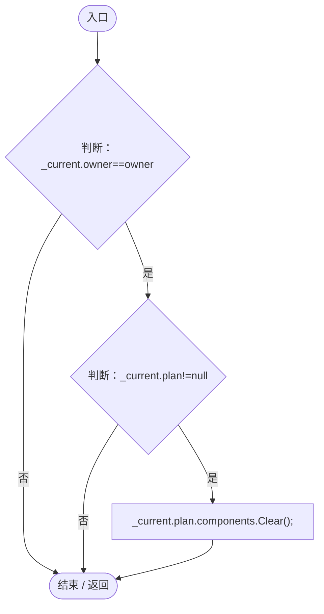

## Read · L57

`public static T Read<T>(EntityGeneController owner)where T:Component`

### Editor / Player · Roslyn编译器控制流

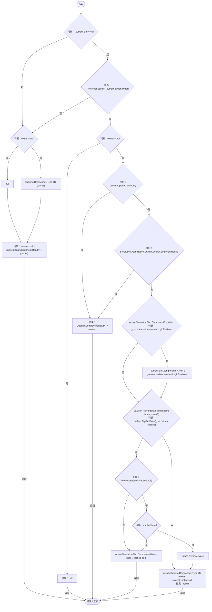

项目内调用/回调引用：

- [OptionalComponent.Read · L7](806c46b42ced4d36.md#m69622a4dee165c5a)（方法）
- [ActiveSimulationPlan.KnownOnly.get · L13](ac63422a085684a6.md#m1ed86b674f03aacf)（访问器）
- [SimulationOptimization.Current.get · L25](11c9091e70893352.md#mde7abfdc18429e4a)（访问器）
- [EntityGeneController.LogicRevision.get · L19](7494d53178552f0e.md#me69facc1c0f1e164)（访问器）

## Reset · L68

`[RuntimeInitializeOnLoadMethod(RuntimeInitializeLoadType.SubsystemRegistration)]private static void Reset()`

### Editor / Player · Roslyn编译器控制流

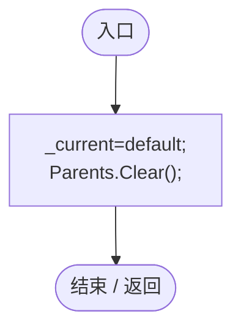
