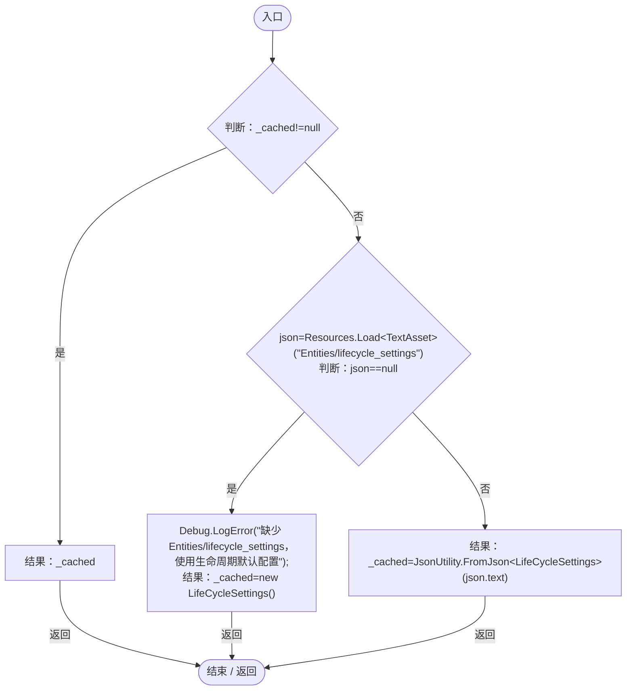

# LifeCycleSettings.cs

[返回总索引](../README.md) · `Runtime` · `Assets/DarwinPark/Entities/LifeCycleSettings.cs`

[源文件](../../../Assets/DarwinPark/Entities/LifeCycleSettings.cs) · 源码校验：`3cb58e6fbf65e0172f2a4cea879dd60482094c05e9346387c6e3106c7843aeac`

方法按源文件位置排列。事件/回调引用不表示立即执行；分支与异常说明见总索引。完整源码与可点击关系图请打开离线手册。

## Load · L16

`public static LifeCycleSettings Load()`

### Editor / Player · Roslyn编译器控制流

