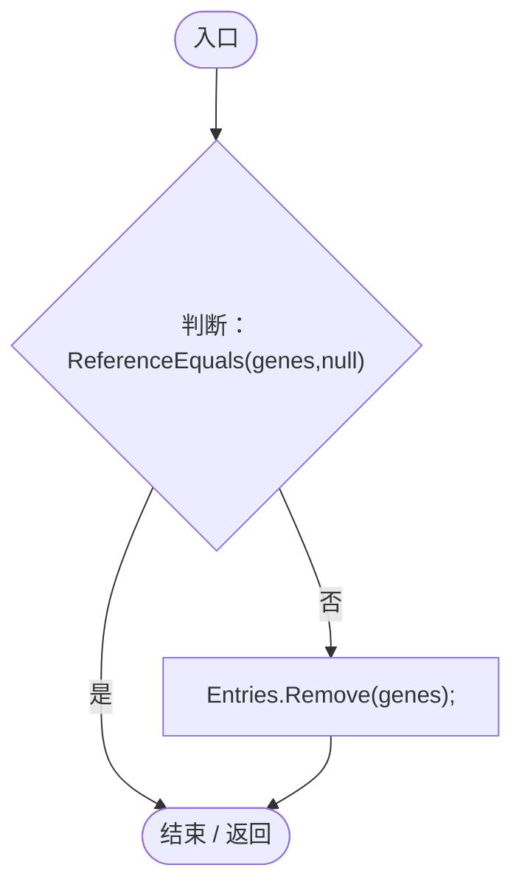
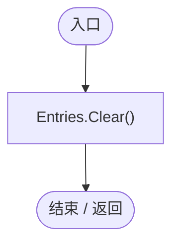
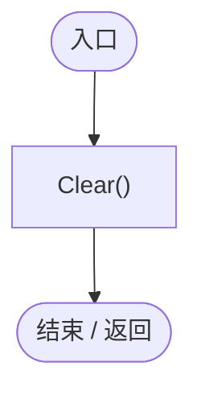

```mermaid
flowchart TD
  b0(["入口"])
  b1{"判断：genes==null"}
  b2["结果：false"]
  b3{"判断：Entries.TryGetValue(genes,out var entry)"}
  b4["entry=new();<br/>Entries.Add(genes,entry);"]
  b5{"settings=EcologyBalanceSettings.Current<br/>nutrition=DarwinPark.Genetics.NutritionEcologySettings.Current<br/>判断：entry.revision!=genes.LogicRevision"}
  b6{"判断：ReferenceEquals(entry.settings,settings)"}
  b7{"判断：ReferenceEquals(entry.nutrition,nutrition)"}
  b8{"entry.revision=genes.LogicRevision;<br/>entry.settings=settings;<br/>entry.nutrition=nutrition;<br/>entry.candidate=false;<br/>primary=null<br/>heterotroph=false<br/>判断：genes.Evaluation!=null"}
  b9["genes.Evaluation.Genes"]
  b10{"判断：genes.Evaluation.Genes"}
  b11{"var<br/>判断：gene.IsActive"}
  b12{"判断：gene.Definition.Id==nutrition.heterotrophyGene"}
  b13{"判断：gene.Definition.Id==nutrition.scavengerGene"}
  b14["heterotroph=true;"]
  b15{"判断：gene.Definition.Id==settings.nutritionGene"}
  b16{"判断：primary==null"}
  b17{"判断：gene.EffectiveStrength&gt;primary.EffectiveStrength"}
  b18["primary=gene;"]
  b19["genes.Evaluation.Genes"]
  b20{"entry.candidate<br/>判断：heterotroph"}
  b21{"primary<br/>判断：primary"}
  b22[".State"]
  b23["primary"]
  b24{"判断：primary?.State!=null"}
  b25["System.Array.IndexOf(settings.producerStates,primary.State.StateId)&gt;=0"]
  b26["!heterotroph&amp;&amp;primary?.State!=null&amp;&amp;System.Array.IndexOf(settings.producerStates,primary.State.StateId)&gt;=0"]
  b27["entry.candidate=!heterotroph&amp;&amp;primary?.State!=null&amp;&amp;System.Array.IndexOf(settings.producerStates,primary.State.StateId)&gt;=0;"]
  b28{"判断：entry.candidate"}
  b29{"genes.GetComponent&lt;EggIncubation&gt;()<br/>判断：genes.GetComponent&lt;EggIncubation&gt;()"}
  b30[".Incubating"]
  b31["genes.GetComponent&lt;EggIncubation&gt;()"]
  b32{"判断：genes.GetComponent&lt;EggIncubation&gt;()?.Incubating==true"}
  b33["结果：false"]
  b34{"判断：genes.Evaluation.Attributes.TryGetValue(settings.movementAttribute,out var move)"}
  b35{"判断：move&lt;=0"}
  b36["genes.GetAttribute(settings.movementAttribute)&lt;=0"]
  b37["!genes.Evaluation.Attributes.TryGetValue(settings.movementAttribute,out var move)&#124;&#124;move&lt;=0&#124;&#124;genes.GetAttribute(settings.movementAttribute)&lt;=0"]
  b38["结果：!genes.Evaluation.Attributes.TryGetValue(settings.movementAttribute,out var move)&#124;&#124;move&lt;=0&#124;&#124;genes.GetAttribute(settings.movementAttribute)&lt;=0"]
  b39(["结束 / 返回"])
  b0 --> b1
  b1 -->|"是"| b2
  b1 -->|"否"| b3
  b2 -->|"返回"| b39
  b3 -->|"否"| b4
  b3 -->|"是"| b5
  b4 --> b5
  b5 -->|"否"| b6
  b5 -->|"是"| b8
  b6 -->|"是"| b7
  b6 -->|"否"| b8
  b7 -->|"否"| b8
  b7 -->|"是"| b28
  b8 -->|"是"| b9
  b8 -->|"否"| b20
  b9 --> b10
  b10 -->|"是"| b11
  b10 -->|"否 · 经过finally 19"| b20
  b11 -->|"是"| b12
  b11 -->|"否"| b10
  b12 -->|"否"| b13
  b12 -->|"是"| b14
  b13 -->|"是"| b14
  b13 -->|"否"| b15
  b14 --> b15
  b15 -->|"是"| b16
  b15 -->|"否"| b10
  b16 -->|"否"| b17
  b16 -->|"是"| b18
  b17 -->|"是"| b18
  b17 -->|"否"| b10
  b18 --> b10
  b20 -->|"否"| b21
  b20 -->|"是"| b26
  b21 -->|"否"| b22
  b21 -->|"是"| b23
  b22 --> b24
  b23 --> b24
  b24 -->|"是"| b25
  b24 -->|"否"| b26
  b25 --> b27
  b26 --> b27
  b27 --> b28
  b28 -->|"是"| b29
  b28 -->|"否"| b33
  b29 -->|"否"| b30
  b29 -->|"是"| b31
  b30 --> b32
  b31 --> b32
  b32 -->|"是"| b33
  b32 -->|"否"| b34
  b33 -->|"返回"| b39
  b34 -->|"是"| b35
  b34 -->|"否"| b37
  b35 -->|"否"| b36
  b35 -->|"是"| b37
  b36 --> b38
  b37 --> b38
  b38 -->|"返回"| b39
  b10 -. "退出保护区时 finally（示意）" .-> b19

```

# ProducerClassification.cs

[返回总索引](../README.md) · `Runtime` · `Assets/DarwinPark/Entities/Ecology/ProducerClassification.cs`

[源文件](../../../Assets/DarwinPark/Entities/Ecology/ProducerClassification.cs) · 源码校验：`e51c9b61d395a7bc27416598c43c4b7d2dc4429f6eb2414aeeb9bc30551be818`

方法按源文件位置排列。事件/回调引用不表示立即执行；分支与异常说明见总索引。完整源码与可点击关系图请打开离线手册。

## IsProducer · L10

`public static bool IsProducer(EntityGeneController genes)`

### Editor / Player · Roslyn编译器控制流

项目内调用/回调引用：

- [EcologyBalanceSettings.Current.get · L29](5a37bc79f15f6238.md#md33d4c4b8f82540b)（访问器）
- [NutritionEcologySettings.Current.get · L19](846a17351dbd6aa4.md#mb3eb930022e314f3)（访问器）
- [EntityGeneController.LogicRevision.get · L19](7494d53178552f0e.md#me69facc1c0f1e164)（访问器）
- [EntityGeneController.Evaluation.get · L18](7494d53178552f0e.md#mc0039c100a31b455)（访问器）
- [EntityGeneController.GetAttribute · L277](7494d53178552f0e.md#m5ef0e4e944f0c71b)（方法）

## Remove · L24

`public static void Remove(EntityGeneController genes)`

### Editor / Player · Roslyn编译器控制流

## Clear · L25

`public static void Clear()`

### Editor / Player · Roslyn编译器控制流

## Reset · L26

`[RuntimeInitializeOnLoadMethod(RuntimeInitializeLoadType.SubsystemRegistration)]private static void Reset()`

### Editor / Player · Roslyn编译器控制流

项目内调用/回调引用：

- [ProducerClassification.Clear · L25](ad32a2250ced390a.md#m6e5747a7a733b6f6)（方法）
