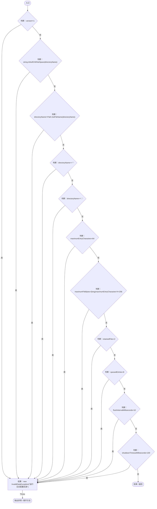
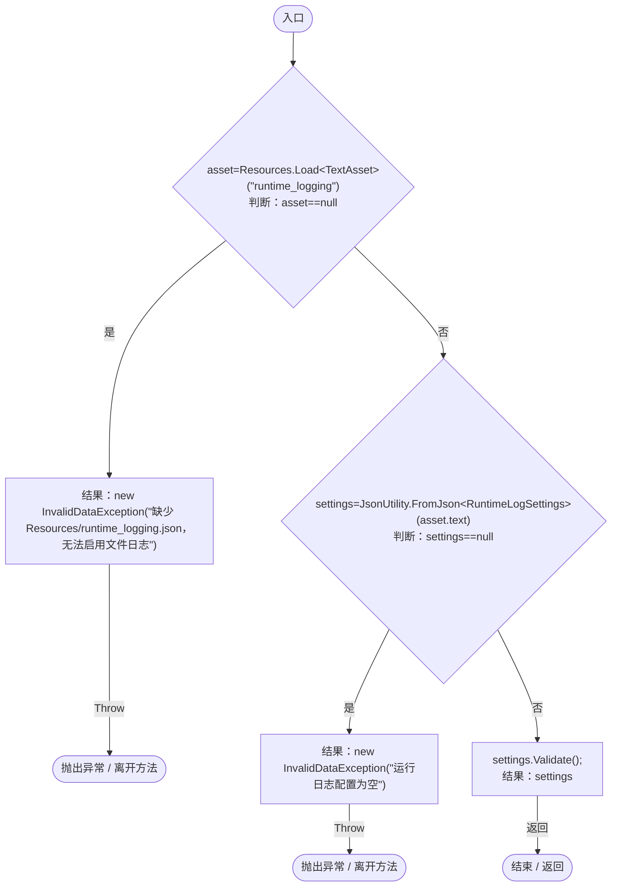

# RuntimeLogSettings.cs

[返回总索引](../README.md) · `Runtime` · `Assets/DarwinPark/Core/Logging/RuntimeLogSettings.cs`

[源文件](../../../Assets/DarwinPark/Core/Logging/RuntimeLogSettings.cs) · 源码校验：`dc355dec503b0503dfae94b36e960fd271089708d8b72ca235bbb01cbd209ce8`

方法按源文件位置排列。事件/回调引用不表示立即执行；分支与异常说明见总索引。完整源码与可点击关系图请打开离线手册。

## Validate · L14

`public void Validate()`

### Editor / Player · Roslyn编译器控制流

## Load · L20

`public static RuntimeLogSettings Load()`

### Editor / Player · Roslyn编译器控制流

项目内调用/回调引用：

- [RuntimeLogSettings.Validate · L14](ade1290a5194a825.md#m362aa19b15ccb5ce)（方法）
