# ReadmeEditor.cs

[返回总索引](../README.md) · `Editor` · `Assets/TutorialInfo/Scripts/Editor/ReadmeEditor.cs`

[源文件](../../../Assets/TutorialInfo/Scripts/Editor/ReadmeEditor.cs) · 源码校验：`2ed5109bfd6774170df2551098d87eaf14d453b0173f8c9c37d83655eaac6ff9`

方法按源文件位置排列。事件/回调引用不表示立即执行；分支与异常说明见总索引。完整源码与可点击关系图请打开离线手册。

## ReadmeEditor.ctor · L19

`static ReadmeEditor()`

### Editor · Roslyn编译器控制流

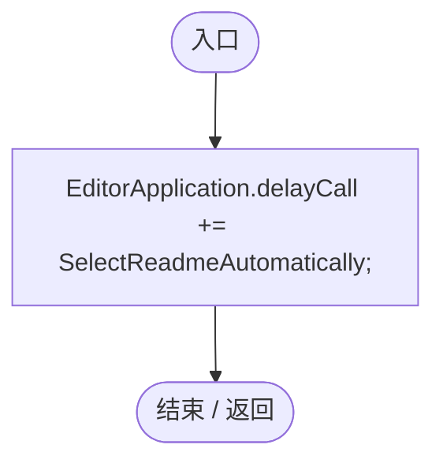

项目内调用/回调引用：

- [ReadmeEditor.SelectReadmeAutomatically · L54](aec8f8a911da4f2b.md#md02ddd0ec05de7d9)（方法）

## RemoveTutorial · L24

`static void RemoveTutorial()`

### Editor · Roslyn编译器控制流

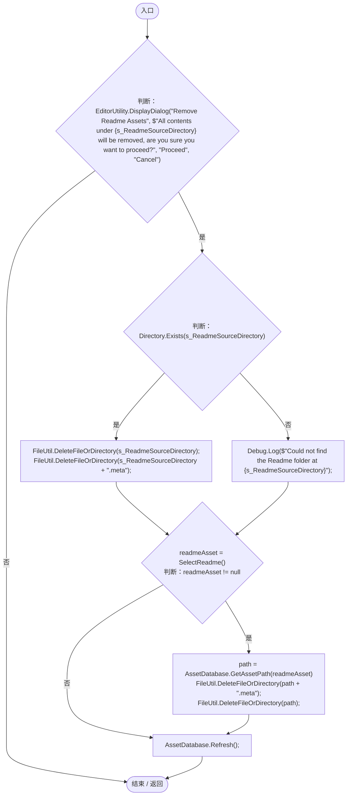

项目内调用/回调引用：

- [ReadmeEditor.SelectReadme · L77](aec8f8a911da4f2b.md#me663834154b0c9b6)（方法）

## SelectReadmeAutomatically · L54

`static void SelectReadmeAutomatically()`

### Editor · Roslyn编译器控制流

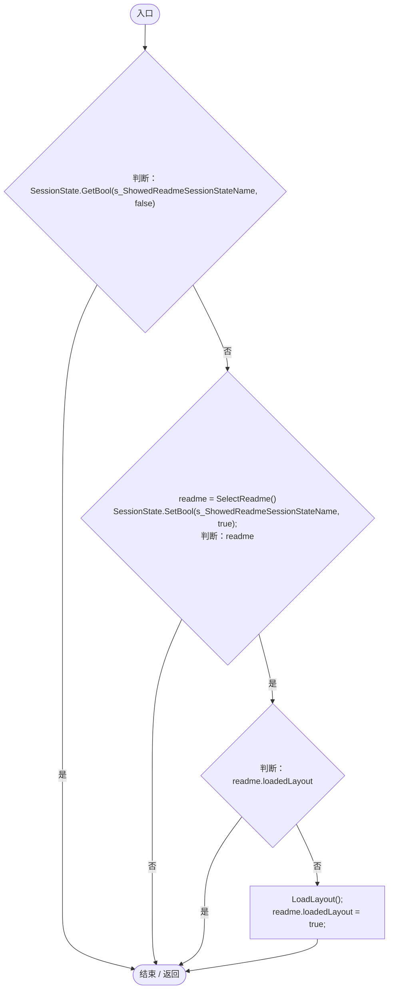

项目内调用/回调引用：

- [ReadmeEditor.SelectReadme · L77](aec8f8a911da4f2b.md#me663834154b0c9b6)（方法）
- [ReadmeEditor.LoadLayout · L69](aec8f8a911da4f2b.md#m2f9485cd03aefd0c)（方法）

## LoadLayout · L69

`static void LoadLayout()`

### Editor · Roslyn编译器控制流

```mermaid
flowchart TD
  b0(["入口"])
  b1["assembly = typeof(EditorApplication).Assembly<br/>windowLayoutType = assembly.GetType(&quot;UnityEditor.WindowLayout&quot;, true)<br/>method = windowLayoutType.GetMethod(&quot;LoadWindowLayout&quot;, BindingFlags.Public &#124; BindingFlags.Static)<br/>method.Invoke(null, ne…"]
  b2(["结束 / 返回"])
  b0 --> b1
  b1 --> b2

```

## SelectReadme · L77

`static Readme SelectReadme()`

### Editor · Roslyn编译器控制流

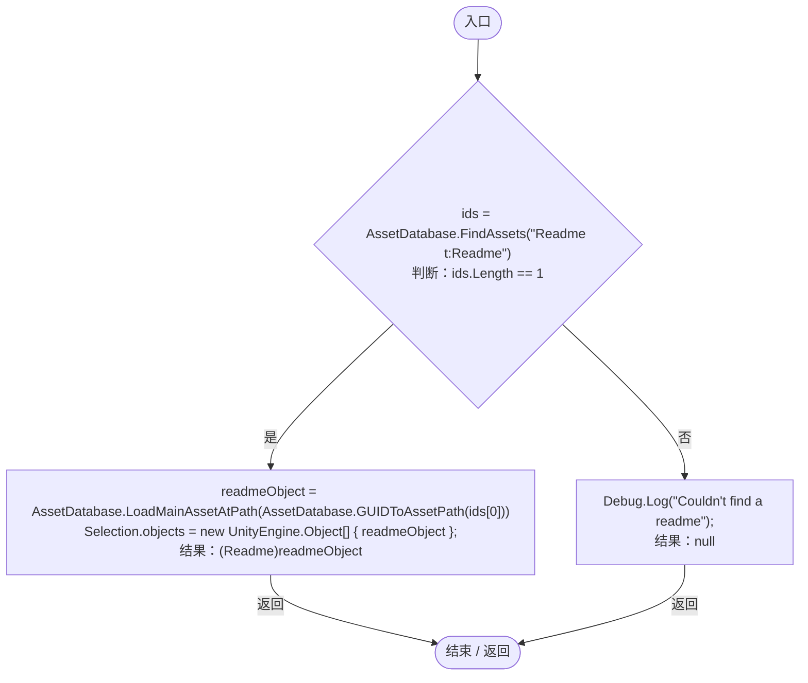

## OnHeaderGUI · L95

`protected override void OnHeaderGUI()`

### Editor · Roslyn编译器控制流

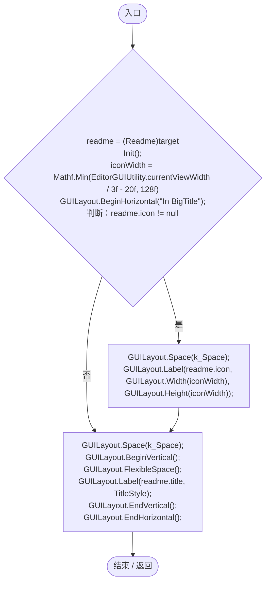

项目内调用/回调引用：

- [ReadmeEditor.Init · L199](aec8f8a911da4f2b.md#mcb728f6977a5031a)（方法）
- [ReadmeEditor.TitleStyle.get · L169](aec8f8a911da4f2b.md#m3b22f55b5414f50a)（访问器）

## OnInspectorGUI · L123

`public override void OnInspectorGUI()`

### Editor · Roslyn编译器控制流

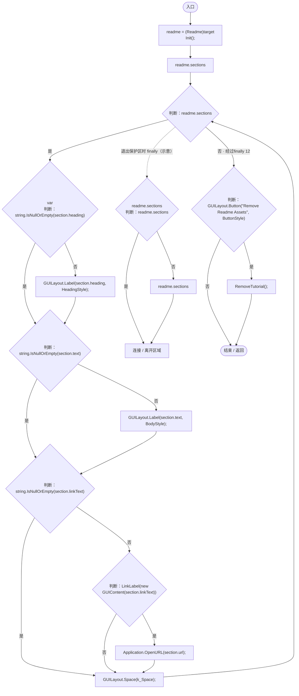

项目内调用/回调引用：

- [ReadmeEditor.Init · L199](aec8f8a911da4f2b.md#mcb728f6977a5031a)（方法）
- [ReadmeEditor.HeadingStyle.get · L177](aec8f8a911da4f2b.md#mc523aab48aec9cf4)（访问器）
- [ReadmeEditor.BodyStyle.get · L185](aec8f8a911da4f2b.md#mdbc0f0dcb48513c8)（访问器）
- [ReadmeEditor.LinkLabel · L228](aec8f8a911da4f2b.md#ma9e4b063637b43cd)（方法）
- [ReadmeEditor.ButtonStyle.get · L193](aec8f8a911da4f2b.md#m8846aee09b3e216f)（访问器）
- [ReadmeEditor.RemoveTutorial · L24](aec8f8a911da4f2b.md#m538e648d516b6192)（方法）

## LinkStyle.get · L161

`get`

### Editor · Roslyn编译器控制流

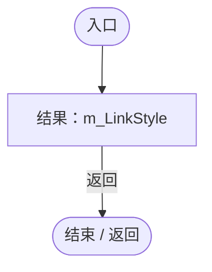

## TitleStyle.get · L169

`get`

### Editor · Roslyn编译器控制流

## HeadingStyle.get · L177

`get`

### Editor · Roslyn编译器控制流

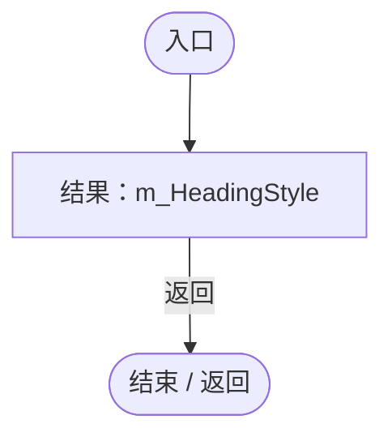

## BodyStyle.get · L185

`get`

### Editor · Roslyn编译器控制流

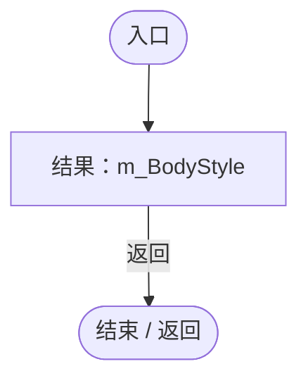

## ButtonStyle.get · L193

`get`

### Editor · Roslyn编译器控制流

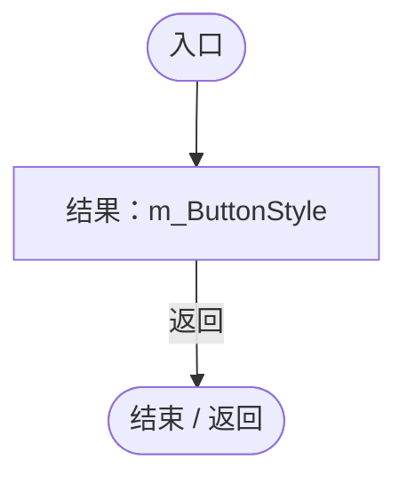

## Init · L199

`void Init()`

### Editor · Roslyn编译器控制流

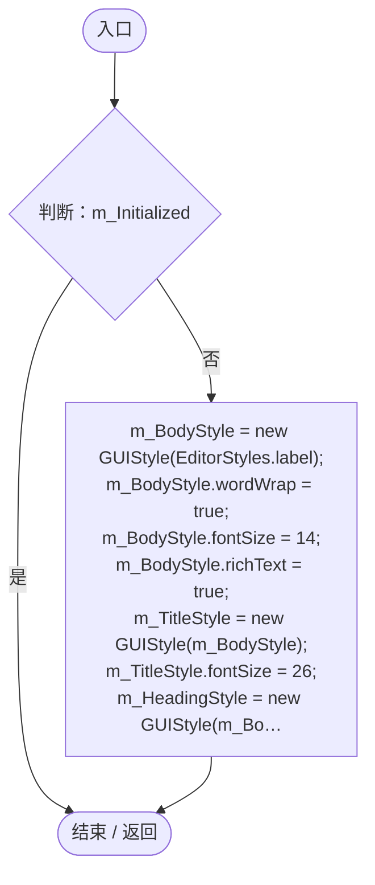

## LinkLabel · L228

`bool LinkLabel(GUIContent label, params GUILayoutOption[] options)`

### Editor · Roslyn编译器控制流

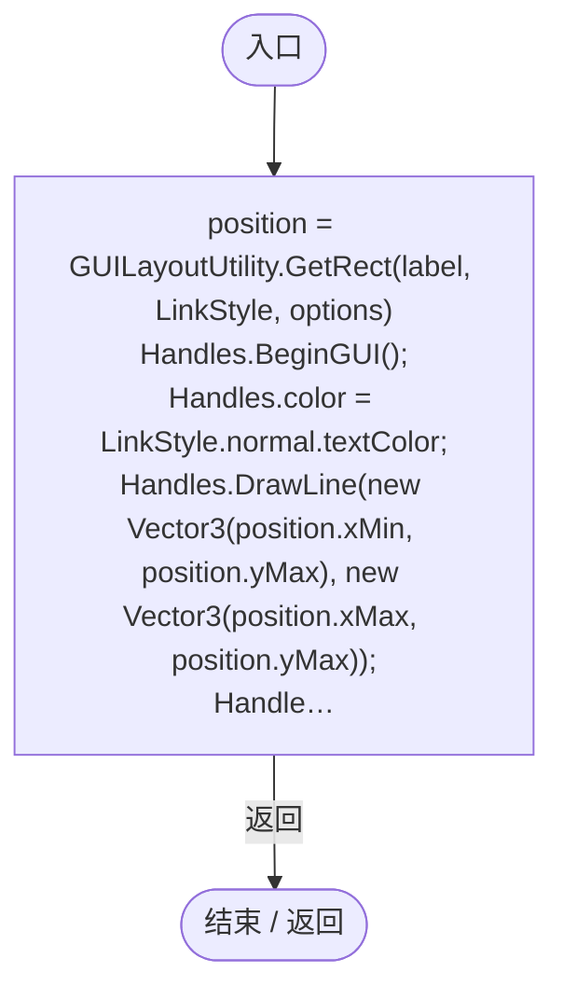

项目内调用/回调引用：

- [ReadmeEditor.LinkStyle.get · L161](aec8f8a911da4f2b.md#mc932f870b7aae1ea)（访问器）
