# EntityPerceptionHub.cs

[返回总索引](../README.md) · `Runtime` · `Assets/DarwinPark/Entities/Ecology/EntityPerceptionHub.cs`

[源文件](../../../Assets/DarwinPark/Entities/Ecology/EntityPerceptionHub.cs) · 源码校验：`0b2ebd853863d5ec86afc52f18cd4ed99187acb3bbcc18c81c1ddba09fd65958`

方法按源文件位置排列。事件/回调引用不表示立即执行；分支与异常说明见总索引。完整源码与可点击关系图请打开离线手册。

## EntitySighting.ctor · L12

`public EntitySighting(DarwinEntity target,Vector3 point,float time)`

### Editor / Player · Roslyn编译器控制流

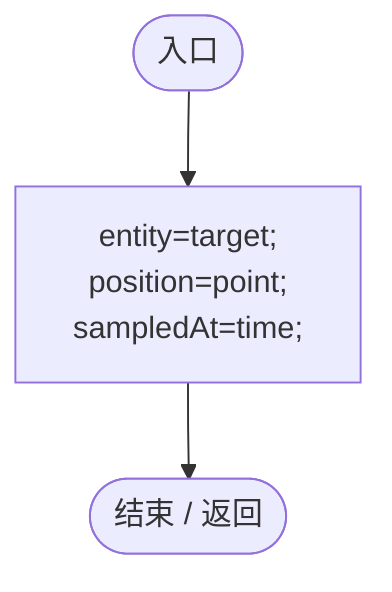

## Searches.get · L23

`get`

### Editor / Player · 语法控制结构 / 声明（非CFG）

## Searches.set · L23

`private set`

### Editor / Player · 语法控制结构 / 声明（非CFG）

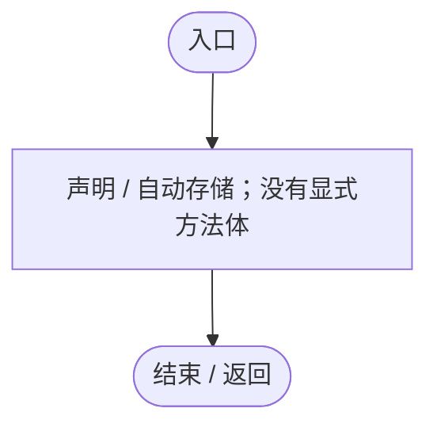

## Delivered.get · L23

`get`

### Editor / Player · 语法控制结构 / 声明（非CFG）

## Delivered.set · L23

`private set`

### Editor / Player · 语法控制结构 / 声明（非CFG）

## CandidateVisits.get · L23

`get`

### Editor / Player · 语法控制结构 / 声明（非CFG）

## CandidateVisits.set · L23

`private set`

### Editor / Player · 语法控制结构 / 声明（非CFG）

## Now.get · L24

`private static float Now`

### Editor / Player · 语法控制结构 / 声明（非CFG）

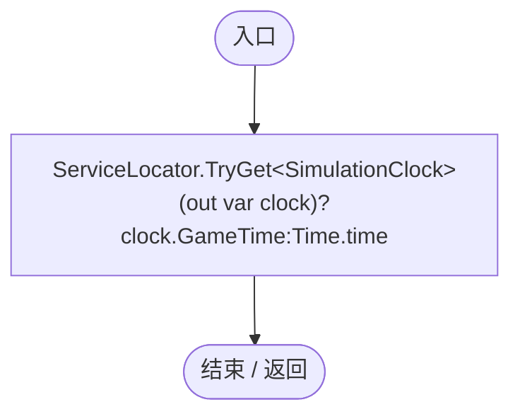

项目内调用/回调引用：

- [ServiceLocator.TryGet · L26](f2fdbe9f9ccd93cb.md#m143b24e6d58471b0)（方法）
- [SimulationClock.GameTime.get · L23](a8f444aec9614b0a.md#m74adfa39a896652f)（访问器）

## Get · L25

`private static Inbox Get(EntityGeneController genes)`

### Editor / Player · Roslyn编译器控制流

```mermaid
flowchart TD
  b0(["入口"])
  b1{"判断：Inboxes.TryGetValue(genes,out var inbox)"}
  b2["inbox=new Inbox();<br/>Inboxes.Add(genes,inbox);"]
  b3{"判断：inbox.revision!=genes.LogicRevision"}
  b4["PerceptionSubscriptions.Forget(genes,inbox.byTarget.Keys);<br/>inbox.revision=genes.LogicRevision;<br/>inbox.frame=-1;<br/>inbox.next=float.NegativeInfinity;<br/>inbox.sightings.Clear();<br/>inbox.byTarget.Clear();<br/>settings=ObservationSettings.Current<br/>obser…"]
  b5["genes.Genome.Genes"]
  b6{"判断：genes.Genome.Genes"}
  b7{"var<br/>判断：gene.DefinitionId==settings.geneId"}
  b8["hasGene=true;"]
  b9["genes.Genome.Genes"]
  b10["inbox.attention"]
  b11{"observation<br/>判断：observation"}
  b12[".State"]
  b13{"判断：.State"}
  b14[".StateId"]
  b15["observation?.State?.StateId"]
  b16["inbox.attention=observation?.State?.StateId==settings.attentionState;"]
  b17{"inbox.range<br/>判断：hasGene"}
  b18{"判断：observation!=null"}
  b19{"Mathf.Max(0,genes.GetAttribute(settings.rangeAttribute))<br/>判断：inbox.attention"}
  b20["settings.attentionRangeMultiplier"]
  b21["settings.wideRangeMultiplier"]
  b22["Mathf.Max(0,genes.GetAttribute(settings.rangeAttribute))*(inbox.attention?settings.attentionRangeMultiplier:settings.wideRangeMultiplier)"]
  b23["0"]
  b24["Mathf.Max(0,genes.GetAttribute(&quot;senseRange&quot;))"]
  b25["inbox.range=hasGene?(observation!=null?Mathf.Max(0,genes.GetAttribute(settings.rangeAttribute))*(inbox.attention?settings.attentionRangeMultiplier:settings.wideRangeMultiplier):0):Mathf.Max(0,genes.GetAttribute(&quot;senseRange&quot;));"]
  b26{"inbox.interval<br/>判断：hasGene"}
  b27{"判断：inbox.attention"}
  b28["settings.attentionRefreshSeconds"]
  b29["settings.wideRefreshSeconds"]
  b30["0"]
  b31["inbox.interval=hasGene?(inbox.attention?settings.attentionRefreshSeconds:settings.wideRefreshSeconds):0;"]
  b32["结果：inbox"]
  b33(["结束 / 返回"])
  b0 --> b1
  b1 -->|"否"| b2
  b1 -->|"是"| b3
  b2 --> b3
  b3 -->|"是"| b4
  b3 -->|"否"| b32
  b4 --> b5
  b5 --> b6
  b6 -->|"是"| b7
  b6 -->|"否 · 经过finally 9"| b10
  b7 -->|"是"| b8
  b7 -->|"否"| b6
  b8 -->|"经过finally 9"| b10
  b10 --> b11
  b11 -->|"否"| b12
  b11 -->|"是"| b15
  b12 --> b13
  b13 -->|"否"| b14
  b13 -->|"是"| b15
  b14 --> b16
  b15 --> b16
  b16 --> b17
  b17 -->|"是"| b18
  b17 -->|"否"| b24
  b18 -->|"是"| b19
  b18 -->|"否"| b23
  b19 -->|"是"| b20
  b19 -->|"否"| b21
  b20 --> b22
  b21 --> b22
  b22 --> b25
  b23 --> b25
  b24 --> b25
  b25 --> b26
  b26 -->|"是"| b27
  b26 -->|"否"| b30
  b27 -->|"是"| b28
  b27 -->|"否"| b29
  b28 --> b31
  b29 --> b31
  b30 --> b31
  b31 --> b32
  b32 -->|"返回"| b33
  b6 -. "退出保护区时 finally（示意）" .-> b9

```

项目内调用/回调引用：

- [EntityGeneController.LogicRevision.get · L19](7494d53178552f0e.md#me69facc1c0f1e164)（访问器）
- [PerceptionSubscriptions.Forget · L10](69ad03522af4e9d9.md#m7d8542e80b44bab2)（方法）
- [ObservationSettings.Current.get · L16](fde4b9e3a289b4e6.md#m3eb41cdee2818913)（访问器）
- [EcologyQueries.Active · L28](bdf7ccc2c9c0452f.md#m4fb10ad424167e3b)（方法）
- [EntityGeneController.GetAttribute · L277](7494d53178552f0e.md#m5ef0e4e944f0c71b)（方法）

## Range · L40

`public static float Range(EntityGeneController genes)`

### Editor / Player · Roslyn编译器控制流

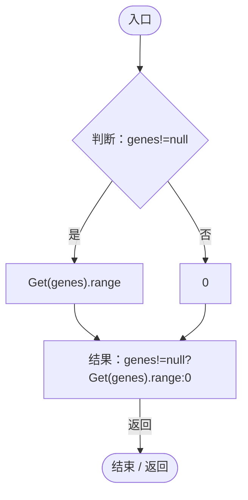

项目内调用/回调引用：

- [EntityPerceptionHub.Get · L25](aeecc36cb2c3cc24.md#m6e8ef31a160a5e74)（方法）

## Range · L41

`public static float Range(EntityGeneController genes,string attribute)`

### Editor / Player · Roslyn编译器控制流

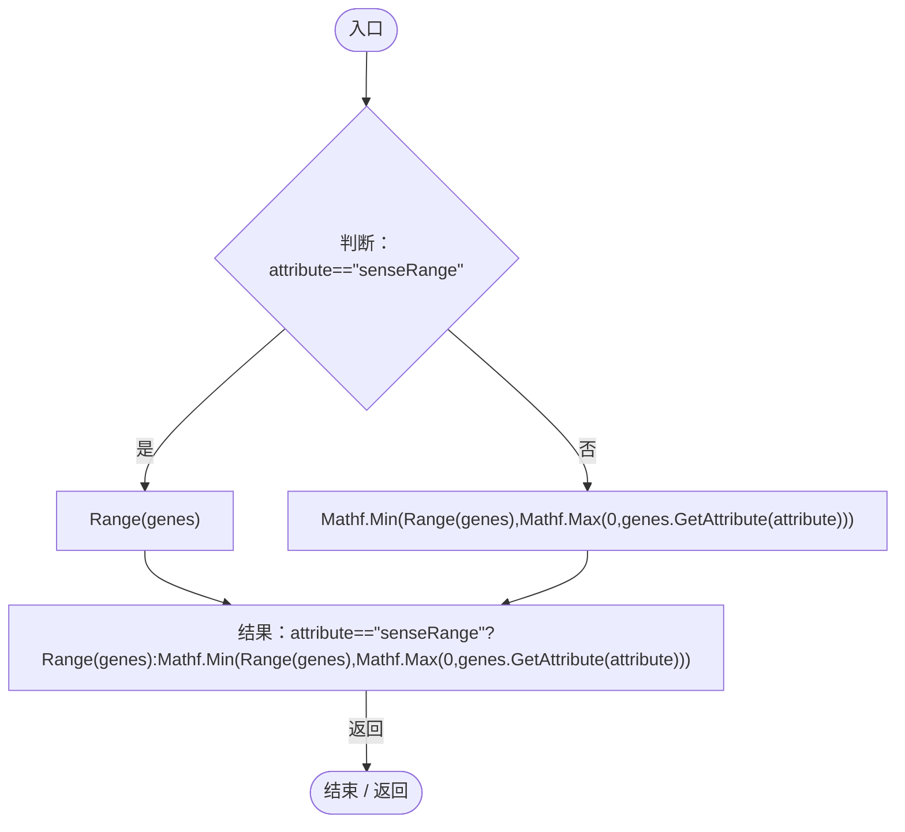

项目内调用/回调引用：

- [EntityPerceptionHub.Range · L40](aeecc36cb2c3cc24.md#m82b4d3ee35795aa8)（方法）
- [EntityGeneController.GetAttribute · L277](7494d53178552f0e.md#m5ef0e4e944f0c71b)（方法）

## Read · L42

`public static IReadOnlyList<EntitySighting> Read(EntityGeneController genes)`

### Editor / Player · Roslyn编译器控制流

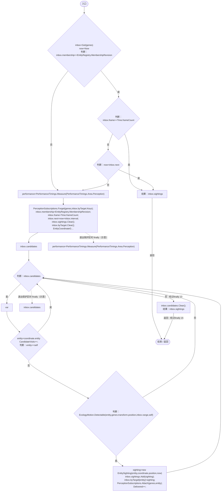

项目内调用/回调引用：

- [EntityPerceptionHub.Get · L25](aeecc36cb2c3cc24.md#m6e8ef31a160a5e74)（方法）
- [EntityRegistry.MembershipRevision.get · L15](2093aaf08559c9f2.md#m6afb6f184d119e11)（访问器）
- [PerformanceTimings.Measure · L24](a8403a4c7503726d.md#m10eb19b6d45944c4)（方法）
- [PerceptionSubscriptions.Forget · L10](69ad03522af4e9d9.md#m7d8542e80b44bab2)（方法）
- [EntityCoordinateGrid.Query · L26](f6d0404a662a5d5c.md#mb223b609771bd310)（方法）
- [EntityPerceptionHub.Searches.set · L23](aeecc36cb2c3cc24.md#m80cf9d67dfba16a7)（访问器）
- [EntityPerceptionHub.Searches.get · L23](aeecc36cb2c3cc24.md#m7431de46c6f0053f)（访问器）
- [EntityPerceptionHub.CandidateVisits.set · L23](aeecc36cb2c3cc24.md#m198ffeb4d9c2d0b7)（访问器）
- [EntityPerceptionHub.CandidateVisits.get · L23](aeecc36cb2c3cc24.md#m55ffe61e92656f55)（访问器）
- [EcologyMotion.Detectable · L63](6ed9d0eedb456d32.md#mfbde5a5e024a8840)（方法）
- [EntitySighting.EntitySighting.ctor · L12](aeecc36cb2c3cc24.md#me8009eddbd5e5621)（构造函数）
- [PerceptionSubscriptions.Attach · L9](69ad03522af4e9d9.md#mdc971fe9af8c746f)（方法）
- [EntityPerceptionHub.Delivered.set · L23](aeecc36cb2c3cc24.md#m91a5fa7769843b48)（访问器）
- [EntityPerceptionHub.Delivered.get · L23](aeecc36cb2c3cc24.md#m1dd3178d30ad24bb)（访问器）

## TryLocate · L57

`public static bool TryLocate(EntityGeneController genes,DarwinEntity target,out Vector3 point,float maximumRange=float.PositiveInfinity)`

### Editor / Player · Roslyn编译器控制流

```mermaid
flowchart TD
  b0(["入口"])
  b1{"point=default;<br/>判断：target==null"}
  b2["结果：false"]
  b3{"Read(genes);<br/>inbox=Get(genes)<br/>判断：inbox.byTarget.TryGetValue(target,out var sighting)"}
  b4{"判断：EntityNeighborhood.TryPosition(target,out var current)"}
  b5{"判断：EcologyMotion.Detectable(target,genes.transform.position,Mathf.Min(inbox.range,maximumRange),genes.GetComponent&lt;DarwinEntity&gt;())"}
  b6["结果：false"]
  b7{"point<br/>判断：inbox.attention"}
  b8{"判断：inbox.interval==0"}
  b9["current"]
  b10["sighting.position"]
  b11["point=inbox.attention&#124;&#124;inbox.interval==0?current:sighting.position;"]
  b12["结果：true"]
  b13(["结束 / 返回"])
  b0 --> b1
  b1 -->|"是"| b2
  b1 -->|"否"| b3
  b2 -->|"返回"| b13
  b3 -->|"是"| b4
  b3 -->|"否"| b6
  b4 -->|"是"| b5
  b4 -->|"否"| b6
  b5 -->|"否"| b6
  b5 -->|"是"| b7
  b6 -->|"返回"| b13
  b7 -->|"否"| b8
  b7 -->|"是"| b9
  b8 -->|"是"| b9
  b8 -->|"否"| b10
  b9 --> b11
  b10 --> b11
  b11 --> b12
  b12 -->|"返回"| b13

```

项目内调用/回调引用：

- [EntityPerceptionHub.Read · L42](aeecc36cb2c3cc24.md#mbe2216b46b71081b)（方法）
- [EntityPerceptionHub.Get · L25](aeecc36cb2c3cc24.md#m6e8ef31a160a5e74)（方法）
- [EntityNeighborhood.TryPosition · L96](e5e24c4aff0395b1.md#m25ecdad5c922e7d5)（方法）
- [EcologyMotion.Detectable · L63](6ed9d0eedb456d32.md#mfbde5a5e024a8840)（方法）

## Notice · L63

`public static void Notice(EntityGeneController genes,DarwinEntity target)`

### Editor / Player · Roslyn编译器控制流

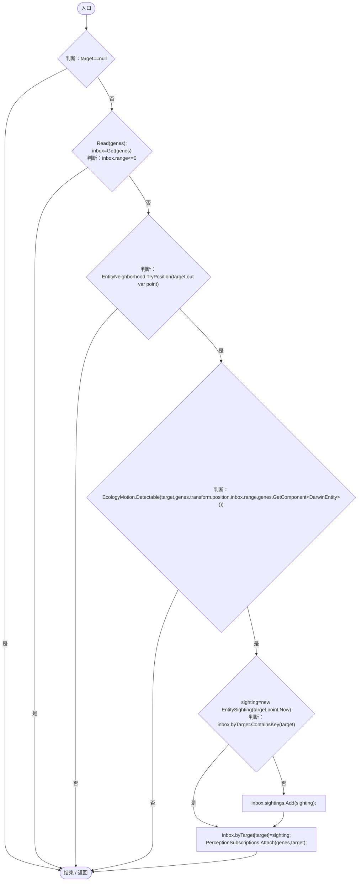

项目内调用/回调引用：

- [EntityPerceptionHub.Read · L42](aeecc36cb2c3cc24.md#mbe2216b46b71081b)（方法）
- [EntityPerceptionHub.Get · L25](aeecc36cb2c3cc24.md#m6e8ef31a160a5e74)（方法）
- [EntityNeighborhood.TryPosition · L96](e5e24c4aff0395b1.md#m25ecdad5c922e7d5)（方法）
- [EcologyMotion.Detectable · L63](6ed9d0eedb456d32.md#mfbde5a5e024a8840)（方法）
- [EntitySighting.EntitySighting.ctor · L12](aeecc36cb2c3cc24.md#me8009eddbd5e5621)（构造函数）
- [PerceptionSubscriptions.Attach · L9](69ad03522af4e9d9.md#mdc971fe9af8c746f)（方法）

## Remove · L70

`public static void Remove(EntityGeneController genes)`

### Editor / Player · Roslyn编译器控制流

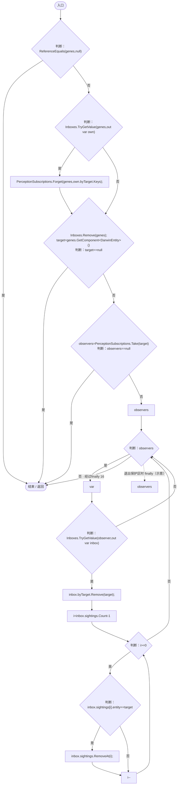

项目内调用/回调引用：

- [PerceptionSubscriptions.Forget · L10](69ad03522af4e9d9.md#m7d8542e80b44bab2)（方法）
- [PerceptionSubscriptions.Take · L11](69ad03522af4e9d9.md#m9c6d356120ea5915)（方法）

## Clear · L79

`public static void Clear()`

### Editor / Player · Roslyn编译器控制流

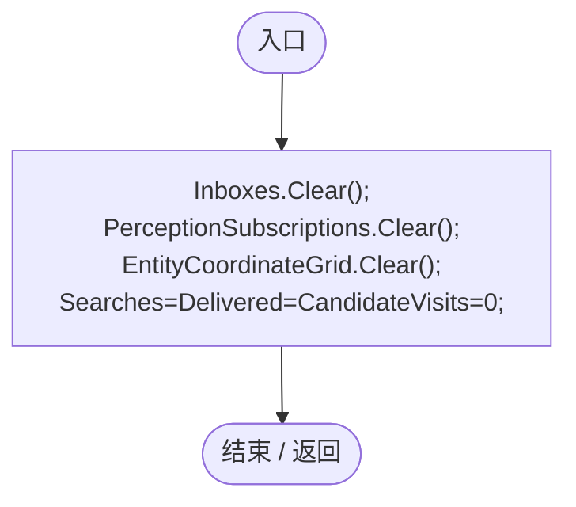

项目内调用/回调引用：

- [PerceptionSubscriptions.Clear · L12](69ad03522af4e9d9.md#mee8b670a83bc365e)（方法）
- [EntityCoordinateGrid.Clear · L33](f6d0404a662a5d5c.md#m2f8c9144ba3b3c91)（方法）
- [EntityPerceptionHub.Searches.set · L23](aeecc36cb2c3cc24.md#m80cf9d67dfba16a7)（访问器）
- [EntityPerceptionHub.Delivered.set · L23](aeecc36cb2c3cc24.md#m91a5fa7769843b48)（访问器）
- [EntityPerceptionHub.CandidateVisits.set · L23](aeecc36cb2c3cc24.md#m198ffeb4d9c2d0b7)（访问器）

## Reset · L80

`[RuntimeInitializeOnLoadMethod(RuntimeInitializeLoadType.SubsystemRegistration)]private static void Reset()`

### Editor / Player · Roslyn编译器控制流

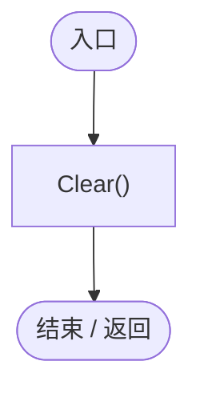

项目内调用/回调引用：

- [EntityPerceptionHub.Clear · L79](aeecc36cb2c3cc24.md#m31fc0fb1c51cd043)（方法）
