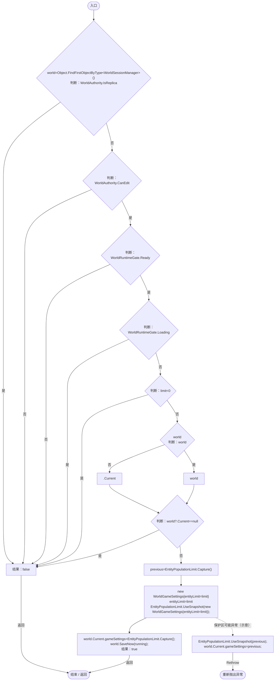

```mermaid
flowchart TD
  b0(["入口"])
  b1{"判断：WorldAuthority.IsReplica"}
  b2{"判断：WorldAuthority.CanEdit"}
  b3{"判断：WorldRuntimeGate.Ready"}
  b4{"判断：WorldRuntimeGate.Loading"}
  b5["结果：false"]
  b6["Object.FindObjectsByType&lt;RandomPlanetSpawner&gt;(FindObjectsSortMode.None)"]
  b7{"判断：Object.FindObjectsByType&lt;RandomPlanetSpawner&gt;(FindObjectsSortMode.None)"}
  b8["var<br/>job.Cancel();"]
  b9{"Object.FindObjectsByType&lt;RandomPlanetSpawner&gt;(FindObjectsSortMode.None)<br/>判断：Object.FindObjectsByType&lt;RandomPlanetSpawner&gt;(FindObjectsSortMode.None)"}
  b10["Object.FindObjectsByType&lt;RandomPlanetSpawner&gt;(FindObjectsSortMode.None)"]
  b11["连接 / 离开区域"]
  b12["PopulationMaintenance.SuspendAll();"]
  b13{"EntityPlacementTool.Instance<br/>判断：EntityPlacementTool.Instance"}
  b14["EntityPlacementTool.Instance?.CancelPlacement();"]
  b15{"EntityViewController.Instance<br/>判断：EntityViewController.Instance"}
  b16["EntityViewController.Instance?.ExitView();"]
  b17["Object.FindObjectsByType&lt;GeneInspectorUI&gt;(FindObjectsSortMode.None)"]
  b18{"判断：Object.FindObjectsByType&lt;GeneInspectorUI&gt;(FindObjectsSortMode.None)"}
  b19["var<br/>inspector.HideEntityInfo();"]
  b20{"Object.FindObjectsByType&lt;GeneInspectorUI&gt;(FindObjectsSortMode.None)<br/>判断：Object.FindObjectsByType&lt;GeneInspectorUI&gt;(FindObjectsSortMode.None)"}
  b21["Object.FindObjectsByType&lt;GeneInspectorUI&gt;(FindObjectsSortMode.None)"]
  b22["连接 / 离开区域"]
  b23{"EntityFavoritesManager.Instance<br/>判断：EntityFavoritesManager.Instance"}
  b24["EntityFavoritesManager.Instance?.ClearWorld();"]
  b25["entities=EntityRegistry.All.ToArray()"]
  b26["entities"]
  b27{"判断：entities"}
  b28["var"]
  b29{"entity.GetComponent&lt;EntityManualControl&gt;()<br/>判断：entity.GetComponent&lt;EntityManualControl&gt;()"}
  b30["entity.GetComponent&lt;EntityManualControl&gt;()?.Release();"]
  b31{"member=entity.GetComponent&lt;AntColonyMember&gt;()<br/>判断：member!=null"}
  b32["AntColonyWorker.Release(member);"]
  b33{"entities<br/>判断：entities"}
  b34["entities"]
  b35["连接 / 离开区域"]
  b36["entities"]
  b37{"判断：entities"}
  b38{"var<br/>判断：entity!=null"}
  b39["entity.gameObject.SetActive(false);<br/>Object.Destroy(entity.gameObject);"]
  b40{"entities<br/>判断：entities"}
  b41["entities"]
  b42["连接 / 离开区域"]
  b43["EntityRegistry.Clear();<br/>PopulationRangeLayer.ClearWorld();<br/>world=Object.FindFirstObjectByType&lt;WorldSessionManager&gt;()"]
  b44{"world<br/>判断：world"}
  b45[".Current"]
  b46["world"]
  b47{"判断：world?.Current!=null"}
  b48["world.SaveNow(ServiceLocator.Get&lt;SimulationClock&gt;().IsRunning);"]
  b49["Debug.Log(&quot;[实体清理] 已清除全部实体：&quot;+entities.Length);<br/>结果：true"]
  b50(["结束 / 返回"])
  b0 --> b1
  b1 -->|"否"| b2
  b1 -->|"是"| b5
  b2 -->|"是"| b3
  b2 -->|"否"| b5
  b3 -->|"是"| b4
  b3 -->|"否"| b5
  b4 -->|"是"| b5
  b4 -->|"否"| b6
  b5 -->|"返回"| b50
  b6 --> b7
  b7 -->|"是"| b8
  b7 -->|"否 · 经过finally 9"| b12
  b8 --> b7
  b9 -->|"否"| b10
  b9 -->|"是"| b11
  b10 --> b11
  b12 --> b13
  b13 -->|"否"| b14
  b13 -->|"是"| b15
  b14 --> b15
  b15 -->|"否"| b16
  b15 -->|"是"| b17
  b16 --> b17
  b17 --> b18
  b18 -->|"是"| b19
  b18 -->|"否 · 经过finally 20"| b23
  b19 --> b18
  b20 -->|"否"| b21
  b20 -->|"是"| b22
  b21 --> b22
  b23 -->|"否"| b24
  b23 -->|"是"| b25
  b24 --> b25
  b25 --> b26
  b26 --> b27
  b27 -->|"是"| b28
  b27 -->|"否 · 经过finally 33"| b36
  b28 --> b29
  b29 -->|"否"| b30
  b29 -->|"是"| b31
  b30 --> b31
  b31 -->|"是"| b32
  b31 -->|"否"| b27
  b32 --> b27
  b33 -->|"否"| b34
  b33 -->|"是"| b35
  b34 --> b35
  b36 --> b37
  b37 -->|"是"| b38
  b37 -->|"否 · 经过finally 40"| b43
  b38 -->|"是"| b39
  b38 -->|"否"| b37
  b39 --> b37
  b40 -->|"否"| b41
  b40 -->|"是"| b42
  b41 --> b42
  b43 --> b44
  b44 -->|"否"| b45
  b44 -->|"是"| b46
  b45 --> b47
  b46 --> b47
  b47 -->|"是"| b48
  b47 -->|"否"| b49
  b48 --> b49
  b49 -->|"返回"| b50
  b7 -. "退出保护区时 finally（示意）" .-> b9
  b18 -. "退出保护区时 finally（示意）" .-> b20
  b27 -. "退出保护区时 finally（示意）" .-> b33
  b37 -. "退出保护区时 finally（示意）" .-> b40

```

# WorldEntityActions.cs

[返回总索引](../README.md) · `Runtime` · `Assets/DarwinPark/UI/WorldEntityActions.cs`

[源文件](../../../Assets/DarwinPark/UI/WorldEntityActions.cs) · 源码校验：`0fc3ec85d30ca6658da1017d46915bf3b2e0836cb8684ecc8a258129c8c33bd6`

方法按源文件位置排列。事件/回调引用不表示立即执行；分支与异常说明见总索引。完整源码与可点击关系图请打开离线手册。

## SetLimit · L12

`public static bool SetLimit(int limit,bool running)`

### Editor / Player · Roslyn编译器控制流

项目内调用/回调引用：

- [WorldSessionManager.Current.get · L21](08741c7b7b9d9344.md#m5d26a5eb846a8504)（访问器）
- [EntityPopulationLimit.Capture · L29](44f717c5df79d270.md#m9d42f19642677139)（方法）
- [EntityPopulationLimit.UseSnapshot · L30](44f717c5df79d270.md#m735185cedc969868)（方法）
- [WorldSessionManager.SaveNow · L157](08741c7b7b9d9344.md#mbecd8b5c222ba46b)（方法）

## ClearAll · L23

`public static bool ClearAll()`

### Editor / Player · Roslyn编译器控制流

项目内调用/回调引用：

- [RandomPlanetSpawner.Cancel · L91](1c13222a547b265c.md#m13321aa05f521986)（方法）
- [PopulationMaintenance.SuspendAll · L131](923ccc4e86c4786c.md#m10e1fbf173d55891)（方法）
- [EntityPlacementTool.Instance.get · L13](2ca993947b0a7e7a.md#mafb26991c0dfcb86)（访问器）
- [EntityPlacementTool.CancelPlacement · L81](2ca993947b0a7e7a.md#m5a9374d2c71f0a2d)（方法）
- [EntityViewController.Instance.get · L15](0ad0345f83229ef0.md#mb3b8144b56e80842)（访问器）
- [EntityViewController.ExitView · L105](0ad0345f83229ef0.md#mca8619c7f27942c9)（方法）
- [GeneInspectorUI.HideEntityInfo · L316](924e27c34e7b1f0a.md#m11944eddcac871c2)（方法）
- [EntityFavoritesManager.Instance.get · L10](b60fb973e9d3815a.md#m0dac2feb106bac97)（访问器）
- [EntityFavoritesManager.ClearWorld · L49](b60fb973e9d3815a.md#m4954d3e7fcdfe6b3)（方法）
- [EntityManualControl.Release · L37](a6969896da35e1f0.md#m87aa0efacece2c5b)（方法）
- [AntColonyWorker.Release · L125](8a0cca2020271b6f.md#m1d9a49a310c2b22d)（方法）
- [EntityRegistry.Clear · L37](2093aaf08559c9f2.md#mbc5c3633c74276c3)（方法）
- [PopulationRangeLayer.ClearWorld · L25](7ad316e94c5af908.md#m02787b2f4b274bce)（方法）
- [WorldSessionManager.Current.get · L21](08741c7b7b9d9344.md#m5d26a5eb846a8504)（访问器）
- [WorldSessionManager.SaveNow · L157](08741c7b7b9d9344.md#mbecd8b5c222ba46b)（方法）
- [SimulationClock.IsRunning.get · L22](a8f444aec9614b0a.md#m10f4fe307faca0f0)（访问器）
- [ServiceLocator.Get · L33](f2fdbe9f9ccd93cb.md#m2ae625299520c56d)（方法）
