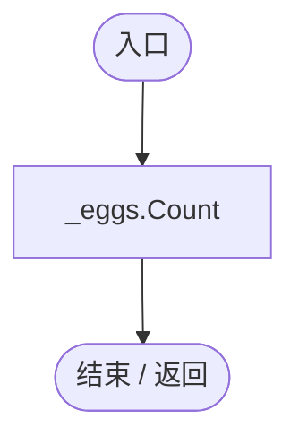
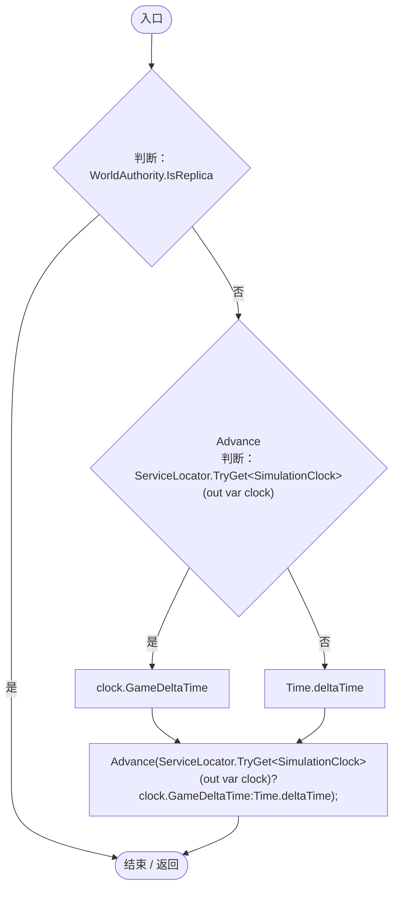
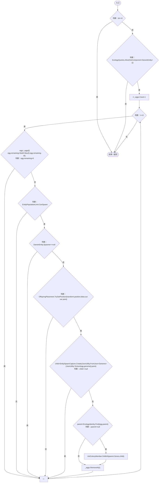
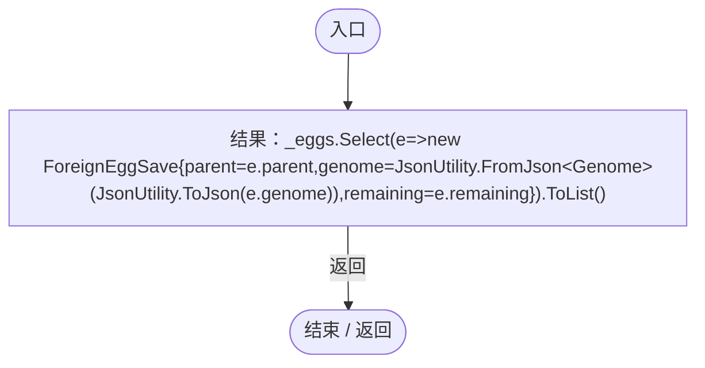
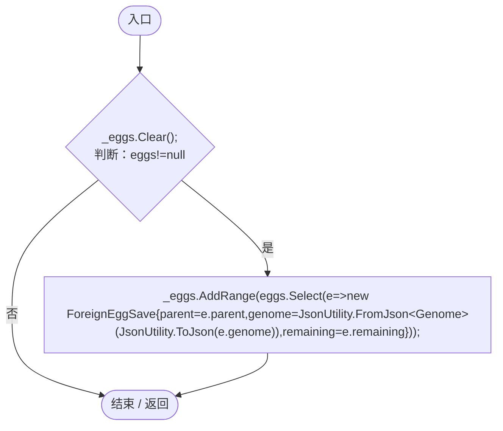
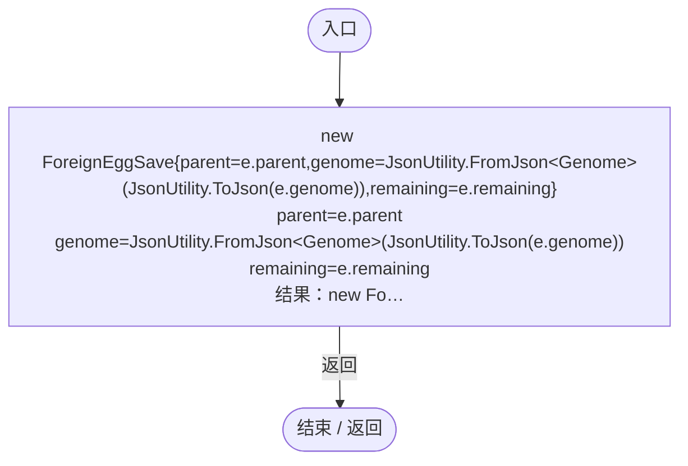

```mermaid
flowchart TD
  b0(["入口"])
  b1{"判断：parent==null"}
  b2{"判断：WorldAuthority.IsReplica"}
  b3{"判断：EcologyQueries.Alive(parent.GetComponent&lt;DarwinEntity&gt;())"}
  b4{"offspring<br/>判断：offspring"}
  b5[".Genes"]
  b6["offspring"]
  b7{"判断：offspring?.Genes==null"}
  b8{"判断：offspring.Genes.Count==0"}
  b9["结果：false"]
  b10["settings=NutritionEcologySettings.Current<br/>nearest=null<br/>best=settings.eggHostRadius*settings.eggHostRadius"]
  b11["EntityRegistry.All"]
  b12{"判断：EntityRegistry.All"}
  b13["var"]
  b14{"判断：EcologyQueries.Alive(host)"}
  b15{"判断：host.gameObject==parent.gameObject"}
  b16{"DarwinPark.Core.OptionalComponent.Read&lt;EggIncubation&gt;(host)<br/>判断：DarwinPark.Core.OptionalComponent.Read&lt;EggIncubation&gt;(host)"}
  b17[".Incubating"]
  b18["DarwinPark.Core.OptionalComponent.Read&lt;EggIncubation&gt;(host)"]
  b19{"判断：DarwinPark.Core.OptionalComponent.Read&lt;EggIncubation&gt;(host)?.Incubating==true"}
  b20{"DarwinPark.Core.OptionalComponent.Read&lt;NutritionParasite&gt;(host)<br/>判断：DarwinPark.Core.OptionalComponent.Read&lt;NutritionParasite&gt;(host)"}
  b21[".Host"]
  b22["DarwinPark.Core.OptionalComponent.Read&lt;NutritionParasite&gt;(host)"]
  b23{"判断：DarwinPark.Core.OptionalComponent.Read&lt;NutritionParasite&gt;(host)?.Host!=null"}
  b24{"DarwinPark.Core.OptionalComponent.Read&lt;PopulationBehavior&gt;(parent)<br/>判断：DarwinPark.Core.OptionalComponent.Read&lt;PopulationBehavior&gt;(parent)"}
  b25[".SameGroup(host)"]
  b26["DarwinPark.Core.OptionalComponent.Read&lt;PopulationBehavior&gt;(parent)"]
  b27{"判断：DarwinPark.Core.OptionalComponent.Read&lt;PopulationBehavior&gt;(parent)?.SameGroup(host)==true"}
  b28{"host.GetComponent&lt;EggHostPregnancy&gt;()<br/>判断：host.GetComponent&lt;EggHostPregnancy&gt;()"}
  b29[".Count"]
  b30["host.GetComponent&lt;EggHostPregnancy&gt;()"]
  b31{"判断：host.GetComponent&lt;EggHostPregnancy&gt;()?.Count"}
  b32["host.GetComponent&lt;EggHostPregnancy&gt;()?.Count"]
  b33["0"]
  b34{"判断：(host.GetComponent&lt;EggHostPregnancy&gt;()?.Count??0)&gt;=settings.maximumEggsPerHost"}
  b35{"distance=(host.transform.position-parent.transform.position).sqrMagnitude<br/>判断：distance&lt;best"}
  b36["best=distance;<br/>nearest=host;"]
  b37{"判断：EntityRegistry.All"}
  b38["EntityRegistry.All"]
  b39["连接 / 离开区域"]
  b40{"判断：nearest==null"}
  b41["结果：false"]
  b42{"nearest.GetComponent&lt;EggHostPregnancy&gt;()<br/>判断：nearest.GetComponent&lt;EggHostPregnancy&gt;()"}
  b43["nearest.GetComponent&lt;EggHostPregnancy&gt;()"]
  b44["nearest.gameObject.AddComponent&lt;EggHostPregnancy&gt;()"]
  b45["pregnancy=nearest.GetComponent&lt;EggHostPregnancy&gt;()??nearest.gameObject.AddComponent&lt;EggHostPregnancy&gt;()"]
  b46["pregnancy._eggs<br/>new ForeignEggSave{parent=EcologyIdentity.Of(parent.GetComponent&lt;DarwinEntity&gt;()),genome=JsonUtility.FromJson&lt;Genome&gt;(JsonUtility.ToJson(offspring)),remaining=settings.eggIncubationSeconds/Mathf.Max(.01f,parent.GetAttribu…"]
  b47["结果：true"]
  b48(["结束 / 返回"])
  b0 --> b1
  b1 -->|"否"| b2
  b1 -->|"是"| b9
  b2 -->|"否"| b3
  b2 -->|"是"| b9
  b3 -->|"是"| b4
  b3 -->|"否"| b9
  b4 -->|"否"| b5
  b4 -->|"是"| b6
  b5 --> b7
  b6 --> b7
  b7 -->|"否"| b8
  b7 -->|"是"| b9
  b8 -->|"是"| b9
  b8 -->|"否"| b10
  b9 -->|"返回"| b48
  b10 --> b11
  b11 --> b12
  b12 -->|"是"| b13
  b12 -->|"否 · 经过finally 37"| b40
  b13 --> b14
  b14 -->|"是"| b15
  b14 -->|"否"| b12
  b15 -->|"否"| b16
  b15 -->|"是"| b12
  b16 -->|"否"| b17
  b16 -->|"是"| b18
  b17 --> b19
  b18 --> b19
  b19 -->|"否"| b20
  b19 -->|"是"| b12
  b20 -->|"否"| b21
  b20 -->|"是"| b22
  b21 --> b23
  b22 --> b23
  b23 -->|"否"| b24
  b23 -->|"是"| b12
  b24 -->|"否"| b25
  b24 -->|"是"| b26
  b25 --> b27
  b26 --> b27
  b27 -->|"否"| b28
  b27 -->|"是"| b12
  b28 -->|"否"| b29
  b28 -->|"是"| b30
  b29 --> b31
  b30 --> b31
  b31 -->|"否"| b32
  b31 -->|"是"| b33
  b32 --> b34
  b33 --> b34
  b34 -->|"是"| b12
  b34 -->|"否"| b35
  b35 -->|"是"| b36
  b35 -->|"否"| b12
  b36 --> b12
  b37 -->|"否"| b38
  b37 -->|"是"| b39
  b38 --> b39
  b40 -->|"是"| b41
  b40 -->|"否"| b42
  b41 -->|"返回"| b48
  b42 -->|"否"| b43
  b42 -->|"是"| b44
  b43 --> b45
  b44 --> b45
  b45 --> b46
  b46 --> b47
  b47 -->|"返回"| b48
  b12 -. "退出保护区时 finally（示意）" .-> b37

```

# EggHostPregnancy.cs

[返回总索引](../README.md) · `Runtime` · `Assets/DarwinPark/Entities/Ecology/EggHostPregnancy.cs`

[源文件](../../../Assets/DarwinPark/Entities/Ecology/EggHostPregnancy.cs) · 源码校验：`c0b7d0f988acf194693b5a0541145133f6c8184dd15baa8fc06a97e12c24ecfe`

方法按源文件位置排列。事件/回调引用不表示立即执行；分支与异常说明见总索引。完整源码与可点击关系图请打开离线手册。

## Count.get · L16

`public int Count`

### Editor / Player · 语法控制结构 / 声明（非CFG）

## TryDeposit · L17

`public static bool TryDeposit(EntityGeneController parent,Genome offspring)`

### Editor / Player · Roslyn编译器控制流

项目内调用/回调引用：

- [EcologyQueries.Alive · L39](bdf7ccc2c9c0452f.md#m8352bfacbe2996a8)（方法）
- [NutritionEcologySettings.Current.get · L19](846a17351dbd6aa4.md#mb3eb930022e314f3)（访问器）
- [OptionalComponent.Read · L7](806c46b42ced4d36.md#m69622a4dee165c5a)（方法）
- [NutritionParasite.Host.get · L22](4a18785b7c1e1484.md#m5812c5feaf5f3103)（访问器）
- [PopulationBehavior.SameGroup · L127](21e4f62f75a9a80f.md#m4af6332162bb0355)（方法）
- [EcologyIdentity.Of · L22](bdf7ccc2c9c0452f.md#mb23020fe763aafd3)（方法）
- [EntityGeneController.GetAttribute · L288](7494d53178552f0e.md#m45127bcdd833aaf5)（方法）

## Update · L31

`private void Update()`

### Editor / Player · Roslyn编译器控制流

项目内调用/回调引用：

- [EggHostPregnancy.Advance · L32](b0ff4b8259f98b85.md#mfacac663d4191a31)（方法）
- [ServiceLocator.TryGet · L26](f2fdbe9f9ccd93cb.md#m143b24e6d58471b0)（方法）
- [SimulationClock.GameDeltaTime.get · L26](a8f444aec9614b0a.md#me7f11abae18a4f2d)（访问器）

## Advance · L32

`public void Advance(float dt)`

### Editor / Player · Roslyn编译器控制流

项目内调用/回调引用：

- [EcologyQueries.Alive · L39](bdf7ccc2c9c0452f.md#m8352bfacbe2996a8)（方法）
- [OffspringPlacement.TryGetPosition · L9](eeef5e6fb7a6f46b.md#mcf47222366c0f594)（方法）
- [EntitySpawnCapture.Create · L11](5a4874756805f604.md#m2adfeb24d77063b5)（方法）
- [EcologyIdentity.Find · L21](bdf7ccc2c9c0452f.md#mb670b64dc2baff58)（方法）
- [AntColonyMember.OnBirth · L73](baebd85c05598377.md#m5a3b31593e0247b1)（方法）
- [DarwinEntity.Genes.get · L14](70798dde169f2e8b.md#m622eb1adf401d431)（访问器）

## Capture · L45

`public List<ForeignEggSave> Capture()`

### Editor / Player · Roslyn编译器控制流

项目内调用/回调引用：

- [EggHostPregnancy.回调@45 · L45](b0ff4b8259f98b85.md#m4345fec86fbca73e)（回调/委托）

## 回调@45 · L45

`e … => 回调`

### Editor / Player · Roslyn编译器控制流

## Restore · L47

`public void Restore(List<ForeignEggSave> eggs)`

★ 修复（防Bug回归）：恢复同样深拷贝，推进运行计时不能顺带改写读入的存档/联机快照。

### Editor / Player · Roslyn编译器控制流

项目内调用/回调引用：

- [EggHostPregnancy.回调@48 · L48](b0ff4b8259f98b85.md#m3d1686607df41020)（回调/委托）

## 回调@48 · L48

`e … => 回调`

### Editor / Player · Roslyn编译器控制流

