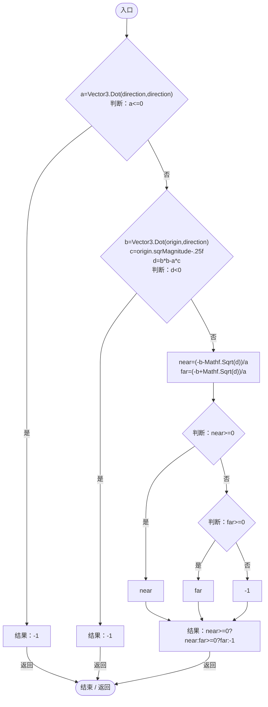
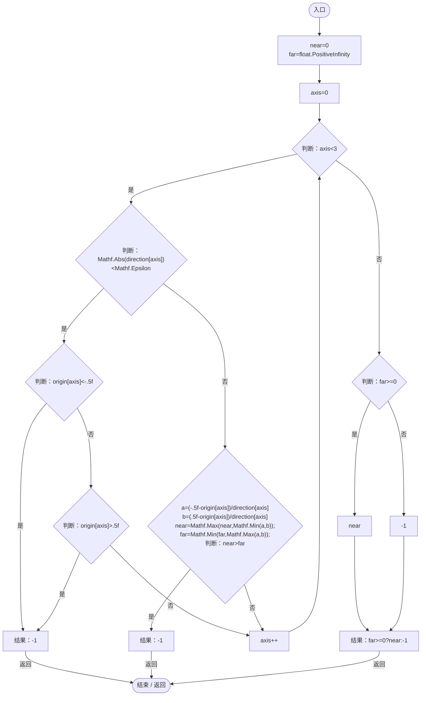

# WorldInspectablePicker.cs

[返回总索引](../README.md) · `Runtime` · `Assets/DarwinPark/UI/WorldInspectablePicker.cs`

[源文件](../../../Assets/DarwinPark/UI/WorldInspectablePicker.cs) · 源码校验：`69359b24cd1468354e073d24512b99ad01f8da4372c64f56b39cf95806cbacb1`

方法按源文件位置排列。事件/回调引用不表示立即执行；分支与异常说明见总索引。完整源码与可点击关系图请打开离线手册。

## Pick · L10

`public static bool Pick(Ray ray,float maximum,out DarwinEntity entity,out ColonyResource resource)`

### Editor / Player · Roslyn编译器控制流

```mermaid
flowchart TD
  b0(["入口"])
  b1{"entity=null;<br/>resource=null;<br/>ray.direction=ray.direction.normalized;<br/>nearest=maximum<br/>判断：Physics.Raycast(ray,out var hit,maximum,~0,QueryTriggerInteraction.Ignore)"}
  b2["nearest=hit.distance;<br/>entity=hit.collider.GetComponentInParent&lt;DarwinEntity&gt;();"]
  b3["ColonyResource.All"]
  b4{"判断：ColonyResource.All"}
  b5["var"]
  b6["origin=candidate.transform.InverseTransformPoint(ray.origin)<br/>direction=candidate.transform.InverseTransformVector(ray.direction)"]
  b7{"判断：candidate.State.kind==ColonyResourceKind.Corpse"}
  b8["Sphere(origin,direction)"]
  b9["Box(origin,direction)"]
  b10["distance=candidate.State.kind==ColonyResourceKind.Corpse?Sphere(origin,direction):Box(origin,direction)"]
  b11{"判断：distance&lt;0"}
  b12{"判断：distance&gt;=nearest"}
  b13["nearest=distance;<br/>resource=candidate;<br/>entity=null;"]
  b14{"判断：ColonyResource.All"}
  b15["ColonyResource.All"]
  b16["连接 / 离开区域"]
  b17{"判断：entity!=null"}
  b18["resource!=null"]
  b19["entity!=null"]
  b20["结果：entity!=null&#124;&#124;resource!=null"]
  b21(["结束 / 返回"])
  b0 --> b1
  b1 -->|"是"| b2
  b1 -->|"否"| b3
  b2 --> b3
  b3 --> b4
  b4 -->|"是"| b5
  b4 -->|"否 · 经过finally 14"| b17
  b5 --> b6
  b6 --> b7
  b7 -->|"是"| b8
  b7 -->|"否"| b9
  b8 --> b10
  b9 --> b10
  b10 --> b11
  b11 -->|"否"| b12
  b11 -->|"是"| b4
  b12 -->|"是"| b4
  b12 -->|"否"| b13
  b13 --> b4
  b14 -->|"否"| b15
  b14 -->|"是"| b16
  b15 --> b16
  b17 -->|"否"| b18
  b17 -->|"是"| b19
  b18 --> b20
  b19 --> b20
  b20 -->|"返回"| b21
  b4 -. "退出保护区时 finally（示意）" .-> b14

```

项目内调用/回调引用：

- [ColonyResource.State.get · L22](293dbaecfff4b585.md#m341a1355f4d657bf)（访问器）
- [WorldInspectablePicker.Sphere · L22](b30f6db5375f9436.md#md469b3066d896a23)（方法）
- [WorldInspectablePicker.Box · L27](b30f6db5375f9436.md#m23cd35bfb77b33cf)（方法）

## Sphere · L22

`private static float Sphere(Vector3 origin,Vector3 direction)`

### Editor / Player · Roslyn编译器控制流

## Box · L27

`private static float Box(Vector3 origin,Vector3 direction)`

### Editor / Player · Roslyn编译器控制流

