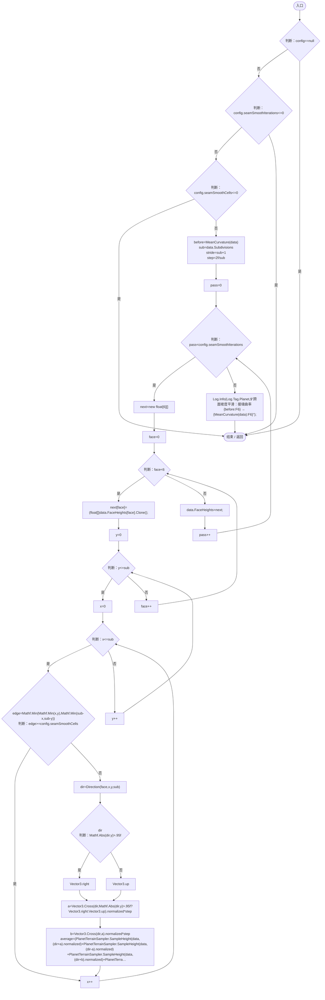
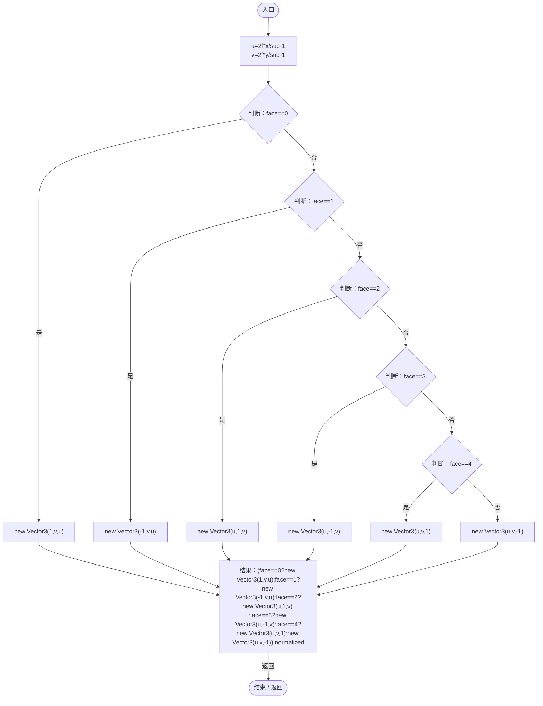
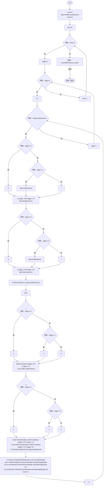

# PlanetSeamContinuity.cs

[返回总索引](../README.md) · `Runtime` · `Assets/DarwinPark/Planet/Terrain/PlanetSeamContinuity.cs`

[源文件](../../../Assets/DarwinPark/Planet/Terrain/PlanetSeamContinuity.cs) · 源码校验：`da8cc4a6c4475c388fbf5bbe57a9c85bfaa9e242d62b39fb3a29bdc3bfa76361`

方法按源文件位置排列。事件/回调引用不表示立即执行；分支与异常说明见总索引。完整源码与可点击关系图请打开离线手册。

## Smooth · L9

`public static void Smooth(PlanetTerrainData data, ErosionConfig config)`

### Editor / Player · Roslyn编译器控制流

项目内调用/回调引用：

- [PlanetSeamContinuity.MeanCurvature · L46](b45fffad7e3300e3.md#mcacd4832135628d3)（方法）
- [PlanetSeamContinuity.Direction · L40](b45fffad7e3300e3.md#mb2cb3d81d0d467ec)（方法）
- [PlanetTerrainSampler.SampleHeight · L32](fd5c1d83b88a7c8b.md#m759508f0c5a04b21)（方法）
- [Log.Info · L31](735e5abf0df2bddc.md#md1fe08215a3ce4d3)（方法）

## Direction · L40

`public static Vector3 Direction(int face,int x,int y,int sub)`

### Editor / Player · Roslyn编译器控制流

## MeanCurvature · L46

`public static float MeanCurvature(PlanetTerrainData data)`

### Editor / Player · Roslyn编译器控制流

项目内调用/回调引用：

- [PlanetSeamContinuity.Direction · L40](b45fffad7e3300e3.md#mb2cb3d81d0d467ec)（方法）
- [PlanetTerrainSampler.SampleHeight · L32](fd5c1d83b88a7c8b.md#m759508f0c5a04b21)（方法）
