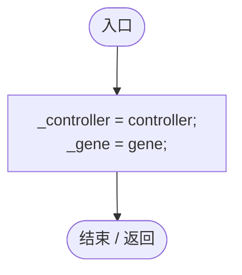
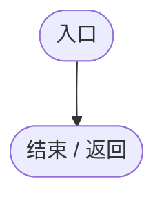
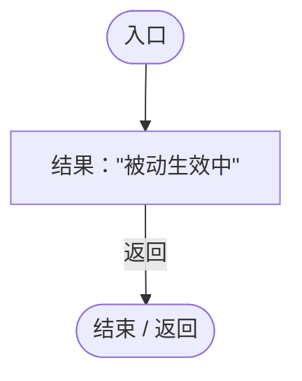

# StorageGeneLogic.cs

[返回总索引](../README.md) · `Runtime` · `Assets/DarwinPark/Entities/Logic/StorageGeneLogic.cs`

[源文件](../../../Assets/DarwinPark/Entities/Logic/StorageGeneLogic.cs) · 源码校验：`2e8bace2a193afa0af6f87c729a2975cf63cf430121509f2710ff70b64ef24f0`

方法按源文件位置排列。事件/回调引用不表示立即执行；分支与异常说明见总索引。完整源码与可点击关系图请打开离线手册。

## Initialize · L11

`public void Initialize(EntityGeneController controller, GeneInstance gene)`

### Editor / Player · Roslyn编译器控制流

## OnUpdate · L17

`public void OnUpdate(float dt)`

### Editor / Player · Roslyn编译器控制流

## GetTooltipInfo · L23

`public string GetTooltipInfo()`

### Editor / Player · Roslyn编译器控制流

