# PlanetClimateMap.cs

[返回总索引](../README.md) · `Runtime` · `Assets/DarwinPark/Planet/PlanetClimateMap.cs`

[源文件](../../../Assets/DarwinPark/Planet/PlanetClimateMap.cs) · 源码校验：`730f7d5207029b622d55f44137d4ac358fc69ed6b6234809938b3f7f0bcfd889`

方法按源文件位置排列。事件/回调引用不表示立即执行；分支与异常说明见总索引。完整源码与可点击关系图请打开离线手册。

## Instance.get · L16

`get`

### Editor / Player · 语法控制结构 / 声明（非CFG）

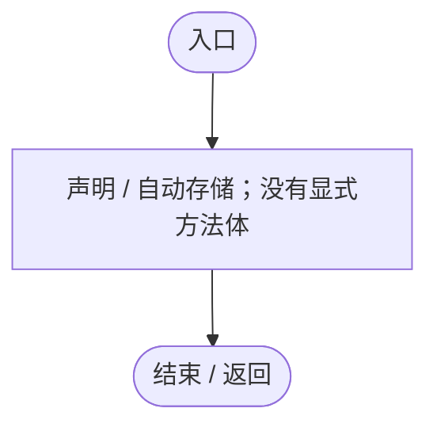

## Instance.set · L16

`private set`

### Editor / Player · 语法控制结构 / 声明（非CFG）

## ClimateTexture.get · L23

`get`

### Editor / Player · 语法控制结构 / 声明（非CFG）

## ClimateTexture.set · L23

`private set`

### Editor / Player · 语法控制结构 / 声明（非CFG）

## IsReady.get · L24

`get`

### Editor / Player · 语法控制结构 / 声明（非CFG）

## IsReady.set · L24

`private set`

### Editor / Player · 语法控制结构 / 声明（非CFG）

## Awake · L40

`private void Awake()`

### Editor / Player · Roslyn编译器控制流

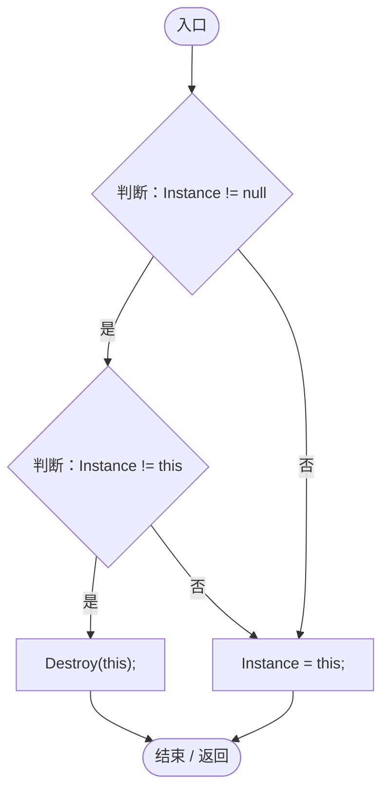

项目内调用/回调引用：

- [PlanetClimateMap.Instance.get · L16](b4e9726c1bcf4c37.md#m3add54a419aeef9f)（访问器）
- [PlanetClimateMap.Instance.set · L16](b4e9726c1bcf4c37.md#mbbd66d0dd7d04e53)（访问器）

## OnDestroy · L46

`private void OnDestroy()`

### Editor / Player · Roslyn编译器控制流

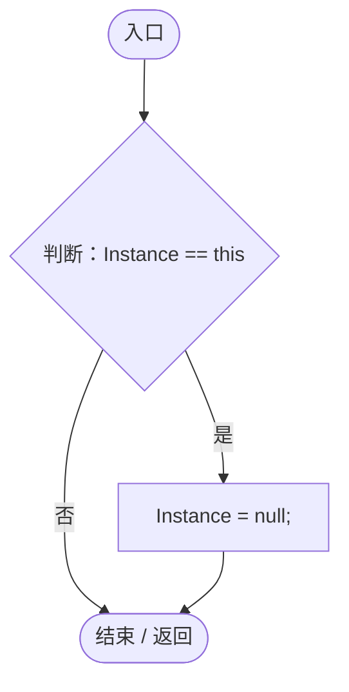

项目内调用/回调引用：

- [PlanetClimateMap.Instance.get · L16](b4e9726c1bcf4c37.md#m3add54a419aeef9f)（访问器）
- [PlanetClimateMap.Instance.set · L16](b4e9726c1bcf4c37.md#mbbd66d0dd7d04e53)（访问器）

## Start · L51

`private void Start()`

### Editor / Player · Roslyn编译器控制流

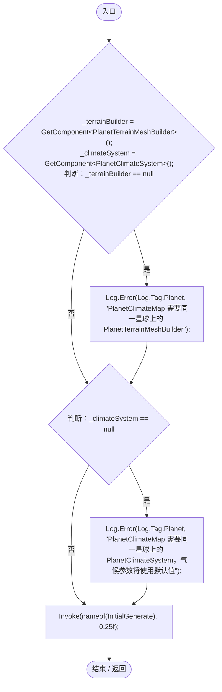

项目内调用/回调引用：

- [Log.Error · L43](735e5abf0df2bddc.md#m2addd5e1d74b000d)（方法）

## InitialGenerate · L64

`private void InitialGenerate()`

### Editor / Player · Roslyn编译器控制流

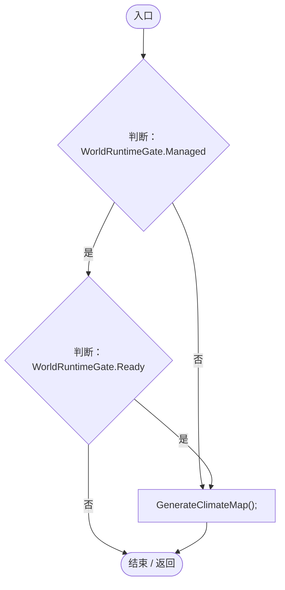

项目内调用/回调引用：

- [PlanetClimateMap.GenerateClimateMap · L78](b4e9726c1bcf4c37.md#m32cde1f109325e93)（方法）

## MarkDirty · L65

`public void MarkDirty()`

### Editor / Player · Roslyn编译器控制流

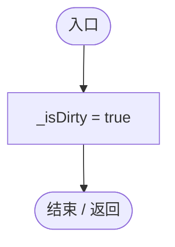

## Update · L67

`private void Update()`

### Editor / Player · Roslyn编译器控制流

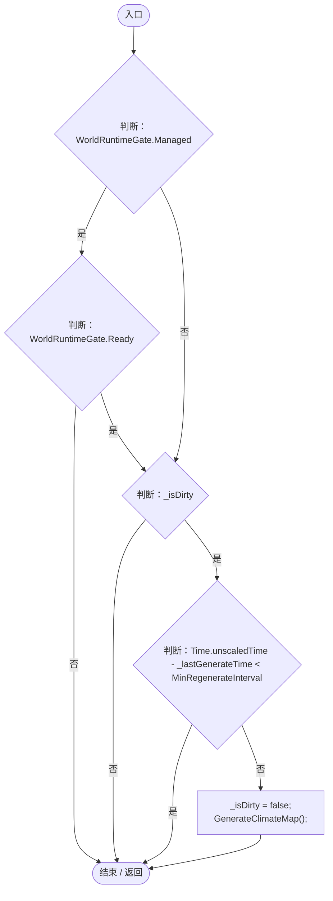

项目内调用/回调引用：

- [PlanetClimateMap.GenerateClimateMap · L78](b4e9726c1bcf4c37.md#m32cde1f109325e93)（方法）

## GenerateClimateMap · L78

`public void GenerateClimateMap()`

### Editor / Player · Roslyn编译器控制流

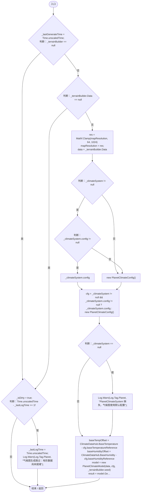

项目内调用/回调引用：

- [PlanetTerrainMeshBuilder.Data.get · L78](415285cf043354a9.md#m8382f579717fbc6d)（访问器）
- [Log.Warn · L37](735e5abf0df2bddc.md#m25a5d11252901de1)（方法）
- [PlanetClimateModel.PlanetClimateModel.ctor · L48](0249d34bf86f4fa3.md#m49e0c243be23136b)（构造函数）
- [PlanetClimateModel.Generate · L59](0249d34bf86f4fa3.md#m49a6e534a85dc57e)（方法）
- [PlanetClimateMap.ApplyGeneratedClimate · L114](b4e9726c1bcf4c37.md#m20ba66ec7eca94e5)（方法）

## ApplyGeneratedClimate · L114

`public void ApplyGeneratedClimate(PlanetClimateResult result)`

★ 适配：气候纯数据可后台计算，纹理与材质必须主线程上传。

### Editor / Player · Roslyn编译器控制流

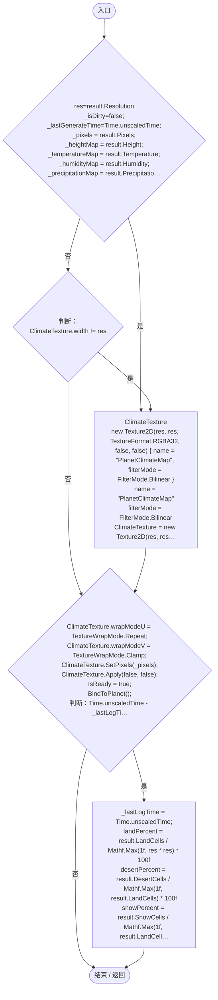

项目内调用/回调引用：

- [PlanetClimateMap.ClimateTexture.get · L23](b4e9726c1bcf4c37.md#m4542608e8858e330)（访问器）
- [PlanetClimateMap.ClimateTexture.set · L23](b4e9726c1bcf4c37.md#md50c7e6431c42025)（访问器）
- [PlanetClimateMap.IsReady.set · L24](b4e9726c1bcf4c37.md#mf83470e1851baf5d)（访问器）
- [PlanetClimateMap.BindToPlanet · L165](b4e9726c1bcf4c37.md#m1cc29bf168530455)（方法）
- [Log.Info · L31](735e5abf0df2bddc.md#md1fe08215a3ce4d3)（方法）

## ApplyToBlock · L158

`public void ApplyToBlock(MaterialPropertyBlock block)`

★ 适配：把气候贴图写入指定 MaterialPropertyBlock，供图层按钮复用。

### Editor / Player · Roslyn编译器控制流

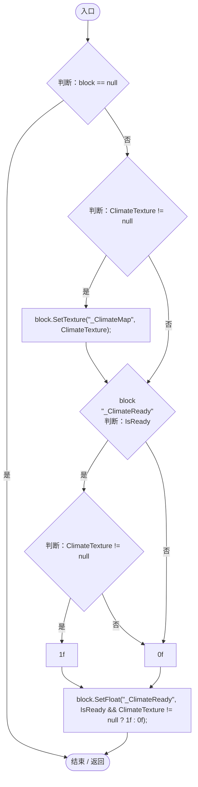

项目内调用/回调引用：

- [PlanetClimateMap.ClimateTexture.get · L23](b4e9726c1bcf4c37.md#m4542608e8858e330)（访问器）
- [PlanetClimateMap.IsReady.get · L24](b4e9726c1bcf4c37.md#m0ab54e1cef9b13e9)（访问器）

## BindToPlanet · L165

`private void BindToPlanet()`

### Editor / Player · Roslyn编译器控制流

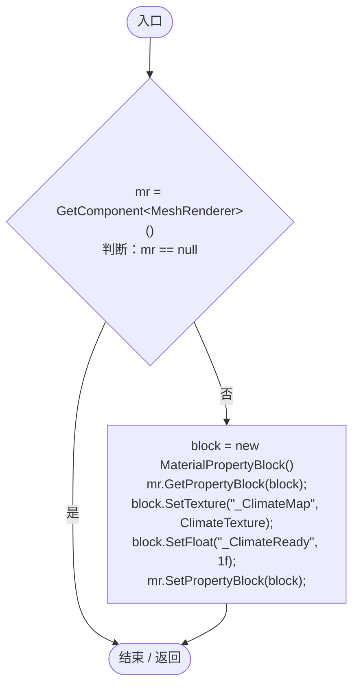

项目内调用/回调引用：

- [PlanetClimateMap.ClimateTexture.get · L23](b4e9726c1bcf4c37.md#m4542608e8858e330)（访问器）

## SampleClimate · L180

`public bool SampleClimate(Vector3 worldPos, float tempOffset, float humidityOffset, out ClimateData data)`

  世界坐标采样气候。气候系统和 UI 共用，保证“看到的图层”和“实体感受到的气候”一致。  

### Editor / Player · Roslyn编译器控制流

```mermaid
flowchart TD
  b0(["入口"])
  b1{"data = default;<br/>判断：IsReady"}
  b2{"判断：_temperatureMap == null"}
  b3["结果：false"]
  b4{"dir = transform.InverseTransformDirection(worldPos - transform.position).normalized<br/>判断：dir.sqrMagnitude &lt; 1e-6f"}
  b5["结果：false"]
  b6{"判断：_generatedResolution &gt; 0"}
  b7["_generatedResolution"]
  b8["mapResolution"]
  b9["res = _generatedResolution &gt; 0 ? _generatedResolution : mapResolution"]
  b10["uv = PlanetTerrainSampler.DirectionToUV(dir)<br/>fx = uv.x * res - 0.5f<br/>fy = uv.y * res - 0.5f<br/>x0 = Mathf.FloorToInt(fx)<br/>y0 = Mathf.FloorToInt(fy)<br/>tx = fx - x0<br/>ty = fy - y0<br/>x1 = WrapIndex(x0 + 1, res)<br/>y1 = Mathf.Clamp(y0 + 1, 0, res - 1)<br/>x0 …"]
  b11{"判断：_oceanMap[i00]"}
  b12{"判断：_oceanMap[i10]"}
  b13{"判断：_oceanMap[i01]"}
  b14["_oceanMap[i11]"]
  b15["_oceanMap[i00] &amp;&amp; _oceanMap[i10] &amp;&amp; _oceanMap[i01] &amp;&amp; _oceanMap[i11]"]
  b16["isOcean = _oceanMap[i00] &amp;&amp; _oceanMap[i10] &amp;&amp; _oceanMap[i01] &amp;&amp; _oceanMap[i11]"]
  b17{"判断：_climateSystem != null"}
  b18{"判断：_climateSystem.config != null"}
  b19["_climateSystem.config"]
  b20["new PlanetClimateConfig()"]
  b21["cfg = _climateSystem != null &amp;&amp; _climateSystem.config != null ? _climateSystem.config : new PlanetClimateConfig()"]
  b22["temp = Mathf.Clamp(temp + tempOffset, -60f, 70f);<br/>humidity = Mathf.Clamp(humidity + humidityOffset, 0f, 100f);<br/>precipitation = Mathf.Clamp(precipitation, 0f, 100f);"]
  b23["data<br/>new ClimateData { Temperature = temp, Humidity = humidity, Precipitation = precipitation, Type = cfg.Classify(temp, humidity, isOcean) }<br/>Temperature = temp<br/>Humidity = humidity<br/>Precipitation = precipitation<br/>Type = cfg.Classify(temp, …"]
  b24["结果：true"]
  b25(["结束 / 返回"])
  b0 --> b1
  b1 -->|"是"| b2
  b1 -->|"否"| b3
  b2 -->|"是"| b3
  b2 -->|"否"| b4
  b3 -->|"返回"| b25
  b4 -->|"是"| b5
  b4 -->|"否"| b6
  b5 -->|"返回"| b25
  b6 -->|"是"| b7
  b6 -->|"否"| b8
  b7 --> b9
  b8 --> b9
  b9 --> b10
  b10 --> b11
  b11 -->|"是"| b12
  b11 -->|"否"| b15
  b12 -->|"是"| b13
  b12 -->|"否"| b15
  b13 -->|"是"| b14
  b13 -->|"否"| b15
  b14 --> b16
  b15 --> b16
  b16 --> b17
  b17 -->|"是"| b18
  b17 -->|"否"| b20
  b18 -->|"是"| b19
  b18 -->|"否"| b20
  b19 --> b21
  b20 --> b21
  b21 --> b22
  b22 --> b23
  b23 --> b24
  b24 -->|"返回"| b25

```

项目内调用/回调引用：

- [PlanetClimateMap.IsReady.get · L24](b4e9726c1bcf4c37.md#m0ab54e1cef9b13e9)（访问器）
- [PlanetTerrainSampler.DirectionToUV · L24](fd5c1d83b88a7c8b.md#m3ef2b43aabed9098)（方法）
- [PlanetClimateMap.WrapIndex · L234](b4e9726c1bcf4c37.md#m5e3b9c545f97ce4b)（方法）
- [PlanetClimateMap.Bilerp · L229](b4e9726c1bcf4c37.md#ma318f605fe78a05b)（方法）
- [PlanetClimateConfig.Classify · L129](caa5d97c52b00485.md#m07936a82a4f7e6a6)（方法）

## Bilerp · L229

`private static float Bilerp(float v00, float v10, float v01, float v11, float tx, float ty)`

### Editor / Player · Roslyn编译器控制流

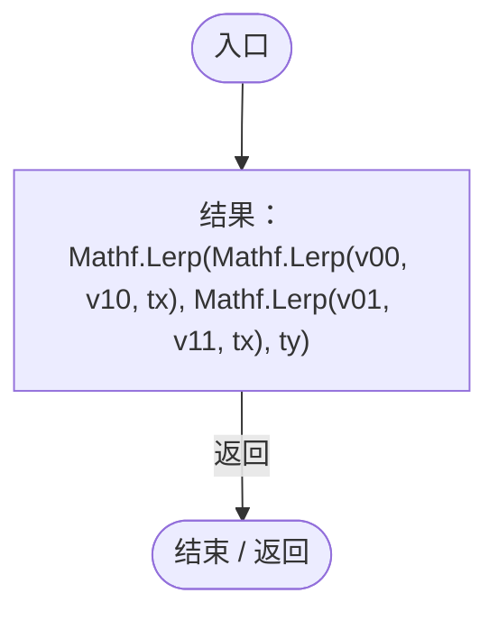

## WrapIndex · L234

`private static int WrapIndex(int index, int size)`

### Editor / Player · Roslyn编译器控制流

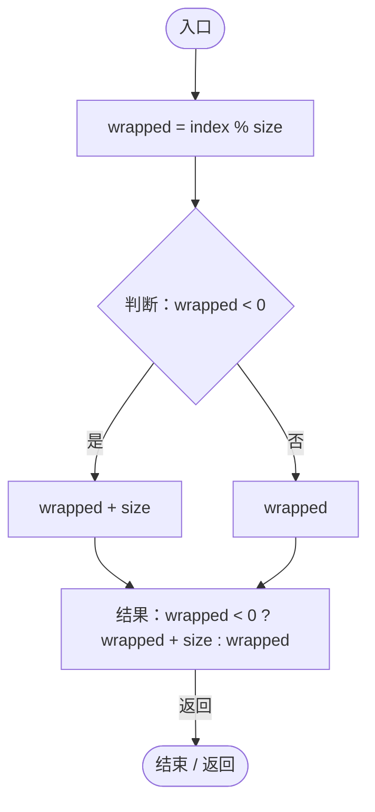
