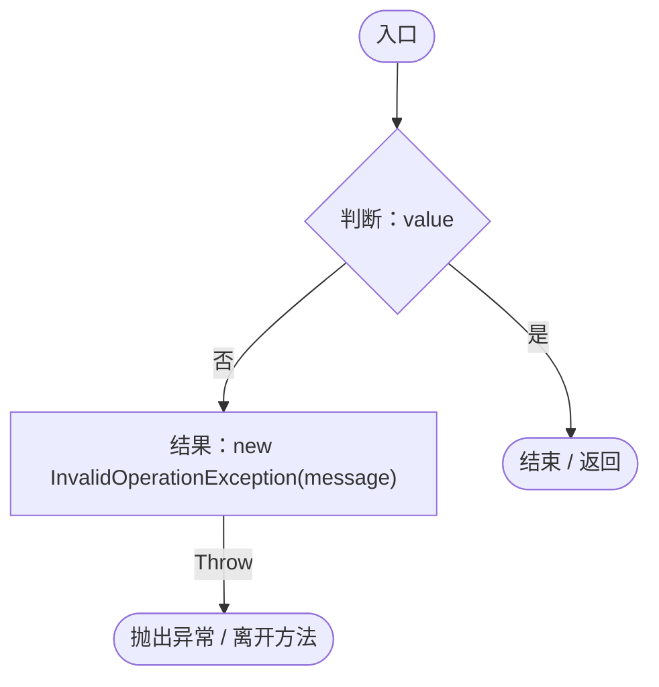
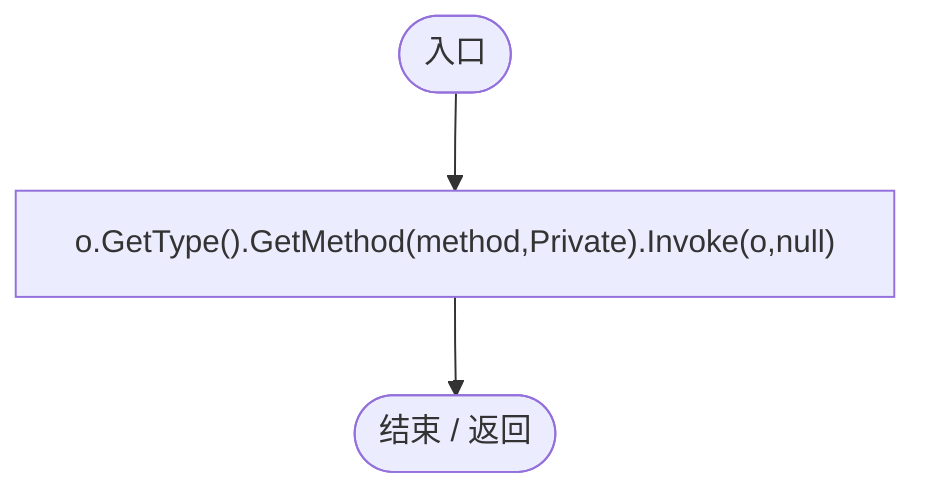
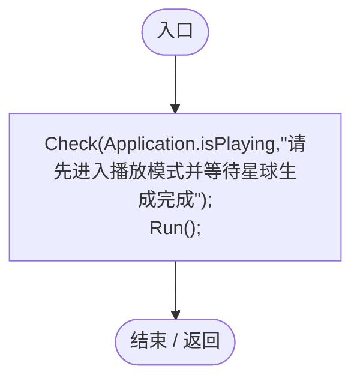
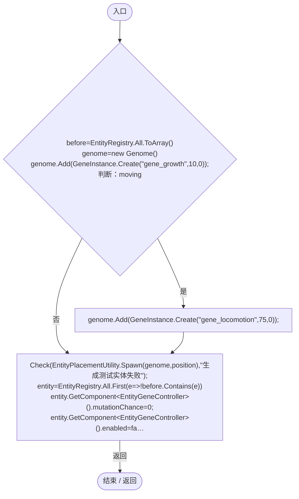
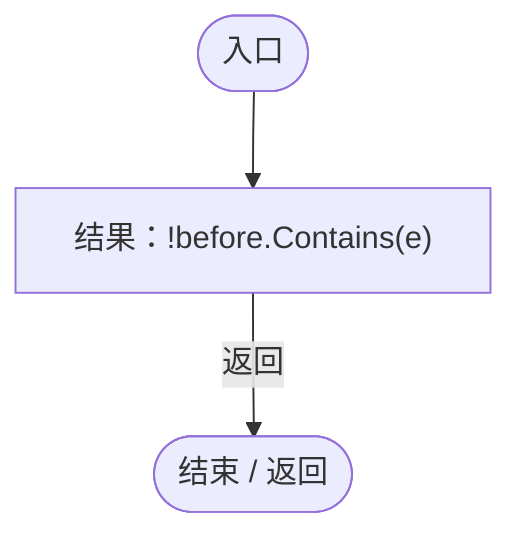
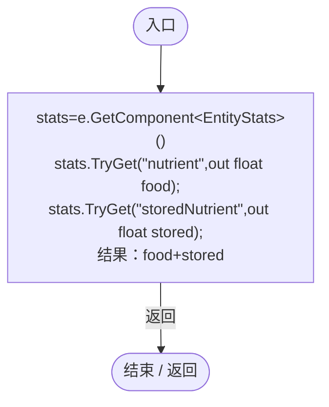
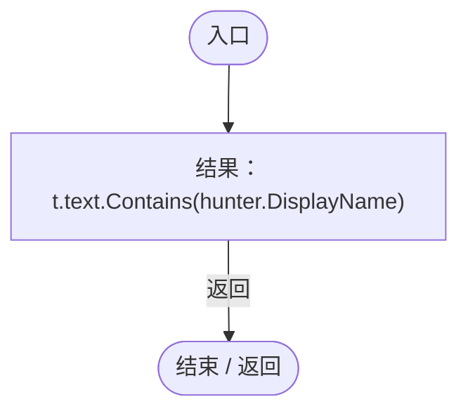
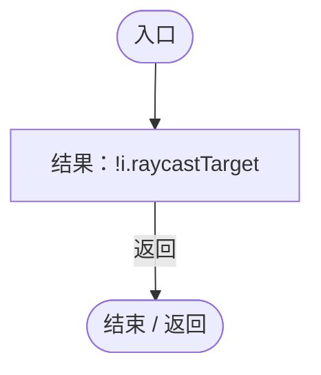
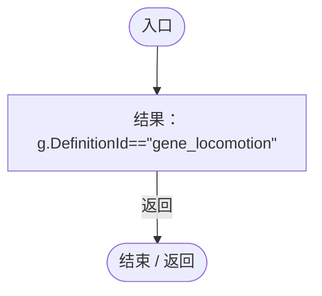

```mermaid
flowchart TD
  b0(["入口"])
  b1["report=new StringBuilder()<br/>view=UnityEngine.Object.FindFirstObjectByType&lt;EntityViewController&gt;()<br/>Check(view!=null,&quot;场景未挂载 EntityViewController&quot;);<br/>builder=UnityEngine.Object.FindFirstObjectByType&lt;PlanetTerrainMeshBuilder&gt;()<br/>clock=ServiceLo…"]
  b2["i=0"]
  b3{"判断：i&lt;512"}
  b4{"lat=1-2f*(i+.5f)/512<br/>angle=i*2.39996323f<br/>local=new Vector3(Mathf.Sqrt(1-lat*lat)*Mathf.Cos(angle),lat,Mathf.Sqrt(1-lat*lat)*Mathf.Sin(angle))<br/>判断：builder.radius+PlanetTerrainSampler.SampleHeight(builder.Data,local)*builder.heightScale&gt;bui…"}
  b5["up=builder.transform.TransformDirection(local);"]
  b6["i++"]
  b7["tangent=Vector3.ProjectOnPlane(Vector3.right,up).normalized<br/>hunter=Spawn(builder.transform.position+up*(builder.WaterRadius+25),true)<br/>prey=Spawn(hunter.transform.position+tangent*1.2f,false)<br/>genes=hunter.GetComponent&lt;EntityGeneController…"]
  b8["clock.Play();<br/>clock.SetTimeScale(1);<br/>Physics.SyncTransforms();<br/>stats.Modify(&quot;nutrient&quot;,-10);<br/>stats.Feed(3);<br/>stats.TryGet(&quot;nutrient&quot;,out float fed);<br/>stats.TryGet(&quot;storedNutrient&quot;,out float banked);"]
  b9{"判断：Mathf.Abs(fed-3)&lt;.001f"}
  b10["banked==0"]
  b11["Mathf.Abs(fed-3)&lt;.001f"]
  b12["Check(Mathf.Abs(fed-3)&lt;.001f &amp;&amp; banked==0,&quot;未优先恢复饱食度&quot;);"]
  b13["stats.Feed(9);<br/>stats.TryGet(&quot;nutrient&quot;,out fed);<br/>stats.TryGet(&quot;storedNutrient&quot;,out banked);"]
  b14{"判断：Mathf.Abs(fed-10)&lt;.001f"}
  b15["Mathf.Abs(banked-2)&lt;.001f"]
  b16["Mathf.Abs(fed-10)&lt;.001f"]
  b17["Check(Mathf.Abs(fed-10)&lt;.001f &amp;&amp; Mathf.Abs(banked-2)&lt;.001f,&quot;饱食度填满后的储存顺序错误&quot;);"]
  b18["stats.Modify(&quot;storedNutrient&quot;,-banked);<br/>report.AppendLine(&quot;PASS: feeding fills satiety first (0+3=3, storage 0); 3+9 fills 10 then stores 2&quot;);"]
  b19{"判断：builder.subdivisions&gt;=320"}
  b20["builder.Data.Vertices.Length&gt;600000"]
  b21["builder.subdivisions&gt;=320"]
  b22["Check(builder.subdivisions&gt;=320 &amp;&amp; builder.Data.Vertices.Length&gt;600000,&quot;地表网格密度未提升&quot;);"]
  b23["climate=builder.GetComponent&lt;PlanetClimateMap&gt;()"]
  b24{"判断：climate.IsReady"}
  b25["climate.ClimateTexture.width&gt;=1024"]
  b26["climate.IsReady"]
  b27["Check(climate.IsReady &amp;&amp; climate.ClimateTexture.width&gt;=1024,&quot;气候图未提升到 1024&quot;);"]
  b28["Check(!ShaderUtil.ShaderHasError(builder.TerrainMaterial.shader),&quot;近景细节 Shader 编译失败&quot;);<br/>report.AppendLine(&quot;PASS: 320 face subdivisions, &gt;600k welded vertices; climate 1024; surface shader error-free&quot;);<br/>inspector.ShowEntityInfo(hunter);<br/>pan…"]
  b29{"判断：title.GetComponent&lt;RectTransform&gt;().rect.height&lt;=38"}
  b30["title.Find(&quot;Title&quot;)==null"]
  b31["title.GetComponent&lt;RectTransform&gt;().rect.height&lt;=38"]
  b32["Check(title.GetComponent&lt;RectTransform&gt;().rect.height&lt;=38 &amp;&amp; title.Find(&quot;Title&quot;)==null,&quot;标题没有压缩/仍存在信息标签&quot;);"]
  b33["input.onEndEdit.Invoke(&quot; 测试·捕食者 &quot;);"]
  b34{"判断：hunter.DisplayName==&quot;测试·捕食者&quot;"}
  b35["input.text==hunter.DisplayName"]
  b36["hunter.DisplayName==&quot;测试·捕食者&quot;"]
  b37["Check(hunter.DisplayName==&quot;测试·捕食者&quot; &amp;&amp; input.text==hunter.DisplayName,&quot;名称输入没有提交&quot;);"]
  b38["input.onEndEdit.Invoke(&quot; &quot;);<br/>Check(hunter.DisplayName==&quot;测试·捕食者&quot;,&quot;空名称未回退&quot;);<br/>favorites=EntityFavoritesManager.Instance<br/>favorites.ToggleFavorite(hunter);<br/>favorites.TogglePanel();<br/>input.onEndEdit.Invoke(&quot;测试·改名&quot;);<br/>root=ServiceLocator.Get&lt;UIRo…"]
  b39{"判断：rect.width==400"}
  b40["rect.height==102"]
  b41["rect.width==400"]
  b42["Check(rect.width==400 &amp;&amp; rect.height==102,&quot;参数面板尺寸未压缩&quot;);"]
  b43["Canvas.ForceUpdateCanvases();<br/>fieldRect=RectTransformUtility.CalculateRelativeRectTransformBounds(parameter.transform,parameter.GetComponentInChildren&lt;InputField&gt;().transform)<br/>sliderRect=RectTransformUtility.CalculateRelativeRectTransfor…"]
  b44{"判断：view.Target==hunter"}
  b45["orbit.EntityViewActive"]
  b46["view.Target==hunter"]
  b47["Check(view.Target==hunter &amp;&amp; orbit.EntityViewActive,&quot;同一实体双击未进入视角&quot;);"]
  b48{"判断：Cursor.visible"}
  b49["Cursor.lockState==CursorLockMode.Locked"]
  b50["!Cursor.visible"]
  b51["Check(!Cursor.visible &amp;&amp; Cursor.lockState==CursorLockMode.Locked,&quot;实体视角没有隐藏/锁定鼠标&quot;);"]
  b52["crosshair=root.MainCanvas.transform.Find(&quot;EntityCrosshair&quot;)"]
  b53{"判断：crosshair!=null"}
  b54["crosshair.GetComponentsInChildren&lt;Image&gt;().All(i=&gt;!i.raycastTarget)"]
  b55["crosshair!=null"]
  b56["Check(crosshair!=null &amp;&amp; crosshair.GetComponentsInChildren&lt;Image&gt;().All(i=&gt;!i.raycastTarget),&quot;准星缺失或阻挡射线&quot;);"]
  b57["possession=view.GetComponent&lt;EntityPossessionInput&gt;()"]
  b58{"判断：possession.attackMouseButton==0"}
  b59["possession.jumpKey==KeyCode.Space"]
  b60["possession.attackMouseButton==0"]
  b61["Check(possession.attackMouseButton==0 &amp;&amp; possession.jumpKey==KeyCode.Space,&quot;左键攻击/空格跳跃绑定错误&quot;);"]
  b62["manual=hunter.GetComponent&lt;EntityManualControl&gt;()"]
  b63{"判断：manual.IsControlled"}
  b64["manual.CanMove"]
  b65["manual.IsControlled"]
  b66["Check(manual.IsControlled &amp;&amp; manual.CanMove,&quot;行动基因实体未接管&quot;);"]
  b67["manual.SetInput(tangent,false);<br/>Call(manual,&quot;FixedUpdate&quot;);<br/>body=hunter.GetComponent&lt;Rigidbody&gt;()<br/>Check(Vector3.Dot(body.linearVelocity,tangent)&gt;0,&quot;手动移动无速度&quot;);<br/>velocity=body.linearVelocity<br/>action=genes.Genome.Genes.First(g=&gt;g.DefinitionId…"]
  b68{"判断：Vector3.Dot(body.linearVelocity,up)&gt;0"}
  b69["!jump.TryJump(manual.CanMove)"]
  b70["Vector3.Dot(body.linearVelocity,up)&gt;0"]
  b71["Check(Vector3.Dot(body.linearVelocity,up)&gt;0 &amp;&amp; !jump.TryJump(manual.CanMove),&quot;跳跃上升被截断或可空中连跳&quot;);"]
  b72["body.linearVelocity=-up;<br/>Call(manual,&quot;FixedUpdate&quot;);<br/>body.position+=up*10;<br/>Physics.SyncTransforms();<br/>Check(!jump.TryJump(manual.CanMove),&quot;未接地仍然可以跳跃&quot;);<br/>body.position=originalSpawn;<br/>body.linearVelocity=Vector3.zero;<br/>report.AppendLine(&quot;PASS…"]
  b73{"判断：Vector3.ProjectOnPlane(body.linearVelocity,up).magnitude&lt;.01f"}
  b74["!manual.AttackHeld"]
  b75["Vector3.ProjectOnPlane(body.linearVelocity,up).magnitude&lt;.01f"]
  b76["Check(Vector3.ProjectOnPlane(body.linearVelocity,up).magnitude&lt;.01f &amp;&amp; !manual.AttackHeld,&quot;失效基因仍可移动/攻击&quot;);"]
  b77["action.Enabled=true;<br/>genes.Recalculate();<br/>view.ExitView();"]
  b78{"判断：Cursor.visible"}
  b79{"判断：Cursor.lockState==CursorLockMode.None"}
  b80["!crosshair.gameObject.activeSelf"]
  b81["Cursor.visible &amp;&amp; Cursor.lockState==CursorLockMode.None &amp;&amp; !crosshair.gameObject.activeSelf"]
  b82["Check(Cursor.visible &amp;&amp; Cursor.lockState==CursorLockMode.None &amp;&amp; !crosshair.gameObject.activeSelf,&quot;退出没有恢复鼠标/隐藏准星&quot;);"]
  b83{"判断：manual.IsControlled"}
  b84{"判断：orbit.EntityViewActive"}
  b85["Vector3.Dot(camera.transform.forward,(hunter.transform.position-camera.transform.position).normalized)&gt;.99f"]
  b86["!manual.IsControlled &amp;&amp; !orbit.EntityViewActive &amp;&amp; Vector3.Dot(camera.transform.forward,(hunter.transform.position-camera.transform.position).normalized)&gt;.99f"]
  b87["Check(!manual.IsControlled &amp;&amp; !orbit.EntityViewActive &amp;&amp; Vector3.Dot(camera.transform.forward,(hunter.transform.position-camera.transform.position).normalized)&gt;.99f,&quot;退出没有对准当前实体/释放输入&quot;);"]
  b88["Check(view.EnterView(prey),&quot;不能观察无行动基因实体&quot;);<br/>observer=prey.GetComponent&lt;EntityManualControl&gt;()<br/>Check(!observer.CanMove,&quot;无行动基因实体获得控制&quot;);<br/>view.ExitView();<br/>report.AppendLine(&quot;PASS: same-entity double-click; manual motion; AI yields; gene loss …"]
  b89["i=0"]
  b90{"判断：i&lt;10"}
  b91["typeof(EntityVitals).GetMethod(&quot;AdvanceVitals&quot;,Private).Invoke(vitals,new object[]{.1f});<br/>i++"]
  b92["net=Nutrition(hunter)-beforeNutrition<br/>Check(net&gt;0,&quot;一次正常攻击后的营养收益不足以覆盖 1 秒代谢&quot;);<br/>beforeKill=Nutrition(hunter)<br/>prey.GetComponent&lt;EntityStats&gt;().Modify(&quot;health&quot;,.5f-hp,false);<br/>genes.GetLogic(action).OnUpdate(1.1f);<br/>settings=LocomotionSettings…"]
  b93{"判断：view.Target==null"}
  b94{"判断：orbit.EntityViewActive"}
  b95["!manual.IsControlled"]
  b96["view.Target==null &amp;&amp; !orbit.EntityViewActive &amp;&amp; !manual.IsControlled"]
  b97["Check(view.Target==null &amp;&amp; !orbit.EntityViewActive &amp;&amp; !manual.IsControlled,&quot;实体死亡未退出控制&quot;);"]
  b98["report.AppendLine(&quot;PASS: pause blocks movement; death exits entity view and releases control&quot;);"]
  b99["view.ExitView();<br/>camera.transform.SetPositionAndRotation(oldPosition,oldRotation);<br/>hunter.gameObject.SetActive(false);<br/>prey.gameObject.SetActive(false);<br/>UnityEngine.Object.Destroy(hunter.gameObject);<br/>UnityEngine.Object.Destroy(prey.gameO…"]
  b100{"clock<br/>判断：scale&gt;0"}
  b101["scale"]
  b102["1"]
  b103["clock.SetTimeScale(scale&gt;0?scale:1);"]
  b104{"判断：running"}
  b105["clock.Play();"]
  b106["clock.Pause();"]
  b107["连接 / 离开区域"]
  b108["Directory.CreateDirectory(&quot;Artifacts/EntityControlReview&quot;);<br/>File.WriteAllText(&quot;Artifacts/EntityControlReview/runtime-checks.txt&quot;,report.ToString());<br/>ScreenCapture.CaptureScreenshot(Path.GetFullPath(&quot;Artifacts/EntityControlReview/compact-…"]
  b109(["结束 / 返回"])
  b0 --> b1
  b1 --> b2
  b2 --> b3
  b3 -->|"是"| b4
  b3 -->|"否"| b7
  b4 -->|"是"| b5
  b4 -->|"否"| b6
  b5 --> b7
  b6 --> b3
  b7 --> b8
  b8 --> b9
  b9 -->|"是"| b10
  b9 -->|"否"| b11
  b10 --> b12
  b11 --> b12
  b12 --> b13
  b13 --> b14
  b14 -->|"是"| b15
  b14 -->|"否"| b16
  b15 --> b17
  b16 --> b17
  b17 --> b18
  b18 --> b19
  b19 -->|"是"| b20
  b19 -->|"否"| b21
  b20 --> b22
  b21 --> b22
  b22 --> b23
  b23 --> b24
  b24 -->|"是"| b25
  b24 -->|"否"| b26
  b25 --> b27
  b26 --> b27
  b27 --> b28
  b28 --> b29
  b29 -->|"是"| b30
  b29 -->|"否"| b31
  b30 --> b32
  b31 --> b32
  b32 --> b33
  b33 --> b34
  b34 -->|"是"| b35
  b34 -->|"否"| b36
  b35 --> b37
  b36 --> b37
  b37 --> b38
  b38 --> b39
  b39 -->|"是"| b40
  b39 -->|"否"| b41
  b40 --> b42
  b41 --> b42
  b42 --> b43
  b43 --> b44
  b44 -->|"是"| b45
  b44 -->|"否"| b46
  b45 --> b47
  b46 --> b47
  b47 --> b48
  b48 -->|"否"| b49
  b48 -->|"是"| b50
  b49 --> b51
  b50 --> b51
  b51 --> b52
  b52 --> b53
  b53 -->|"是"| b54
  b53 -->|"否"| b55
  b54 --> b56
  b55 --> b56
  b56 --> b57
  b57 --> b58
  b58 -->|"是"| b59
  b58 -->|"否"| b60
  b59 --> b61
  b60 --> b61
  b61 --> b62
  b62 --> b63
  b63 -->|"是"| b64
  b63 -->|"否"| b65
  b64 --> b66
  b65 --> b66
  b66 --> b67
  b67 --> b68
  b68 -->|"是"| b69
  b68 -->|"否"| b70
  b69 --> b71
  b70 --> b71
  b71 --> b72
  b72 --> b73
  b73 -->|"是"| b74
  b73 -->|"否"| b75
  b74 --> b76
  b75 --> b76
  b76 --> b77
  b77 --> b78
  b78 -->|"是"| b79
  b78 -->|"否"| b81
  b79 -->|"是"| b80
  b79 -->|"否"| b81
  b80 --> b82
  b81 --> b82
  b82 --> b83
  b83 -->|"否"| b84
  b83 -->|"是"| b86
  b84 -->|"否"| b85
  b84 -->|"是"| b86
  b85 --> b87
  b86 --> b87
  b87 --> b88
  b88 --> b89
  b89 --> b90
  b90 -->|"是"| b91
  b90 -->|"否"| b92
  b91 --> b90
  b92 --> b93
  b93 -->|"是"| b94
  b93 -->|"否"| b96
  b94 -->|"否"| b95
  b94 -->|"是"| b96
  b95 --> b97
  b96 --> b97
  b97 --> b98
  b98 -->|"经过finally 99"| b108
  b99 --> b100
  b100 -->|"是"| b101
  b100 -->|"否"| b102
  b101 --> b103
  b102 --> b103
  b103 --> b104
  b104 -->|"是"| b105
  b104 -->|"否"| b106
  b105 --> b107
  b106 --> b107
  b108 --> b109
  b8 -. "退出保护区时 finally（示意）" .-> b99

```

# EntityControlRegression.cs

[返回总索引](../README.md) · `Editor` · `Assets/DarwinPark/Editor/EntityControlRegression.cs`

[源文件](../../../Assets/DarwinPark/Editor/EntityControlRegression.cs) · 源码校验：`d51b39fa9281d4ec797dd197c0bb2611ef0c708b3bfe1ec556a4b263f91f1c72`

方法按源文件位置排列。事件/回调引用不表示立即执行；分支与异常说明见总索引。完整源码与可点击关系图请打开离线手册。

## Check · L24

`private static void Check(bool value,string message)`

### Editor · Roslyn编译器控制流

## Call · L25

`private static void Call(object o,string method)`

### Editor · Roslyn编译器控制流

## Validate · L26

`[MenuItem("Tools/Darwin Park/Validate Entity Controls")] public static void Validate()`

### Editor · Roslyn编译器控制流

项目内调用/回调引用：

- [EntityControlRegression.Check · L24](b536fa681c9ba1d5.md#m78e927ec845e1028)（方法）
- [EntityControlRegression.Run · L48](b536fa681c9ba1d5.md#m2f22b36d44961f9c)（方法）

## Spawn · L33

`private static DarwinEntity Spawn(Vector3 position,bool moving)`

### Editor · Roslyn编译器控制流

项目内调用/回调引用：

- [Genome.Add · L19](a2ef23f865bc7ee8.md#md9cfdc94b8b8d40f)（方法）
- [GeneInstance.Create · L20](f82e1498d67f5afd.md#m72e94c278de3cf8b)（方法）
- [EntityControlRegression.Check · L24](b536fa681c9ba1d5.md#m78e927ec845e1028)（方法）
- [EntityPlacementUtility.Spawn · L77](6d2c32e632b9c147.md#m79ec74c5c23421cd)（方法）
- [EntityControlRegression.回调@39 · L39](b536fa681c9ba1d5.md#mb3d138f47f28aed5)（回调/委托）

## 回调@39 · L39

`e … => 回调`

### Editor · Roslyn编译器控制流

## Nutrition · L44

`private static float Nutrition(DarwinEntity e)`

### Editor · Roslyn编译器控制流

项目内调用/回调引用：

- [EntityStats.TryGet · L90](75aa86a368efdf24.md#m24ee1433e4a70d94)（方法）

## Run · L48

`private static void Run()`

### Editor · Roslyn编译器控制流

项目内调用/回调引用：

- [EntityControlRegression.Check · L24](b536fa681c9ba1d5.md#m78e927ec845e1028)（方法）
- [ServiceLocator.Get · L33](f2fdbe9f9ccd93cb.md#m2ae625299520c56d)（方法）
- [SimulationClock.IsRunning.get · L22](a8f444aec9614b0a.md#m10f4fe307faca0f0)（访问器）
- [PlanetTerrainSampler.SampleHeight · L32](fd5c1d83b88a7c8b.md#m759508f0c5a04b21)（方法）
- [PlanetTerrainMeshBuilder.Data.get · L78](415285cf043354a9.md#m8382f579717fbc6d)（访问器）
- [PlanetTerrainMeshBuilder.WaterRadius.get · L94](415285cf043354a9.md#m28d8809083881ec1)（访问器）
- [EntityControlRegression.Spawn · L33](b536fa681c9ba1d5.md#m9ac7eb9e6a40a6a7)（方法）
- [SimulationClock.Play · L78](a8f444aec9614b0a.md#m7aa9e64b7de60ed0)（方法）
- [SimulationClock.SetTimeScale · L81](a8f444aec9614b0a.md#mecaa463a0561aca3)（方法）
- [EntityStats.Modify · L104](75aa86a368efdf24.md#m858c2a75d852ecc1)（方法）
- [EntityStats.Feed · L95](75aa86a368efdf24.md#mc025822ff1eb86a0)（方法）
- [EntityStats.TryGet · L90](75aa86a368efdf24.md#m24ee1433e4a70d94)（方法）
- [PlanetClimateMap.IsReady.get · L24](b4e9726c1bcf4c37.md#m0ab54e1cef9b13e9)（访问器）
- [PlanetClimateMap.ClimateTexture.get · L23](b4e9726c1bcf4c37.md#m4542608e8858e330)（访问器）
- [GeneInspectorUI.ShowEntityInfo · L385](924e27c34e7b1f0a.md#mea69a0457b885287)（方法）
- [EntityFavoritesManager.Instance.get · L10](b60fb973e9d3815a.md#m0dac2feb106bac97)（访问器）
- [EntityFavoritesManager.ToggleFavorite · L55](b60fb973e9d3815a.md#m20d366a69a0f5fdd)（方法）
- [EntityFavoritesManager.TogglePanel · L36](b60fb973e9d3815a.md#ma95fb9dcce4925e2)（方法）
- [UIRoot.MainCanvas.get · L14](9c1421378791f0e0.md#maa2cc9baf1248477)（访问器）
- [EntityViewController.RegisterClick · L67](0ad0345f83229ef0.md#m4fb659737eb45ff1)（方法）
- [EntityViewController.Target.get · L16](0ad0345f83229ef0.md#m87ca090092a884ab)（访问器）
- [OrbitCamera.EntityViewActive.get · L39](42eb429559b42bcb.md#m4b320edff61e06a5)（访问器）
- [EntityManualControl.IsControlled.get · L12](a6969896da35e1f0.md#m125d8f7da7ab33bf)（访问器）
- [EntityManualControl.SetInput · L33](a6969896da35e1f0.md#m7c7f5613b3bebc74)（方法）
- [EntityControlRegression.Call · L25](b536fa681c9ba1d5.md#md747ab9b29fd4885)（方法）
- [IGeneLogic.OnUpdate · L9](5304fdad773967f8.md#m829188d65276f8e5)（方法）
- [EntityGeneController.GetLogic · L211](7494d53178552f0e.md#maadb710e89e60395)（方法）
- [EntityJumpMotor.ResolveGroundContact · L57](fa3269c9da0aa692.md#m2b0cf22d86a21bf5)（方法）
- [EntityJumpMotor.TryJump · L22](fa3269c9da0aa692.md#m5d4b3420e4d2918e)（方法）
- [EntityGeneController.Recalculate · L97](7494d53178552f0e.md#m65ea735c1e0e37a1)（方法）
- [EntityManualControl.AttackHeld.get · L13](a6969896da35e1f0.md#m39dd2982bac56366)（访问器）
- [EntityViewController.ExitView · L105](0ad0345f83229ef0.md#mca8619c7f27942c9)（方法）
- [EntityViewController.EnterView · L73](0ad0345f83229ef0.md#mbd7be6d2bbd0ec83)（方法）
- [EntityControlRegression.Nutrition · L44](b536fa681c9ba1d5.md#ma432117db13a0e3b)（方法）
- [EntityManualControl.SetAim · L27](a6969896da35e1f0.md#m70f09d0090a1fa41)（方法）
- [EntityGeneController.GetAttribute · L257](7494d53178552f0e.md#m600509f72d274f0c)（方法）
- [EntityStats.Modify · L111](75aa86a368efdf24.md#m9c837be197158240)（方法）
- [LocomotionSettings.Load · L17](8cce83c7d4563cf0.md#m06b74c04dd63fb4a)（方法）
- [SimulationClock.Pause · L79](a8f444aec9614b0a.md#m30929d45a885d0f1)（方法）
- [EntityControlRegression.回调@95 · L95](b536fa681c9ba1d5.md#m0fe88495f1139a40)（回调/委托）
- [EntityControlRegression.回调@113 · L113](b536fa681c9ba1d5.md#m06b812f409017de5)（回调/委托）
- [EntityControlRegression.回调@119 · L119](b536fa681c9ba1d5.md#m4188f772da47d0ec)（回调/委托）

## 回调@95 · L95

`t … => 回调`

### Editor · Roslyn编译器控制流

## 回调@113 · L113

`i … => 回调`

### Editor · Roslyn编译器控制流

## 回调@119 · L119

`g … => 回调`

### Editor · Roslyn编译器控制流

